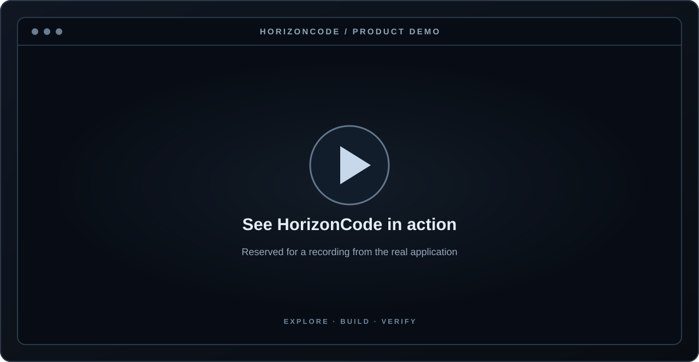
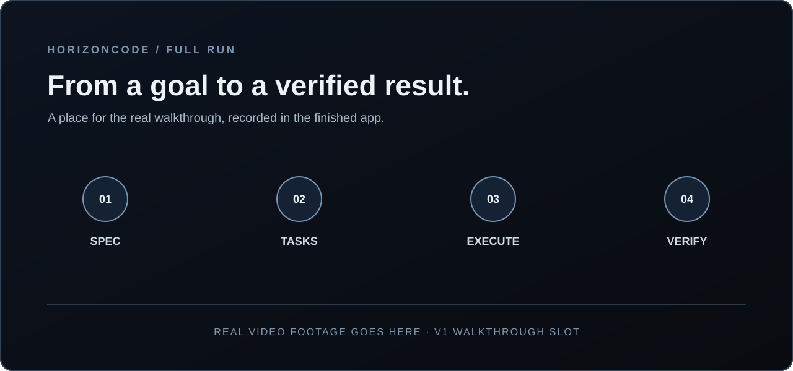

<p align="center">
  
</p>

<p align="center">
  <strong>One coding agent. From the first edit to the final verified result.</strong>
</p>

<p align="center">
  Code interactively. Delegate larger jobs. Keep your models, tools, and execution under your control.
</p>

<p align="center">
  <a href="#see-it-in-action">See it in action</a> ·
  <a href="#why-horizoncode">Why HorizonCode</a> ·
  <a href="#what-you-can-build-with">Features</a> ·
  <a href="#run-from-source">Get started</a> ·
  <a href="#project-status">Status</a>
</p>

---

## See it in action

<!--
DEMO SLOT 01 — Replace the SVG with a real, unedited HorizonCode TUI recording.
Recommended: docs/media/horizoncode-demo.gif (or .webp), 16:9; show a real
repository, request, tool activity, a patch, and evidence/test output.
Keep the logo/hero above. Do not show upstream OpenCode footage as HorizonCode.
-->
<p align="center">
  
</p>

<p align="center"><sub>Demo space reserved for real HorizonCode footage: explore → edit → test → verify.</sub></p>

**Full walkthrough video:** see [the reserved video section](#the-full-run-on-screen) below. It will link to a real recording after the managed workflow is implemented and verified.

<!--
DEMO SLOT 02 — Add a real walkthrough video / poster after V1 acceptance.
Suggested: "From Goal to verified Run" (2–4 minutes), hosted on GitHub Releases
or a supported video site. Link a real thumbnail; never a dead video URL.
-->

## Built for the small fix. And the long haul.

Most coding agents are good at answering your next prompt. Bigger engineering work has a different problem: the plan changes, context disappears, an effect fails, a process restarts, and the final answer still needs to be checked.

HorizonCode is designed for **both** without forcing you into a heavyweight workflow for everyday edits.

| **Direct coding** | **Managed work — V1 direction** |
| --- | --- |
| Start in a repository. Explore, ask, modify, debug and iterate in an interactive session. | Define a goal, review the specification, and let a bounded Run coordinate tasks and attempts. |
| No mandatory project setup or Goal object. Choose your model and get to work. | Pause, inspect, resume or cancel; retain durable state across interruptions. |
| The fast path for the change in front of you. | The long path for migrations, multi-step changes, and jobs that need proof of completion. |

**The distinction:** a completed chat response is not the same thing as a completed engineering task. Managed Runs are designed to finish only when their acceptance criteria have evidence against the final repository revision.

## Why HorizonCode?

### The result matters more than the response

A model can say a change is complete while tests are red. HorizonCode's planned verification loop checks the outcome—not just the assistant's confidence. Final state, tests, evidence and unresolved work remain visible.

### Your models. Your rules.

Choose your own provider, model and workflow. Local and smaller models are part of the intended experience, not an afterthought. HorizonCode's product rule is simple: **no silent model swap, hidden paid fallback, or surprise cost escalation.**

### One place to work. More ways to work.

Stay in a fast terminal interface; use web and desktop views when they make more sense. Explore source, inspect diffs, follow active tasks and work with rich artifacts. All surfaces are intended to operate over the same underlying sessions and controls.

### Tools with real boundaries

An agent's command, subagent, plugin or MCP server should not quietly outrun its permissions. HorizonCode is building one Guard/ExecutionHost path for mutations, with approval, bounded execution, effect receipts and reconciliation when the outcome is uncertain.

### Built to recover, not just retry

Long-running work needs more than a large context window. The managed runtime is designed around durable tasks, bounded workers, resource/worktree leases, cancellation, restart recovery and independent final verification—not blindly rerunning uncertain effects.

## What you can build with

The following is the **HorizonCode V1 product direction**, not a claim that every capability is already operational. Current implementation status is below.

| | V1 capability | Why it matters |
| --- | --- | --- |
| **01** | **Repository intelligence & precise edits** | Symbol-aware navigation, search, Git-aware changes, stale-edit protection and efficient context handling. |
| **02** | **Specialized agents & delegation** | Build, plan, explore and review; hand bounded work to specialists without losing the parent task or its permissions. |
| **03** | **A complete developer toolbox** | Language servers, code actions, debugging, terminal/build/test tools, and supervised Python/JavaScript REPLs. |
| **04** | **Browser, desktop & web research** | Inspect pages and UI behavior, interact with supported applications and bring sourced web results into coding work. |
| **05** | **Skills, hooks, plugins & MCP** | Reuse and extend tools through a capability-aware integration layer rather than one-off agent configurations. |
| **06** | **Durable managed execution** | Reviewed goals, persistent Runs, dependency-aware Tasks, bounded worktrees and crash-safe recovery. |
| **07** | **Verification & evidence** | Connect changes to tests, artifact results, acceptance criteria and the final integrated repository state. |
| **08** | **Cost, tokens & observability** | See selected models, provider usage, costs, failure signals and execution history instead of guessing where resources went. |
| **09** | **A serious, progressive UI** | Fast streaming TUI; accessible web/desktop surfaces; diffs, artifacts, charts and clear task status. |
| **10** | **Control over experiments** | Optional features are discoverable in Settings; Experimental capabilities are clearly labeled and never silently enabled. |

<details>
<summary><strong>How HorizonCode intends to finish a managed job</strong></summary>

1. **Describe the outcome.** Turn the request into a reviewable, versioned specification with explicit acceptance criteria.
2. **Approve the plan.** The user accepts the scope before effectful managed execution begins.
3. **Execute bounded work.** Tasks run with scoped tools, permissions, budgets and resource leases.
4. **Recover safely.** Unknown effects are reconciled instead of blindly retried; interrupted work can be inspected and resumed.
5. **Verify the integrated result.** Check the final repository revision against the accepted criteria. The model's final message alone is never sufficient.

This is the intended V1 flow; its production scheduler, integrations and independent verifier are still in development.

</details>

## The full run, on screen

<!--
VIDEO SLOT — Replace this artwork with a real video poster linked to
an actual, published HorizonCode recording when managed V1 is verified.
Show specification acceptance, Task progress, interruption/recovery and
criterion-based final verification. Do not present this conceptual card as UI.
-->
<p align="center">
  
</p>

<p align="center"><sub>Full workflow video space reserved. No pre-recorded or simulated product behavior is being represented here.</sub></p>

## Run from source

HorizonCode is currently a **source-build developer preview**. Official `horizoncode` installers and standalone releases are not yet available.

**Prerequisites:** Linux, Git, Python 3, [Bun 1.3.14](https://bun.sh/) and [Rust](https://rustup.rs/).

```bash
git clone https://github.com/sarv-projects/horizoncode.git
cd horizoncode

# Restore the pinned source files without overwriting HorizonCode changes.
python3 scripts/architecture/bootstrap_source.py --apply

bun install --frozen-lockfile
cargo build --locked --manifest-path kernel/Cargo.toml --bin session_supervisor

# Launch the current development terminal application.
bun run dev
```

The development entrypoint and some internal packages still use inherited command names. No fake `curl | sh` installer or unpublished package name is offered here.

To run the project's validation gate:

```bash
bun run horizon:full-gate
```

## Project status

HorizonCode is being implemented in public. **Interactive coding and the existing application foundation are present; the full managed-coding product is not yet released.**

| In the repository now | Still being completed for V1 |
| --- | --- |
| Direct interactive sessions and provider/model selection | Complete branded installation and release packaging |
| Existing terminal, web and desktop application foundations | Unified, verified HorizonCode UX across those surfaces |
| Rust Guard for supported approved file writes; bounded ToolBatch validation | Universal mediation of shell, process, plugin, MCP, subagent and other mutations |
| Durable internal Goal / SpecVersion / Run / Task / Attempt event state | Authenticated managed UI, production scheduler/workers, leases and effect reconciliation |
| Optional-feature surfaces and Experimental labels | End-to-end feature eligibility, independent verification and cross-platform security qualification |

**Security note:** this is not a fully sandboxed, cross-platform production release. Specific execution paths and supported operating systems must pass their own tests before those protections can be claimed.

The precise implementation record is [HANDOFF.md](HANDOFF.md). Product scope and release gates are in [the delivery plan](arch_V1/10-DELIVERY.md).

## Contribute & follow development

HorizonCode is a project for developers who care about how agents *actually* complete work: behavior under failure, resource bounds, model choice, performance and reliable evidence.

- [Issues and feature discussions](https://github.com/sarv-projects/horizoncode/issues)
- [Contributor and coding-agent rules](AGENTS.md)
- [Architecture and design decisions](arch_V1/README.md)
- [Implementation roadmap](docs/superpowers/plans/2026-10-11-horizoncode-converged-implementation.md)

## Credits & licensing

HorizonCode is developed independently by [sarv-projects](https://github.com/sarv-projects). Its interactive coding foundation incorporates [OpenCode](https://github.com/anomalyco/opencode); preserved upstream source and copyright notices are in [`opencode/`](opencode/) and [`opencode/LICENSE`](opencode/LICENSE). HorizonCode is not affiliated with the OpenCode maintainers.

Root-level license/third-party notices and final distribution packaging are being completed before release. Existing upstream attribution obligations remain in force.

---

<p align="center"><strong>HorizonCode — Built for the Future.</strong></p>
<p align="center"><sub>From your next edit to your next big engineering job.</sub></p>
