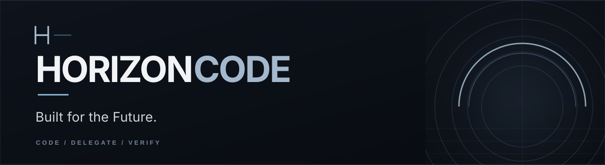

**Explore the code. Make the change. Check the result.**

A terminal-first coding agent, with durable managed work in development.

[Get started](#get-started) · [What works today](#what-works-today) · [Why HorizonCode](#why-horizoncode) · [Contributing](#contributing)

---

## Get started

HorizonCode is currently a **developer preview you run from source**. There is no official one-line installer or stable standalone \`horizoncode\` binary yet.

**Requirements:** Linux, Git, Python 3, [Bun 1.3.14](https://bun.sh/), and the [Rust toolchain](https://rustup.rs/).

\`\`\`bash
git clone https://github.com/sarv-projects/horizoncode.git
cd horizoncode

python3 scripts/architecture/bootstrap_source.py --apply
bun install --frozen-lockfile
cargo build --locked --manifest-path kernel/Cargo.toml --bin session_supervisor
bun run dev
\`\`\`

The development entrypoint still inherits some OpenCode command/package names while HorizonCode's own release packaging is being built.

## From a question to a change

Use the interactive session for the work in front of you: trace a bug, inspect unfamiliar code, make a focused edit, or review a diff. You don't need to create a managed project to start coding.

**Direct coding now. Managed execution next.** HorizonCode is working toward a second way to operate: define a goal, approve what "done" means, let bounded tasks run, and recover the state after an interruption. That end-to-end managed workflow is **not yet shipped**.

## Why HorizonCode?

**The diff isn't the outcome.** A confident final message means little if tests failed or the repository moved underneath it. HorizonCode is being built to connect work to evidence, not just model narration.

**Fast work should stay fast.** A one-file fix shouldn't require setting up a Goal, Task graph, or scheduler. Direct sessions remain direct.

**Long work should survive interruptions.** The Rust managed-control foundation stores Goal, SpecVersion, Run, Task, and Attempt state durably. Scheduler integration and independently verified completion are still being implemented.

**Tools should have one permission boundary.** The Rust Guard already mediates a supported file-write effect path. Shell processes, plugins, MCP, and other mutation origins must pass the same boundary before that security promise can be considered complete.

## What works today?

| Available in the development tree | Not yet ready for general use |
| --- | --- |
| Interactive terminal coding and provider/model selection | Finished HorizonCode CLI installers and release binaries |
| Code browsing, sessions, and inherited extension surfaces | Universal Guard coverage across shell, MCP, plugins, and subagents |
| Tested, bounded provider tool-call validation | Broader guarded process and platform-specific execution |
| Rust-mediated approved file-write path | Production-managed workers, scheduler, resource leases, and recovery |
| Internal durable Goal / Run / Task / Attempt state | Authenticated managed UI and independent end-to-end verification |
| Feature visibility and Experimental labels | Fully integrated feature eligibility across all surfaces |

Want the detailed proof instead of a marketing claim? Read [the current implementation handoff](HANDOFF.md). The implementation gates are in [the delivery plan](arch_V1/10-DELIVERY.md).

> [!NOTE]
> The full execution-security boundary and cross-platform guarantees are still under construction. The source preview is not a finished sandboxed product. Don't treat a passed unit test as proof that every tool, process, or plugin is isolated.

## For developers

The source tree combines the application, its pinned base, and HorizonCode's Rust implementation. Missing base files are restored without overwriting first-party changes.

\`\`\`bash
# Complete development validation
bun run horizon:full-gate
\`\`\`

Start with the [contributor instructions](AGENTS.md), [architecture index](arch_V1/README.md), and [current implementation work](docs/superpowers/plans/2026-10-11-horizoncode-converged-implementation.md).

## Contributing

HorizonCode is being developed openly. [Open an issue](https://github.com/sarv-projects/horizoncode/issues) for a reproducible bug or a specific proposal. Before implementing a larger change, check [HANDOFF.md](HANDOFF.md) to avoid duplicating work or bypassing unfinished safety boundaries.

## Origins & attribution

HorizonCode is an independent project maintained under [sarv-projects](https://github.com/sarv-projects). Its interactive coding foundation incorporates [OpenCode](https://github.com/anomalyco/opencode), with the preserved source and copyright notice in [\`opencode/\`](opencode/) and [\`opencode/LICENSE\`](opencode/LICENSE). HorizonCode is not affiliated with the OpenCode maintainers.

Root licensing, third-party notices, and release packaging are still being finalized. Existing upstream attribution obligations continue to apply.
