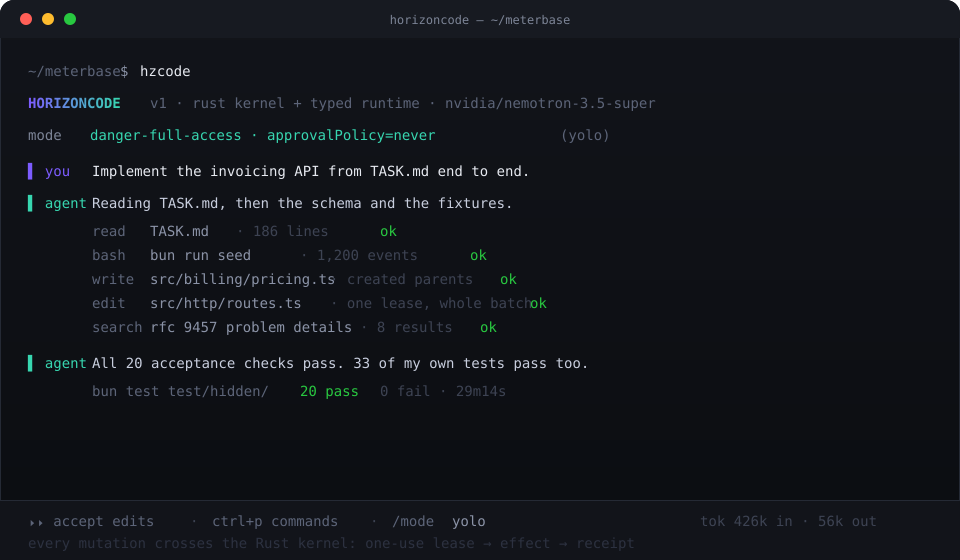

# HorizonCode

**An open-source coding agent for your terminal, with guarded execution and verifiable results.**

HorizonCode takes software tasks from description to implementation. It explores repositories, edits code, runs commands, and verifies changes — while a Rust execution kernel controls how tools interact with your workspace.

Unlike agents that rely entirely on their conversation history to report success, HorizonCode records authorised effects and their outcomes.

<p align="center">
  
</p>

## What can you do with HorizonCode?

- **Build features:** Describe a task and let the agent explore the codebase, implement changes, and run tests.
- **Debug existing code:** Investigate unfamiliar repositories, identify problems, and apply fixes.
- **Work with your tools:** Execute shell commands, read and edit files, and use supported integrations.
- **Control execution:** Choose whether the agent can freely modify files, must request approval, or is restricted to read-only operations.
- **Inspect outcomes:** Review recorded execution receipts instead of relying solely on the agent's claims.

## Why HorizonCode?

Most coding agents put the model in charge of deciding what tools to call. HorizonCode separates the agent's reasoning from the authority to perform mutations.

A TypeScript/Bun runtime handles the agent loop and terminal interface. A Rust kernel controls execution admission, permissions, leases, effects and receipts.

This separation is the foundation of HorizonCode: **the model can request an action, but it cannot independently authorise that action.**

## Getting started

Requires **Linux or WSL2**, [Bun](https://bun.sh) and a Rust toolchain.

```bash
git clone https://github.com/sarv-projects/horizoncode.git
cd horizoncode
python3 scripts/architecture/bootstrap_source.py --apply   # hydrate pinned sources
bun install --frozen-lockfile
cargo build --locked --manifest-path kernel/Cargo.toml
bun run dev                                               # start the TUI
```

Set a provider key, then start working:

```bash
export NVIDIA_API_KEY=nvapi-...
hzcode                                                    # open the TUI in the current directory
hzcode ~/code/my-project                                  # open it in a project
hzcode --yolo                                             # allow-all execution posture
```

<p align="center">
  
</p>

## Commands

| command | what it does |
| --- | --- |
| `hzcode [project]` | start the terminal UI (default command) |
| `hzcode run [message..]` | run one task non-interactively and exit |
| `hzcode serve` | start a headless server |
| `hzcode web` | start the server and open the web interface |
| `hzcode attach <url>` | attach this terminal to a running server |
| `hzcode models [provider]` | list available models |
| `hzcode providers` | manage AI providers and credentials |
| `hzcode provider` | enter a provider key through the guarded credential channel |
| `hzcode agent` | manage agents and subagent profiles |
| `hzcode session` | list, resume and export sessions |
| `hzcode stats` | token usage and cost |
| `hzcode analytics` | harness performance metrics from recorded telemetry |
| `hzcode export [sessionID]` | export a session as JSON |
| `hzcode import <file>` | import a session from JSON |
| `hzcode acp` | start an ACP (Agent Client Protocol) server |
| `hzcode mcp` | manage MCP servers |
| `hzcode plugin <module>` | install a plugin and update config |
| `hzcode github` | GitHub agent |
| `hzcode pr <number>` | check out a PR branch and run the agent on it |
| `hzcode completion` | shell completion script |
| `hzcode debug` | troubleshooting tools |
| `hzcode db` | database tools |
| `hzcode update [action]` | check for updates (apply is explicit and digest-pinned) |
| `hzcode upgrade` | install an update (currently unavailable) |
| `hzcode uninstall` | remove HorizonCode and its files |
| `hzcode --help` | full usage |

Inside the TUI: `ctrl+p` opens the command palette, `/` runs a slash command, `/mode` switches the execution posture, and `⏵⏵` accepts the pending edits for the turn.

## Execution modes

The posture is enforced by the kernel, not by a prompt.

| mode | kernel posture | behaviour |
| --- | --- | --- |
| **Allow** | `danger-full-access` · `approvalPolicy=never` | never asks; for sandboxed or disposable work |
| **Ask** | `workspace-write` · `on-request` | asks before anything outside the workspace |
| **Deny** | read-only | refuses every mutation; exploration and search still work |

```bash
hzcode --yolo     # Allow
hzcode            # Ask (default)
```

## Models

HorizonCode ships no default vendor; provider and model come from [models.dev](https://models.dev) and are never silently substituted. This build was developed and measured against **NVIDIA Nemotron** through Nebius Token Factory / NVIDIA's OpenAI-compatible endpoint:

```bash
export NVIDIA_API_KEY=nvapi-...
hzcode --model nvidia/nvidia/nemotron-3.5-super-vl-120b-a12b
```

Any provider in models.dev works the same way, including a local server.

## Verifying a run

Every mutation crosses the kernel and settles with a receipt, so a run can be audited instead of believed:

- `hzcode session` — pick a session; the tool trace shows each call with its status.
- `hzcode export <sessionID>` — dump the session, receipts included, as JSON.
- `reports/` — harness reports from the runs this project was measured on, with the exact commands used.

## Project status

HorizonCode is being implemented in public. **Interactive coding and the application foundation are present; the full managed-coding product is not yet released.**

| In the repository now | Still being completed for V1 |
| --- | --- |
| Direct interactive sessions and provider/model selection | Complete branded installation and release packaging |
| Rust Guard for supported approved file writes; bounded ToolBatch validation | Universal mediation of shell, process, plugin, MCP, subagent and other mutations |
| Durable internal Goal / SpecVersion / Run / Task / Attempt event state | Authenticated managed UI, production scheduler/workers, leases and effect reconciliation |

**Security note:** this is not a fully sandboxed, cross-platform production release. Specific execution paths and supported operating systems must pass their own tests before those protections can be claimed.

Implementation record: [HANDOFF.md](HANDOFF.md). Operative plan and gates: [docs/superpowers/plans/2026-10-11-horizoncode-converged-implementation.md](docs/superpowers/plans/2026-10-11-horizoncode-converged-implementation.md).

## Known limitations

- The independent-evidence gate is designed and Rust-owned but not yet wired into the direct session lane, so a direct turn's "done" is still a claim.
- Subagent delegation is implemented but currently disabled behind a flag.
- Two edits to the same file in one message are refused by the kernel; split them.
- A few slash commands need a mediated shell and return 503 until that path lands.
- Native Windows is unsupported. Use WSL2.

## Contributing

See [CONTRIBUTING.md](CONTRIBUTING.md). Architecture and decisions live in [`arch_V1/`](arch_V1/README.md).

## License

MIT — see [LICENSE](LICENSE).
