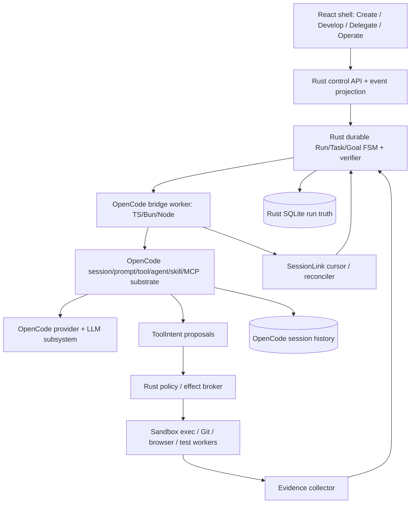

# OPENCODE INTEGRATION LLD — canonical v2 integration

> **Current repository binding (2026-10-10):** Active packages/ source and opencode/ snapshot both exist and selected provider, runner, tool and worktree files are byte-identical. Avoid introducing a second provider stack; production integration follows the actual root package layout. Existing kernel files remain real code, not hypothetical crates.

## Imported v2 architectural basis

# 10 — OpenCode-first implementation map: packages, interfaces, classes and logic

This chapter SUPERSEDES the greenfield `packages/model-providers`, `packages/agent-worker`, session portions of `studio-agent-control`, and any assumption that Rust should own AI provider SDKs in 02/03. Existing durable Rust services remain. The names below are **proposed new code**, not present in upstream.

## 10.1 Dependency topology



**No giant cross-runtime library:** OpenCode stays TypeScript. Rust only owns things where OS behavior, deterministic transactional coordination, permission enforcement, process supervision, resource isolation or workspace race prevention measurably improve reliability. Browser and UI remain TS. Do not port `provider.ts`, AI SDK bridges, session message codec, MCP connector or auth to Rust without evidence of a concrete bottleneck AND measured parity tests.

## 10.2 Final proposed folder tree

```text
apps/desktop                 Tauri host only; no authoritative run state
apps/web                     Optional authenticated browser view
apps/cli                     Same typed command API as GUI
packages/ui/{design,shell,create,develop,delegate,operate,settings}
packages/ui/{components,command-palette,api-client,viewmodels}
packages/opencode-vendor/     pinned upstream subtree/fork (minimal maintained patches)
packages/opencode-bridge/     VersionCompat, SessionGateway, ModelGateway, ToolIntentBridge
packages/opencode-adapters/   v1/v2 session, provider, tool, agent/profile, skill mapping
packages/worker-protocol/     generated TypeScript types from one canonical schema
packages/harness-profiles/    model-agnostic native/minimal/compat codecs
packages/local-models/       endpoint probes, capabilities, structured-output adaptation
packages/agent-plugin-sdk/   versioned agent/protocol interfaces; capability manifests
packages/browser-worker/     Playwright with isolated browser contexts
packages/intel-worker/       LSP, tree-sitter, ripgrep; incremental per-revision indexes
packages/preview-worker/     dev-server driver, health checks, preview proxy
packages/publish-worker/     release adapter, exact permission handoff
packages/testing/            golden streams, provider conformance, model capability probes
crates/core-daemon            bootstrap, API, supervised workers, reconciliation
crates/domain                 immutable Goal/Run/Task/Attempt/Execution/Effect/Evidence
crates/run-engine             task planning, DAG scheduling, completion gate
crates/goal-engine            persistent /goal state + user edits + acceptance coverage
crates/state-events           SQLite, outbox, cross-store bridge cursors, migrations
crates/policy-broker          runtime authorization, scopes, decision/approval cache
crates/effect-broker          idempotency, expected revision, signed effect receipts
crates/execution-supervisor   worker lifecycle, fences, quotas, cleanup on crashes
crates/workspace-pool         Git worktree reusable pool, integration, port/data lease
crates/verification           independent test/browser/security/criterion evidence
crates/healing                L1 deterministic repair -> L2 infra -> L3 learning -> L4 canary
crates/retention              blob pin/mark/sweep/compaction, WAL housekeeping
crates/telemetry              provider/model usage, traces, quality signals
crates/repo-service           Rust read-model interface to TS intelligence worker
crates/operations             publish, incident, backup/export, monitoring
contracts/v2                 canonical RPC/event schemas + generated TS/Rust
storage/migrations/v2         new tables and safe migration path
upstream/                    upstream pins, patch ledger, 3rd-party notices
```

## 10.3 Bounded context ownership / never duplicate

| Concept | Single authority | Other readers/writers |
|---|---|---|
| session message / streamed part / local agent turn | OpenCode session DB | Rust bridge ingests read-only event receipts |
| current goal, criteria, approvals | Rust goal store | OpenCode prompt builder reads goal snapshot |
| Task dependency and Attempt status | Rust run engine | OpenCode cannot directly update status |
| ToolIntent and effect outcome | Rust effect broker | OpenCode may propose; Rust authorizes and records |
| model provider auth/capability/transport | OpenCode provider subsystem | Rust stores opaque `ModelSelection` only |
| user-selected model and harness | Rust persisted settings/profile | OpenCode uses resolved selection only |
| permission grant | Rust policy broker | UI displays requests; TS worker never mints grants |
| source file current content | filesystem/Git with Rust revision guards | UI and OpenCode read only through authorized tools |
| build/test/check observation | isolated execution worker + verifier | planner/agent sees evidence references |
| reusable worktree pool, port/test DB | Rust workspace-pool | workers hold expiring leases only |
| auto-learning patterns | rust healing learner store | prompt builder consumes filtered advisory retrieval |
| UI pane/terminal tab state | React client persisted preference | never a source of goal or permission authority |

## 10.4 Class / interface map (public contracts)

`OpenCodeBridgeHost` (`packages/opencode-bridge/src/host.ts`): `start(handshake)`, `health()`, `stop(grace)`, `createOrAttachSession(ref)`, `admitPrompt(session,prompt,idempotencyKey)`, `resumeSession(session,cursor)`, `interruptSession(session)`, `subscribeEvents(session,cursor)`, `resolveAgentProfile(profileVersion)`, `resolveModelSelection(pinned)`. Always isolate upstream SDK exceptions into versioned `BridgeError` and NEVER swallow a lost event stream.

`OpenCodeV1Adapter`/`OpenCodeV2Adapter`: same Gateway port; translate messages/parts/streaming tool calls into canonical `SessionEvent`, preserve OpenCode-native IDs; detect a feature unavailable in V2 and fall back to **selected supported adapter**, never silently move DB data. `compatibilityProbe` captures exact upstream package semver/commit and supported protocol version.

`ModelGateway`: `listProviders()`, `listModels(provider)`, `getCapabilities(provider,model)`, `probeProvider(connection)`, `inferStream(selection,history,toolCatalog,cancelToken)`, `resumeProviderContinuation(providerOpaqueMetadata)` when supported; usage record must include `{measured,estimated,unknown}`. The gateway must honor selected model and fail with `UNAVAILABLE` rather than silently choosing another.

`HarnessRegistry`: `listHarnesses()`, `getHarness(id,version)`, `validate(selection,capabilities)`, `encodeTools()`, `decodeToolCall()`, `validateToolCall()`, `formatToolResult()`, `classifyStop()`, `normalizeMalformedOutput()`. A harness is compatibility formatting and decoding, not a tool privilege bypass. Retry malformed model outputs at most configuration threshold; no false tool success.

`SessionLinkRepository`: `link(runId,taskId,attemptId,openCodeSessionId)`, `ackCursor(linkId,sequence)`, `getUnackedEvents(linkId)`, `detectGap(linkId, sequence)`, `reconcileCrossStore(linkId)`. Duplicate OpenCode events may arrive after crash: `unique(opencode_session_id, event_id)` prevents duplicate Run mutations.

`AgentTaskBridge`: `startAttempt(taskEnvelope,agentProfile)`, `injectGoalSnapshot(goalRevision,criteria,acceptedDecisions)`, `proposeToolIntent(openCodeCall)`, `emitTurnResult(outcome)`, `applySteer(userInput)`, `endAttempt(result)`. Agent messages are never counted as independently verified criteria.

`ToolBrokerBridge`: `registerToolProxy(toolId,schema)`, `requestTool(intent,executionFence)`, `awaitApproval(approvalId)`, `deliverResult(result)`, `cancelPending(toolCallId)`; never expose privileged direct Node host-tool implementation in untrusted worker. For tool implementations inseparable from legacy OpenCode, run them in OS-isolated worker with scoped mount/process permissions and record explicitly weaker guarantees.

`GoalController`: `set(objective,criteria)`, `get()`, `edit(revisionPatch)`, `pause()`, `resume()`, `clear()`, `proposeComplete(evidenceRefs)`, `reportBlocked(reason)`, `suspendBudget()`, `reconcileAfterCrash()`. All functions use optimistic revision and append status event. Mark `complete` only after verification and invariant checks; creation/restoration never drops open criteria.

`ProviderHealthRegistry`: `observe(endpoint,measurement)`, `classify(error)`, `tripBreaker(endpoint)`, `allowRequest(endpoint)`, `recordHalfOpenProbe()`, `resetAfterSuccess()`; health decisions operate on endpoint, auth profile and model, not globally. UX offers manual fallback, never automatic model routing.

`WorktreePool`: `ensureWarm(project,base,policy)`, `acquire(requirements)`, `validateIdle(tree)`, `renewLease()`, `release(tree,artifacts)`, `rebaseOrResetCleanIdle()`, `quarantine(tree)`, `planGC(dryRun)`, `sweepSafeGarbage()`; external processes and dirty user work must be inspected before reclamation.

`ParallelismAdvisor`: `computeConflicts(tasks)`, `estimateCriticalPath()`, `estimateSetupAndIntegrationCost()`, `selectParallelGroup()`, `enforceMaxActive()`. Explicit user concurrency cap overrides recommendation; absent proof of independence -> serialize shared mutable resources.

`VerificationGate`: `deriveChecks(criteria)`, `executeChecks(revision,environment)`, `readEvidence()`, `compareBaseline()`, `evaluateCriteria()`, `signRunVerdict()`. This is Rust-authoritative and cannot be issued directly by the model.

`HealingOrchestrator`: `normalizeFailure()`, `runL1()`, `runL2()`, `recordL3Candidate()`, `evaluateL4Candidate()`, `stopOrReplan()`. L1–L4 are separate configurable strategies, not one always-running LLM chain.

## 10.5 Low-overhead fast execution path

**Small safe edit:** UI→Core request→repo index scoped context→OpenCode provider turn→proposed `edit`→Rust broker checks hash/policy→stage patch→incremental parser/linter/tests→evidence→UI. Avoid mandatory large task DAG decomposition: a Run may contain ONE Task, ONE Attempt. Persist only meaningful facts; batch chat tokens in OpenCode store; do not copy token stream into Rust events byte-for-byte.

**Complex delegated work:** UI→goal/criteria→planner proposes DAG→scheduler picks independent tasks→acquire warm workspace/test lease→OpenCode child session per Attempt→effects→verifier→integration staging→final goal gate. Python/CLI agents are optional peer executors through `AgentRuntime` SPI, not used to implement the core loop again.

**Performance SLO proposals, not guaranteed measurements:** UI keystroke responsiveness p95 < 50 ms on a reference desktop; local status/event round trip p95 < 150 ms; engine startup with warm profile < 2 s excluding model startup; model first token and tokens/s measured by chosen provider and never marketed as guaranteed; index cached by file hash; worker pool min=0 idle, max user-defined; prompt preparation target p95 < 300 ms on indexed moderate repositories.

## 10.6 Integration and upstream upgrade rules

(1) Detect `OpenCodeUpstreamRevision`; (2) run provider and session differential tests; (3) regenerate protocol mappings; (4) run tool-broker security tests; (5) run crash/compaction/goal persistence tests; (6) validate migration; (7) update patch ledger + notices; (8) opt-in rollout. The Rust build must compile against our own generated contract, not OpenCode internal module paths.

### Why not simply keep OpenCode's own permission DB and add a second Rust permission engine?

That would create TWO authorities and allow inconsistent approvals. The chosen design uses Rust's permission decision as the ultimate gate for privileged effects; OpenCode permission prompts may be displayed as UI proposals but cannot authorize a tool without Rust consent. If an upstream tool cannot be securely intercepted, disable it in strict modes or place it inside an enforceable restricted sandbox; document weaker mode explicitly.

### 20.7 Source-backed whole-response dispatch barrier increment

`packages/core/src/session/runner/llm.ts` now buffers local `tool-call` events through a
provider `finish` and `step-finish`, validates every local call against the
`ToolRegistry.Materialization` pinned for that request, and begins local dispatch only if
the complete local batch validates. A stream error, cancellation, clean EOF without a
terminal event, missing step settlement, or one invalid local call dispatches zero calls;
all recorded calls receive explicit failed results. Valid calls retain the existing
concurrent settlement behavior. `packages/core/src/tool/tool.ts` and `tool/registry.ts`
expose this input-schema preflight on the materialization without changing Session SQL
or EventV2 schemas.

Focused acceptance: `session-runner.test.ts` checks delayed execution until terminal
completion, provider error after a call, missing finish, missing step settlement, and one
invalid input withholding its valid sibling; the full runner suite passed 91 tests / 296
assertions and the Core typecheck passed on 2026-10-10. This is only the host-side
collection/preflight seam. Rust ThreadService ToolBatch admission, Guard/resource/budget
checks and Rust execution are still missing; the current Core runner still invokes Bun
`ToolRegistry.settle`, so this does not enable a governed production tool route.


---
