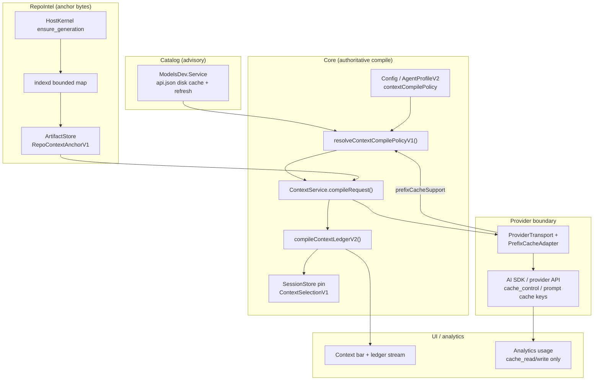
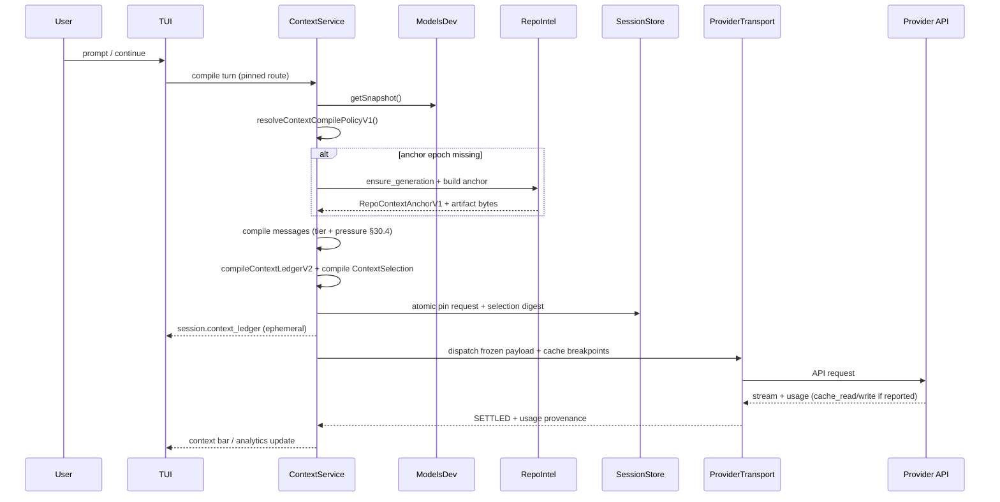

# 30 — Context engineering, repository intelligence and local/small-model runtime

**Status:** normative V1 target. This chapter makes low-token, low-latency operation a first-class architecture requirement rather than an optimization pass.

## 30.1 Principles

1. The model sees **only what it needs for the current decision**.
2. Canonical history and durable Goal/Run state are not deleted to make context smaller.
3. Context assembly is deterministic, inspectable and budgeted against the **actual selected model**.
4. Repository discovery prefers structured symbol/navigation tools before broad file reads.
5. Local and very small models are valid first-class selections. HorizonCode degrades features honestly instead of silently routing to a bigger or paid model.
6. Tool schemas and skill bodies are themselves context cost and are loaded progressively.
7. Context cleanup must be reversible at the view/projection level.
8. Every compaction/prune operation exposes what changed and why.

## 30.2 ContextLedger and user-visible context bar

One `ContextService` compiles provider requests. A read-only `ContextLedger` projection exposes the current model-visible plan.

```ts
type ContextEntryKindV2 =
  | "system"
  | "goal"
  | "user"
  | "assistant"
  | "thinking"
  | "tool_call"
  | "tool_result"
  | "file"
  | "symbol"
  | "artifact"
  | "image"
  | "document"
  | "skill"
  | "memory"
  | "subagent_result"
  | "environment"

type ContextEntryV2 = {
  entryID: Id<"ContextEntryId">
  kind: ContextEntryKindV2
  sourceRef: string
  sourceRevision?: string
  trust: "system" | "user" | "workspace" | "external" | "mixed"
  bytes?: number
  bytesKind: "exact" | "estimated" | "unknown"
  tokens: {
    kind: "exact" | "estimated" | "unknown"
    value?: number
    tokenizerID?: string
  }
  included: boolean
  inclusionReason?: string
  protected: boolean
  cacheClass?: "static" | "history" | "turn" | "attachment" | "none"
  freshness?: string
  digest: Digest
}

type ContextLedgerV2 = {
  schemaVersion: 2
  lane: "direct" | "managed"
  sessionID: SessionID
  requestID: string
  sourceRevision: DecimalU64
  providerID: string
  modelID: string
  harnessID: string
  harnessRevision: number
  requestPayloadDigest: Digest
  requestBytes: number
  contextSelection: ContextSelectionV1
  contextSelectionDigest?: Digest // required for managed; HostKernel-issued
  entries: ContextEntryV2[]
  completeness: "complete" | "partial"
  partialReason?: string
}
```

`ContextLedgerV2` is a bounded read-only projection for one exact provider request. The
request payload is represented only by its digest and byte count; raw prompt content and
credentials are not stored in the ledger. Each included entry must refer to a source in the
exact `ContextSelectionV1`, and the ledger identity/revision must match that selection.
Managed ledgers additionally carry HostKernel's selection digest. Unknown byte/token facts
omit numeric values; exact token counts identify their tokenizer. `complete` and
`partialReason` are mutually exclusive. This DTO does not create a second transcript store,
select a provider route, or grant effect authority. See
[`contracts-v2/context-ledger-v2.schema.json`](contracts-v2/context-ledger-v2.schema.json).

**Contract correction (2026-10-24, arch owner ruling — schema artifacts realigned to this owner):**

- `harnessRevision` is an **integer** (`number`), bounded `1..9007199254740991`. The TS toolset
  producer enforces `Number.isSafeInteger` and `>= 1`; the Rust context-selection decoder requires
  `Value::Unsigned` in `1..=9_007_199_254_740_991`; and the sibling
  `context-ledger-v2` canonical already declared `{"type":"integer","minimum":1,"maximum":9007199254740991}`.
  The `context-selection-v1` canonical artifact alone declared a positive-u64-decimal **string**, so
  it was the single wrong side and has been corrected to integer. `sourceRevision` remains a
  `DecimalU64` **string** — only `harnessRevision` changed. Acceptance: `NAME`-independent schema
  parity cases below (`CTX-SEL-*` mirror bounds) plus the Rust decoder and TS producer must all
  agree; any future re-typing of this field breaks TS↔Rust interop and is a §30-owner change.
- `entries[].inclusionReason` now also requires `minLength: 1` in the canonical artifact, matching
  the TS mirror: a reason cannot be the empty string. The mirror is intentionally stricter than it
  was; `maxLength: 256` is unchanged. A coverage rule ("every selection source has an included
  entry") remains producer-enforced in `compileContextLedgerV2` because JSON Schema cannot express
  it structurally.

Context bar segments:
- system/control;
- durable goal/criteria;
- conversation;
- files/symbols;
- tool results/artifacts;
- skills/memory;
- attachments/media;
- reserved model output.

UI shows absolute tokens where known, percentage of model context, whether token count is exact or estimated, and entries removed by the next cleanup operation.

## 30.3 Context operations have different semantics

### `/trim`

Deterministic removal of expendable paired payloads, primarily old verbose tool output where an artifact/reference remains.

- no model call;
- never removes Goal/spec, unresolved NeedsYou, current tool batch, unacknowledged effect, or required evidence;
- preserves a short typed placeholder and artifact ref;
- ideal first pressure response.

### `/prune`

Relevance-based removal of stale natural-language/history entries.

- may use a small model or deterministic scorer;
- default interactive mode shows a preview with reasons;
- protected recent user turns and pinned entries cannot be pruned;
- accepted prune record stores source range/digest so history search can recover it.

### `/compact`

Creates a bounded summary artifact over an older history range.

**Heritage alias:** `/summarize` maps to the same ActionDescriptor as `/compact` in direct
Sessions (OpenCode compatibility). `/trim`, `/prune`, and `/clear` are **not** aliases of
compact; help text must describe the §30.3 differences.

- summary has provenance and covered cursor range;
- original history remains canonical/retrievable;
- changed Goal/constraints after summary creation are not retroactively folded into it;
- compaction quality can be verified against protected facts.

### `/clear`

Starts a new model-visible context epoch while preserving Thread history. It does not erase the session. History Search can retrieve prior messages and artifacts later.

## 30.4 Automatic context pressure recovery

Do not hard-code one universal 75% trigger. Derive thresholds from model context, maximum requested output, tool/schema reserve and provider behavior.

Default policy:

```text
soft_pressure = max(estimated_input, last_provider_reported_input)
                 >= context_window - output_reserve - tool_reserve - safety_margin

recovery order:
  0. at **soft_pressure** (user may disable): auto-run `/trim` once per epoch (§30.30 REL-M)
  1. evict expired/rebuildable tool payloads to artifacts
  2. remove duplicate/stale file reads
  3. trim paired historical tool calls/results
  4. retrieve narrower symbol/file ranges
  5. propose/apply bounded prune
  6. compact an eligible old history range
  7. if still impossible -> CONTEXT_BUDGET_EXCEEDED with exact diagnostics
```

**Snapcompact feasibility (DEFERRED/UNAVAILABLE in V1):** pinned OMP distinguishes ephemeral inline imaging from a persistent archive stored in compaction state. The latter would require a new durable archive/reference and rebuild contract; the former must be implemented later as a derived projection through the existing V1 ContextService, with selected-model image-capability metadata, image-aware token/count/byte budgeting and a local renderer. Current Core V2 provides media transport for user attachments, but not those snapcompact-specific owners or proofs. No snapcompact code or setting is added. Any later experiment must preserve canonical history, use only the selected provider/model, remain rebuildable/disableable, and pass protected-fact, privacy, cost, cache and rejection/recovery tests; see §16.15.2 and §42 SRC-024.

A provider's reported input-token usage, when available, is recorded and may raise pressure earlier than estimates. Estimates never overwrite measured usage.

Protect:
- active Goal/acceptance criteria and latest approved decisions;
- unresolved approvals/questions;
- current user request;
- recent conversational intent needed for coherence;
- current Task/Attempt state;
- source refs necessary to interpret the pending diff/tool call.

The exact number of protected recent turns is model/profile policy, not a universal constant.

## 30.5 Prompt compiler for small/local models

A small model must not receive the same control prompt as a large hosted model.

Provider request is layered:

```text
Layer 0 — compact immutable protocol/safety contract
Layer 1 — selected agent identity + current objective
Layer 2 — tiny repository/environment facts
Layer 3 — only currently exposed tools
Layer 4 — retrieved source/context
Layer 5 — current conversation slice
Layer 6 — output/tool result protocol
```

### Bootstrap target

The compiler has an explicit `maxCompiledControlTokens` per profile. For small-context models, start with the smallest safe control contract and expand only on demand. The runtime measures the actual tokenizer where available; it does not assume a fixed chars/token ratio.

No full tool catalog, full skill descriptions, full repository map or full HorizonCode documentation is included by default.

### Progressive tool exposure

Expose a minimal starter surface such as:

```text
context.search
tools.search
repo.overview
symbols.search
files.read
files.patch (only in edit mode)
terminal.run (only when permitted)
task.finish/propose
```

`tools.search(query)` returns compact tool descriptors. The model may request a tool family; the next provider turn pins the expanded toolset generation.

For models without native function calling:
- use an explicit selected harness with a small structured envelope;
- parse/validate strictly;
- allow a bounded repair attempt for malformed structure;
- never execute ambiguous text as a privileged command.

### Harness selection is independent from model/provider

The selected `HarnessProfileV1` controls request **shaping**, not routing. It may define:
- system/control prompt structure;
- initial and discoverable tool projection;
- message lowering/role conversion;
- structured/text action decoding;
- output shaping and context policy.

The same Ollama/LM Studio/LiteLLM/OpenAI-compatible model may be tested with
`native-rich`, `native-minimal`, `bash-only` or an explicit compatibility harness while the
endpoint/provider/model identity remains byte-for-byte pinned in the run configuration.
An incompatible harness returns `UNAVAILABLE`; HorizonCode does not “fix” incompatibility by
choosing a different model.

The `bash-only` profile uses independent bounded subprocess actions by default so one command's
shell state does not implicitly contaminate the next action. Stateful PTY/terminal sessions remain
a separate explicit tool when the task actually requires them. All shell actions still become
ordinary ToolIntent/ToolBatch effects.

Harness measurements include prompt tokens/bytes, tool-schema tokens/bytes, context headroom,
parse/repair rate, TTFT and task outcome so a richer harness must justify its cost.

## 30.6 First-class local inference providers

V1 provider UX must explicitly support:

- **Ollama**
- **LM Studio**
- **LiteLLM**
- **arbitrary OpenAI-compatible endpoint**

These are provider configurations, not different product modes.

```ts
type LocalEndpointProfileV2 = {
  endpointId: string
  kind: "ollama" | "lm_studio" | "litellm" | "openai_compatible"
  baseUrl: string
  authSecretRef?: string
  modelId: string
  protocol: "chat_completions" | "responses" | "custom"
  contextWindow?: number
  maxOutputTokens?: number
  requestByteLimit?: number
  capabilities: {
    streaming: "yes" | "no" | "unknown"
    nativeTools: "yes" | "no" | "unknown"
    structuredOutput: "yes" | "no" | "unknown"
    images: "yes" | "no" | "unknown"
    promptCaching: "yes" | "no" | "unknown"
  }
}
```

A capability probe is read-only and bounded. Unknown values remain unknown. The user sees detected versus configured capability separately.

### Local model guarantees

- No network to a paid provider unless the user selected/authorized it.
- Offline mode also disables web/MCP/embedding/network services unless explicitly permitted.
- If a chosen local model cannot complete the requested workflow, report the missing capability and possible harness options without silently selecting another model.
- Hardware insufficiency yields diagnostics (RAM/VRAM/context/request size), not automatic cloud fallback.
- The product must remain useful with small context by retrieval, narrow tools and short prompts.

## 30.7 Repository intelligence architecture

`RepoIntelService` owns derived, rebuildable repository intelligence. Workspace/Git remains canonical.

Pipeline:

```text
manifest discovery
  -> language/framework/build/test detection
  -> file inventory
  -> parser/tree-sitter symbols
  -> persistent lexical/symbol index
  -> LSP enrichment on demand
  -> optional semantic embeddings only when explicitly enabled
```

Do not start an embedding model merely to open a project.

**Current runtime status (2026-10-26):** semantic embeddings and semantic recall in this section
and §30.20–30.22 are DESIGNED, not wired. `indexd` implements only bounded lexical `Text`
queries; `Symbol`, `References`, `Impact` and `Expand` return typed unsupported
(`indexd/src/repo_intel.rs:6-8,93-100`), and the crate has a single dependency (`indexd/Cargo.toml`).
The self-corrections at §30.14 (line 518), §30.18 (line 689) and §30.21 (line 740) remain the
detailed status/acceptance anchors and are not duplicated here. This status note does not weaken
the target pipeline above.

## 30.8 SymbolIndexV2

```ts
type SymbolKindV2 =
  | "class" | "interface" | "enum" | "function" | "method"
  | "type" | "variable" | "property" | "module" | "trait"
  | "struct" | "constant"

type SymbolRecordV2 = {
  symbolId: Id<"SymbolId">
  repoGeneration: RepoGenerationId
  path: string
  language: string
  kind: SymbolKindV2
  name: string
  qualifiedName?: string
  startLine: number
  endLine: number
  signatureHash: Digest
  enclosingSymbolId?: string
  exported?: boolean
}

type ReferenceEdgeV2 = {
  fromSymbolId?: string
  fromPath: string
  fromLine: number
  toSymbolId?: string
  text: string
  confidence: "high" | "medium" | "low"
  source: "lsp" | "parser" | "import_graph" | "lexical"
}
```

Drift-safe lookup:
1. verify file/repo generation;
2. if stale, reparse target file;
3. match signature hash + local structural context;
4. return updated ID/range or explicit `SYMBOL_STALE`, never a silently wrong location.

## 30.9 Built-in repository-intelligence tools

**V1 exposure boundary (2026-10-21, source-only):** The authenticated HostKernel
`query_structure` endpoint returns bounded lexical occurrences and immutable
generation provenance. Bounded authenticated `discover` source and Core-backed
`repo.tree`/`repo.detect` adapters now exist; those tools remain omitted from the
model registry pending integrated acceptance. Search inputs are rejected before
dispatch when the UTF-8 query exceeds 1 KiB, contains line/control characters, or
the relative root exceeds 4 KiB/is not normalized. Search results remain lexical
candidates. Parser-backed definitions, symbol outlines, impact graphs and resolved
reference edges report unavailable because no approved parser/index provenance is
wired. Unsaved-buffer overlays remain unavailable because no trusted immutable
editor-buffer producer is wired. Managed artifact text search is scoped by
Rust-resolved verified Attempt evidence and bounded HostKernel ranges; direct-session
artifact search remains unavailable without a durable ArtifactRef-to-DirectAttempt
authority index. These are source observations, not acceptance evidence.

| Tool | Purpose | Model-visible output |
|---|---|---|
| `repo.detect` | languages/framework/build/test/package systems | compact structured manifest |
| `repo.tree` | bounded directory tree | filtered paths only |
| `symbols.search` | BM25/fuzzy symbol lookup | names/kinds/path/line/confidence |
| `symbols.outline` | symbol tree for one file | IDs + ranges |
| `symbols.read` | exact source for symbol ID | bounded source |
| `references.find` | callers/imports/type refs | confidence-tiered edges |
| `definitions.find` | definition resolution | exact or candidates |
| `impact.analyze` | likely dependents/tests/contracts | evidence-backed graph |
| `text.search` | fallback lexical/regex search | bounded matches |
| `diagnostics.get` | LSP/compiler/linter diagnostics | typed diagnostics |
| `tests.related` | map changed symbols/files to tests | ranked test targets |

BM25/fuzzy matching supports camelCase and snake_case normalization. Ranking is deterministic given one index generation.

Target language parsers for V1 should cover the product's highest-value languages first and expand through adapters. Desired broad catalog includes TypeScript, JavaScript, Python, Go, Rust, Java, C, C++, C#, Kotlin, Swift, Ruby, PHP and Scala; unsupported languages fall back to lexical/LSP tools rather than pretending full symbol coverage.

## 30.10 Index lifecycle and performance

Index state:

```text
ABSENT -> BUILDING -> CURRENT -> STALE -> BUILDING
                    -> PARTIAL
                    -> FAILED
CURRENT/PARTIAL -> RETIRED
```

- initial index streams useful partial results; user does not wait for full repository indexing to chat;
- filesystem watcher batches/debounces changes;
- only changed files reparse when possible;
- index storage is embedded/rebuildable, not another external daemon dependency;
- 50K+ file repositories require bounded queues, ignored-directory rules and memory limits;
- index corruption triggers rebuild, never source changes;
- source read permissions are applied before indexing and querying.

## 30.11 Context caching

Tier selection (cache-anchor vs minimize-tokens) and Models.dev hint bridge: **§30.26**. This section states caching law for all tiers.

Cache metadata is provider-specific and advisory.

Context compiler marks stable segments:
- static control prompt;
- pinned profile/tool protocol;
- stable project rules;
- history prefix/compaction;
- attachments/files with immutable digest;
- current turn.

Analytics records whether the provider reported cache reads/writes/hits. HorizonCode never fabricates a cache-hit percentage from unsupported providers.

Changing one dynamic file should not invalidate unrelated static system/project segments when the provider protocol supports independent cache boundaries.

## 30.12 History search

History remains useful after `clear/trim/prune/compact`.

`history.search` searches authorized canonical session ranges and artifacts by lexical/FTS index first; optional model synthesis happens only after candidate retrieval. It returns message/artifact refs and can add selected entries back to context with user-visible provenance.

The built-in History Search specialist is read-only and receives only candidate ranges, not the entire account history.

**Current P3 source projection (2026-10-22; unverified):** `history.search` scans only the
current canonical Session's text parts through one-message SQL projections (up to 64 messages,
16 text parts per message, a 16,384-character prefix per part, 1 MiB of inspected UTF-8 text
and 12 excerpts). A truncated part stops the scan with PARTIAL provenance rather than
hydrating the rest of its stored text. Each Part's serialized UTF-8 size is projected before
JSON text extraction; Parts above 65,536 encoded bytes are returned as explicit oversized or
unavailable evidence without loading their text into the caller. `history.read_range` first
projects only serialized byte length, returns oversized before JSON extraction, then selects a
bounded SQL substring only if a second exact-key query still satisfies the byte cap and the
serialized length is unchanged. A changed/disappeared row is unavailable. Offsets count Unicode
code points, matching SQLite `substr/length`. Both tools return message/part provenance and
sanitize display controls, format controls and common
credential-shaped strings. This is a bounded lexical page scan, not an
FTS index; it does not search other Sessions or artifacts. `history.attach` remains
unavailable because no accepted attachment authority/freshness path binds selected history
to a new ContextSelection. These tools are source-present, not acceptance evidence.

## 30.13 Accuracy rules for small models

Small models benefit from **more deterministic harness, less prompt**, not hidden escalation.

- enforce one task objective at a time;
- prefer exact structured schemas with small enums;
- split compound tool batches when the selected harness/model cannot reliably produce them;
- validate file hashes before patches;
- use compiler/LSP/test feedback rather than asking the model to infer success;
- make repository tools return concise structured facts;
- cap repair attempts and change strategy after repeated identical failure;
- use specialist retrieval rather than copying repository summaries;
- final verification is external to the producing model.

## 30.14 LanguageServiceBroker and editor/LSP coexistence

HorizonCode must improve Pyright, rust-analyzer, TypeScript server, clangd, jdtls and other
language services rather than fight them.

`LanguageServiceBroker` owns discovery/routing, not language semantics:

```ts
type LanguageServiceSourceV1 =
  | { kind: "editor"; clientId: string; serverName: string }
  | { kind: "supervised"; executionId: string; serverName: string }
  | { kind: "external"; adapterId: string; serverName: string }

type LanguageServiceLifecycleV1 =
  | "discovered" | "starting" | "active" | "idle" | "stopping" | "stopped"

type LanguageServiceSnapshotV1 = {
  source: LanguageServiceSourceV1
  workspaceId: WorkspaceId
  languageId: string
  rootUri: string
  configurationDigest: Digest
  serverVersion?: string
  capabilitiesDigest: Digest
  health: "starting" | "healthy" | "degraded" | "failed"
  generation: number
}
```

Routing order is capability- and trust-based, not a universal preference:
1. reuse a compatible, healthy editor/project service through an authenticated adapter when
   attaching does not disturb the editor;
2. reuse HorizonCode's already-supervised service for the same root/config generation;
3. start one supervised service only when needed and permitted;
4. fall back to parser/symbol/lexical tools when no language server is usable.

Rules:
- do not launch a duplicate Pyright/rust-analyzer/tsserver merely for one query;
- do not kill/reconfigure an editor-owned server;
- workspace root/config/interpreter/toolchain differences create distinct generations;
- diagnostics from different sources retain source/version so contradictory results remain visible;
- LSP writes/commands/code-actions that mutate state are ordinary effects, not read-only queries;
- server stderr/output is bounded/artifactized;
- project-supplied server binaries/config are untrusted execution inputs and use ExecutionHost;
- optional LSP/MCP adapters normalize into the same definitions/references/diagnostics tools.

`LanguageServiceLifecycleV1` is internal broker state, separate from `LanguageServiceSnapshotV1.health`; the existing snapshot wire shape does not change here. Concurrent starts coalesce only for the full compatible identity: source owner, authenticated principal/read scope, workspace/root/config/toolchain/executable/version, policy generation, and sandbox profile. These bindings are resolved by trusted owners, not caller-asserted. An active query holds a bounded generation pin through completion, cancellation, or deadline. The pin is broker bookkeeping, not Guard/resource authorization. Only an idle Horizon-owned supervised service may be evicted, and only after query pins drain, process ownership is confirmed, and no effect is active or unsettled. An editor/external service may be detached from or marked degraded, never stopped/reconfigured/evicted by HorizonCode. Startup failure, resource refusal, stale generation, or unhealthy editor service returns explicit fallback provenance; an old result is never presented as current.

The local `indexd` implementation is currently only a bounded lexical slice; it must not be
reported as this complete service until persistence, parsing/symbols, watcher lifecycle and
LSP integration are actually wired and verified.

## 30.15 Context epoch markers and named reviewed memory blocks

Every `clear` creates a visible `ContextEpochMarker` with prior/new epoch IDs, triggering
action, timestamp and retained pinned references. UI/history search can cross the marker;
provider context compilation does not unless explicit retrieval reattaches old material.

Reviewed memory may expose named blocks such as:
- Project Setup
- Architecture Decisions
- Build/Test Commands
- User Preferences
- Known Constraints

The names are organization/UI conveniences over provenance-bearing MemoryRecords, not arbitrary
free-form prompt files. A block edit records source, revision and reviewer. Model-extracted
memory remains a candidate until accepted by MemoryService policy. Named blocks never override
Goal/spec/security/evidence.

## 30.16 Local-model transport timing and strict structured-call rules

Provider timing separates:
- DNS/connect/TLS or local socket reachability;
- server queue;
- model load/warm-up until response start;
- time-to-first-token;
- steady-state generation;
- tool/result round trips.

For local endpoints, `responseStartTimeoutMs` may be much larger than connect timeout because
loading multi-GB weights is not endpoint failure. Every wait remains cancelable and visible.
Cold start does not by itself open a provider circuit breaker. Repeated health/connect failures
do.

Malformed structured output fails closed:
- truncated JSON strings/objects are never repaired by inventing a terminator/value;
- duplicate/unknown required fields follow the pinned schema policy;
- deterministic whitespace/fence extraction may normalize representation only;
- optional model-assisted repair creates a *new* candidate message/tool call with its own ID;
- the repaired candidate is fully schema/policy validated and counts against a bounded repair
  budget;
- no command/file path/argument guessed by the harness is ever executed.

Compatibility gateways such as LiteLLM may stream non-contiguous tool-call indexes or
provider-specific deltas. The adapter may reorder/assemble only when identity/order is
unambiguous and tested; otherwise return a typed protocol error.

## 30.17 Terminal/log retrieval without context flooding

Long terminal/build/test streams are stored as bounded append-only managed artifacts. The
model gets short live tails and structured exit/diagnostic facts; terminal retrieval never
accepts a caller-supplied filesystem path or materializes a full log in model context.

Built-ins:
- `terminal.output_range(artifactID, generation, lineStart, lineEndExclusive, maxBytes)`;
- `terminal.search(artifactID, generation, query|regex, maxResults, maxBytesPerExcerpt)`;
- `artifacts.search_text(artifactRef, query|regex, maxResults)`.

`artifactID` is opaque and managed by the artifact owner; every retrieval supplies its
expected generation. Terminal line references are stable, zero-based, half-open ranges
`[lineStart,lineEndExclusive)` and search matches include generation-bound byte offsets.
Results are bounded excerpts plus line/range references and digest/generation metadata.
Rotation, truncation or replacement advances generation; stale references fail with
`STALE_GENERATION` rather than resolving to different content. `query|regex` preserves
the selected literal-query or regular-expression mode. Terminal search/output-range
accept no `processRef`, arbitrary path or full-log injection. PTY status/replay is a
separate bounded terminal-ID/generation operation, not artifact search.

**P3 managed artifact source update (2026-10-21; source only):** the model-facing
`artifacts_search_text`, `terminal_search`, and `terminal_output_range` adapters resolve
the exact opaque `ArtifactRef` through Rust's verified managed-Attempt scope, inspect its
metadata, and retrieve bytes only with bounded `ArtifactControl.readRange` calls. They
have no filesystem or arbitrary-path fallback. Current scope resolution admits only
unambiguous current-epoch succeeded Attempts whose exact verifier evidence owns the
artifact; direct-session artifacts remain unavailable. Sensitive classification,
UNKNOWN redaction, failed capture, and non-text media types are refused. Search/range
responses disclose digest generation, fidelity, classification/redaction status, exact
byte/line bounds, and partial UTF-8/scan/line-limit state. This is source wiring only;
no validation was run and it does not establish terminal artifact acceptance.

**P3 context-discovery fail-closed correction (historical, 2026-10-21):** `repo_tree`
and `repo_detect` previously enumerated/read workspace files directly from the
OpenCode-derived process after a UI permission prompt. The available HostKernel RepoIntel
contract supports generation-bound structure queries and reads only for HostKernel-issued
document refs; it has no bounded directory-listing or manifest-discovery operation.
The direct filesystem tools are therefore no longer included in the model-visible
registry, and their adapters return typed UNAVAILABLE without reading locally. The
existing authenticated HostKernel query can return bounded literal text occurrences;
it cannot enumerate directory entries. `read_document` reads one caller-named relative
path at a revalidated revision, but the earlier query/read contract had no bounded
listing operation or typed not-found result for fixed manifest probes. Neither operation
alone could implement truthful tree or manifest-detection semantics. The additive
RepoDiscoveryV1 contract below supplies bounded enumeration and typed manifest candidates.
Statements above describing the missing DTO are historical; the tools remain absent from
ToolRegistry pending integrated P1/P3 acceptance.

**P1/P3 RepoDiscoveryV1 source contract (2026-10-21; unverified):** `repo-intel.v1/discover`
accepts an authenticated out-of-body ServerAuth + RepoRead(Session, Location) context and a
strict body containing only request ID, normalized root, `tree|manifests` mode, deadline and
bounded `maxEntries≤512`, `maxBytes≤262144`, `maxDepth≤16`. HostKernel rechecks Location owner,
current Guard `files.read`, workspace identity/revision and the principal binding; every reply
pins principal, Session, Location, owner epoch, workspace, source revision, read-policy digest,
root, mode and limits. Entries contain relative names, kind, depth, size and optional recognized
manifest/language hints, never file contents. Enumeration is descriptor-rooted and no-follow;
symlinks may be listed but are never traversed. CURRENT/PARTIAL carries explicit coverage/reason;
Core treats transport, stale, deadline and authorization failures as UNAVAILABLE. Manifest bytes
are obtained only with `read_document` at the exact returned source revision. OpenCode Core-backed
tree/detect adapters and the TypeScript runtime schema are source-present, but registry exposure
stays disabled until integrated acceptance. The canonical JSON Schema mirror now contains the
strict discovery request/page definitions and union entries; cross-field request correlation,
authority echo, ordering, and request-bound checks remain enforced by Core. No checks have run.

**P3 Explorer source addition (2026-10-22; not accepted):** the opt-in `/editor` overlay and
`/editor --side` pane now have a read-only browse/preview path. The authenticated
`/experimental/repo-explorer/discover` and `/read` endpoints project the existing Core
`SessionSupervisor` RepoIntel operations; request bodies contain no principal, Location,
filesystem root or permission authority. Discovery is capped at 256 entries, 262,144 accounted
bytes and depth 8. Selecting a regular file reads at most 131,072 UTF-8 bytes through
`read_document` at the exact `discovery_observation` revision. Symlinks are shown but disabled,
large files are disabled for preview, and the TUI has no local filesystem fallback. The side pane
supports the same parent/directory/file-preview flow. Rendered path labels remove terminal/control
and bidi characters and mask credential-shaped filename segments while retaining the exact raw
path reference for the authenticated read. External editor launch/profile selection is
P4-owned and is not implied by this browse path. Both components expose an optional exact
`(pathRef, sourceRevision)` callback with a distinct “Open in configured editor” action after a
valid preview; P4 must bind that callback to its guarded launch adapter. Source files are
`packages/opencode/src/server/routes/instance/httpapi/groups/repo-explorer.ts`,
`packages/opencode/src/server/routes/instance/httpapi/handlers/repo-explorer.ts`,
`packages/sdk/js/src/v2/gen/sdk.gen.ts`, `packages/sdk/js/src/v2/gen/types.gen.ts`, and
`packages/tui/src/component/dialog-editor-explorer.tsx`. Acceptance and generated-client
consistency checks have not run; keep model-visible RepoIntel tools and external launch gated.

**P3 RepoIntel source audit (2026-10-21; unverified):** HostKernel revalidates
authenticated principal, Session, Location, owner epoch, current workspace revision and Guard
read policy for discovery and structure queries. Opaque continuation leases bind the exact
query digest, root, principal, Session, Location, source generation/revision and owner epoch;
Core rejects malformed, repeated, oversized or non-progressing pages. The current indexd
backend is lexical-only. The checked-in parser references in UI highlighting are not an
approved RepoIntel parser source, and no immutable editor-buffer ingress exists: the current
LSP reader snapshots on-disk bytes through HostKernel rather than receiving a user's unsaved
buffer. Therefore semantic symbols/definitions/references and overlay queries stay typed
UNAVAILABLE. Query-to-patch admission reopens the current source snapshot and checks the exact
generation, digest and read-policy pins before Guarded patch planning. HostKernel owns bounded
generation retention and exact lease retirement; memory-pressure eviction remains unused until
an authenticated policy trigger exists. These source paths are not acceptance evidence.

## 30.18 Acceptance tests

- 4K/8K context fixture can inspect and patch a small repo without prompt overflow.
- Local OpenAI-compatible endpoint receives no unexpected network/provider fallback.
- Ollama/LM Studio/LiteLLM configs round-trip and keep exact selected model.
- Model with no native tools can use the explicitly chosen minimal harness or receives unsupported status.
- Tool search exposes only requested descriptors and changes the next toolset generation.
- `trim` removes payload bytes but history/artifact recovery works.
- `prune preview` cannot remove protected entries.
- `compact` preserves a protected constraint and source range.
- `clear` creates a visible epoch marker; history search can recover and explicitly reattach prior facts.
- actual provider token count can trigger recovery even when character estimate is low.
- symbol edit causes drift-safe re-resolution or explicit stale failure.
- 50K-file synthetic repo keeps indexing memory/latency within configured budget and remains interactive during build.
- permission-denied files never enter index/search/context.
- healthy editor-owned Pyright/rust-analyzer fixture is reused without spawning a duplicate server.
- differing interpreter/root/config causes a new language-service generation rather than cross-project result reuse.
- language-server code action cannot mutate state while Plan/read-only mode forbids mutation.
- cold local model may exceed normal cloud response-start timeout while remaining cancelable and healthy.
- truncated JSON tool call is rejected; no guessed argument reaches Guard/ExecutionHost.
- LiteLLM-style fragmented tool stream assembles only when identity/order is unambiguous.
- 100 MB terminal artifact can locate a target error by bounded search without adding the whole output to context.
- current `indexd` lexical-only implementation reports PARTIAL/unavailable symbol features until the full service is wired.

## 30.19 Cache adapter and schema traceability

The provider/cache telemetry adapter contract is §37.9. Actual model endpoint and harness remain pinned; provider-reported cache buckets are measured only when reported, estimates labeled and unknown never coerced to zero. Static/context digest design does not claim a cache hit. LanguageServiceSnapshotV1 schema and §37.4 govern LSP broker identity, generation and stale-result errors; an editor-owned server must not be killed or duplicated by a query tool. Implement adapter/runtime fixtures before VERIFIED status.

## 30.20 Memory-efficiency, recall and context-cache correctness (A-V2-30)

Separate **process RAM** from **model-visible context**: smaller prompts do not necessarily reduce idle process PSS, and a shared daemon does not automatically reduce token use. Measure both, and expose the difference. OwnerScoped caches include an explicit namespace/revision, max count/bytes, TTL and evictability. Audit duplicated canonical transcript vs provider-request projection, compaction artifacts, old tool results, tokenizer buffers, index overlay generations, highlights/Markdown, images and remote/local embedding models. Discard rebuildable entries before allocating another worker; never evict unsettled effect receipts, accepted criteria or uncommitted user source.

Recall is a replaceable, opt-in feature behind `ContextService`/ContextLedger, not a second transcript or an automatically trusted memory injection. Support local deterministic/project-scoped search first; remote relevance/reranking/embeddings only when separately selected, authenticated and cost/privacy disclosed. Bound retrieval count, per-result token/byte budget, total recall tokens, provenance/trust label and freshness; reject cross-project/secret data and prompt-injection attempts. A failed recall degrades to no injected memory without changing task policy or lying about remembered facts. Review/write of named memory blocks is explicit and recorded.

For prompt caching and prewarming, record provider-reported token/cache buckets and retention constraints when known, not guessed savings. Reuse immutable compatible request prefixes without contaminating user/Session boundaries; do not send an unsolicited paid completion or risk a stale context epoch merely to keep a remote KV cache warm. For local small models record cold model load, resident RAM/VRAM, context size, throughput, output reserve and cancellation independently. Never downshift the selected model without explicit policy.

Benchmark context/heap tradeoffs with 100k-token transcript, 100 MB sampled tool output, 10/20 Session attachments, cache churn, stale generation, optional model load and idle long-run growth. §18.17 owns RAM methodology, §31.16 UI cache controls and §32.32 the test cases.

## 30.21 Cache ledger, context compiler and memory-recall execution LLD

**Canonical truth stays canonical:** OpenCode-derived Session messages in its owning store; Rust OwnerLog for control/effects; indexd for rebuildable repository generations. ContextLedger is the only typed description of the *model-visible projection*, not a shadow conversation database. Process memory and token context are separate units and must never be summed.

~~~ts
type CacheKeyV1 = {
  family: "repo_generation"|"editor_overlay"|"tokenization"|"provider_prefix"|
    "tool_tail"|"syntax_highlight"|"markdown"|"mermaid"|"image"|"artifact_preview"|"memory_recall";
  principalRef: string; workspaceBinding?: string; sourceRevision: string;
  modelTokenizerDigest?: string; providerRouteDigest?: string;
  promptPolicyDigest?: string; artifactDigest?: string; rendererGeneration?: string;
};
type CacheEntryV1 = {
  key: CacheKeyV1; valueRef: string; measuredBytes: string; entryCount: number;
  insertedAtMs: string; expiresAtMs: string; lastReadSequence: string;
  pinnedBy: string[]; evictable: boolean; immutable: boolean;
};
type RecallRequestV1 = {
  sessionId: string; workspaceBinding: string; contextEpoch: string;
  queryDigest: string; allowedRoots: string[]; maxResults: number;
  maxTotalTokens: number; deadlineMs: number; sourcePolicyDigest: string;
};
type RecallCandidateV1 = {
  artifactRef: string; sourceRevision: string; sourceKind: string;
  tokenEstimate: number; accessScope: string; relevanceScore?: number;
  confidence: "MEASURED"|"ESTIMATED"|"UNKNOWN"; trust: "PROJECT"|"USER_REVIEWED"|"EXTERNAL_UNTRUSTED";
};
~~~

**Cache API under the existing context/index/UI owners:** `lookup(key,generation)` returns HIT/MISS/STALE/UNAVAILABLE with provenance; `insertIfCurrent(key,bytes,budget,expectedGeneration)` atomically charges owner-family byte cap and refuses stale inserts; `pin/unpin(key,consumerGeneration)` blocks eviction during an active request; `evictToBudget(family,bytes)` uses size-aware LRU plus expiry, removes both primary and reverse keys, and records actual freed bytes (not hoped-for bytes). Never intern mutable per-Session prompt/message buffers across principals. Zero out ephemeral secret-bearing buffers when practical; encryption/OS memory protections remain platform-specific.

**Context compile algorithm:** freeze selected provider/model/harness, source Session message revision and accepted task criteria; gather protected instructions + current user request + tool schemas; deduplicate repeat source refs by exact content digest while preserving ordering/provenance; retrieve bounded relevant files/snippets under workspace ACL; allocate token budget = provider effective context limit - fixed output reserve - selected-tool reserve - system/policy protection, with UNKNOWN tokenizer estimate applying conservative overhead. If over budget: trim low-value ephemeral tool tail first, reduce retrieved snippets, then create a provenance-linked compact summary with independent source refs. Do not strip safety/policy, accepted spec/criteria, last user request or unsettled effect references. Recompute digest and only cache an immutable prefix for the **same** provider/account/model/harness/tokenizer/policy/source epoch. Source mutation or permission change invalidates derived view.

**Recall pipeline (opt-in):** `resolveScope → list local reviewed/project sources → ACL and exclusion filters → bounded lexical/symbol retrieval → optional selected local embedding/rerank → freshness/revision recheck → deterministic dedup → capped source-linked excerpts → prompt compiler`. Never implicitly contact a remote embedding API or attach a memory to another workspace. A retrieved document/tool output is lower trust than system/user instructions; escaping/quotation and explicit untrusted labels prevent instruction adoption. If recall exceeds latency/token budget or source is stale, report SKIPPED with no ungrounded injected memory. Writing memory is a separate explicit user-approved storage action with TTL/deletion/secret policy; automatic compaction is **not** durable memory authorization.

**Indexd exact baseline:** `indexd/src/lib.rs` currently offers immutable `BaseGeneration`, `BufferOverlay`, generation pins, bounded lexical search and stable cursor; current hard implementation constants include `MAX_BASE_FILES = 4096`, `MAX_FILE_BYTES = 1 MiB`, `MAX_BASE_CONTENT_BYTES = 64 MiB` and `MAX_OVERLAY_CONTENT_BYTES = 8 MiB`. These are **per-index operational limits**, not total process RAM targets, and are not permission to load 20 full duplicate indexes. Share immutable generation only with exact compatible project/root/ACL/source revision; client overlays remain owner-bound. If index generation is stale or unsupported symbol/ref enrichment is missing, return partial lexical confidence rather than invent symbol accuracy.

**Local inference:** provider selection and model file ownership stay in existing host/transport; memory sampler reports local model resident CPU RAM/GPU VRAM separately. Loading/evicting the selected local model requires explicit workload/resource policy and cannot silently offload a prompt to remote cloud. Cold model load may be long but remains bounded, cancellable, quota-aware and visible. Provider KV cache is not a general filesystem cache and may have undocumented retention: mark cache hit UNKNOWN unless authoritative usage reports it.

**Concurrent invalidations:** editor overlay N+1 invalidates symbol/snippet/cache objects from N; async request holding a pinned immutable N can finish read with explicit N provenance but may not authorize a write against N when current revision differs. A user revoking a workspace/secret permission invalidates all dependent cached projections immediately; no stale cross-session result. On daemon restart, rebuild caches from source and carry only explicit immutable artifact hashes, not raw secret-bearing client buffers.

**Tests:** same 100k-token transcript with remote/local models, 100 MB log artifact, two workspaces containing identical path names, 20 concurrent Session reads, ACL revocation between retrieval and prompt injection, stale overlay, secret document, hostile embedded instructions, cache under byte pressure, tokenizer change, no silent paid inference and context summary with source lineage. Source refs, measured/estimated tokens and full/sampled fidelity are required for acceptance.

## 30.22 Adaptive RepoIntel policy and revision-coherent queries (A-V2-32)

There is one RepoIntelService and one derived index model. `lightweight | adaptive | full` are requested/effective analysis profiles, not separate engines, capability registries, schedulers, or permission modes:

- **lightweight:** use available immutable index/parser/lexical sources; do not activate LSP, embeddings, or another optional helper implicitly. If richer analysis is requested, report that it is unavailable under the effective profile and offer an explicit escalation where appropriate.
- **adaptive:** a query may request compatible LSP or other optional analysis on demand, subject to effective settings, authenticated scope, Guard/ExecutionHost for processes, and existing resource admission.
- **full:** permits broader on-demand analysis. Changing the setting does not prewarm or spawn services; any explicit prewarm is a separate user action subject to normal process/resource admission. Embeddings remain independently selected, and remote embeddings require their own provider/network/cost authorization.

The existing config owner resolves `requested → effective` using precedence, platform/build eligibility, Guard policy, and current resource state. Missing/invalid setting state resolves to `lightweight`. Pressure may narrow effective analysis or queue optional work with a typed reason; it must not silently change the selected model/provider, present unavailable analysis as complete, or block ordinary direct-session input. RepoIntel uses the existing §18/§37 resource and cache owners: it creates no second RAM controller, and hard per-machine limits are not invented without representative measurements.

Base generations are immutable and keyed by the existing repository/workspace/source revision, parser set, and read-scope/policy pins. Identical concurrent requests share one in-flight compatible build and immutable generation. Buffer overlays are separate immutable snapshots keyed by exact content digest and bound to the authenticated query owner (Session/Attempt identity where applicable). A shared base is reusable only when all base pins match; an overlay is never selected by “latest” or path alone. Authenticated request context resolves principal, workspace, read scope, and overlay; caller/model fields cannot self-assert them. Existing RepoGeneration and content digests remain authoritative—no independent revision counter is introduced.

Each query pins the existing RepoGeneration and, when present, an owner-issued immutable overlay reference/digest; query transport references the snapshot rather than embedding an unbounded overlay body. Results identify the exact base revision/generation and overlay digest served, source kind (`symbol_index`, `parser`, `lexical`, `lsp`), completeness (`complete | partial`), freshness (`current | stale | unknown`), whether the requested generation was available, and a typed stale/unavailable/fallback reason from the canonical error registry. A query that supplies `overlayRef` requires that exact owner-bound snapshot: missing, expired, foreign, base-mismatched or policy-stale overlays return typed unavailable/stale with no nodes and never downgrade to a base-only answer. A separate query that does not request an overlay may return an explicitly partial base-only answer only when its exact base revision is named; it must never claim to answer for a caller's divergent workspace. Corrupt derived indexes are discarded/rebuilt from source without modifying source files.

An immutable query pinned to generation N may finish with N provenance after the workspace advances, but it cannot authorize a write. Before mutation, the ordinary files.patch/Guard path re-resolves the current target and checks expected content digest/workspace fence. If a file changed after query, reject stale and require re-read/rebase; do not silently apply a stale range. Existing symbol signatures, local structural context and RepoGeneration remain the freshness mechanism.

LSP document synchronization uses §12.18 `RepoDocumentReadRequestV1` through authenticated
`repo-intel.v1/read_document`. It receives only HostKernel-read UTF-8 text plus
content/workspace digests at the requested current revision; the LSP client never opens
workspace paths itself. This is the same RepoIntel boundary, not a new file service or
process authority. A stale or denied read is unavailable and cannot fall back to an
app-process filesystem read.

Under existing §18.18 pressure rules, throttle or suspend background indexing first, reduce new index concurrency, defer optional embeddings, and refuse/queue optional LSP startup when admission is insufficient. Evict only unpinned rebuildable derived caches. An idle Horizon-owned LSP may stop only after query pins drain and normal effect/process settlement; do not terminate editor-owned services, active queries/effects, or unsettled workers. Preserve interactive input/cancellation responsiveness and disclose any partial coverage.

**Acceptance additions:** five concurrent agents querying the same symbol share one compatible base-generation build; two agents with different uncommitted overlays get distinct correct results; read-scope mismatch prevents sharing; index corruption rebuilds without a source write; LSP startup/resource refusal returns typed partial fallback; pressure throttles optional indexing while direct work remains responsive; result provenance and query-to-patch freshness are covered by §32.4/§32.23/§32.32–33. These are target requirements, not claims that the current lexical index or production bridge implements them.

## 30.23 Structural references and demand paging (A-V2-33)

Use §12.18 `RepoGenerationRequestV1`, `RepoGenerationPinV1`, `RepoNodeRefV1` and `RepoStructureQueryV1` over the single existing RepoIntel generation. First, Core calls `repo-intel.v1/ensure_generation` with authenticated RepoRead context and bounded relative `rootRef`/collection limits; HostKernel resolves Location and Guard `files.read`, securely collects bounded snapshots, and returns a short-lived generation pin. The registered Location must carry a durable principal binding established by authenticated registration; unbound legacy Locations and principal mismatches have no RepoIntel read authority and are rejected before filesystem observation. Core then calls `query_structure` with the returned index digest. The measured workspace `sourceRevision` and derived index `sourceGeneration` are distinct pins; a source/policy change between calls returns typed STALE and no nodes. A reference is opaque, short-lived and bound to workspace, source generation/revision, file digest, parser identity and exact byte range. A query pins one compatible base/owner overlay and returns bounded node pages, explicit coverage/completeness and typed fallback provenance. Enforce server-side hard maxima for nodes, bytes, depth and deadline; cursors bind to the same authenticated owner and generation. Unsupported parser features return partial/lexical/LSP provenance, never fabricated AST certainty.

Structural results are read evidence only. A later edit reopens the current file and validates digest/range through canonical `files.patch` and Guard. Generation changes, overlay mismatch, incomplete parse or stale digest returns a typed stale/partial result and requires refresh. The P3 phase owns the source adapter and transport; a large index generation must use bounded authenticated chunks or an embedded API, never exceed the existing HostKernel RPC frame limit. Query paging is V1 scope; broader parser language coverage is evidence-gated.

**Current P3 integration boundary (2026-10-20):** OpenCode's model-visible symbol/reference/definition tools call Core `SessionSupervisor.queryRepoStructure`; Core performs authenticated `ensure_generation → query_structure` over the same RepoRead Session/Location context. Source snapshots remain HostKernel-internal and indexd is an embedded Rust library, so no source bytes are serialized through the Core RPC frame. HostKernel remeasures workspace/read-policy pins and binds page/node refs to its query lease. The lease and retained `Arc<RepoIntelGeneration>` are HostKernel-epoch scoped; restart invalidates them. HostKernel retains at most 64 lease generations and caps their aggregate observed source bytes at 64 MiB. These are admission/accounting bounds, not measured index heap size. Expiry, stale source/policy and epoch teardown remove the retained generation and invalidate its exact P8 registry row; cursor leases tied to the generation are removed too. P8's `CacheRegistryV1` receives an authenticated HostKernel observation during `ensure_generation`, using source-byte accounting only; physical allocation and reclaimed bytes remain unknown. The exact HostKernel retirement composer consumes P8's eviction candidate, revalidates owner and zero live Arc pins, drops its retained generation, and returns the exact retirement acknowledgement. The composition source exists but has no authenticated policy/pressure trigger and remains unused; P3 must not synthesize pressure or invoke it. The legacy OpenCode in-process lexical cache remains unavailable as a product default; it is not a second production index owner. Structural parsing currently returns typed UNAVAILABLE (`sourceKind=none`, no nodes) because §42.11 rejects the available external parser/dependency paths. Overlay requests fail typed unavailable before source collection: there is no genuine Core-owned immutable unsaved-buffer snapshot producer, and P4's authenticated disk document reader does not represent unsaved editor buffers. Resource-pressure profile projection likewise remains unavailable to Core/RepoIntel; P3 must not accept pressure from caller, model or configuration input.

Authenticated structure pagination remains unavailable at runtime until final integrated acceptance. Core has a strict opaque `repo_cur_` lease schema and capability-gated continuation plumbing. It requests `repo-intel.cursor-lease-v1` as an optional HostKernel feature, rejects a supplied cursor before Location registration unless that feature is negotiated, skips page-one generation acquisition on continuation, and sends no caller-supplied `sourceGeneration`. HostKernel source now resolves/mints owner-bound leases, remeasures workspace/read policy before collection, and invalidates on source/policy change, expiry, cancellation, retirement, or owner-epoch restart; the feature remains disabled by default. A stale or foreign cursor returns typed stale/unavailable with no nodes. Current model-visible search remains one bounded page and reports partial coverage honestly.

**P3 source audit checkpoint (2026-10-21; not acceptance evidence):** the authenticated discovery DTO is present in the TypeScript and canonical JSON schemas; Core verifies request identity, principal binding, Session/Location, owner epoch, bounds, sorted unique descendant paths, per-entry depth, and tree-versus-manifest semantics. The `repo_tree`/`repo_detect` adapters use only HostKernel inventory and exact-revision document reads, and remain unregistered pending integrated acceptance. The then-open conflict between `workspace_revision_digest` and displaying symlink metadata was addressed in a later P1 source change: discovery now uses a separate no-follow observation revision and does not weaken the workspace mutation/checkpoint digest. The symlink journey still needs integrated acceptance. Parser-backed definitions/references, unsaved-buffer overlays, and pressure-triggered cache retirement also remain unavailable because their trusted parser, editor-buffer, and resource-policy producers are not yet accepted. No test, build, typecheck, or audit evidence is implied by this checkpoint.

**P3 source update (2026-10-20; historical):** Core's structure-page adapter rejects repeated/no-progress continuation tokens, oversize UTF-8 cursor bytes, and cursors on non-current/non-partial responses; the public search input also enforces the canonical cursor bound before HostKernel transport. At that point `repo_tree` and `repo.detect` were inert because no authenticated HostKernel discovery contract existed. The 2026-10-21 authenticated discovery integration below supersedes that limitation: Core-backed adapters now use Guarded HostKernel enumeration and exact-revision document reads, while registry exposure remains acceptance-gated. App-process filesystem fallback remains prohibited. Parser-backed definitions/references and unsaved-buffer overlays remain unavailable; cursor source is wired but disabled pending acceptance; the authenticated pressure trigger and cache-eviction acceptance remain outstanding.

The disabled legacy RepoIntel LRU has an idle TTL, generation pin-aware eviction and an optional owner-event port for isolated adapter use. Its events are not sent to P8 and do not describe HostKernel's retained `Arc`; keep this LRU out of the product path. P8's HostKernel-only cache consumer accepts only its non-Clone HostKernel-minted observation from the exact live RepoRead lease/generation and its exact retirement acknowledgement. P3/Core must not reconstruct those proofs or treat its own source-byte/event counters as Rust cache authority. HostKernel now invalidates the exact P8 row and linked cursor when removing a generation lease; no Core-side invalidation is allowed. Eviction remains P8 plan → P1 revalidates the exact owner/generation and zero live query pins → P1 drops the retained generation → P8 accepts the exact retirement acknowledgement and a fresh observation. The retirement adapter exists, but the authenticated trigger remains unavailable. Source-byte accounting is not physical allocation; `reclaimedBytes` stays unknown absent measured memory. No second registry is introduced and a planned eviction is not reported as reclaimed memory. The canonical Config projection continues to supply requested/effective profile and configuration provenance, without asserting resource pressure.

**P3 source ownership checkpoint (2026-10-20; historical, not acceptance evidence):** `packages/core/src/session/supervisor.ts` owns the authenticated Core `ensure_generation → query_structure` and `read_document` transport, including `cancelOnInterrupt`, ServerAuth/Session/Location binding, strict generation-pin decoding, and source-revision equality checks. `indexd/src/repo_structure.rs` emits honest bounded lexical occurrence candidates and typed unavailable results; it does not claim AST declarations, reference edges, overlays, or continuation tokens. `packages/opencode/src/tool/repo-tools.ts` owns the model-visible symbols/references/definitions. Its former `repo_tree`/`repo.detect` implementations used local filesystem reads; these were replaced with the authenticated discovery adapters described below, which remain absent from the model-visible registry pending acceptance. `packages/opencode/src/lsp/repo-document-reader.ts` delegates document sync to HostKernel with no filesystem fallback. No parser source was added because the approved provenance register does not admit a parser dependency/source, and no trusted unsaved-buffer producer exists in Core.

**P3 bounded-output/client correction (2026-10-20; source only):** `repo_tree` now caps rendered UTF-8 output at 32 KiB in addition to its depth, entry and scan-count limits, reserving space for truncation and partial-coverage notices. The strict RepoIntel page client rejects a continuation token unless the page is current, partial, nonempty and exactly fills the requested node limit, matching indexd's proof that an additional occurrence exists beyond the emitted page. Regression coverage was updated/authored for full-page continuation and aggregate tree output bounds; no tests or builds were run, so P3 remains unverified.

**P3 continuation client and index paging source update (2026-10-20; not acceptance evidence):** `packages/schema/src/repo-intelligence-v1.ts` brands and bounds HostKernel cursor leases and enforces first-page `sourceGeneration` versus continuation-with-cursor shape. Core requests the optional capability and only dispatches continuation when HostKernel negotiates `repo-intel.cursor-lease-v1`; it retains authenticated RepoRead context and `cancelOnInterrupt`, skips `ensure_generation` for a continuation, and sends no caller-supplied generation authority. `indexd/src/repo_structure.rs` exposes `RepoIntelGeneration::query_structure_page` with internal `RepoStructurePositionV1 { path_ref, symbol_index, byte_offset }`; the exclusive last-emitted position follows canonical BTreeMap path and selector order and uses UTF-8 byte offsets. Indexd emits `next_position` only after observing a further matching node; it does not mint tokens. It skips paths before the resolved anchor before applying each page's byte budget. P1 has now wired the HostKernel source lease resolution/minting and strict public `nextCursor` projection, including owner-epoch, identity, workspace, generation, revision, root, digest, expiry, cancellation, and current Guard/source remeasurement. HostKernel still initializes the cursor capability disabled and does not advertise it by default; source wiring is not runtime acceptance.

**P3 base-generation reuse clarification (2026-10-21; source review only):** HostKernel dispatch is synchronous through one mutable HostKernel instance, so concurrent `ensure_generation` calls cannot overlap inside this process and no in-flight singleflight map is required for this dispatcher. `ensure_repo_generation` collects and remeasures the full bounded source snapshot before looking up a retained exact matching `Arc<RepoIntelGeneration>`; an equivalent later request can skip the index build, but receives no source-scan savings. The immutable base may be reused across Sessions when authenticated principal, Location/root, workspace binding, source revision, read-scope and policy pins, limits, observed file count/bytes, parser identity and owner epoch match. Session/request IDs remain per-query lease identity and are excluded from the base key. This is serialized retained reuse, not overlapping concurrent coalescing or evidence of the full §30.22 work-reduction acceptance; that acceptance remains open and must be evaluated against final integrated source/runtime evidence.

**P3 semantic parser/source audit (2026-10-20; source only):** The pinned OpenCode package uses `web-tree-sitter` plus Bash and PowerShell grammars for shell-command parsing, not RepoIntel semantics; its broader TUI parser table is syntax highlighting. The in-repo `repo_take/jcode` has no compatible semantic index/parser surface. The pinned OMP source contains an ast-grep parser and bounded walker, but §42.11 explicitly rejects porting its `pi_ast`/`pi-vfs` dependency graph into the canonical Rust indexd generation. The existing OpenCode LSP client has workspace/document symbol methods, but `packages/opencode/src/lsp/lsp.ts` has no process clients and its launch/protocol gates remain false under P4/P1 ownership; it cannot currently supply semantic answers. Therefore definitions and semantic references remain truthfully unavailable; lexical results are explicitly labeled candidates. No parser package/dependency or cross-runtime source-byte path was added.

Exact remaining P3 integration dependencies: (1) Cursor source is wired but remains disabled pending integrated acceptance. A file suffix that cannot fit in the remaining per-page `max_bytes` is explicitly skipped, marks the result partial, and does not stop scanning later files; only a real extra matching node may mint the next cursor. This preserves the approved last-emitted-occurrence position and byte limit while allowing forward progress, at the cost of explicit omissions from oversized suffixes. (2) P1/P8 cache observation, exact generation-row invalidation, and HostKernel retirement composition are source-present; the authenticated pressure/policy trigger and cross-phase acceptance remain unavailable. P3 must not synthesize cache lifecycle events or invoke eviction. (3) Parser-backed semantics require an approved parser provenance/dependency and a single-owner bridge into the immutable indexd generation; overlays require a genuine authenticated immutable Core editor-buffer producer. All P3 journeys still require final integrated verification and acceptance.

**P3 persistence integration status (2026-10-20; source audit only):** `indexd::PersistentGenerationStore` provides bounded, corruption-checking immutable-pack persistence, but there is no production caller in HostKernel, Core, or OpenCode. It remains an opt-in library facility, not a persistent RepoIntel product path. Integrating it requires P1/HostKernel to select and protect a cache root under authenticated principal/workspace/policy scope, revalidate pins before reuse, and own one store per root; P3 must not add a second index or filesystem cache owner. Until that HostKernel integration and rebuild/restart acceptance exist, the canonical index remains rebuildable/in-process and §30.7/§30.10 persistence requirements remain open.

**P3 schema consistency and process-origin checkpoint (2026-10-20; source only):** `RepoStructurePageV1` now rejects node refs whose source revision differs from the page, stale status without stale freshness, mismatched reported/returned node counts, source-less non-unavailable pages, and fallback source provenance inconsistent with the page. `RepoDocumentReadResponseV1.text` is character-bounded to the canonical 128 KiB document ceiling; Core still enforces the exact UTF-8 byte bound from the request. Core `Ripgrep` currently rejects `find`, `glob`, and `grep` before binary resolution, command construction, or spawn because no HostKernel operation provides the same bounded glob/regex semantics under authenticated current `files.read` scope. The existing RepoIntel structure query is literal lexical occurrence paging only and is not an equivalent replacement. Do not re-enable ripgrep or add another process route until P1 supplies that Guarded HostKernel read contract. RepoIntel schema and pre-spawn gate regressions were authored but not run; P3 remains unverified.

**P3 config provenance correction (2026-10-20; source only):** when Core cannot identify the configuration source for a requested RepoIntel profile, the projection now preserves `effectiveSource=unknown` through the OpenCode tool result instead of relabeling it as a settings-origin value. An omitted profile resolves to lightweight with `effectiveSource=default`, even when a user/project config layer exists. This is provenance only; it does not grant analysis or process authority. Focused regression coverage was authored but not run.

**P3 directory-enumeration bound correction (2026-10-20; source only):** RepoIntel generation collection and `repo.tree` now use only the descriptor-rooted bounded directory enumerator; `RepoIntelSourceRoot` no longer exposes an unbounded listing API. The collector caps total enumerated entries from its existing file/directory budgets and reports a typed partial stop. This does not add a new cache or HostKernel quota. Source regressions were adjusted but not run.

**P3 selector bound parity (2026-10-21; source only):** the public RepoStructure query schema now enforces the same combined `symbols + nodeRefs ≤ 100` ceiling as indexd, rather than allowing a 200-item request through schema validation only to have Rust reject it. Regression authored; not run.

**P3 structural scan-work bound (2026-10-21; source only):** `indexd::RepoIntelGeneration::query_structure_page` separately caps repeated selector scan work at 4 MiB. `maxBytes` continues to report unique source bytes; the work cap prevents a bounded body containing many selectors from multiplying scans without limit. A work-limited page is `PARTIAL` with `resource_refused` fallback and no continuation position. Added unrun indexd fixtures for selector-work exhaustion, exact host-resolved continuation, and forged continuation anchors. This remains lexical-only and does not change the disabled HostKernel cursor feature or promote RepoIntel acceptance.

**P3 document response integrity and repo-contained fixture state (2026-10-21; source only):** Core now verifies `RepoDocumentReadResponseV1.contentDigest` against the BLAKE3 digest of the returned UTF-8 text in addition to path, exact workspace revision and byte limit. The shared browser-safe schema package owns the pure digest helper; a known-vector fixture and the real HostKernel document journey assert the contract. That real-socket fixture stores temporary state beneath the repository's ignored `kernel/target/repo-intel-live-tests/` tree, so running it will not touch an external temp directory. These fixtures remain unrun; document reads remain false-gated until the integrated P1/P4 acceptance wave.

**P3 authenticated discovery integration (2026-10-21; source only):** P1 has added the bounded `repo-intel.v1/discover` contract and Guarded HostKernel enumeration; Core strictly verifies response authority, limits, descendant paths, relative depth, UTF-8 byte ordering/uniqueness, and tree-versus-manifest entry semantics. P3's `repo_tree` adapter renders only the returned no-follow inventory and caps model-visible output at 32 KiB. `repo_detect` reads recognized manifest candidates only through Core `readRepoDocument` at the exact discovery `sourceRevision`, enforces the aggregate actual UTF-8 read-byte budget and candidate basename/kind, and reports bounded package/language/framework plus declared build/test facts. Invalid JSON is reported as PARTIAL rather than a complete detection. Both tools remain absent from `ToolRegistry` pending integrated acceptance; their adapters do not fall back to app-process filesystem reads. Source fixtures now cover the manifest-derived framework/package-manager/test/build facts; no test or build was run.

**P3 discovery acceptance dependency (2026-10-21; source audit):** The source contract and fixtures require a tree containing symlinks to return their canonical path labels without following them. HostKernel discovery uses `symlink_metadata` and a dedicated bounded `repo_discovery_observation_revision`; it hashes the stored link target text with `read_link` and never resolves or descends the link. The ordinary `workspace_revision_digest` remains stricter for mutation, snapshot, and checkpoint authority. This separate discovery-only observation source resolves the previously recorded revision-walker blocker without weakening those paths. The source change still needs the symlink journey acceptance on the integrated revision.

**P3 effective analysis profile correction (2026-10-21; source only):** persisted `adaptive`/`full` requests are retained as requested configuration but project `effective=lightweight`, `effectiveSource=unknown`, and `reason=feature_unavailable` while parser, overlay, LSP and trusted resource-admission capability paths remain unaccepted. This prevents a configuration value from claiming analysis capability that the runtime does not supply. No pressure signal or eviction authority is inferred; P8's exact CacheRegistry observations/retirement composer remain unused absent its trusted trigger, and the legacy Core cache remains disabled in production. Profile regression fixtures were updated but not run.

**P3 RepoDocumentRead contract reconciliation and phase status (2026-10-22; source only):**
§12.18 and §37.4 now match the TypeScript/HostKernel contract: each read names
`revisionKind` (`workspace` or `discovery_observation`) and is bounded to 131,072 UTF-8
bytes. The canonical JSON Schema mirror already carries those constraints. P3 remains
PARTIAL: model-visible RepoIntel/discovery tools and cursor continuation are acceptance-gated;
semantic parser results, trusted editor overlays, persistent protected cache/restart
lifecycle, pressure-triggered retirement, broader artifact history search/attach, and final
integrated journeys remain open. No tests, builds or typechecks were run.

**P3 model registry gate (2026-10-21; source only):** RepoIntel and discovery tool definitions are now installed in the shared OpenCode `ToolRegistry`, which is the same model-tool projection used by direct CLI/TUI sessions. Exposure requires the existing experimental setting, the negotiated authenticated `repo-intel.read-context-v1` HostKernel feature, and a separate source acceptance constant. Both acceptance constants remain false: discovery still needs integrated symlink/revision and manifest-read journeys; structure query/cursor still needs authenticated end-to-end acceptance. Feature negotiation alone cannot expose a tool, and a registry handshake failure resolves to hidden. No separate CLI/TUI tool registry or local filesystem fallback is added. This is fail-closed source wiring, not acceptance evidence.


## 30.24 Request-bound context revision and catalog provenance (2026-10-21)

Pi's dynamic context sections and transcript-aware system/tool updates reinforce the existing
ContextService contract: resolve trusted instructions, skills, templates, profile, toolset,
history and artifact refs into one bounded `ContextSelectionV1`; pin its revisions/digest to
the model request; and apply changes only at the next request boundary. Progressive
disclosure is a context-size optimization, not an authority decision. Compaction summaries
remain derived, bounded references; canonical history is retained and recoverable.

`ContextSelectionV1.lane` makes the pin owner explicit. In the direct lane, Core
ContextService compiles the exact provider-visible payload and Core SessionStore atomically
persists the selection/digest and observed Session cursor before the configured ProviderTransport
is called. Core passes the same immutable payload whose digest was pinned. No direct request
requires a HostKernel bind/advance RPC. In the managed lane, Core compiles and retains the same
immutable payload while HostKernel validates the selection against the live Attempt,
computes/persists its canonical DTO digest in OwnerLog, and returns the exact request
ID/sequence/digest receipt before Core dispatches. The Session cursor is a canonical
`DecimalU64` string in both lanes; opaque owner-issued revisions remain strings. Provider-input
source identity is the request ID, and its revision is the direct Session cursor or managed
request sequence, respectively. Source ownership never changes the requirement that tools and
other effects pass through Guard.

**Managed multi-request binding (2026-10-21):** `ContextSelectionV1` describes one exact
provider request, not an entire multi-step Attempt. Attempt admission binds request sequence
1. Before that admission, Core prepares the child Session and exact initial provider request
without dispatch, compiles its selection, and retains the immutable prepared request. After
admission, Core must dispatch that same prepared request; it cannot rebuild or mutate it.
Before each later provider request, Core compiles the actual next prompt and obtains
`managed_context.advance` for the exact next sequence (2–1024), request ID and selection
digest, under the same live Attempt, child Session, profile, owner epoch and current managed
revision. HostKernel persists the bounded reference-only selection and returns an idempotent
receipt; an exact retry replays that receipt, while a gap, conflict, stale owner, terminal
Attempt or missing source revision denies before provider dispatch. The selection's
`sessionID` is the Attempt's child Core Session that owns the prompt/transcript; the parent
Session remains a separate lineage pin. Include authoritative managed Task/accepted Spec,
profile, toolset, instruction/skill/template, history and artifact refs only with exact
owner-provided revisions and canonical digests. Where prompt transformations cannot expose
stable individual references, Core adds a separate `provider-input` aggregate reference over
the exact normalized provider-visible system/messages/tools; this is integrity provenance,
not a replacement for available source refs or an authority grant. The digest returned by
Rust must be attached to the same immutable request passed to the provider. Tool results or
context changes after one dispatch enter only the next compiled request. No context reference
may grant effect authority or widen the live Attempt capability scope.

**Direct request lifecycle (V1, DEC-V1-32):** Core ingress authenticates the explicit user
prompt or continue and resolves only the already-selected route and configured policies. Core
assigns the request ID and, in one SessionStore transaction, pins the `lane: direct`
ContextSelection, active AgentProfileV2 revision/digest and effective permission-scope digest,
exact normalized provider-input digest, selected provider/model/account/
harness/endpoint revisions, privacy/network/output-token/cost-policy revision, and request
status before transport. Exact request-ID replay with identical pins returns existing state;
changed input or authority pins conflict. The transport rechecks the digest of the same
frozen object immediately before send. `PINNED` can resume after restart only with that exact
object and route. Once `DISPATCHING` is durable, missing response/assistant settlement is
`UNKNOWN` and must not trigger automatic retry; final assistant entry, usage and `SETTLED`
state commit atomically, and explicit user continuation creates a new request ID. Provider
credential bytes are supplied only through the selected-route protected
SecretBroker callback and are never persisted with ContextSelection. A hard cost ceiling is
enforced against conservatively reserved or settled usage before another request; unknown
usage stops continuation when the ceiling cannot be proven. This direct journal does not use
OwnerLog or the managed `providers.infer` challenge/lease path.

HorizonCode already consumes models.dev metadata. Provider-agnostic context limits,
modalities and prices are catalog claims with source/freshness; selected-route availability,
authentication and actual usage come from runtime/provider evidence. Do not overlay a second
Pi catalog, silently reroute a selected model, or infer cost/cache hits from missing fields.
Automatic prompt-cache warming remains off; any future opt-in must account for its extra
provider requests and disclose the selected route and cost/savings estimate. Comparative
decisions and links: [`docs/research/2026-10-21-pi-codex-harness-decisions.md`](../docs/research/2026-10-21-pi-codex-harness-decisions.md).

**P3 source update (2026-10-22; not acceptance evidence):** `ContextLedgerV2` now has a
strict schema and pure Core `compileContextLedgerV2` projection keyed to one exact request,
provider/model/harness, source revision, payload digest/bytes and required `ContextSelection`;
managed projections also require the HostKernel selection digest. The compiler persists no
raw prompt or credentials and creates no second transcript store. Direct ledger projection
fails closed until the provider boundary receives the exact Core selection. P7 owns final
provider-boundary capture/stream projection. Same-session `history.search` and
`history.read_range` use a size-first SQL projection with a 65,536-byte serialized-Part cap,
bounded text prefix/range, and explicit oversized/unavailable outcomes; `history.attach`
remains unavailable. Core `ContextSelectionV1` now requires the normative explicit `lane`
and a typed trusted profile reference for direct requests. The P2 managed producer in
`packages/opencode/src/session/llm.ts` still needs `lane: "managed"`, and the actual direct
request path still needs its trusted profile resolution/persisted selection caller. Cross-phase
writer coordination and integrated acceptance remain open. P3 remains PARTIAL; discovery,
cursor, semantic parser, overlay, persistent cache lifecycle and final journeys are not
accepted by this source update.

## 30.25 Competitive retrieval algorithms — V1 adaptation (`DEC-V1-35`, §10.18)

External repo-intelligence products (Aider repo-map, Cursor semantic index + grep, mgrep, code-review-graph) are **not** imported as parallel authorities. V1 adapts **algorithms inside the single RepoIntel/`indexd` owner and ContextService** per §10.18.2 and §42.21.

| Pattern (evidence) | Horizon adaptation | Rejected V1 bolt-on |
|---|---|---|
| Aider: tree-sitter tags → file graph → personalized rank → token-budgeted map | Build/reference edges in §30.8; rank into `ContextSelection` / context compile (§30.21); expose via progressive repo tools | Separate Python repo-map process |
| Cursor: custom embeddings + Merkle sync + **grep hybrid** | Lexical `indexd` first; optional **user-enabled** local embeddings (§30.7); never default cloud team index | Hosted Turbopuffer-style default index |
| mgrep / “Codebase Memory MCP”: semantic MCP + background sync | Optional routed MCP tool only; no second generation owner | mgrep as canonical RepoIntel |
| CRG: persistent SQLite graph + MCP review context | Incremental parse, blast-radius queries, and token-budgeted graph walks **in `indexd`** when parser provenance is approved (§42.11) | Installing CRG as required dependency |
| LSP diagnostic loop | P4 broker: publish buffer → diagnostics → session runner bounded repair before user-visible settle | New standalone Rust LSP product without ADR |

**Nice-to-have (§10.18.3):** symbol/reference edges and `impact.analyze`; opt-in embeddings; persistent `indexd` packs under HostKernel — none are alternate indexes.

**Acceptance:** §32.47 `V1-ADAPT-003`..`005` plus existing §32.4, §32.10–11, RD-* and CTX-* families. Marketing token-reduction percentages are not acceptance criteria (`DEC-V1-34`).

## 30.26 Models.dev bridge and tiered context compile (`ContextCompilePolicyV1`)

Status: normative V1 design (2026-10-22). **WIRED/VERIFIED** requires §32.10 `CX-014`..`CX-021`, §32.45 `CTX-*`, §37.14, §37.30, and real-provider journeys documented below. Schemas: [`context-compile-policy-v1.schema.json`](contracts-v2/context-compile-policy-v1.schema.json), [`repo-context-anchor-v1.schema.json`](contracts-v2/repo-context-anchor-v1.schema.json); ledger embeds optional `compilePolicy`. LLD: **§37.30**. Atlas: **§45.30**.

### 30.26.1 Problem and goal

Provider prefix caching (Anthropic, DeepSeek, Google routes, OpenAI ephemeral cache where supported) rewards **byte-stable prefixes**; uncached routes (many gateways, Groq-class speedsters, local models) reward **smaller prompts**. Horizon must **maximize useful work per token and per dollar** without:

- switching the user-selected provider/model/harness (`DEC-V1-32`, `DEC-V1-34`);
- fabricating cache hits or savings (**§30.11**, **`CX-013`**);
- a second catalog/router (**§42.21** — models.dev is **metadata only**);
- a parallel Rust/string `PromptBuilder` that bypasses Core `ContextService` and `ContextSelectionV1`.

### 30.26.2 External catalog truth (models.dev — verified 2026-10-22)

Horizon consumes the same JSON family as OpenCode **`ModelsDev.Service`** (`packages/core/src/models-dev.ts`):

| Endpoint | Use |
|---|---|
| `https://models.dev/api.json` (default mirror: `https://models.opencode.ai/api.json`) | `Record<providerId, Provider>` with nested `models` |
| `https://models.dev/models.json` | Provider-agnostic model metadata |
| `https://models.dev/catalog.json` | Combined |

**Provider record:** `id`, `name`, `env[]`, optional `api`, `npm`, `models: Record<modelId, Model>`.

**Model record (authoritative fields for this bridge):**

- `limit.context`, `limit.output`, optional `limit.input`
- `cost.input`, `cost.output`, optional **`cost.cache_read`**, **`cost.cache_write`**, tiers
- `tool_call`, `reasoning`, `modalities`, etc.

There is **no** `lab`, `features[]`, or `pricing.cached` field in this schema. **`cost.cache_read` present** is a **catalog hint** that the model *may* support billed cache reads — not proof that **this user's route** exposes prefix caching (gateways may strip it). Live sample (models.dev `anthropic` / `claude-sonnet-4-5`): `cache_read: 0.3`, `cache_write` present, `limit.context: 200000`.

Catalog rows are **advisory** with `source` (`cache` \| `bundled` \| `override` \| `unavailable`) and `freshness` (`fresh` \| `stale` \| `unknown`) from `ModelsDev.getSnapshot()`.

### 30.26.3 HLD — components and ownership



| Layer | Owner | Responsibility |
|---|---|---|
| HLD policy | **§30.26** (this), **§30.11** caching law | Tier semantics, invalidation, no fake hits |
| Catalog ingest | **`ModelsDev.Service`** (Core TS) | Fetch/cache `api.json`; provenance |
| Policy resolution | **`resolveContextCompilePolicyV1`** (Core) | `requested` → `effective` + hints |
| Compile | **`ContextService`** (Core) | Messages, segments, `ContextSelection`, pressure |
| Anchor artifact | **RepoIntel + ArtifactStore** | One bounded map per anchor epoch |
| Cache breakpoints | **`ProviderTransport` / §37.30** | API-level cache metadata, not prompt XML |
| Pin / authority | **SessionStore** (direct), **HostKernel** (managed) | **DEC-V1-32**, **§30.24** |
| Observation | **§37.14 CacheObservationAdapterV1** | Measured cache buckets only |
| UX | **§16** context bar, **§31** ledger event | Show policy + UNKNOWN cache |

**Rust HostKernel** produces index/anchor bytes and guards reads; it does **not** assemble provider chat strings.

### 30.26.4 Compile tiers (effective policy)

| `effective` | When | Stable prefix | Tail |
|---|---|---|---|
| **`cache_anchor`** | Route adapter reports `ephemeral` or `explicit_breakpoints`, or strong catalog hint + verified adapter | Full **RepoContextAnchor** projection (`anchorProjection: full`), harness, static system segments — **identical bytes** across turns in same anchor epoch | User message, current turn tools/results, **query-targeted** file slices |
| **`minimize_tokens`** | No reliable prefix cache | **Compressed** anchor projection (`compressed`), aggressive snippet caps, §30.5 layers | Same, but smaller |

**`requested`** (`auto` \| `cache_anchor` \| `minimize_tokens`): from `AgentProfileV2.limits.contextCompilePolicy` (default `auto`), Settings override, or session-local override (ActionDescriptor).

**`resolveContextCompilePolicyV1` algorithm (normative):**

```text
1. requested := profile → settings → session override (first explicit wins)
2. routeCaps := ProviderTransport.prefixCacheSupport for pinned route revision
3. hints := ModelsDev row for (providerID, modelID) + snapshot source/freshness
4. If requested == cache_anchor AND routeCaps == none → fail closed before dispatch
   with typed UNAVAILABLE (or require user confirm downgrade — product choice; default deny)
5. If requested == minimize_tokens → effective minimize_tokens
6. If requested == cache_anchor → effective cache_anchor
7. If requested == auto:
   a. If routeCaps in {explicit_breakpoints, ephemeral} → cache_anchor (resolvedFrom route_adapter)
   b. Else if hints.priceCacheReadKnown AND catalogFreshness != stale → cache_anchor (catalog_hint)
   c. Else → minimize_tokens (conservative_default)
8. Attach catalogHints + prefixCacheSupport to ContextCompilePolicyV1 on ledger
9. After SETTLED usage: optional measured_usage adjustment is telemetry-only;
   it MUST NOT switch provider/model; may suggest UI “cache not observed” only
```

**Guarantee disclaimer (required in UI/docs):** Horizon **maximizes prefix stability** and **reports** provider cache buckets; it does **not** guarantee cache hits (TTL, minimum tokens, account, gateway, normalization drift).

### 30.26.5 RepoContextAnchor — “universal map” without intent churn

**Bug avoided:** rebuilding the repo map from the **current user question** changes prefix bytes → cache miss.

**Fix:**

1. On **anchor epoch start** (session start, or workspace `sourceRevision` change, or explicit `/context anchor regen`): build bounded map from RepoIntel generation — paths + public signatures / lexical summaries per §30.25 (not query-specific).
2. Persist canonical bytes in **ArtifactStore**; metadata **`RepoContextAnchorV1`** (`repo-context-anchor-v1.schema.json`).
3. Pin in **`ContextSelectionV1`** as `kind: artifact`, `inclusionReason: context_anchor`, digest-stable.
4. **Query-specific** retrieval (ranked files, symbols) compiles into **tail** sources only (`inclusionReason: retrieval`).

**Bounds:** `byteLength ≤ 8 MiB`, `fileCount ≤ 4096` (align indexd); partial maps labeled `completeness: partial`.

**Invalidation:** workspace revision, harness revision, profile revision, permission revocation, or explicit regen — not per user message.

### 30.26.6 Provider transport (not string markers)

Forbidden: fake tags such as `<cache_control_block_end/>` inside concatenated text.

Required: **`PrefixCacheAdapterV1`** (§37.30) marks **structured** message blocks per provider:

- Anthropic: `cache_control` on eligible content blocks
- OpenAI-compatible: documented prompt-cache / `promptCacheKey` where supported (existing session-scoped key path in Core runner is one input; adapter unifies)
- Others: `none` unless Doctor `phase: "cache"` proves otherwise

Ledger entries for anchor + system use `cacheClass: "static"`; tail uses `turn` / `history` per §30.11.

### 30.26.7 End-to-end sequence (direct lane)



Managed lane: identical compile through step `ContextSelection`; add **`managed_context.advance`** digest bind before dispatch (**§30.24**).

### 30.26.8 Connection map (rest of architecture)

| Consumer | Connection |
|---|---|
| **§01** immutable constraints | Single compiler; no hidden model switch |
| **§03.6** context pressure | §30.4 recovery runs inside compile; tier affects prefix size not delete canonical history |
| **§12–15** IPC | `ContextSelectionV1` wire; managed digest |
| **§16** UX | Context bar shows `effective` tier, anchor digest, next trim; Settings optional override |
| **§17 DEC-V1-32** | Direct pin before transport |
| **§29** harness | Harness revision invalidates static segment |
| **§31** UI | `session.context_ledger` includes `compilePolicy` |
| **§32** tests | `CX-014`..`021`, `CTX-*` |
| **§37.16–18** Doctor | `phase: "cache"` on full tier probes |
| **§37.30** | `PrefixCacheAdapterV1`, `resolveContextCompilePolicyV1` interfaces |
| **§42.21** | models.dev = metadata; no second router |
| **§45.30** | Atlas diagram |
| **§10.18 prio 3** | `V1-ADAPT-003` |

### 30.26.9 LLD entry points (implementation, not VERIFIED)

| Module | Function / service |
|---|---|
| `packages/core/src/models-dev.ts` | `Service.getSnapshot()` → catalog hints |
| `packages/core/src/session/context-compile-policy.ts` (new) | `resolveContextCompilePolicyV1(...)` |
| `packages/core/src/session/context-service.ts` (owner) | `compileDirectProviderRequestContextV1` calls resolver + anchor |
| `packages/core/src/session/context-ledger.ts` | attach `compilePolicy` to ledger |
| `packages/core/src/session/runner/llm.ts` | pass policy into compile; no post-pin mutation |
| `packages/opencode/src/auth/provider-transport.ts` | `prefixCacheSupport` capability |
| HostKernel / `indexd` | anchor generation RPC (bounded) |

### 30.26.10 Testing law — cache outcomes are empirical

Acceptance rows **`CX-014`..`CX-021`** (§32.10) are **required** before VERIFIED. **Critical testing note:**

> **Provider prefix cache behavior MUST be validated on real pinned routes in CI/canary. Tests PASS when policy, stability, and honest telemetry are correct; they do NOT FAIL the release solely because `cache_read` is zero on a given run — that result is recorded as UNKNOWN or “no observed cache” and investigated. Tests FAIL if the product claims a cache hit without provider usage evidence, mutates the anchor prefix between turns without invalidation, switches model/provider to “optimize cache”, or sends cache breakpoints on routes with `prefixCacheSupport: none`.**

Suggested canary matrix (document in test plan, not marketing):

| Route class | Expect |
|---|---|
| Anthropic direct | Stable anchor digest across 3 turns; usage shows `cache_read` **or** honest UNKNOWN |
| OpenAI with cache | Same stability; ephemeral cache may miss on turn 1 |
| Groq / local | `minimize_tokens`; smaller `requestBytes`; no cache breakpoints |
| Gateway stripping cache | `catalog_hint` may suggest anchor but `route_adapter` → minimize unless user forces anchor |

### 30.26.11 Current implementation status

**CODE_PRESENT / PARTIAL:** `ModelsDev.Service`, `compileContextLedgerV2`, `ContextSelection` pin, models.dev-shaped `cost.cache_read` in catalog, optional `promptCacheKey` on one OpenCode path. **Not yet wired:** `resolveContextCompilePolicyV1`, `RepoContextAnchor` generation, `PrefixCacheAdapterV1`, ledger `compilePolicy`, profile `contextCompilePolicy`, `CX-014`..`021` execution on integrated revision.

## 30.27 Session epochs and lane choice (long-horizon UX)

Users coming from OpenCode/Cursor/Claude Code need explicit rules for **when to reset what**:

| Action | Model-visible history | Session record | Workspace files | Use when |
|---|---|---|---|---|
| Continue chat | Full | Same Session | Unchanged | Default |
| `/trim` | Drops verbose tool payload only | Same | Unchanged | Soft pressure (§30.4) |
| `/prune` | Removes selected stale turns (preview) | Same | Unchanged | Relevance cleanup |
| `/compact` | Summary artifact + shorter view | Same | Unchanged | Long chat, keep thread |
| `/clear` | **New context epoch** | Same Session ID | Unchanged | Fresh model window; history searchable |
| `/fork` / timeline | Branch from message | New Session link | Unchanged | Experiment without losing parent |
| New Session | Empty chat | New Session | Unchanged | New task, same repo |
| Managed **new Run** | Managed context slice | Run/Task IDs | Worktree may differ | Multi-step verified automation only |

**Law:** `/clear` is not delete; `/compact` is not `/clear`. Goals and protected lines survive
pressure recovery (§30.4). Help text and `builtin.context-recovery` must teach this table.

## 30.28 Direct-session speed compiler (`DEC-V1-37` speed arm)

Normative behaviors (mutations stay Guarded):

| ID | Behavior | Owner |
|---|---|---|
| SP-A | **Compile overlap:** start `ContextService.compile` on send; if ledger digest unchanged from cache, overlap with provider transport | Core runner |
| SP-B | **Symbol-first:** default tool-plan bias `repo.tree` / `symbols.search` before whole-file `files.read` | Harness + §30.25 |
| SP-C | **Cold RepoIntel:** `query_structure` async; first turn uses lexical/grep + honest `index_warming` flag; never block Send | `indexd`, P3 |
| SP-D | **Harness auto-pick:** context window ≤8k → prefer `harness.native-minimal`; else rich when model supports tools | Profile + §33.20 |
| SP-E | **PERF-DIRECT** release fixture | §32.49 |

Acceptance: §32.50 `SPD-*` plus existing `PERF-DIRECT-*`.

## 30.29 SWE accuracy contracts (direct + managed)

| ID | Contract | Owner |
|---|---|---|
| ACC-F | **Edit loop:** after `files.patch`, schedule bounded LSP `diagnostics.get`; surface in tool result; optional one repair turn (user setting) | P4 + §10.19 |
| ACC-G | **Stale-edit:** every write carries revision/hashline fence; mismatch → typed retry, not silent apply | §10.5, hooks §33.18 |
| ACC-H | Managed PASS requires `builtin.verifier` evidence on exact revision | §11, DEC-V1-31 |
| ACC-I | Release claims require HUP-001/002 holdout | DEC-V1-34, §32.40 |
| ACC-J | **Verify locally:** `job.*` / workspace command profile runs tests; structured pass/fail for user (not chat PASS) | §33.4 jobs, §16 |

## 30.30 Reliability and long-horizon defaults

| ID | Behavior | Owner |
|---|---|---|
| REL-K | UNKNOWN UX copy and reconcile actions (§14, §16) | P7 TUI |
| REL-L | `/checkpoints` priority for rewind | §16.18 |
| REL-M | Auto `/trim` at soft pressure; suggest `/compact`; never auto-drop Goal lines | §30.4 (extend) |
| REL-N | Session import/export (OpenCode transfer seam) | §42, P3 |
| REL-O | Soft pressure: coalesce UI + tool tail; hard: stop new subagents | §18.18, §31.16 |
| LH-T | Direct hours-long vs managed Goals opt-in | §01.4, §16.4.1 |
| LH-U | Long sessions: §30.26 `cache_anchor` when route supports | §37.30 |
| LH-V | Recall opt-in only (§30.20) | Settings |
| LH-W | Parallel work: worktree lease per task | §21, P8 |
| LH-X | Activity digest not injected into model context | §31.22 |
| LH-Y | `builtin.context-recovery` + `builtin.horizoncode` teach epochs | §29, §33.17 |

Acceptance IDs: §32.52 `LHR-001`..`003` (epoch/verify); do not confuse with §32.11 `LH-001`.. migration journeys.
