# 45. V1 event & flow atlas — comprehensive module diagram set (derived synthesis)

Status: **DERIVED, NON-NORMATIVE SYNTHESIS** for final-V1 review, onboarding and acceptance planning. This document **depends on** the `arch_V1` normative owners listed in `README.md`. Every event name, state name and step below is transcribed from an owning section; if any diagram here conflicts with an owner, **the owner wins**. This file must never be cited as authority, and adding it changes no feature status (`DESIGNED → CODE_PRESENT → WIRED → TESTED → VERIFIED → RELEASED` unchanged). Generation date: 2026-10-18.

Scope: final V1 (Linux/WSL-first CLI/TUI). Post-V1 surfaces appear only where explicitly marked `[post-V1]`.

How to use: pick the module, read the owning topic document, then use the diagram here as the mental model for implementation/testing. The coverage matrix (§45.24) proves every numbered architecture document is accounted for; the test map (§45.23) links modules to §32 acceptance families.

---

## 45.1 Diagram index and dependencies

| Atlas section | Module / journey | Normative owner(s) | Acceptance (§32) |
|---|---|---|---|
| §45.2 | Master topology & ownership | 01, 13, 02 | 32.6 |
| §45.3 | Durable event classes & envelope | 04, 12 | 32.25 |
| §45.4 | Startup, negotiation, capability exposure | 03.1, 13.1–13.3, 13.8 | 32.25 |
| §45.5 | Direct coding turn + ToolBatch | 03.2, 15.2, 15.20, 11.6 | 32.5, 32.7 |
| §45.6 | Universal effect path (every origin) | 03.3, 13.5, 14.2–14.5, 11.7 | 32.14, 32.20 |
| §45.7 | Managed goal vertical | 03.4, 11.2–11.4, 15.20 | 32.9 |
| §45.8 | Subagents & DAG workers | 03.5, 29.5, 29.17–29.18, 21.11 | 32.12, 32.33 |
| §45.9 | Context pressure & compaction | 03.6, 30.2–30.5 | 32.10, 32.11 |
| §45.10 | Repository change & RepoIntel | 03.7, 30.7–30.10, 30.22 | 32.4 |
| §45.11 | LSP / DAP / REPL brokers | 03.8–03.9, 37.6–37.8, 11.11–11.12 | 32.28 |
| §45.12 | Web-search cascade (V1) | 03.12, 37.5, 33.9, `DEC-V1-26` | 32.28 |
| §45.13 | Terminal/PTY & process ownership | 33.7, 37.13, 13.6 | 32.7, 32.20 |
| §45.14 | Skills, hooks, MCP, plugins | 29.6–29.8, 5.9 | 32.13 |
| §45.15 | Automations | 03.14, 11.15, 37.10, 31.12 | 32.18 |
| §45.16 | Streaming UI, artifacts, analytics | 31.1–31.12, 37.11–37.12, 12.10 | 32.16, 32.17 |
| §45.17 | Recovery, reconciliation, cancellation | 03.15, 04.7–04.8, 11.1, 11.20 | 32.19 |
| §45.18 | Checkpoint / rewind | 14.19, 31.18, 16.18, `DEC-V1-25` | 32.19 |
| §45.19 | Resource-aware concurrency (A-V2-30) | 11.20, 18.17–18.18, 21.10–21.11, 29.18, 03.20 | 32.32, 32.37 |
| §45.20 | Provider Doctor & session import | 37.16–37.19, 11.20 | 32.21, 32.31 |
| §45.21 | Post-V1 surface map | 03.10–03.11, 03.17–03.18, 37.3–37.4, 37.20–37.21, 33.30 | 32.15, 32.35 |
| §45.22 | Event catalog quick reference | 04.3–04.5 | — |
| §45.23 | Acceptance/test map | 32 | — |
| §45.24 | Coverage matrix (all documents) | README index | — |

---

## 45.2 Master topology and ownership (owner: 01-SYSTEM, 13-COMPOSITION-IPC, 02-DOMAIN)

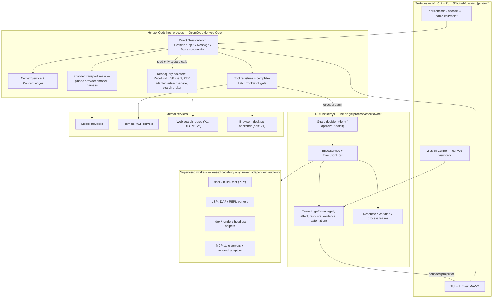

Ownership law restated (never violated by any diagram below):

- Direct conversational Session/Input/Message/Part/continuation is owned by HorizonCode direct Core (OpenCode-derived). Rust never re-owns it.
- Rust kernel owns managed Goal/SpecVersion/Run/Task/Attempt, ToolBatch authorization facts, EffectIntent/lease/receipt, Evidence/Verification, resource leases and durable automation control.
- Every mutation crosses the same Guard and authorized ExecutionHost. Plugin/MCP/LSP/DAP/browser/desktop/REPL/automation origins get no bypass.
- Provider/model/harness stays pinned per turn; no hidden paid or authenticated fallback anywhere.
- One canonical capability registry; one process supervisor; model self-report is never completion evidence.

---

## 45.3 Event classes and durable envelope (owner: 04-STATE-EVENTS, 12-DOMAIN-SCHEMAS)

| Class | Owner / store | Examples | Durability |
|---|---|---|---|
| Durable managed events | Rust OwnerLogV2 | goal, run/task/attempt, tool/effect, approval/lease, evidence, resource, automation families (§45.22) | fenced, replayable, never dropped for UI |
| Session observation events | OpenCode session store + Rust projection metadata | bounded source cursor/ACK, redacted projection fields | canonical in OpenCode; Rust projection read-only |
| Ephemeral events | derived queues | token/text/thinking deltas, tool progress, paint/progress, model loading, transient browser/desktop observations | coalescible/droppable per UI policy; never evidence |
| Derived analytics/index queues | rebuildable | metrics, symbol index, render queues, file-touch warnings | rebuild from owners; never authorizes behavior |

Implemented OwnerLogV2 physical record (`kernel/src/owner_log.rs`): `format_version: 2`, `seq`, `time_ms`, `kind`, `data`, `previous_digest`, `event_digest`. The committed **owner head** binds owner kind/ID, generation, durability profile and committed cursor. Logical projections additionally require event ID/type/version, aggregate type/ID/revision, owner epoch, idempotency/correlation, payload digests and observation time.

Consistency law (§4.6): never pretend to have a distributed transaction across OpenCode, Rust and external targets. Use foreign IDs/digests + durable PREPARED intent + idempotency refs + receipts + reconciliation. A conversational tool result may reference a Rust receipt; neither store impersonates the other.

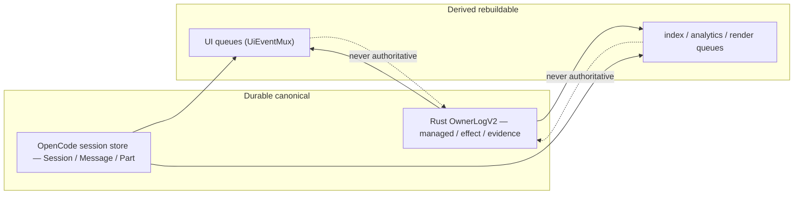

---

## 45.4 Startup, negotiation and capability exposure (owner: 03.1, 13.2–13.3, 13.8)

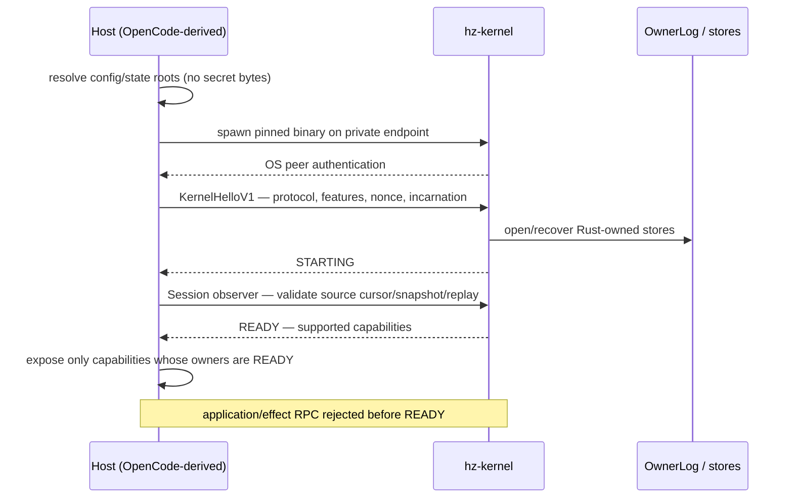

Rules: private transport is authenticated local IPC, bounded length-prefixed MessagePack `HzKernelRpcV1`; every frame after the bootstrap handshake carries negotiated version, IDs, caller, owner epoch + incarnation, payload type and bounded length/checksum; missing/stale/oversized fails closed. Shutdown: stop admissions → cancel/settle bounded workers → reconcile unknown effects → persist cursors → release owned resources → close endpoint.

---

## 45.5 Direct coding turn + ToolBatch (owner: 03.2, 15.2, 15.20, 11.6)

```mermaid
sequenceDiagram
    participant U as User (CLI/TUI)
    participant C as Core Session
    participant P as Provider transport
    participant G as Rust Guard
    participant X as ExecutionHost
    participant L as OwnerLog + Session store
    U->>C: input
    C->>C: compile bounded context; pin provider/model/harness/tool-registry generation; freeze spend cap
    C->>P: provider request with hard byte/call/finish deadlines
    P-->>C: stream text/thinking/tool calls (untrusted)
    C->>C: collect COMPLETE batch; size-check; normalize IDs; reject on schema/unknown effect/oversize/unfinished
    alt read-only calls only
        C-->>U: canonical tool-result parts + answer
    else effectful members present
        C->>G: whole ToolBatchControl (transactional preflight)
        G-->>C: DENIED | NEEDS_APPROVAL | ADMITTED
        G->>L: PREPARE EffectIntent + one-use lease (+ approval when required)
        G->>X: authorized execution
        X-->>L: bounded observation; receipt or UNKNOWN
        L-->>C: receipt reference
        C-->>U: tool-result Part + derived status/evidence
    end
```

ToolBatchControl state machine (§11.6):

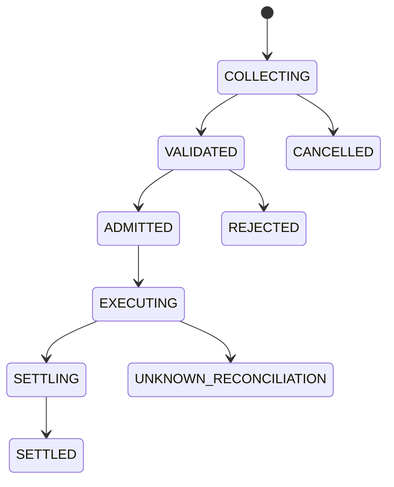

No effectful member executes before the complete batch validates and is admitted. If a partly executed parallel batch fails, each admitted effect settles independently — no claimed atomic rollback of external operations. UNKNOWN can never be converted to success by model text. Hard current bounds (source-verified in §15.20): 32 calls, 256 KiB per-call arguments, 512 KiB total, 16,384 delta chunks, 10-minute max stream.

---

## 45.6 Universal effect path — every origin (owner: 03.3, 13.5, 14, 11.7)

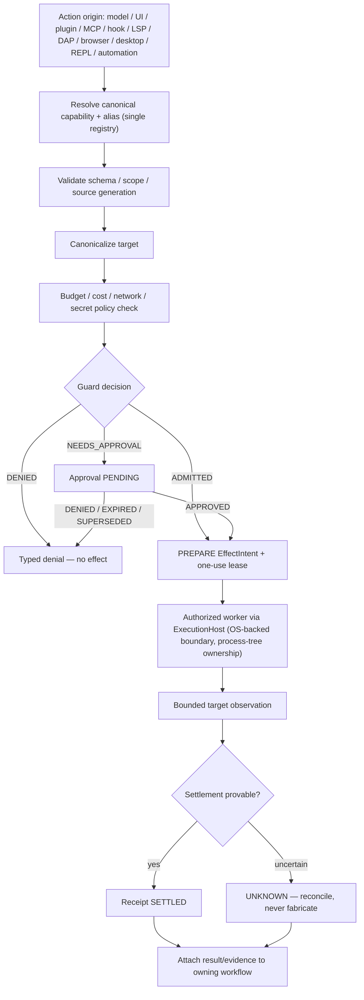

EffectIntent state machine (§11.7):

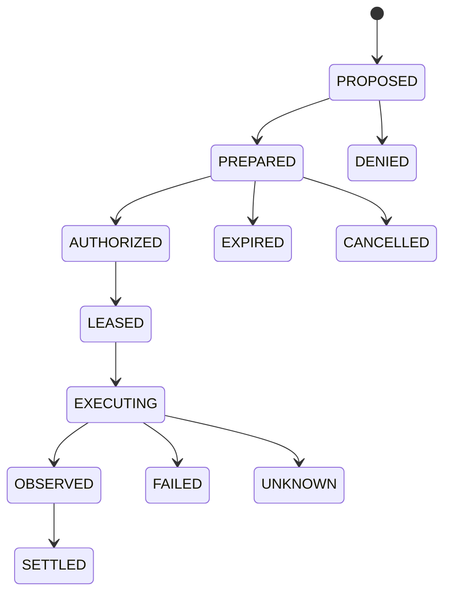

| Companion machine | States (§11.7) |
|---|---|
| Approval | PENDING → APPROVED \| DENIED \| EXPIRED \| SUPERSEDED |
| One-use lease | ISSUED → CLAIMED → CONSUMED, or EXPIRED / REVOKED |

Rules: PREPARED binds canonical target, args digest, workspace/source revision, policy epoch and budget; lease cannot be reused or widened; observation and settlement are distinct; exactly-once is claimed only when the real target provides compatible idempotency; no Bun/worker/plugin side-channel may perform the effect outside this path (§13.5).

---

## 45.7 Managed goal vertical (owner: 03.4, 11.2–11.4, 15.20 managed executor)

Goal + SpecVersion:

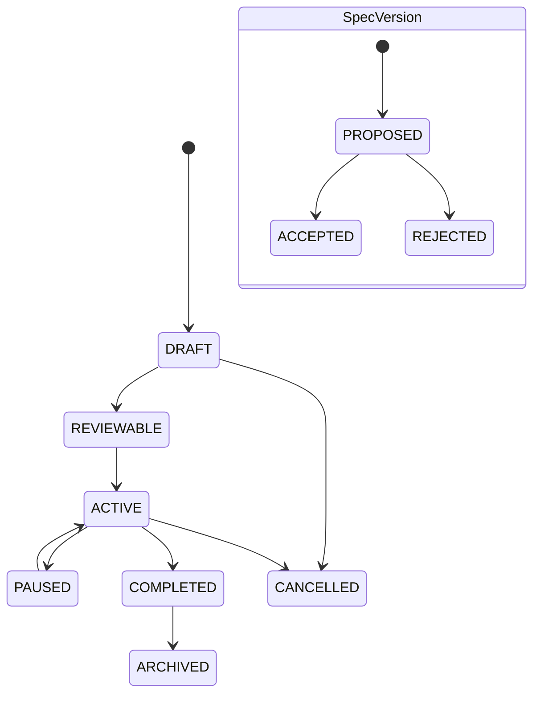

Run:

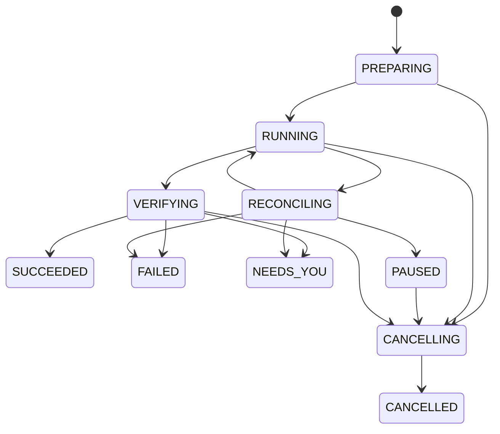

Task and Attempt:

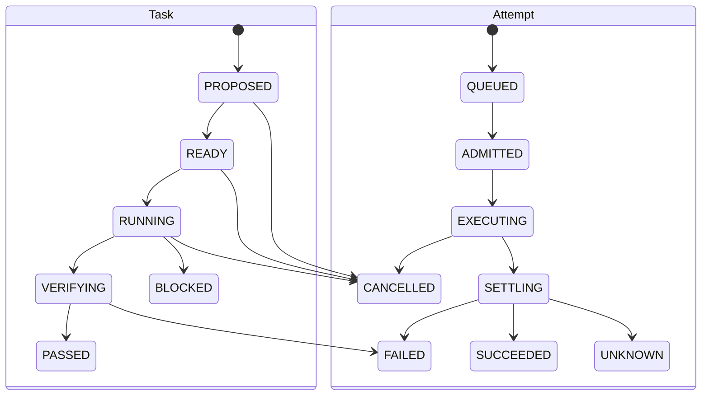

Journey (§3.4): draft objective/criteria/budget → reviewable Goal/SpecVersion with zero effects → user accepts SpecVersion → Rust initializes Run + dependency DAG → scheduler reserves resources/workspaces and dispatches bounded Attempts → all effects use the same Guard as direct mode → integration produces a known final revision → independent verifier checks criteria/evidence against that revision → Run terminal state. Causal ordering (§11.20): spec acceptance precedes Run admission; predecessor trusted PASS precedes dependent READY; Guard approval precedes lease claim; process exit does not imply effect settlement; all receipts and final-revision evidence precede Run SUCCEEDED.

---

## 45.8 Subagents and DAG workers (owner: 03.5, 29.5, 29.17–29.18, 21.11)

Direct-session delegation and managed DAG workers share profiles, bounded resource
admission and Guarded effects, but have different owners and completion meaning. A direct
child has its own Core Session and never needs a Goal; a managed child is attached to an
accepted SpecVersion Task/Attempt and only Rust plus the independent verifier can settle it.
Both use one `SubagentDeliveryV1` envelope tagged `direct_session` or `managed_attempt`;
the lane authority is bound as specified in §§12.11/37.9, and its digest does not replace
authenticated owner lookup or live policy/Attempt validation.

**Direct-session child lifecycle (no Goal):**

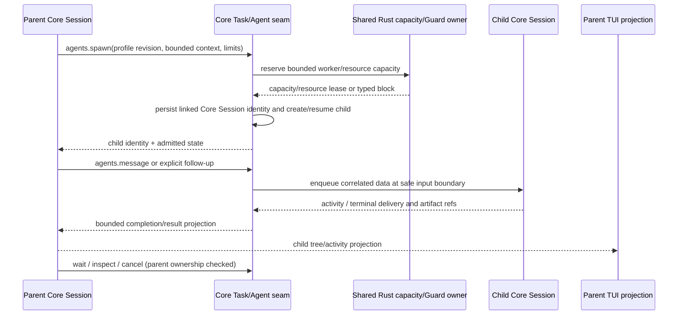

Timeout is an observation, not cancellation. A message does not implicitly start a turn;
follow-up has an explicit wake policy. Parent and child Core Sessions retain separate
transcripts. A direct child result may inform the parent but is not managed evidence or a
Goal/Task PASS.

**Managed Task/DAG lifecycle (accepted Goal):**

```mermaid
sequenceDiagram
    participant PR as Parent / integrator
    participant K as Rust scheduler (sole Task owner)
    participant W as Child worker (leased scope)
    participant V as Independent verifier
    PR->>K: TaskProposalV1 — temp IDs, deps, criteria, read/write scopes, profile
    K->>K: validate DAG (cycle, cross-Run, limits, revision); persist one authoritative graph revision
    K->>K: compute READY = eligible + independently PASSED parents + no blocking UNKNOWN
    K->>W: TaskDeliveryEnvelopeV1 — immutable criteria/scope/deps + minimum context
    W-->>K: CandidateTaskResultV1 — artifacts (sha256), touched files, receipts, missing criteria
    K->>V: verify criterion subset at exact source revision (verifier ≠ same effectful Attempt)
    V-->>K: trusted PASS / FAIL / NEEDS_YOU
    Note over K: downstream READY only after trusted PASSED; late child cannot overwrite newer revision
```

Invariants (§29.18, §21.11): exactly one authoritative Task revision at a time; every task has finite attempt/deadline/depth/token bounds; descendant capability grant = intersection(parent grant, policy, consent, support, task subset) — never derived from model text; parallel write scopes either disjoint or serialized by workspace leases; “unknown write set” counts as conflicting. Worker is not scheduler: agents may propose graph changes but never commit task transitions or acceptance.

Worker/lease machines (§11.5, §21.11): WorkerExecution `RESERVED → STARTING → READY → BUSY → IDLE → RELEASED`; delegated dispatch `PREPARED → STARTING → RUNNING → RETURNED | FAILED | CANCELLED | UNKNOWN`. `AcquireResourceLease` reserves capacity atomically with workspace lease and one Attempt identity; durable append wins before any process spawn; release only after observed process-tree exit, artifact flush and effect reconciliation.

---

## 45.9 Context pressure and compaction (owner: 03.6, 30.2–30.5)

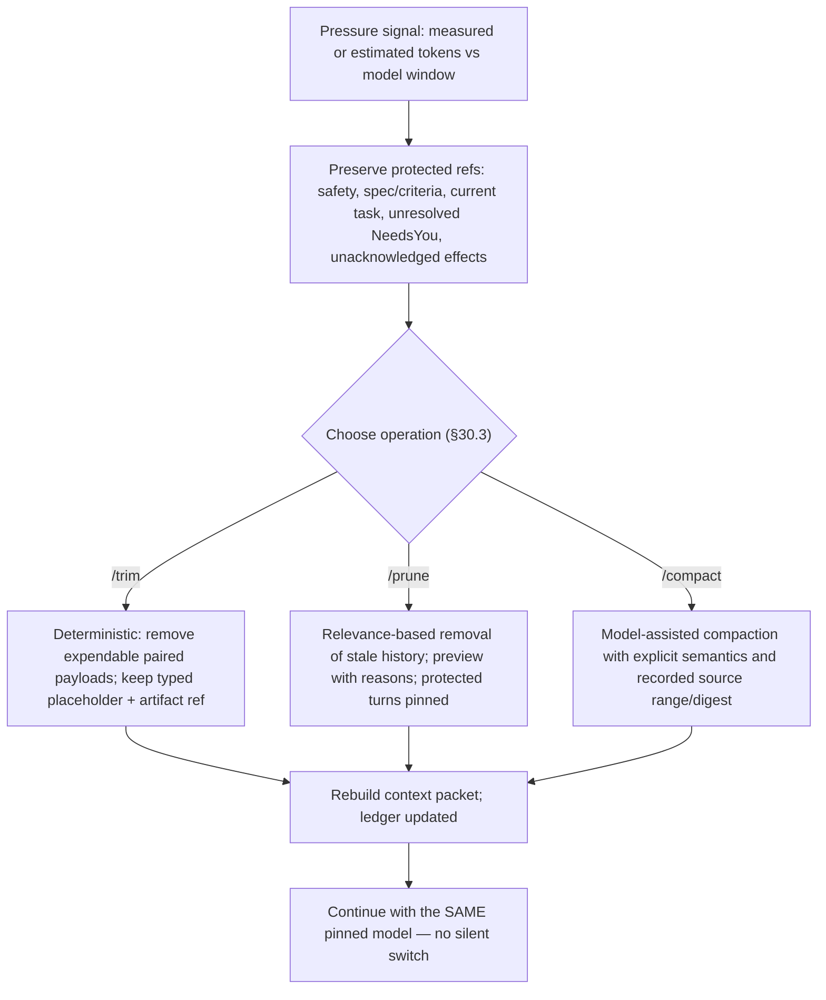

ContextLedger exposes the model-visible plan: entry kind, source ref/revision, trust class, exact/estimated/unknown tokens, inclusion reason, protection, cache class, digest. The context bar shows absolute tokens where known, percentage of window, exact vs estimated, and what the next cleanup would remove. Canonical history is never modified by pressure handling.

---

## 45.10 Repository change and RepoIntel (owner: 03.7, 30.7–30.10, 30.22)

```mermaid
sequenceDiagram
    participant A as Agent
    participant R as RepoIntel + LSP
    participant G as Rust Guard
    participant F as File capability
    A->>R: target symbol/file query (generation-checked)
    R-->>A: symbol IDs + ranges, or SYMBOL_STALE — never a silently wrong location
    A->>A: inspect source; produce patch with source revision + stale guard
    A->>G: files.patch effect (canonical file tool)
    G-->>F: ADMITTED + one-use lease
    F-->>A: applied patch, new revision
    A->>R: re-diagnose (LSP), run related tests
    A->>A: inspect diff/evidence; managed mode verifies criteria
```

RepoIntel pipeline (§30.7): manifest discovery → language/framework/build/test detection → file inventory → tree-sitter symbols → persistent lexical/symbol index → on-demand LSP enrichment → optional embeddings only when explicitly enabled. Workspace/Git stays canonical; the index is derived and rebuildable.

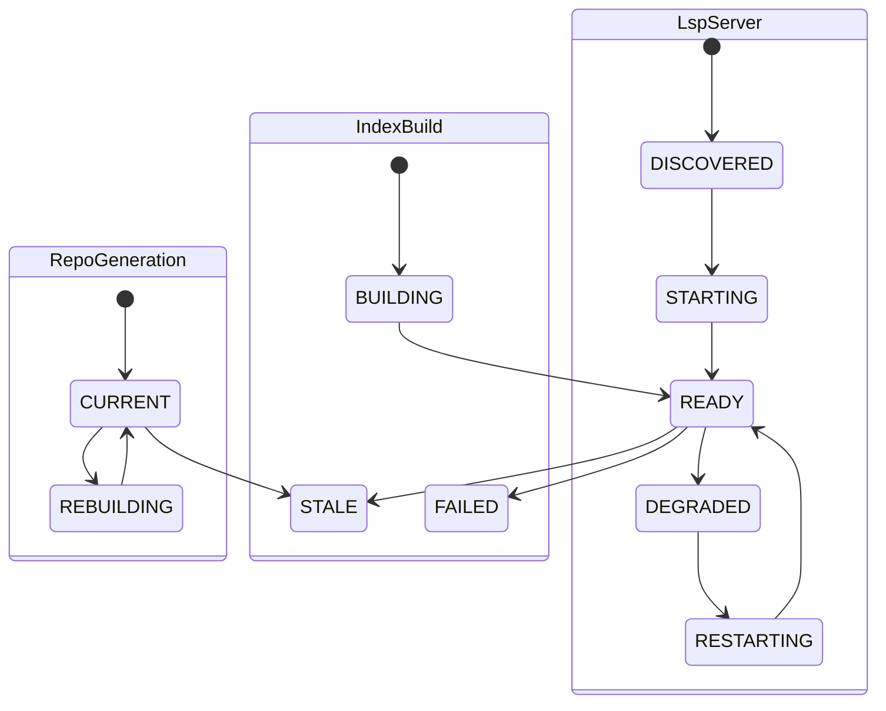

Built-in repo tools (§30.9): `repo.detect`, `repo.tree`, `symbols.search`, `symbols.outline`, `symbols.read`, `references.find`, `definitions.find`, `impact.analyze`, `text.search`, `diagnostics.get`, `tests.related` — bounded model-visible outputs, deterministic ranking per index generation, lexical/LSP fallback for unsupported languages.

---

## 45.11 LSP / DAP / REPL brokers (owner: 03.8–03.9, 37.6–37.8, 11.11–11.12)

| Broker | Flow | States |
|---|---|---|
| LanguageServiceBroker (`37.6`) | diagnostics/symbols query → Core Config resolves immutable trusted launch profile → HostKernel validates profile/revision and admits via Guard + the single ExecutionHost → bounded service result → versioned edit prepared → Guard mutation → apply through file capability → re-diagnose | per-server machine in §45.10; editor-owned servers are discovered, never taken over; raw launch fields are not authority |
| DebugAdapterBroker (`37.7`) | start/attach Guarded session → breakpoints/step/read variables (scoped reads) → optional guarded evaluate → terminate/reconcile | `CREATED → STARTING → STOPPED_AT_BREAKPOINT \| RUNNING → TERMINATING → TERMINATED` |
| ReplBroker (`37.8`) | start bounded Python/JS worker → execute chunks preserving worker state → bounded outputs/artifacts → any tool callback routes through canonical action + Guard → reset/stop or idle expiry | `CREATED → STARTING → READY → BUSY → READY → STOPPING → STOPPED` |

Hard rules: the debugger cannot bypass ExecutionHost; evaluate is an effect (or disabled by policy) and never grants ambient host shell authority; REPL callbacks are effects; all three report availability truthfully per OS/language support (`DEC-V1-21`, `DEC-V1-22` gates). Core Config is the trusted launch-profile owner for V1 LSP/DAP; HostKernel validates the immutable projection and uses the same single supervisor. No second registry or caller-provided executable/path/argv/env/PID authority is introduced. The strict profile schema, fixtures, Guard admission and confinement must be complete before launch is enabled.

---

## 45.12 Web-search cascade — V1 (owner: 03.12, 37.5, 33.9; `DEC-V1-26`)

```mermaid
sequenceDiagram
    participant M as Model / User
    participant B as WebSearchBroker
    participant S as Settings route list
    participant P as Provider route
    M->>B: web.search(query)
    B->>B: validate query / privacy / domain policy
    B->>S: resolve enabled ordered cascade (built-in default + enabled BYO-key routes)
    loop enabled routes in order
        B->>P: bounded request
        alt success
            P-->>B: results + provider/route/auth/cost/freshness provenance
        else auth 4xx (401/403/407)
            P-->>B: route-local failure + status; no same-route retry
            B->>P: next explicitly enabled route
        else timeout / rate-limit / empty / 5xx
            P-->>B: typed failure reason
        else other 4xx
            P-->>B: typed terminal request/configuration failure
        end
    end
    alt a route succeeded
        B-->>M: bounded results, provenance explicit
    else chain exhausted
        B-->>M: one bounded normal retry; per-route reasons surfaced — never a fabricated result
    end
```

State machine: `VALIDATED → ROUTED → RUNNING → COMPLETE | FAILED | CANCELLED` (§11, web-search lane).

Binding rules (`37.5`, `DEC-V1-20/26`): the built-in default route needs no key; every enabled route joins one ordered, inspectable, reorderable cascade; disabled/unconfigured providers are simply absent (no separate off step); enabling a paid/authenticated route is the recorded consent for its cost/auth class; auth 401/403/407 is recorded and may continue only to another explicitly enabled route, while other non-rate-limit 4xx stops; `web.search.inspect_provider` reports auth/cost/rate-limit/last-error/freshness per route; results are untrusted data (injection handling per §5.8) and never authorize an effect; large fetched content becomes an artifact, not prompt context. Provider matrix owner: `DEC-V1-20`.

---

## 45.13 Terminal/PTY and process ownership (owner: 33.7, 37.13, 13.6)

One host-scoped Rust kernel is the sole process/effect owner, multiplexed across Locations and Sessions. Core `Pty.Service` is only the adapter (`/pty`, `/api/pty`, WebSocket, replay); tickets/origins authenticate transport and never authorize Guard effects; Core never directly spawns/writes/resizes/kills. Principal proof: validated `ServerAuth` or loopback listener+peer with host-derived OS UID/SID; missing proof denies. Origins must match the exact allowlist (`oc://renderer`, tauri origins, configured listener origins). Locations register through `effects.v2/register_location` from a trusted `Location.Ref` only — Rust canonicalizes and returns `loc_<blake3>`; TypeScript never duplicates path canonicalization. Model bash/effect batches use `effects.v2.prepare_tool_batch`; ALLOW returns the prepared effect ID + capability-lease digest, ASK returns the Guard challenge — only explicit matching `allow_once` continues.

Terminal lifecycle effects flow through the same §45.6 path: `terminal.start/input/resize/cancel` are effects; output is bounded observation; unlimited/unknown write sets reserve conservative exclusive scope.

---

## 45.14 Skills, hooks, MCP, plugins (owner: 29.6–29.8, 5.9)

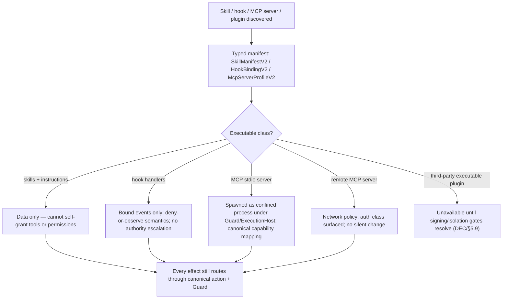

MCP tools map to canonical capabilities and Guard policy — never a parallel tool universe. Sealed built-ins cannot be shadowed. Hooks cannot veto Guard, leak secrets or grant capabilities; a hook failure cannot convert a denied effect into allowed (`DEC-V1-15`).

---

## 45.15 Automations (owner: 03.14, 11.15, 37.10, 31.12)

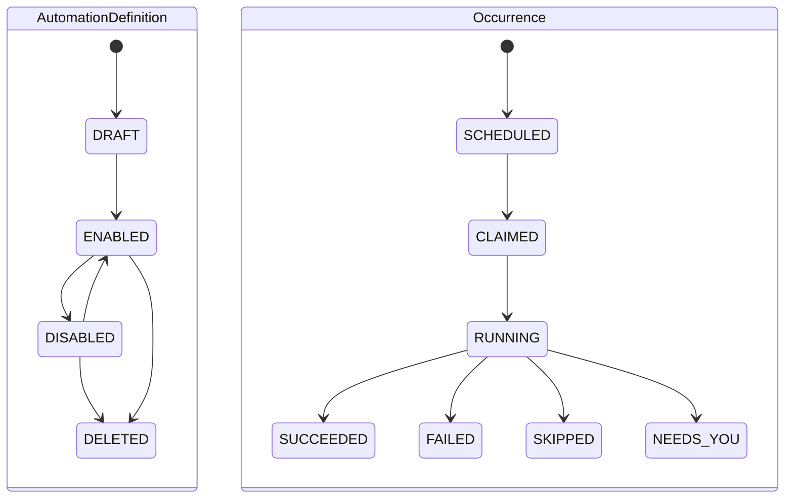

Durable Rust-owned definition/occurrence state; deterministic overlap/missed-run/retry/timezone policy; each occurrence invokes the target canonical action through ordinary authorization (§3.14) — the scheduler has no special effect path. UI shows action/version/scope, schedule, enabled state, next/last occurrence, executor availability and result/NeedsYou. Scheduler availability is displayed accurately when no executor is running.

---

## 45.16 Streaming UI, artifacts, analytics (owner: 31, 37.11–37.12, 12.10)

```mermaid
sequenceDiagram
    participant SR as Source streams
    participant MUX as UiEventMuxV2
    participant T as TUI/CLI
    participant R as ArtifactRenderServiceV2
    SR->>MUX: durable owner/receipt events (never dropped, never reordered)
    SR->>MUX: ephemeral paint/progress (coalescible)
    MUX->>T: bounded per-surface queues, source sequence/revision
    T->>R: render request (immutable source ref, kind, theme/geometry generation)
    R->>R: bounded crash-isolated parser: Markdown/code/diff, Mermaid, safe SVG, numeric chart, image/PDF metadata
    R-->>T: render OR typed failure (stale async result discarded by generation)
    Note over T,R: source/text fallback always shown; durable export is a separate Guarded action
    T-->>SR: reconnect/rebuild from canonical sources, never from the paint queue
```

Artifact model (§31.5): distinguish original/canonical source, durable artifact bytes/metadata, derived render, and ephemeral terminal image placement. Durable records: content digest, MIME/kind, owner/scope/source revision, byte count, fidelity `FULL/HEAD_TAIL_SAMPLE/FAILED`, retention/security metadata. A sampled artifact is never labeled FULL. Artifact states: `STAGED → PERSISTED_FULL | PERSISTED_SAMPLE | FAILED`; renders `OPEN → RENDERING → READY`.

Streaming lanes (§31.1): owning Session message stream; durable Rust control/effect events; ephemeral UI events; analytics observations — the mux may coalesce the ephemeral lane only. Performance budgets (§31.3) are measured on declared hardware; never marketed as guarantees before benchmarking.

Mission Control is a derived view (Runs/Tasks/Attempts, worker graph, leases, approvals/NeedsYou, budget, evidence, automations); its actions dispatch canonical capabilities and it can never edit owner stores directly. Analytics records measured/estimated/unknown provenance and can never authorize behavior.

---

## 45.17 Recovery, reconciliation, cancellation (owner: 03.15, 04.7–04.8, 11.1, 11.20)

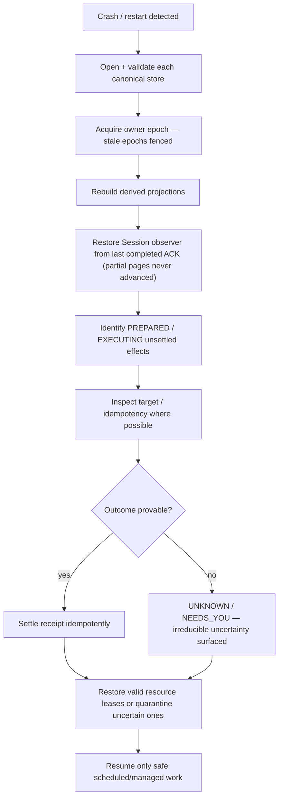

Cancellation law (§4.8): persist a fence against new admissions first. Already-started effects: cancellable → request then observe; not cancellable → wait/reconcile; never erase evidence because a parent was cancelled. No silent cross-session kill; per-task reporting distinguishes cancelled / still running / unknown / settled. New user steer affects only a *future* provider step; once a batch/effect is prepared its digest, args and lease are frozen.

Required recovery tests (§4.11): torn/partial durable append; schema/version rejection; stale owner epoch; duplicate idempotency; Session cursor retention gap; crash after PREPARE before target effect; target executed but receipt lost; worker/host/kernel restart; UI reconnect; derived index rebuild; cancellation race. Any event family that would recreate a Rust canonical conversational thread is invalid.

Crash transition procedure (§11.20): persist owner epoch + cancellation/lease fence → stop new dispatch → inspect actual OS process identity and target evidence → classify completed/failed/UNKNOWN → update OwnerLog once with idempotent delivery → reconcile/block uncertain effects → release or quarantine owned resources → resume queue only after peer scope revalidation.

---

## 45.18 Checkpoint / rewind (owner: 14.19, 31.18, 16.18; `DEC-V1-25`)

```mermaid
flowchart TD
    A["Rewind requested"] --> B["Preview: snapshot bounds, diffs, affected paths (digest-bound)"]
    B --> C{"Destructive reset required?"}
    C -->|yes| D["Refuse with exact reason — a guarded explicit destructive path is a separate decision"]
    C -->|no| E["Guarded workspace restore effect (preview-first)"]
    E --> F["ExecutionHost applies restore"]
    F --> G{"Full success?"}
    G -->|yes| H["Restored — evidence recorded; prior verification invalidated by revision change"]
    G -->|partial| I["UNKNOWN — partial-restore surfaced honestly, never silent"]
```

Checkpoints are a bounded app-owned artifact family: per-Session count/byte caps with a declared eviction owner, oldest-first eviction under §18 pressure before touching user work or evidence, truthful FULL/SAMPLE/FAILED status, and no destructive git action ever implied by deleting a checkpoint. Rewind is not claimed available until §14.19/§16.18/§31.18 are wired and CP-001/CP-002 pass on the exact revision (`DEC-V1-25`).

---

## 45.19 Resource-aware concurrency (A-V2-30) (owner: 11.20, 18.17–18.18, 21.10–21.11, 29.18, 03.20)

```mermaid
stateDiagram-v2
    [*] --> PROPOSED
    PROPOSED --> RESERVED
    RESERVED --> CLAIMED
    CLAIMED --> RELEASE_PENDING
    RELEASE_PENDING --> RELEASED
    RESERVED --> EXPIRED
    CLAIMED --> QUARANTINED
    RELEASE_PENDING --> QUARANTINED
    QUARANTINED --> RELEASE_PENDING
    state ResourcePressure {
        [*] --> NORMAL
        NORMAL --> SOFT_PRESSURE
        SOFT_PRESSURE --> HARD_PRESSURE
        HARD_PRESSURE --> RECOVERING
        RECOVERING --> NORMAL
    }
```

`PROPOSED` reserves nothing; `RESERVED` deducts capacity once before launch; `CLAIMED` = authenticated worker startup lease claimed (not effect success); `RELEASE_PENDING`/`QUARANTINED` keep conservative outstanding reserve; `EXPIRED` is terminal only with proven absence of dispatch; `RELEASED` requires confirmed owned process-tree termination + settled effects + retained evidence + idempotent log transition. `UNKNOWN` is an effect/measurement outcome, never a reservation state. Pressure may go `NORMAL → HARD_PRESSURE` directly on an OS quota alarm; recovery uses hysteresis; pressure never changes model/provider and never deletes user data/receipts or kills unowned processes.

The eight-step A-V2-30 journey (§3.20): attach pinned Session → bounded context with provenance-labeled recall → accepted spec + DAG + capacity reservation before launch → typed ToolIntent batches through Guard/PREPARE/lease/ExecutionHost → bounded tool-tail + attributed PSS/CPU/cost → fence + UNKNOWN + reconcile on any fault → typed artifacts/evidence + independent PASS + reverify integrated revision → provenance-preserving import snapshot/handoff only.

Concurrency race tests (§11.20): cancel vs lease claim; attachment logout vs ACK; duplicate resource request with different args; expiration vs process still running; source edit vs verification; cache eviction vs pinned reader; Provider Doctor consent revocation vs upstream billing; worker unknown vs new Attempt; two clients attaching one Session; kernel incarnation change while old worker returns. Expected outcome for uncertain external mutation is always UNKNOWN — never silent retry or success.

---

## 45.20 Provider Doctor and session import (owner: 37.16–37.19, 11.20)

| Aggregate | Accepted transitions (§11.20) |
|---|---|
| ProviderDoctorRun | `VALIDATED → OFFLINE_RESULT`; `VALIDATED → AUTHORIZED_NETWORK → CATALOG_RESULT`; `VALIDATED → AWAITING_SPEND_APPROVAL → AUTHORIZED_FULL → PROBING → COMPLETE/FAILED/UNKNOWN` |
| VirtualSessionAttachment | `ATTACHING → AUTHENTICATED → ACTIVE → DRAINING → DETACHED`; `ACTIVE → LOST`; `LOST → new AUTHENTICATED generation` after peer proof |
| FileTouchRecord (derived) | `OBSERVED → LIVE → STALE/EXPIRED → REMOVED` — advisory only; never a write permit |
| CacheEntry | `BUILDING → CURRENT → PINNED or EVICTABLE → EVICTED`; `CURRENT → STALE` |
| ToolTailView (derived UI) | `EMPTY → STREAMING → COMMITTED/DROPPED or UNKNOWN` — never a second MessagePart |

Provider Doctor decision table (§15.20): offline missing account/model → FAIL configuration without network; catalog network/auth unavailable → UNKNOWN/typed route error, no fallback; missing full-tier consent → NEEDS_APPROVAL before any model call; partial stream/no terminal → FAILED/UNKNOWN cost status; 429 → bounded same-route retry only if policy permits; unsupported structured tools → UNAVAILABLE; local model out of VRAM → resource blocked, no remote fallback. Full tier is spend-bearing and consent-gated; all identifiers redacted/opaque; spend recorded only from authoritative provider usage. Optional session import creates a provenance-preserving snapshot or handoff under one chosen backend owner — never a silent merge of two live canonical transcripts.

---

## 45.21 Post-V1 surface map — unavailable in V1

| Surface | Design owner | Status |
|---|---|---|
| Browser automation / attached-browser | 03.10, 37.3, 33.9 | `[post-V1]` unavailable; observe → pin generation → Guard mutation → execute → re-observe |
| Desktop / computer control | 03.11, 37.4, `DEC-V1-19` | `[post-V1]` unavailable; capture → pin geometry → Guard input/focus/clipboard → execute → recapture |
| Visual source edit | 03.17, 37.21, 33.30 | `[post-V1]` unavailable; pixel selection is never guaranteed source mapping |
| Deploy & verify | 03.18, 33.30 | `[post-V1]` unavailable; build/upload alone is never deployment completion |
| External ACP client | 37.20, 29.19, `DEC-V1-24` | `[post-V1]` unavailable; upstream ACP server support is not our client |
| Web app / desktop app / SDK clients | 16.1, 31.13, 37.19 | `[post-V1]` under A-V2-31; one state projection, separate consumers |
| HorizonCode-as-MCP-server | `DEC-V1-23` | `[post-V1]` unavailable; MCP remains client-side with confined spawned servers |

Every post-V1 row must keep its routes unavailable until an explicit scope decision plus the relevant §14 Guard, privacy, auth, cost and platform acceptance gates pass. Documented contracts are not features.

---

## 45.22 Event catalog quick reference (owner: 04.3–04.5)

**Design inventory — not every event is implemented; the active Rust decoder accepts only its committed subset** (`ManagedCommand::event/decode` in `kernel/src/managed_control.rs`).

| Family | Events (verbatim from §4.3) |
|---|---|
| Goal/spec | `goal_created`, `spec_proposed`, `spec_accepted`, `goal_paused/resumed/completed/cancelled` |
| Run/task/attempt | `run_started/paused/resumed/cancelling/cancelled/verifying/succeeded/failed/needs_you`; `task_proposed/ready/running/verifying/passed/failed/blocked/cancelled`; `attempt_admitted/executing/settling/succeeded/failed/unknown/cancelled` |
| Tool/effect | `tool_batch_validated/admitted/rejected/executing/settling/settled/unknown`; `effect_prepared/authorized/leased/observed/settled/failed/unknown`; `approval_requested/approved/denied/expired`; `lease_claimed/consumed/expired/revoked` |
| Evidence | `evidence_collected/accepted/rejected/stale`; `verification_started/passed/failed/needs_you` |
| Resource | `resource_acquired/released/quarantined`; `checkpoint_created/restore_requested/restored/rejected` |
| Automation | `automation_created/updated/enabled/disabled`; `occurrence_scheduled/claimed/completed/failed/skipped` |
| Session observation (§4.4) | bounded source Session ID/store/epoch, cursor, last completed ACK/page, foreign event type/version/ID/digest, redacted projection fields — never canonical conversation content |
| Ephemeral (§4.5) | token/text/thinking deltas, tool progress, UI typing/hover/selection, render frames, model loading, transient browser/desktop observations, diagnostics progress, analytics samples |

Envelope rule: durable events carry event ID/type/version, aggregate type/ID/revision, owner epoch, idempotency/correlation, payload + source digests, observation time as logical projections over the implemented `PhysicalRecordV2`. `contracts-v2/managed-event.schema.json` remains a design-only prototype and cannot be used for runtime codegen until an exact OwnerLog adapter/migration + cross-language fixtures are accepted.

---

## 45.23 Acceptance/test map (owner: 32)

| Module | §32 family |
|---|---|
| Repository navigation / focused change | 32.4, 32.5 |
| Architecture & scope control | 32.6 |
| Build/test/debug; git safety | 32.7, 32.8 |
| Managed goals | 32.9 |
| Context; local/small models | 32.10, 32.11, 32.22 |
| Agents/subagents; skills/hooks/MCP | 32.12, 32.13 |
| Permissions & sandbox; beyond-coding execution | 32.14, 32.20 |
| UI/streaming/artifacts; analytics/cost truth | 32.16, 32.17 |
| Automation; recovery/healing | 32.18, 32.19 |
| Performance suites; release minimum | 32.21, 32.24 |
| Contract/architecture consistency | 32.25, 32.26, 32.34 |
| Desktop/search/DAP/REPL canonical acceptance | 32.28 |
| Settings/Experimental class | 32.31 |
| JCode resource regression; source fixtures; reservation reconciliation | 32.32, 32.33, 32.37 |
| Post-V1 future cases (browser/desktop/visual/deploy/ACP) | 32.15, 32.29, 32.35 |

Real-case rule: a module is `VERIFIED` only after its acceptance family passes on the exact revision — with negatives (denial, cancellation, restart, UNKNOWN) and, where user-visible, a rendered-surface check. Diagrams in this atlas are never evidence.

---

## 45.24 Coverage matrix — every architecture document accounted for

| Document | Status | Role | Represented in |
|---|---|---|---|
| 01-SYSTEM.md | Normative owner | Process/topology, aggregate ownership | §45.2 |
| 02-DOMAIN.md | Normative owner | Domain identity + managed records | §45.2, §45.3, §45.7 |
| 03-FLOWS.md | Normative owner | End-to-end flows | §45.4–§45.21 (every section) |
| 04-STATE-EVENTS.md | Normative owner | Durable/ephemeral events, recovery | §45.3, §45.17, §45.22 |
| 05-SECURITY.md | Normative owner | Threat model, security policy | §45.6, §45.12, §45.14, §45.16 |
| 06-CAPABILITIES.md | Compatibility stub (archived) | — | Not an implementation input |
| 07-UX-COMMANDS.md | Compatibility stub (archived) | — | Not an implementation input |
| 08-RECONCILIATION.md | Compatibility stub (archived) | — | Not an implementation input |
| 09-SOURCE-MAP.md | Compatibility stub (archived) | — | Not an implementation input |
| 10-DELIVERY.md | Normative owner | Delivery dependency order P0–P9 | §45.1 phase references; tracker |
| 11-LIFECYCLE.md | Normative owner | State machines + terminal criteria | §45.5–§45.8, §45.15, §45.18–§45.20 |
| 12-DOMAIN-SCHEMAS.md | Normative owner | Schema registry + ownership | §45.3, §45.7–§45.8, §45.19 |
| 13-COMPOSITION-IPC.md | Normative owner | Process composition + IPC | §45.2, §45.4, §45.6 |
| 14-EFFECTS-EXECUTION-SECURITY.md | Normative owner | Guard, EffectService, ExecutionHost, sandbox | §45.6, §45.12, §45.18, §45.21 |
| 15-RUNTIME-EXECUTION.md | Normative owner | Direct/managed runtime, providers, recovery | §45.5, §45.7, §45.12, §45.17, §45.20 |
| 16-UX-SETTINGS-ECOSYSTEM.md | Normative owner | UI, ActionDescriptor, settings, provider UX | §45.12, §45.16, §45.18, §45.20 |
| 17-GOVERNANCE-DECISIONS.md | Normative decisions | Frozen decisions + open gates | Referenced throughout (DEC-V1-*), §45.21 |
| 18-OPERATIONS-RELEASE.md | Normative owner | Storage, telemetry, packaging, release | §45.19, §45.17, §45.24 audit statement |
| 19-OPENCODE-UPSTREAM-REUSE.md | Compatibility stub (archived) | — | Not an implementation input |
| 20-OPENCODE-INTEGRATION-LLD.md | Normative LLD | OpenCode/local source integration seams | §45.2, §45.5, §45.13, §45.17 |
| 21-HEALING-PERMISSIONS-WORKTREE-POOL.md | Normative owner | Healing, permissions, worktree pool | §45.8, §45.19 |
| 22-UNIVERSAL-UI-COMMANDS-MEMORY.md | Compatibility stub (archived) | — | Not an implementation input |
| 23-ADOPTION-GATES-TESTS.md | Compatibility stub (archived) | — | Not an implementation input |
| 24-LOCAL-CODE-AUDIT-AND-MIGRATION.md | Compatibility stub (archived) | — | Not an implementation input |
| 25-DATA-AND-CONTROL-PLANE-CROSSWALK.md | Compatibility stub (archived) | — | Not an implementation input |
| 26-UX-ACCEPTANCE-AND-RELEASE.md | Compatibility stub (archived) | — | Not an implementation input |
| 27-IMPLEMENTATION-READINESS-AUDIT.md | Compatibility stub (archived) | — | Not an implementation input |
| 28-COMPETITIVE-GAP-AUDIT.md | Compatibility stub (archived) | — | Not an implementation input |
| 29-AGENTS-SKILLS-HOOKS-MCP.md | Normative owner | Agents, subagents, skills, hooks, MCP | §45.8, §45.14, §45.19 |
| 30-CONTEXT-INDEXING-LOCAL-MODELS.md | Normative owner | Context, indexing, LSP, local models | §45.9, §45.10, §45.11, §45.19 |
| 31-UI-PERFORMANCE-ARTIFACTS-ANALYTICS.md | Normative owner | Streaming UI, artifacts, analytics, automations | §45.15, §45.16, §45.18, §45.19 |
| 32-TASK-BASED-AGENT-TEST-CATALOG.md | Normative owner | Acceptance catalog | §45.23 (map), all sections |
| 33-BUILTIN-CAPABILITIES-CATALOG.md | Normative owner | Canonical capability IDs | §45.1, §45.12, §45.13, §45.21 |
| 34-DOCUMENT-LINE-AUDIT-LEDGER.md | Retained audit (non-normative) | Historical audit ledger | Not an implementation input |
| 35-USER-REQUEST-COVERAGE-MATRIX.md | Retained navigation (non-normative) | Historical request coverage | Not an implementation input |
| 36-CONTRACT-CONVERGENCE-PLAN.md | Compatibility stub (archived) | — | Not an implementation input |
| 37-RUNTIME-SERVICE-LLD.md | Normative LLD | Service interfaces incl. web search, DAP, REPL | §45.11–§45.13, §45.20, §45.21 |
| 38-OMP-SOURCE-COMPETITIVE-AUDIT.md | Compatibility stub (archived) | — | Research only; distilled into 16/31/33/37/32 |
| 39-OMP-TUI-SLASH-MODEL-SETTINGS-AUDIT.md | Compatibility stub (archived) | — | Research only; distilled into 16/31/33/37/32 |
| 40-HORIZONCODE-OMP-INSPIRED-UI-PROPOSAL.md | Compatibility stub (archived) | — | Research only; distilled into 16/31/33/37/32 |
| 41-OMP-STREAMING-VISUAL-ARTIFACTS-AUDIT.md | Compatibility stub (archived) | — | Research only; distilled into 16/31/33/37/32 |
| 42-EXTERNAL-SOURCE-PROVENANCE-REGISTER.md | Normative register | Source pins/provenance for extraction | §45.12 (SRC-007 web search), §45.21 |
| 43-IMPLEMENTATION-SOURCE-LLD-PLAYBOOK.md | Compatibility stub (archived) | — | Not an implementation input |
| 44-FINAL-REPO-AUDIT-LEDGER.md | Compatibility stub (archived) | — | Not an implementation input |
| GLOSSARY.md | Normative terms | Terminology | Terminology of every section |
| README.md | Normative index | Authority order + owner index | §45.24 (this matrix) |
| 45-V1-EVENT-FLOWS-ATLAS.md | Derived (non-normative) | This atlas — diagram synthesis | — |
| contracts-v2/ | Design registry | Boundary schemas (not proof) | §45.3, §45.22 |
| Repo-level: plan `docs/superpowers/plans/2026-10-11-horizoncode-converged-implementation.md` | Operative plan | Gates, V1 finish list | Phase references throughout |
| Repo-level: `implementationtov1release.md`, `HANDOFF.md`, `CURRENT_RUN.md` | Trackers (non-authoritative) | Status/evidence ledger, handoff, diary | Referenced for observed status only |

---

## 45.25 Audit statement and regeneration rule

- Structure: this file is an `arch_V1` document subject to the repo Markdown structural audit (`scripts/architecture/audit_markdown_repo.py`) and the architecture convergence validator (`scripts/architecture/validate_convergence.py`); both were run after its creation and pass (see CURRENT_RUN.md entry for the exact numbers).
- Authority: derived synthesis only. Additions to this atlas must never introduce new events, states, ownership or policy. If a diagram and an owner disagree, stop and fix the atlas (or raise a §17 decision if the owner itself is wrong — never patch around it here).
- Regeneration triggers: any change to 01–05, 10–18, 20–21, 29–33, 37, 42; any new `DEC-V1-*`; any change to event families (§4.3) or lifecycle states (§11). Re-run both audits; keep the coverage matrix rows in sync.
- Status honesty: a rendered Mermaid diagram is not `WIRED`, `TESTED` or `VERIFIED`. The statuses in `HANDOFF.md`/trackers remain the only progress truth.
