# 45. V1 event & flow atlas — comprehensive module diagram set (derived synthesis)

Status: **DERIVED, NON-NORMATIVE SYNTHESIS** for final-V1 review, onboarding and acceptance planning. This document **depends on** the `arch_V1` normative owners listed in `README.md`. Every event name, state name and step below is transcribed from an owning section; if any diagram here conflicts with an owner, **the owner wins**. This file must never be cited as authority, and adding it changes no feature status (`DESIGNED → CODE_PRESENT → WIRED → TESTED → VERIFIED → RELEASED` unchanged). Generation date: 2026-10-22.

Scope: final V1 (Linux/WSL-first CLI/TUI). Post-V1 surfaces appear only where explicitly marked `[post-V1]`.
Reconciled: 2026-10-22. This is a target-flow map with explicit source-status notes, not
an implementation report. Every claim below remains subordinate to its normative owner.

How to use: pick the module, read the owning topic document, then use the diagram here as the mental model for implementation/testing. The coverage matrix (§45.24) proves every numbered architecture document is accounted for; the test map (§45.23) links modules to §32 acceptance families.

---

## 45.1 Diagram index and dependencies

| Atlas section | Module / journey | Normative owner(s) | Acceptance (§32) |
|---|---|---|---|
| §45.2 | Master topology & ownership | 01, 13, 02 | 32.6 |
| §45.3 | Durable event classes & envelope | 04, 12 | 32.25 |
| §45.4 | Startup, negotiation, capability exposure | 03.1, 13.1–13.3, 13.8 | 32.25 |
| §45.5 | Direct coding turn + ToolBatch | 03.2, 15.2, 15.20, 11.6 | 32.5, 32.7 |
| §45.6 | Universal effect path (every origin) | 03.3, 13.5, 14.2–14.5, 11.7 | 32.14, 32.20 |
| §45.7 | Managed goal vertical | 03.4, 11.2–11.4, 15.20 | 32.9 |
| §45.8 | Subagents & DAG workers | 03.5, 29.5, 29.17–29.18, 21.11 | 32.12, 32.33 |
| §45.9 | Context pressure & compaction | 03.6, 30.2–30.5 | 32.10, 32.11 |
| §45.10 | Repository change & RepoIntel | 03.7, 30.7–30.10, 30.22 | 32.4 |
| §45.11 | LSP / DAP / REPL brokers | 03.8–03.9, 37.6–37.8, 11.11–11.12 | 32.28 |
| §45.12 | Web-search cascade (V1) | 03.12, 37.5, 33.9, `DEC-V1-26` | 32.28 |
| §45.13 | Terminal/PTY & process ownership | 33.7, 37.13, 13.6 | 32.7, 32.20 |
| §45.14 | Skills, hooks, MCP, plugins | 29.6–29.8, 5.9 | 32.13 |
| §45.15 | Automations | 03.14, 11.15, 37.10, 31.12 | 32.18 |
| §45.16 | Streaming UI, artifacts, analytics | 31.1–31.22, 16.21, 37.11–37.12, 12.10 | 32.16, 32.17, 32.48 |
| §45.17 | Recovery, reconciliation, cancellation | 03.15, 04.7–04.8, 11.1, 11.20 | 32.19 |
| §45.18 | Checkpoint / rewind | 14.19, 31.18, 16.18, `DEC-V1-25` | 32.19 |
| §45.19 | Resource-aware concurrency (A-V2-30) | 11.20, 18.17–18.18, 21.10–21.11, 29.18, 03.20 | 32.32, 32.37 |
| §45.20 | Provider Doctor & session import | 37.16–37.19, 11.20 | 32.21, 32.31 |
| §45.21 | Post-V1 surface map | 03.10–03.11, 03.17–03.18, 37.3–37.4, 37.20–37.21, 33.30 | 32.15, 32.35 |
| §45.22 | Event catalog quick reference | 04.3–04.5 | — |
| §45.23 | Acceptance/test map | 32 | — |
| §45.24 | Coverage matrix (all documents) | README index | — |
| §45.29 | V1 competitive adaptation map | 10.18, 17 (`DEC-V1-35`), 30.25, 32.47, 42.21 | §32.47 |
| §45.30 | Models.dev context compile bridge | 30.26, 37.14, 37.30, 16, 31 | §32.10 CX-014..021, CTX-* |

---

## 45.2 Master topology and ownership (owner: 01-SYSTEM, 13-COMPOSITION-IPC, 02-DOMAIN)

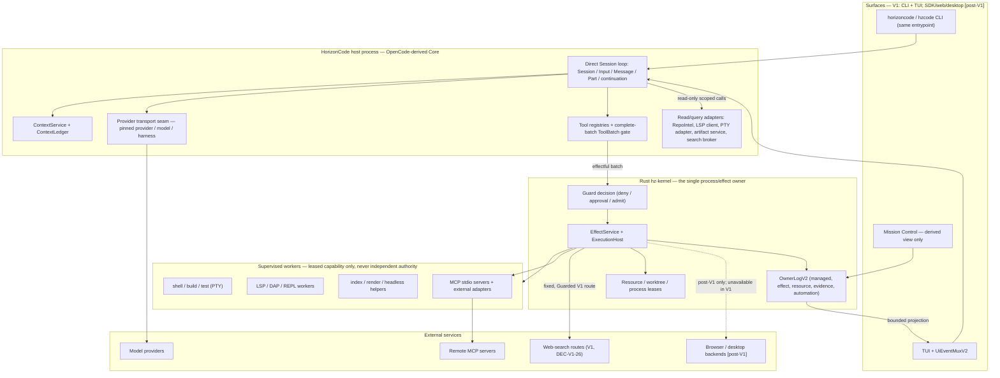

Ownership law restated (never violated by any diagram below):

- Direct conversational Session/Input/Message/Part/continuation is owned by HorizonCode direct Core (OpenCode-derived). Rust never re-owns it.
- Rust kernel owns managed Goal/SpecVersion/Run/Task/Attempt, ToolBatch authorization facts, EffectIntent/lease/receipt, Evidence/Verification, resource leases and durable automation control.
- Every mutation crosses the same Guard and authorized ExecutionHost. Plugin/MCP/LSP/DAP/browser/desktop/REPL/automation origins get no bypass.
- Provider/model/harness stays pinned per turn; no hidden paid or authenticated fallback anywhere.
- One canonical capability registry; one process supervisor; model self-report is never completion evidence.

---

## 45.3 Event classes and durable envelope (owner: 04-STATE-EVENTS, 12-DOMAIN-SCHEMAS)

| Class | Owner / store | Examples | Durability |
|---|---|---|---|
| Durable managed events | Rust OwnerLogV2 | goal, run/task/attempt, tool/effect, approval/lease, evidence, resource, automation families (§45.22) | fenced, replayable, never dropped for UI |
| Session observation events | OpenCode session store + Rust projection metadata | bounded source cursor/ACK, redacted projection fields | canonical in OpenCode; Rust projection read-only |
| Ephemeral events | derived queues | token/text/thinking deltas, tool progress, paint/progress, model loading, transient browser/desktop observations | coalescible/droppable per UI policy; never evidence |
| Derived analytics/index queues | rebuildable | metrics, symbol index, render queues, file-touch warnings | rebuild from owners; never authorizes behavior |

Implemented OwnerLogV2 physical record (`kernel/src/owner_log.rs`): `format_version: 2`, `seq`, `time_ms`, `kind`, `data`, `previous_digest`, `event_digest`. The committed **owner head** binds owner kind/ID, generation, durability profile and committed cursor. Logical projections additionally require event ID/type/version, aggregate type/ID/revision, owner epoch, idempotency/correlation, payload digests and observation time.

Consistency law (§4.6): never pretend to have a distributed transaction across OpenCode, Rust and external targets. Use foreign IDs/digests + durable PREPARED intent + idempotency refs + receipts + reconciliation. A conversational tool result may reference a Rust receipt; neither store impersonates the other.

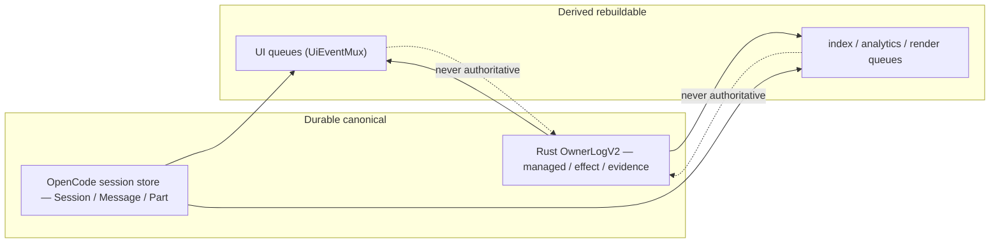

---

## 45.4 Startup, negotiation and capability exposure (owner: 03.1, 13.2–13.3, 13.8)

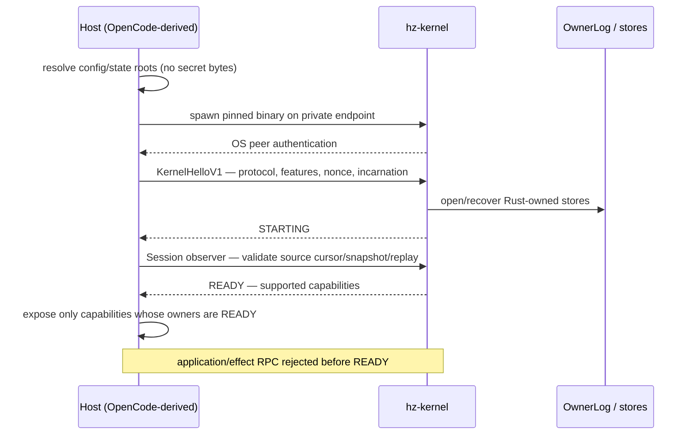

Rules: private transport is authenticated local IPC, bounded length-prefixed MessagePack `HzKernelRpcV1`; every frame after the bootstrap handshake carries negotiated version, IDs, caller, owner epoch + incarnation, payload type and bounded length/checksum; missing/stale/oversized fails closed. Shutdown: stop admissions → cancel/settle bounded workers → reconcile unknown effects → persist cursors → release owned resources → close endpoint.

---

## 45.5 Direct coding turn + ToolBatch (owner: 03.2, 15.2, 15.20, 11.6)

Ordinary direct CLI/TUI prompts and continuation run through Core `SessionRunner`. Each direct
provider request is pinned by Core `ContextService` + `SessionStore` under DEC-V1-32 (§17.26);
managed provider requests use the separate `SessionPrompt` adapter and HostKernel binding to a
live Attempt. Shared stream/tool contracts do not merge the transcript or effect authorities.

```mermaid
sequenceDiagram
    participant U as User (CLI/TUI)
    participant C as Core Session
    participant P as Provider transport
    participant G as Rust Guard
    participant X as ExecutionHost
    participant S as Core SessionStore
    participant L as Rust OwnerLog
    participant A as ArtifactStore
    U->>C: input
    C->>C: authenticate explicit prompt/continue; resolve active AgentProfileV2 and selected provider/model/account/harness and policy
    C->>C: compile exact bounded context; freeze provider input and digest
    C->>S: atomically persist direct ContextSelection, route/policy pins and PINNED request
    C->>S: persist DISPATCHING before provider bytes can leave
    C->>P: exact frozen request on exact selected route; no fallback
    P-->>C: stream text/thinking/tool calls (untrusted)
    C->>S: atomically persist canonical assistant entry, usage and SETTLED state
    C->>C: collect COMPLETE batch; size-check; normalize IDs; reject on schema/unknown effect/oversize/unfinished
    alt read-only calls only
        C-->>U: canonical tool-result parts + answer
    else effectful members present
        C->>G: whole ToolBatchControl (transactional preflight)
        G-->>C: DENIED | NEEDS_APPROVAL | ADMITTED
        G->>L: PREPARE EffectIntent + one-use lease (+ approval when required)
        G->>X: authorized execution
        X-->>L: bounded observation; receipt or UNKNOWN
        L-->>C: receipt reference
        X->>A: persist output artifact with direct Session/request/tool-call/effect receipt scope
        A-->>C: immutable artifact ref (digest, generation, fidelity, redaction)
        C->>S: persist Session-bound artifact reference; render bounded preview/search only
        C-->>U: tool-result Part + derived status/evidence
    end
```

ToolBatchControl state machine (§11.6):

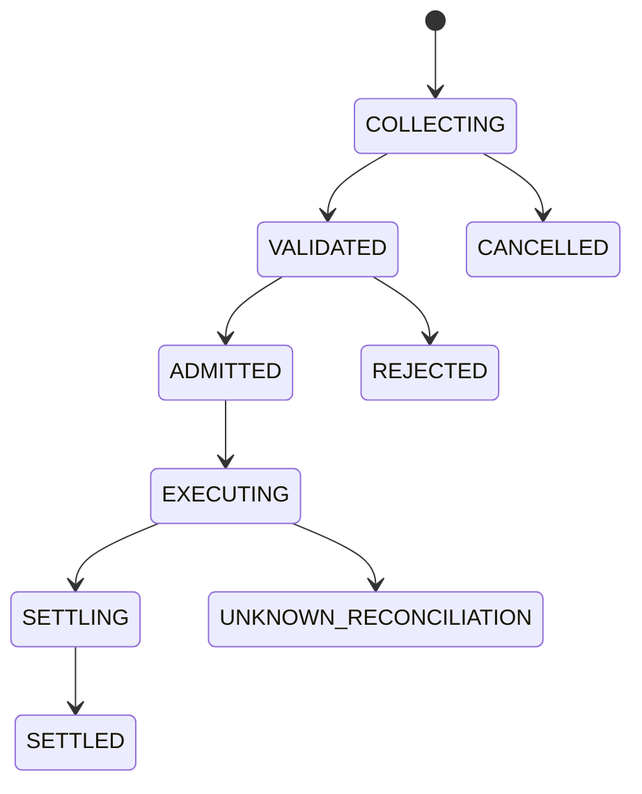

Direct inference authorization covers only the bounded model continuation for the authenticated user turn; it does not authorize any tool effect. The direct request journal is owned by Core SessionStore, not Rust OwnerLog, and exact retries reuse the existing state. A crash after durable `DISPATCHING` without the exact settled assistant response leaves `UNKNOWN` and is never automatically resent; a user continuation starts a new request ID. Managed requests instead require the live Attempt, HostKernel context receipt and managed provider-dispatch lifecycle. No per-round-trip prompt is added for the ordinary direct model/tool loop. No effectful member executes before the complete batch validates and is admitted. If a partly executed parallel batch fails, each admitted effect settles independently — no claimed atomic rollback of external operations. UNKNOWN can never be converted to success by model text. Hard current bounds (source-verified in §15.20): 32 calls, 256 KiB per-call arguments, 512 KiB total, 16,384 delta chunks, 10-minute max stream.

---

## 45.6 Universal effect path — every origin (owner: 03.3, 13.5, 14, 11.7)

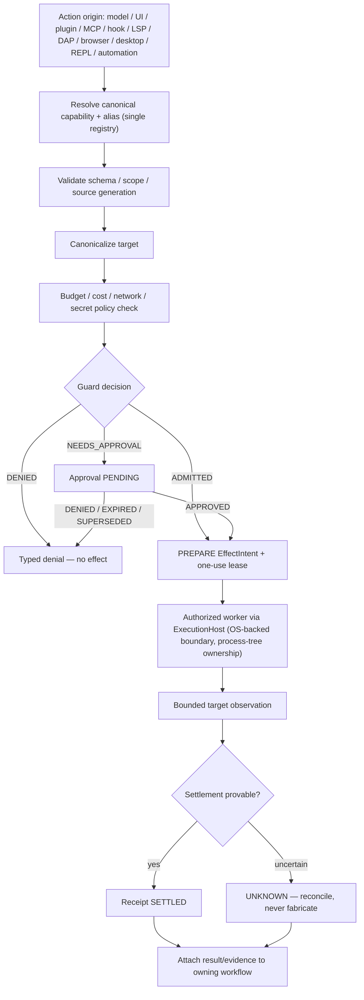

EffectIntent state machine (§11.7):

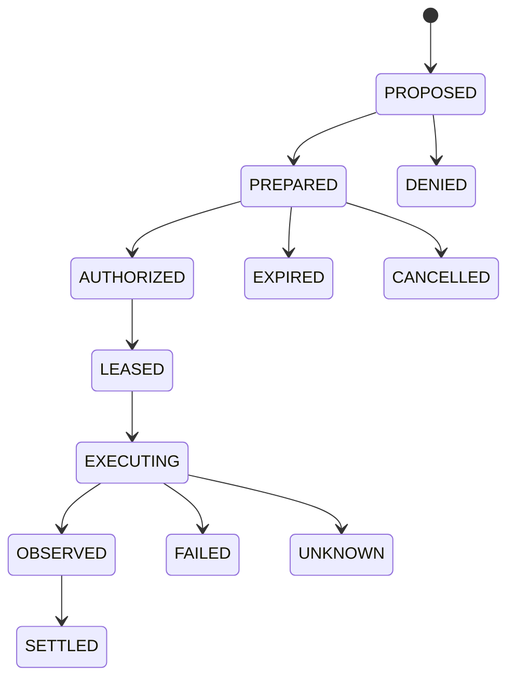

| Companion machine | States (§11.7) |
|---|---|
| Approval | PENDING → APPROVED \| DENIED \| EXPIRED \| SUPERSEDED |
| One-use lease | ISSUED → CLAIMED → CONSUMED, or EXPIRED / REVOKED |

Rules: PREPARED binds canonical target, args digest, workspace/source revision, policy epoch and budget; lease cannot be reused or widened; observation and settlement are distinct; exactly-once is claimed only when the real target provides compatible idempotency; no Bun/worker/plugin side-channel may perform the effect outside this path (§13.5).

---

## 45.7 Managed goal vertical (owner: 03.4, 11.2–11.4, 15.20 managed executor)

Goal + SpecVersion:

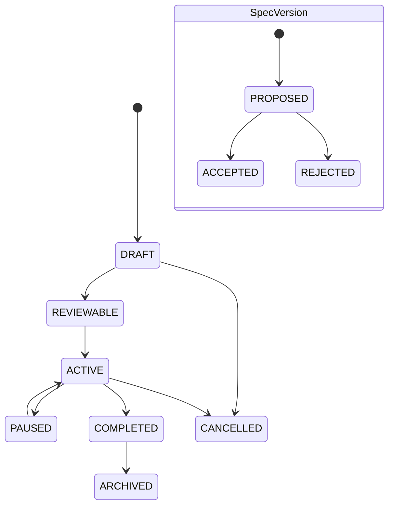

Run:

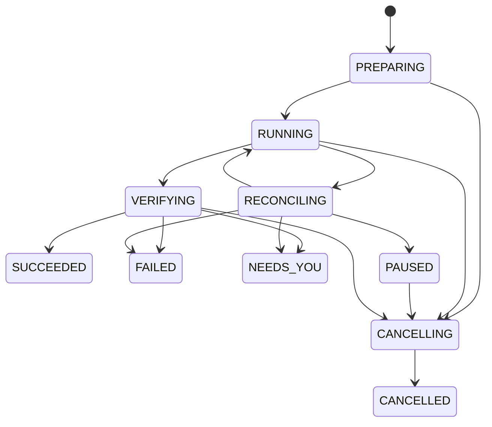

Task and Attempt:

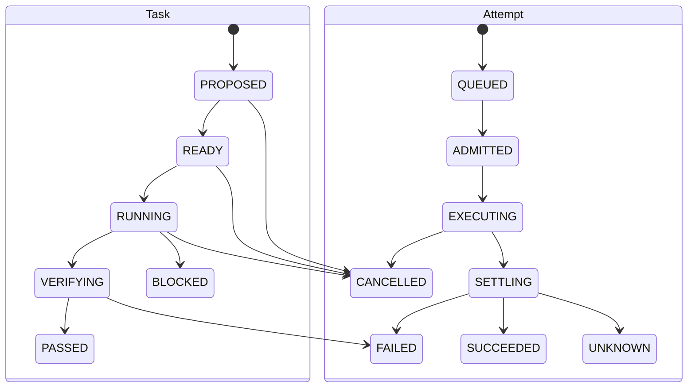

Journey (§3.4): draft objective/criteria/budget → reviewable Goal/SpecVersion with zero effects → user accepts SpecVersion → Rust initializes Run + dependency DAG → scheduler reserves resources/workspaces and dispatches bounded Attempts → all effects use the same Guard as direct mode → integration produces a known final revision → independent verifier checks criteria/evidence against that revision → Run terminal state. Causal ordering (§11.20): spec acceptance precedes Run admission; predecessor trusted PASS precedes dependent READY; Guard approval precedes lease claim; process exit does not imply effect settlement; all receipts and final-revision evidence precede Run SUCCEEDED.

Managed model requests have an additional request-scoped durable subflow. Core compiles the
exact prepared provider input and ContextSelection on the reserved child workspace before seq1
Attempt admission; the same immutable prepared object continues through claim/consume. For each
request, HostKernel stores `managed_context_advanced` when the model-visible source set changes,
then the existing OwnerLog binds the provider route request through
`managed_provider_request_prepared` → `managed_provider_request_dispatching` →
`managed_provider_request_settled` or `managed_provider_request_unknown`. `begin` is the only
one-use send authority and requires the guarded fixed-route transport; exact replay returns no
send authorization. A crash after DISPATCHING becomes UNKNOWN and cannot replay. See §37.22.
The current source has no Guarded managed-provider transport, so this lifecycle is normative
and managed network dispatch remains unavailable. After the final assistant entry is durably
reloaded, belongs to the current user message, has a final finish reason, and has no remaining
tool work, Core may request `managed_provider.complete_turn` using the exact latest settlement
retained by its live Attempt authority. HostKernel verifies the exact settled provider request,
assistant entry, response and usage digests, live owner epoch, and absence of pending provider or
effect work before persisting completion; an intermediate tool-call response cannot complete a
turn or authorize follow-up. This source path remains unverified and unavailable until the
Guarded transport and recovery acceptance pass.

---

## 45.8 Subagents and DAG workers (owner: 03.5, 29.5, 29.17–29.18, 21.11)

Direct-session delegation and managed DAG workers share profiles, bounded resource
admission and Guarded effects, but have different owners and completion meaning. A direct
child has its own Core Session and never needs a Goal; direct fan-out results are independent
candidate results and do not participate in managed dependency settlement or aggregate PASS.
A managed child is attached to an accepted SpecVersion Task/Attempt and only Rust plus the
independent verifier can settle it.
Both use one `SubagentDeliveryV1` envelope tagged `direct_session` or `managed_attempt`;
the lane authority is bound as specified in §§12.11/37.9, and its digest does not replace
authenticated owner lookup or live policy/Attempt validation.

**Direct-session child lifecycle (no Goal):**

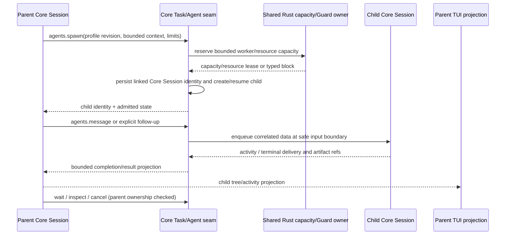

Timeout is an observation, not cancellation. A message does not implicitly start a turn;
follow-up has an explicit wake policy. Parent and child Core Sessions retain separate
transcripts. A direct child result may inform the parent but is not managed evidence or a
Goal/Task PASS.

**Managed Task/DAG lifecycle (accepted Goal):**

```mermaid
sequenceDiagram
    participant PR as Parent / integrator
    participant K as Rust scheduler (sole Task owner)
    participant W as Child worker (leased scope)
    participant V as Independent verifier
    PR->>K: TaskProposalV1 — temp IDs, deps, criteria, read/write scopes, profile
    K->>K: validate DAG (cycle, cross-Run, limits, revision); persist one authoritative graph revision
    K->>K: compute READY = eligible + independently PASSED parents + no blocking UNKNOWN
    K->>W: TaskDeliveryEnvelopeV1 — immutable criteria/scope/deps + minimum context
    W-->>K: CandidateTaskResultV1 — artifacts (sha256), touched files, receipts, missing criteria
    K->>V: verify criterion subset at exact source revision (verifier ≠ same effectful Attempt)
    V-->>K: trusted PASS / FAIL / NEEDS_YOU
    Note over K: downstream READY only after trusted PASSED; late child cannot overwrite newer revision
```

Current implementation admits one coding Task per Run. Under DEC-V1-31 this is the prerequisite managed vertical, not final V1 scope: bounded managed DAG dispatch and aggregate settlement are also required after that vertical passes acceptance. Keep multi-Task dispatch unavailable until per-Task exact-revision verification, conflict-safe workspace leases, replay/cancel/UNKNOWN recovery and aggregate Run settlement pass their acceptance. Direct Core child Sessions remain a separate lane and cannot satisfy managed Task evidence.

Invariants (§29.18, §21.11): exactly one authoritative Task revision at a time; every task has finite attempt/deadline/depth/token bounds; descendant capability grant = intersection(parent grant, policy, consent, support, task subset) — never derived from model text; parallel write scopes either disjoint or serialized by workspace leases; “unknown write set” counts as conflicting. Worker is not scheduler: agents may propose graph changes but never commit task transitions or acceptance.

Worker/lease machines (§11.5, §21.11): WorkerExecution `RESERVED → STARTING → READY → BUSY → IDLE → RELEASED`; delegated dispatch `PREPARED → STARTING → RUNNING → RETURNED | FAILED | CANCELLED | UNKNOWN`. `AcquireResourceLease` reserves capacity atomically with workspace lease and one Attempt identity; durable append wins before any process spawn; release only after observed process-tree exit, artifact flush and effect reconciliation.

---

## 45.9 Context pressure and compaction (owner: 03.6, 30.2–30.5)

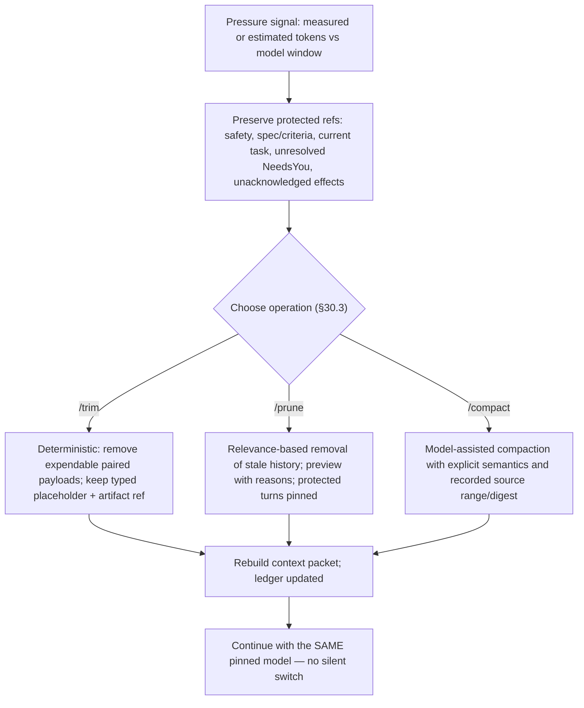

Target ContextLedger exposes the model-visible plan: entry kind, source ref/revision, trust class, exact/estimated/unknown tokens, inclusion reason, protection, cache class, digest. The context bar shows absolute tokens where known, percentage of window, exact vs estimated, and what the next cleanup would remove. Canonical history is never modified by pressure handling. Current direct ContextSelection pins a bounded recent-message reference set; managed ContextSelection pins an already-prepared request. Neither is the complete model-aware retrieval and pressure-recovery pipeline in §30.2/30.21. The pure ledger compiler is source-present; exact payload capture, lane integration, UI event/rendering and acceptance remain implementation work.

For a normalized provider request, Core compiles the exact request-bound ContextLedger and emits
`session.context_ledger` on the existing ephemeral Session stream before transport dispatch.
The event is bound to request ID/source generation, contains only the typed ledger plus digest,
and is rendered by the TUI context bar; it is not a second event store or authority source.
Managed capture requires the live HostKernel ContextSelection digest. Direct capture requires
the exact Core ContextSelection and workspace source revision for that same request; if either
lane cannot supply those pins, it emits no ledger and reports the view unavailable rather than
inventing revision, token, or provenance values. Reconnect may use the active request's bounded
in-memory projection, otherwise the next request supplies the next ledger.

---

## 45.10 Repository change and RepoIntel (owner: 03.7, 30.7–30.10, 30.22)

```mermaid
sequenceDiagram
    participant A as Agent
    participant R as RepoIntel + LSP
    participant G as Rust Guard
    participant F as File capability
    A->>R: target symbol/file query (generation-checked)
    R-->>A: symbol IDs + ranges, or SYMBOL_STALE — never a silently wrong location
    A->>A: inspect source; produce patch with source revision + stale guard
    A->>G: files.patch effect (canonical file tool)
    G-->>F: ADMITTED + one-use lease
    F-->>A: applied patch, new revision
    A->>R: re-diagnose (LSP), run related tests
    A->>A: inspect diff/evidence; managed mode verifies criteria
```

Target RepoIntel pipeline (§30.7): manifest discovery → language/framework/build/test detection → file inventory → structural symbols → persistent lexical/symbol index → on-demand LSP enrichment → optional embeddings only when explicitly enabled. Current source has lexical RepoIntel; parser-backed tree/detect and structural symbol routes remain unavailable pending their authenticated implementation and acceptance. Workspace/Git stays canonical; the index is derived and rebuildable.

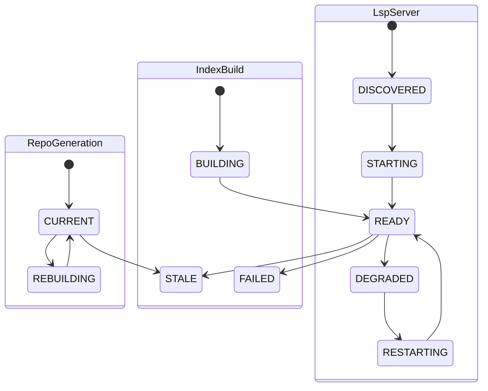

Built-in repo tools (§30.9): `repo.detect`, `repo.tree`, `symbols.search`, `symbols.outline`, `symbols.read`, `references.find`, `definitions.find`, `impact.analyze`, `text.search`, `diagnostics.get`, `tests.related` — bounded model-visible outputs, deterministic ranking per index generation, lexical/LSP fallback for unsupported languages.

---

## 45.11 LSP / DAP / REPL brokers (owner: 03.8–03.9, 37.6–37.8, 11.11–11.12)

| Broker | Flow | States |
|---|---|---|
| LanguageServiceBroker (`37.6`) | diagnostics/symbols query → Core Config resolves immutable trusted launch profile → HostKernel validates profile/revision and admits via Guard + the single ExecutionHost → bounded service result → versioned edit prepared → Guard mutation → apply through file capability → re-diagnose | per-server machine in §45.10; editor-owned servers are discovered, never taken over; raw launch fields are not authority |
| DebugAdapterBroker (`37.7`) | start/attach Guarded session → breakpoints/step/read variables (scoped reads) → optional guarded evaluate → terminate/reconcile | `CREATED → STARTING → STOPPED_AT_BREAKPOINT \| RUNNING → TERMINATING → TERMINATED` |
| ReplBroker (`37.8`) | start bounded Python/JS worker → execute chunks preserving worker state → bounded outputs/artifacts → any tool callback routes through canonical action + Guard → reset/stop or idle expiry | `CREATED → STARTING → READY → BUSY → READY → STOPPING → STOPPED` |

Hard rules: the debugger cannot bypass ExecutionHost; evaluate is an effect (or disabled by policy) and never grants ambient host shell authority; REPL callbacks are effects; all three report availability truthfully per OS/language support (`DEC-V1-21`, `DEC-V1-22` gates). Core Config is the trusted launch-profile owner for V1 LSP/DAP; HostKernel validates the immutable projection and uses the same single supervisor. No second registry or caller-provided executable/path/argv/env/PID authority is introduced. The strict profile schema, fixtures, Guard admission and confinement must be complete before launch is enabled.

---

## 45.12 Web-search cascade — V1 (owner: 03.12, 37.5, 33.9; `DEC-V1-26`)

```mermaid
sequenceDiagram
    participant M as Model / User
    participant B as WebSearchBroker
    participant S as Settings route list
    participant G as Guard / ExecutionHost
    participant P as Provider route
    M->>B: web.search(query)
    B->>B: validate query / privacy / domain policy
    B->>S: resolve enabled ordered cascade (built-in default + enabled BYO-key routes)
    B->>G: authorize aggregate route plan, query digest and budget
    G-->>B: DENIED / NEEDS_APPROVAL / admitted fixed-route authority
    loop enabled routes in order
        B->>G: dispatch exact next enabled route with one-use attempt
        G->>P: bounded request through the fixed SecretBroker sender
        alt success
            P-->>G: results + provider/route/auth/cost/freshness observation
            G-->>B: observation + durable receipt
        else auth 4xx (401/403/407)
            P-->>G: route-local failure + status; no same-route retry
            G-->>B: failure observation + durable receipt
            Note over B,G: Continue only to the next explicitly enabled route under its own authority
        else timeout / rate-limit / 5xx
            P-->>G: typed failure reason
            G-->>B: failure observation + receipt or UNKNOWN
        else complete 2xx with recognized zero-row result array
            P-->>G: terminal EMPTY route outcome + count 0
            G-->>B: EMPTY observation + durable receipt
            Note over B,G: Advance to the next enabled route; never retry this route
        else other 4xx
            P-->>G: typed terminal request/configuration failure
            G-->>B: failure observation + durable receipt
        end
    end
    alt a route succeeded
        B-->>M: bounded results, provenance explicit
    else chain exhausted
        B-->>M: per-route reasons surfaced; no second cascade pass or fabricated result
    end
```

State machine: `VALIDATED → ROUTED → RUNNING → COMPLETE | FAILED | CANCELLED` (§11, web-search lane).
Current source readiness is false for anonymous and BYO route execution. The designed cascade
and route UI do not mean the model-visible search tool can dispatch today; expose it only after
the authenticated Guard/transport/recovery acceptance in §32.28.

Binding rules (`37.5`, `DEC-V1-20/26`): trusted code supplies the route plan; the query contains user intent only and cannot name an endpoint, credential, route or cost class. After first-use query-sharing consent, the anonymous/no-key built-in cascade is the default in §37.5 order: Exa, You.com free profile, Firecrawl Keyless, Parallel. BYO/authenticated routes join only after explicit per-route enablement/configuration; that enablement records consent for its auth/cost class. Auth 401/403/407 is recorded and falls through only to another explicitly enabled route; 429 applies bounded route cooldown; other 4xx stops. A complete HTTP 2xx with a recognized zero-row provider result array is recorded as terminal `EMPTY`, advances to the next enabled route, and is not retried on that route. Model-grounded search is not a preferred/default path and requires a supported adapter plus explicit route selection and consent. `web.search.inspect_provider` reports auth/cost/rate-limit/last-error/freshness per route; results are untrusted data (injection handling per §5.8) and never authorize an effect; large fetched content becomes an artifact, not prompt context. Provider matrix owner: `DEC-V1-20`.

---

## 45.13 Terminal/PTY and process ownership (owner: 33.7, 37.13, 13.6)

One host-scoped Rust kernel is the sole process/effect owner, multiplexed across Locations and Sessions. Core `Pty.Service` is only the adapter (`/pty`, `/api/pty`, WebSocket, replay); tickets/origins authenticate transport and never authorize Guard effects; Core never directly spawns/writes/resizes/kills. Principal proof: validated `ServerAuth` or loopback listener+peer with host-derived OS UID/SID; missing proof denies. Origins must match the exact allowlist (`oc://renderer`, tauri origins, configured listener origins). Locations register through `effects.v2/register_location` from a trusted `Location.Ref` only — Rust canonicalizes and returns `loc_<blake3>`; TypeScript never duplicates path canonicalization. Model bash/effect batches use `effects.v2.prepare_tool_batch`; ALLOW returns the prepared effect ID + capability-lease digest, ASK returns the Guard challenge — only explicit matching `allow_once` continues.

Terminal lifecycle effects flow through the same §45.6 path: `terminal.start/input/resize/cancel` are effects; output is bounded observation; unlimited/unknown write sets reserve conservative exclusive scope.

---

## 45.14 Skills, hooks, MCP, plugins (owner: 29.6–29.8, 5.9)

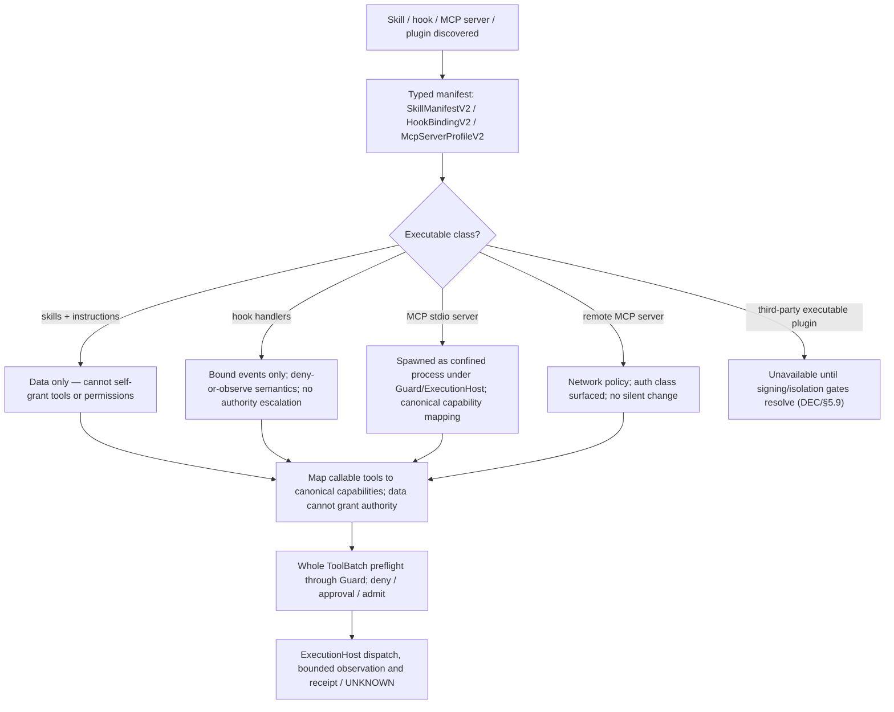

MCP tools map to canonical capabilities and Guard policy — never a parallel tool universe. Sealed built-ins cannot be shadowed. Hooks cannot veto Guard, leak secrets or grant capabilities; a hook failure cannot convert a denied effect into allowed (`DEC-V1-15`).

---

## 45.15 Automations (owner: 03.14, 11.15, 37.10, 31.12)

Definition CRUD is a persisted effect, not a direct registry write. The Core/UI prepares the
exact `automations.create|update|enable|disable` capability and CAS/idempotency arguments
through §14.3 `effects.v2/prepare_user_effect`; any ASK decision uses the §14.2 authenticated
Guard approval event/reply. HostKernel binds the approved intent to one one-use lease before
Rust `AutomationRegistryV1` commits its single OwnerLog CAS and returns the durable mutation
receipt. The Core projection is updated only from that receipt/state; stale definition version
requires a fresh read and new authorization. Lost replies use exact idempotency/receipt
reconciliation and never reapply a mutation. Missing approval, lease, receipt or trusted scope
keeps CRUD unavailable. This flow adds no automation-specific effect authority. `runNow` and
scheduled invocation remain closed until the target action is dispatched through its own
ordinary Guarded authorization and supervised receipt/recovery path.

The automation workspace-owner ASK is a sessionless authenticated `user_action`: its consent
event is scoped to the HostKernel Location and exact automation capability/challenge/effect. The
TUI can offer `allow_once` only for `origin=user_action`, `source=authenticated.user_action`, one
of the four CRUD capabilities above, a valid HostKernel Location ID, and the complete assessed
consent projection. It must not fabricate Session or Run identity. Other approval origins retain
the existing Session/Run binding.

The mutation receipt contains a `guardedProof` with `challengeDigest`, `effectIntentDigest`,
`leaseDigest`, and `executionReceiptDigest`. Rust computes the last digest over the canonical
receipt core (key, approved input digest, automation ID, resulting definition version, operation)
before attaching the proof, then commits the core and all four proof values in one OwnerLog write.
Core receives the exact HostKernel-approved `inputDigest` from its private supervisor adapter and
uses that digest for both mutation and reconciliation; it does not reserialize the request to
recompute it. Reconciliation repeats the exact location/action/challenge/effect/lease/input/key
pins plus `automationID` and canonical `hostOperation` (`automations.create|update|enable|disable`),
and is read-only. A missing registry row means `NOT_FOUND` only if durable EffectHost state
also proves that the authorized operation was never dispatched; PREPARED, UNKNOWN, or disagreement
returns `UNKNOWN` and cannot trigger redispatch.

Each definition pins exactly one immutable fixed action-input JSON object and the schema digest
resolved through the canonical HostKernel machine registry for its exact action/version. The
TUI obtains that projection and validates the authored object before save; Rust/HostKernel
revalidates it before the Guarded definition CAS and before dispatch. EffectIntent binds the
canonical schema and payload digests. Model-generated per-occurrence arguments and raw secrets
are prohibited; secret fields may contain only schema-approved opaque references. Updating any
action/schema/payload creates a new definition version and requires a fresh owner approval. A
legacy definition with no schema or payload pin remains readable but cannot dispatch. If the
canonical schema cannot be resolved, save and dispatch fail closed. The current Rust registry
does not include a cron/timezone producer; it accepts only externally resolved ordered
`DueOccurrenceV1`, so schedule execution remains unavailable until that canonical producer and
the Guarded invocation path are accepted.

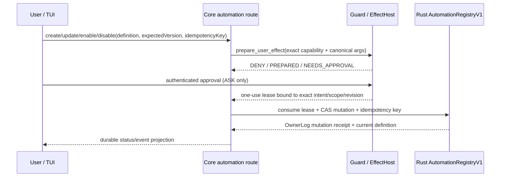

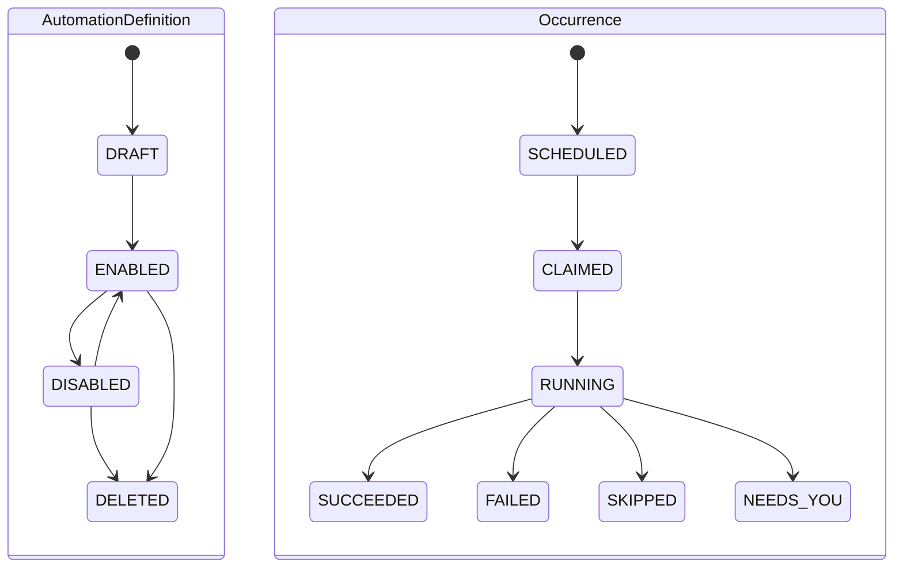

Durable Rust-owned definition/occurrence state; deterministic overlap/missed-run/retry/timezone policy; each occurrence invokes the target canonical action through ordinary authorization (§3.14) — the scheduler has no special effect path. UI shows action/version/scope, schedule, enabled state, next/last occurrence, executor availability and result/NeedsYou. Scheduler availability is displayed accurately when no executor is running.

---

## 45.16 Streaming UI, artifacts, analytics (owner: 31, 37.11–37.12, 12.10)

```mermaid
sequenceDiagram
    participant SR as Source streams
    participant MUX as UiEventMuxV2
    participant T as TUI/CLI
    participant R as ArtifactRenderServiceV2
    SR->>MUX: live owner/receipt notifications (not settlement; source owner remains canonical)
    SR->>MUX: ephemeral paint/progress (coalescible)
    MUX->>T: bounded per-surface queues, source sequence/revision
    T->>R: render request (immutable source ref, kind, theme/geometry generation)
    R->>R: bounded crash-isolated parser: Markdown/code/diff, Mermaid, safe SVG, numeric chart, image/PDF metadata
    R-->>T: render OR typed failure (stale async result discarded by generation)
    Note over T,R: source/text fallback always shown; durable export is a separate Guarded action
    T-->>SR: reconnect/resnapshot Session messages; re-read durable state from its owner
```

V1 instance SSE is live-only: it emits no SSE `id` and has no global `Last-Event-ID`
replay cursor. The UI event envelope's opaque `cursor` orders/deduplicates observed events
only; it does not authorize replay or reconstruct missed state. Event payload IDs identify notifications; Session part deltas carry their
own source `sequence` and `sourceGeneration` for duplicate/gap fencing. On reconnect or
bounded-queue overflow, the TUI reloads canonical Session messages and re-reads durable
managed projections from their owner APIs; it does not reconstruct state from missed SSE
notifications. This path adds no parallel event store. A durable owner transition remains
authoritative even when its notification is absent.

While paginated Session messages load, the TUI tracks live Session source changes. It
retries the canonical read once if events arrive during pagination and commits only a
stable page set. If events continue through that retry, it keeps the live projection and
cursor; a later gap or reconnect can request another bounded resnapshot.

Artifact model (§31.5): distinguish original/canonical source, durable artifact bytes/metadata, derived render, and ephemeral terminal image placement. Durable records: content digest, MIME/kind, owner/scope/source revision, byte count, wire fidelity `full`/`head_tail_sample`/`failed`, retention/security metadata. UI labels render these as `FULL`/`SAMPLE`/`FAILED` without changing wire values; a sampled artifact is never labeled `FULL`. Artifact states: `STAGED → PERSISTED_FULL | PERSISTED_SAMPLE | FAILED`; renders `OPEN → RENDERING → READY`. A managed Attempt cannot resolve/read/cite a direct artifact or its content; equivalent bytes require an independent producer in that Attempt to create a new managed artifact.

Streaming lanes (§31.1): owning Session message stream; durable Rust control/effect events; ephemeral UI events; analytics observations — the mux may coalesce the ephemeral lane only. Performance budgets (§31.3) are measured on declared hardware; never marketed as guarantees before benchmarking.

Mission Control is a derived view (Runs/Tasks/Attempts, worker graph, leases, approvals/NeedsYou, budget, evidence, automations); its actions dispatch canonical capabilities and it can never edit owner stores directly. Analytics records measured/estimated/unknown provenance and can never authorize behavior.

**Activity digest (§31.22, layout §16.21):** Session tool parts project to `ActivityCardV1` rows in the digest pane (not the transcript). File writes/patches render as `file_edit` cards with `▎+`/`▎−` gutter previews, `+N −M` stats, and **Ctrl+R** review overlay over `SourceArtifact` or patch metadata. Reads coalesce to `read_group` within a turn; shell cards update in place while running. Cards honor §31.16 tail budgets and §31.22.3 node/byte caps with `limit_marker` rows. Acceptance: **§32.48** `ACT-001`..`ACT-024`.

---

## 45.17 Recovery, reconciliation, cancellation (owner: 03.15, 04.7–04.8, 11.1, 11.20)

```mermaid
flowchart TD
    A["Crash / restart detected"] --> B["Open + validate each canonical store"]
    B --> C["Acquire owner epoch — stale epochs fenced"]
    C --> D["Rebuild derived projections"]
    D --> E["Restore Session observer from last completed ACK (partial pages never advanced)"]
    E --> F["Identify PREPARED / EXECUTING unsettled effects"]
    F --> G["Inspect target / idempotency where possible"]
    G --> H{"Outcome provable?"}
    H -->|yes| I["Settle receipt idempotently"]
    H -->|no| J["UNKNOWN / NEEDS_YOU — irreducible uncertainty surfaced"]
    I --> K["Restore valid resource leases or quarantine uncertain ones"]
    J --> K
    K --> L["Resume only safe scheduled/managed work"]
```

Cancellation law (§4.8): persist a fence against new admissions first. Already-started effects: cancellable → request then observe; not cancellable → wait/reconcile; never erase evidence because a parent was cancelled. No silent cross-session kill; per-task reporting distinguishes cancelled / still running / unknown / settled. New user steer affects only a *future* provider step; once a batch/effect is prepared its digest, args and lease are frozen.

Required recovery tests (§4.11): torn/partial durable append; schema/version rejection; stale owner epoch; duplicate idempotency; Session cursor retention gap; crash after PREPARE before target effect; target executed but receipt lost; worker/host/kernel restart; UI reconnect; derived index rebuild; cancellation race. Any event family that would recreate a Rust canonical conversational thread is invalid.

Crash transition procedure (§11.20): persist owner epoch + cancellation/lease fence → stop new dispatch → inspect actual OS process identity and target evidence → classify completed/failed/UNKNOWN → update OwnerLog once with idempotent delivery → reconcile/block uncertain effects → release or quarantine owned resources → resume queue only after peer scope revalidation.

---

## 45.18 Checkpoint / rewind (owner: 14.19, 31.18, 16.18; `DEC-V1-25`)

```mermaid
flowchart TD
    A["Rewind requested"] --> B["Preview: snapshot bounds, diffs, affected paths (digest-bound)"]
    B --> C{"Destructive reset required?"}
    C -->|yes| D["Refuse with exact reason — a guarded explicit destructive path is a separate decision"]
    C -->|no| E["Guarded workspace restore effect (preview-first)"]
    E --> F["ExecutionHost applies restore"]
    F --> G{"Full success?"}
    G -->|yes| H["Restored — evidence recorded; prior verification invalidated by revision change"]
    G -->|partial| I["UNKNOWN — partial-restore surfaced honestly, never silent"]
```

Checkpoints are a bounded app-owned artifact family: per-Session count/byte caps with a declared eviction owner, oldest-first eviction under §18 pressure before touching user work or evidence, truthful FULL/SAMPLE/FAILED checkpoint presentation status (SourceArtifact fidelity remains the wire enum `full`/`head_tail_sample`/`failed`), and no destructive git action ever implied by deleting a checkpoint. Rewind is not claimed available until §14.19/§16.18/§31.18 are wired and CP-001/CP-002 pass on the exact revision (`DEC-V1-25`).

---

## 45.19 Resource-aware concurrency (A-V2-30) (owner: 11.20, 18.17–18.18, 21.10–21.11, 29.18, 03.20)

```mermaid
stateDiagram-v2
    [*] --> PROPOSED
    PROPOSED --> RESERVED
    RESERVED --> CLAIMED
    CLAIMED --> RELEASE_PENDING
    RELEASE_PENDING --> RELEASED
    RESERVED --> EXPIRED
    CLAIMED --> QUARANTINED
    RELEASE_PENDING --> QUARANTINED
    QUARANTINED --> RELEASE_PENDING
    state ResourcePressure {
        [*] --> NORMAL
        NORMAL --> SOFT_PRESSURE
        SOFT_PRESSURE --> HARD_PRESSURE
        HARD_PRESSURE --> RECOVERING
        RECOVERING --> NORMAL
    }
```

`PROPOSED` reserves nothing; `RESERVED` deducts capacity once before launch; `CLAIMED` = authenticated worker startup lease claimed (not effect success); `RELEASE_PENDING`/`QUARANTINED` keep conservative outstanding reserve; `EXPIRED` is terminal only with proven absence of dispatch; `RELEASED` requires confirmed owned process-tree termination + settled effects + retained evidence + idempotent log transition. `UNKNOWN` is an effect/measurement outcome, never a reservation state. Pressure may go `NORMAL → HARD_PRESSURE` directly on an OS quota alarm; recovery uses hysteresis; pressure never changes model/provider and never deletes user data/receipts or kills unowned processes.

The eight-step A-V2-30 journey (§3.20): attach pinned Session → bounded context with provenance-labeled recall → accepted spec + DAG + capacity reservation before launch → typed ToolIntent batches through Guard/PREPARE/lease/ExecutionHost → bounded tool-tail + attributed PSS/CPU/cost → fence + UNKNOWN + reconcile on any fault → typed artifacts/evidence + independent PASS + reverify integrated revision → provenance-preserving import snapshot/handoff only.

Concurrency race tests (§11.20): cancel vs lease claim; attachment logout vs ACK; duplicate resource request with different args; expiration vs process still running; source edit vs verification; cache eviction vs pinned reader; Provider Doctor consent revocation vs upstream billing; worker unknown vs new Attempt; two clients attaching one Session; kernel incarnation change while old worker returns. Expected outcome for uncertain external mutation is always UNKNOWN — never silent retry or success.

---

## 45.20 Provider Doctor and session import (owner: 37.16–37.19, 11.20)

| Aggregate | Accepted transitions (§11.20) |
|---|---|
| ProviderDoctorRun | `VALIDATED → OFFLINE_RESULT`; `VALIDATED → AUTHORIZED_NETWORK → CATALOG_RESULT`; `VALIDATED → AWAITING_SPEND_APPROVAL → AUTHORIZED_FULL → PROBING → COMPLETE/FAILED/UNKNOWN` |
| VirtualSessionAttachment | `ATTACHING → AUTHENTICATED → ACTIVE → DRAINING → DETACHED`; `ACTIVE → LOST`; `LOST → new AUTHENTICATED generation` after peer proof |
| FileTouchRecord (derived) | `OBSERVED → LIVE → STALE/EXPIRED → REMOVED` — advisory only; never a write permit |
| CacheEntry | `BUILDING → CURRENT → PINNED or EVICTABLE → EVICTED`; `CURRENT → STALE` |
| ToolTailView (derived UI) | `EMPTY → STREAMING → COMMITTED/DROPPED or UNKNOWN` — never a second MessagePart |

Provider Doctor decision table (§15.20): offline missing account/model → FAIL configuration without network; catalog network/auth unavailable → UNKNOWN/typed route error, no fallback; missing full-tier consent → NEEDS_APPROVAL before any model call; partial stream/no terminal → FAILED/UNKNOWN cost status; 429 → bounded same-route retry only if policy permits; unsupported structured tools → UNAVAILABLE; local model out of VRAM → resource blocked, no remote fallback. Full tier is spend-bearing and consent-gated; all identifiers redacted/opaque; spend recorded only from authoritative provider usage. Optional session import creates a provenance-preserving snapshot or handoff under one chosen backend owner — never a silent merge of two live canonical transcripts.

---

## 45.21 Post-V1 surface map — unavailable in V1

| Surface | Design owner | Status |
|---|---|---|
| Browser automation / attached-browser | 03.10, 37.3, 33.9 | `[post-V1]` unavailable; observe → pin generation → Guard mutation → execute → re-observe |
| Desktop / computer control | 03.11, 37.4, `DEC-V1-19` | `[post-V1]` unavailable; capture → pin geometry → Guard input/focus/clipboard → execute → recapture |
| Visual source edit | 03.17, 37.21, 33.30 | `[post-V1]` unavailable; pixel selection is never guaranteed source mapping |
| Deploy & verify | 03.18, 33.30 | `[post-V1]` unavailable; build/upload alone is never deployment completion |
| External ACP client | 37.20, 29.19, `DEC-V1-24` | `[post-V1]` unavailable; upstream ACP server support is not our client |
| Web app / desktop app / SDK clients | 16.1, 31.13, 37.19 | `[post-V1]` under A-V2-31; one state projection, separate consumers |
| HorizonCode-as-MCP-server | `DEC-V1-23` | `[post-V1]` unavailable; MCP remains client-side with confined spawned servers |

Every post-V1 row must keep its routes unavailable until an explicit scope decision plus the relevant §14 Guard, privacy, auth, cost and platform acceptance gates pass. Documented contracts are not features.

---

## 45.22 Event catalog quick reference (owner: 04.3–04.5)

**Design inventory — not every event is implemented; the active Rust decoder accepts only its committed subset** (`ManagedCommand::event/decode` in `kernel/src/managed_control.rs`).

| Family | Events (verbatim from §4.3) |
|---|---|
| Goal/spec | `goal_created`, `spec_proposed`, `spec_accepted`, `goal_paused/resumed/completed/cancelled` |
| Run/task/attempt | `run_started/paused/resumed/cancelling/cancelled/verifying/succeeded/failed/needs_you`; `task_proposed/ready/running/verifying/passed/failed/blocked/cancelled`; `attempt_admitted/executing/settling/succeeded/failed/unknown/cancelled` |
| Managed provider request | `managed_context_advanced`; `managed_provider_request_prepared/dispatching/settled/unknown`; `managed_provider_turn_completed` — each actual provider dispatch has a unique monotonic Attempt request sequence/providerRequestID; settlement binds the exact persisted Assistant snapshot and indexed step-finish before subsequent effects/requests; turn completion binds the final response plus ordered settled dispatches; dispatching is never replayed |
| Tool/effect | `tool_batch_validated/admitted/rejected/executing/settling/settled/unknown`; `effect_prepared/authorized/leased/observed/settled/failed/unknown`; `approval_requested/approved/denied/expired`; `lease_claimed/consumed/expired/revoked` |
| Evidence | `evidence_collected/accepted/rejected/stale`; `verification_started/passed/failed/needs_you` |
| Resource | `resource_acquired/released/quarantined`; `checkpoint_created/restore_requested/restored/rejected` |
| Automation | `automation_created/updated/enabled/disabled`; `occurrence_scheduled/claimed/completed/failed/skipped` |
| Session observation (§4.4) | bounded source Session ID/store/epoch, cursor, last completed ACK/page, foreign event type/version/ID/digest, redacted projection fields — never canonical conversation content |
| Ephemeral (§4.5) | token/text/thinking deltas, tool progress, UI typing/hover/selection, render frames, model loading, transient browser/desktop observations, diagnostics progress, analytics samples |

Envelope rule: durable events carry event ID/type/version, aggregate type/ID/revision, owner epoch, idempotency/correlation, payload + source digests, observation time as logical projections over the implemented `PhysicalRecordV2`. `contracts-v2/managed-event.schema.json` remains a design-only prototype and cannot be used for runtime codegen until an exact OwnerLog adapter/migration + cross-language fixtures are accepted.

---

## 45.23 Acceptance/test map (owner: 32)

| Module | §32 family |
|---|---|
| Repository navigation / focused change | 32.4, 32.5 |
| Architecture & scope control | 32.6 |
| Build/test/debug; git safety | 32.7, 32.8 |
| Managed goals | 32.9 |
| Context; local/small models | 32.10, 32.11, 32.22 |
| Agents/subagents; skills/hooks/MCP | 32.12, 32.13 |
| Permissions & sandbox; beyond-coding execution | 32.14, 32.20 |
| UI/streaming/artifacts; analytics/cost truth | 32.16, 32.17 |
| Automation; recovery/healing | 32.18, 32.19 |
| Performance suites; release minimum | 32.21, 32.24 |
| Contract/architecture consistency | 32.25, 32.26, 32.34 |
| Desktop/search/DAP/REPL canonical acceptance | 32.28 |
| Settings/Experimental class | 32.31 |
| JCode resource regression; source fixtures; reservation reconciliation | 32.32, 32.33, 32.37 |
| Post-V1 future cases (browser/desktop/visual/deploy/ACP) | 32.15, 32.29, 32.35 |

Real-case rule: a module is `VERIFIED` only after its acceptance family passes on the exact revision — with negatives (denial, cancellation, restart, UNKNOWN) and, where user-visible, a rendered-surface check. Diagrams in this atlas are never evidence.

---

## 45.24 Coverage matrix — every architecture document accounted for

| Document | Status | Role | Represented in |
|---|---|---|---|
| 01-SYSTEM.md | Normative owner | Process/topology, aggregate ownership | §45.2 |
| 02-DOMAIN.md | Normative owner | Domain identity + managed records | §45.2, §45.3, §45.7 |
| 03-FLOWS.md | Normative owner | End-to-end flows | §45.4–§45.21 (every section) |
| 04-STATE-EVENTS.md | Normative owner | Durable/ephemeral events, recovery | §45.3, §45.17, §45.22 |
| 05-SECURITY.md | Normative owner | Threat model, security policy | §45.6, §45.12, §45.14, §45.16 |
| 06-CAPABILITIES.md | Compatibility stub (archived) | — | Not an implementation input |
| 07-UX-COMMANDS.md | Compatibility stub (archived) | — | Not an implementation input |
| 08-RECONCILIATION.md | Compatibility stub (archived) | — | Not an implementation input |
| 09-SOURCE-MAP.md | Compatibility stub (archived) | — | Not an implementation input |
| 10-DELIVERY.md | Normative owner | Delivery dependency order P0–P9; §10.18 V1 adaptation priorities | §45.1, §45.29 |
| 11-LIFECYCLE.md | Normative owner | State machines + terminal criteria | §45.5–§45.8, §45.15, §45.18–§45.20 |
| 12-DOMAIN-SCHEMAS.md | Normative owner | Schema registry + ownership | §45.3, §45.7–§45.8, §45.19 |
| 13-COMPOSITION-IPC.md | Normative owner | Process composition + IPC | §45.2, §45.4, §45.6 |
| 14-EFFECTS-EXECUTION-SECURITY.md | Normative owner | Guard, EffectService, ExecutionHost, sandbox | §45.6, §45.12, §45.18, §45.21 |
| 15-RUNTIME-EXECUTION.md | Normative owner | Direct/managed runtime, providers, recovery | §45.5, §45.7, §45.12, §45.17, §45.20 |
| 16-UX-SETTINGS-ECOSYSTEM.md | Normative owner | UI, ActionDescriptor, settings, provider UX; §16.21 layout | §45.12, §45.16, §45.18, §45.20 |
| 17-GOVERNANCE-DECISIONS.md | Normative decisions | Frozen decisions + open gates | Referenced throughout (DEC-V1-*), §45.21 |
| 18-OPERATIONS-RELEASE.md | Normative owner | Storage, telemetry, packaging, release | §45.19, §45.17, §45.24 audit statement |
| 19-OPENCODE-UPSTREAM-REUSE.md | Compatibility stub (archived) | — | Not an implementation input |
| 20-OPENCODE-INTEGRATION-LLD.md | Normative LLD | OpenCode/local source integration seams | §45.2, §45.5, §45.13, §45.17 |
| 21-HEALING-PERMISSIONS-WORKTREE-POOL.md | Normative owner | Healing, permissions, worktree pool | §45.8, §45.19 |
| 22-UNIVERSAL-UI-COMMANDS-MEMORY.md | Compatibility stub (archived) | — | Not an implementation input |
| 23-ADOPTION-GATES-TESTS.md | Compatibility stub (archived) | — | Not an implementation input |
| 24-LOCAL-CODE-AUDIT-AND-MIGRATION.md | Compatibility stub (archived) | — | Not an implementation input |
| 25-DATA-AND-CONTROL-PLANE-CROSSWALK.md | Compatibility stub (archived) | — | Not an implementation input |
| 26-UX-ACCEPTANCE-AND-RELEASE.md | Compatibility stub (archived) | — | Not an implementation input |
| 27-IMPLEMENTATION-READINESS-AUDIT.md | Compatibility stub (archived) | — | Not an implementation input |
| 28-COMPETITIVE-GAP-AUDIT.md | Compatibility stub (archived) | — | Not an implementation input |
| 29-AGENTS-SKILLS-HOOKS-MCP.md | Normative owner | Agents, subagents, skills, hooks, MCP | §45.8, §45.14, §45.19 |
| 30-CONTEXT-INDEXING-LOCAL-MODELS.md | Normative owner | Context, indexing, LSP; §30.25 retrieval; §30.26 Models.dev bridge | §45.9, §45.10, §45.11, §45.19, §45.29, §45.30 |
| 31-UI-PERFORMANCE-ARTIFACTS-ANALYTICS.md | Normative owner | Streaming UI, artifacts, analytics, automations; §31.22 activity cards | §45.15, §45.16, §45.18, §45.19 |
| 32-TASK-BASED-AGENT-TEST-CATALOG.md | Normative owner | Acceptance catalog; §32.47 V1-ADAPT; §32.48 activity cards | §45.23, §45.29 |
| 33-BUILTIN-CAPABILITIES-CATALOG.md | Normative owner | Canonical capability IDs | §45.1, §45.12, §45.13, §45.21 |
| 34-DOCUMENT-LINE-AUDIT-LEDGER.md | Compatibility stub (archived) | — | Not an implementation input |
| 35-USER-REQUEST-COVERAGE-MATRIX.md | Compatibility stub (archived) | — | Not an implementation input |
| 36-CONTRACT-CONVERGENCE-PLAN.md | Compatibility stub (archived) | — | Not an implementation input |
| 37-RUNTIME-SERVICE-LLD.md | Normative LLD | Services incl. §37.14 cache observation, §37.30 compile bridge | §45.11–§45.16, §45.20, §45.21, §45.30 |
| 38-OMP-SOURCE-COMPETITIVE-AUDIT.md | Compatibility stub (archived) | — | Research only; distilled into 16/31/33/37/32 |
| 39-OMP-TUI-SLASH-MODEL-SETTINGS-AUDIT.md | Compatibility stub (archived) | — | Research only; distilled into 16/31/33/37/32 |
| 40-HORIZONCODE-OMP-INSPIRED-UI-PROPOSAL.md | Compatibility stub (archived) | — | Research only; distilled into 16/31/33/37/32 |
| 41-OMP-STREAMING-VISUAL-ARTIFACTS-AUDIT.md | Compatibility stub (archived) | — | Research only; distilled into 16/31/33/37/32 |
| 42-EXTERNAL-SOURCE-PROVENANCE-REGISTER.md | Normative register | Source pins; §42.21 competitive V1 disposition | §45.12, §45.21, §45.29 |
| 43-IMPLEMENTATION-SOURCE-LLD-PLAYBOOK.md | Compatibility stub (archived) | — | Not an implementation input |
| 44-FINAL-REPO-AUDIT-LEDGER.md | Compatibility stub (archived) | — | Not an implementation input |
| GLOSSARY.md | Normative terms | Terminology | Terminology of every section |
| README.md | Normative index | Authority order + owner index | §45.24 (this matrix) |
| 45-V1-EVENT-FLOWS-ATLAS.md | Derived (non-normative) | This atlas — diagram synthesis | — |
| contracts-v2/ | Design registry | Boundary schemas (not proof) | §45.3, §45.22 |
| Repo-level: plan `docs/superpowers/plans/2026-10-11-horizoncode-converged-implementation.md` | Operative plan | Gates, V1 finish list | Phase references throughout |
| Repo-level: `implementationtov1release.md`, `HANDOFF.md`, `CURRENT_RUN.md` | Trackers (non-authoritative) | Status/evidence ledger, handoff, diary | Referenced for observed status only |

---

## 45.25 Audit statement and regeneration rule

- Structure: this file is an `arch_V1` document subject to the repo Markdown structural audit (`scripts/architecture/audit_markdown_repo.py`) and the architecture convergence validator (`scripts/architecture/validate_convergence.py`). Re-run both after any normative owner change; do not cite a past pass as current evidence.
- Authority: derived synthesis only. Additions to this atlas must never introduce new events, states, ownership or policy. If a diagram and an owner disagree, stop and fix the atlas (or raise a §17 decision if the owner itself is wrong — never patch around it here).
- Regeneration triggers: any change to 01–05, 10–18, 20–21, 29–33, 37, 42; any new `DEC-V1-*`; any change to event families (§4.3) or lifecycle states (§11). Re-run both audits; keep the coverage matrix rows in sync.
- Status honesty: a rendered Mermaid diagram is not `WIRED`, `TESTED` or `VERIFIED`. The statuses in `HANDOFF.md`/trackers remain the only progress truth.


## 45.26 External harness pattern reconciliation (2026-10-22)

This atlas's existing sequence diagrams remain the event and owner authority. Pi Durable's
intent/checkpoint/replay-safe task pattern maps to the existing durable effect intent, receipt,
UNKNOWN reconciliation and canonical resnapshot flows; Codex's separate operation request
and child lifecycle activity maps to the existing Core Session stream plus Rust managed
projections. Do not add a parallel transcript or event store. The accepted context/tool revision
changes are pinned at the next request boundary (§29.21/§30.24); analytics and child activity
remain derived projections (§31.21). The comparative decision and source list are in
[`docs/research/2026-10-21-pi-codex-harness-decisions.md`](../docs/research/2026-10-21-pi-codex-harness-decisions.md).

Rust managed provider OwnerLog record/parser/reducer source is present. HostKernel guarded
route resolution, provider RPC operations and Credential/SecretBroker dispatch are not a
usable end-to-end path; managed dispatch remains gated. Direct provider transport also
remains unavailable for credentialed routes until Guarded SecretBroker integration; anonymous
routes are restricted to the explicitly selected supported route. The authenticated
pre-admission RESERVED worktree target projection and final integration acceptance remain
required. Neither direct nor managed source projections establish a real model request.

**Evidence status:** UI activity, artifact, usage and cost provenance projections have
source, but no final integrated rendered TUI journey has been accepted. Unknown cost stays
unknown; zero is not a default for missing cost. No source-level analytics row proves a
completed provider or coding task.

## 45.27 Direct workspace grants and CodeMode (derived, DEC-V1-28/29)

```mermaid
sequenceDiagram
    participant U as User/TUI
    participant C as Core SessionRunner
    participant K as Rust Guard/HostKernel
    participant X as ExecutionHost
    participant D as CodeMode interpreter
    U->>C: direct coding request
    C->>K: validate direct CodeModeEnablementV1 before helper exposure/launch
    Note over K: managed launch instead checks accepted Spec + Task profile + live Attempt
    C->>D: execute(script, current authorized tools)
    D->>C: complete nested-call wave (<=32)
    C->>K: prepare ToolBatch + current grant/Attempt scope
    K->>K: resolve resources, evaluate Guard, reserve budget
    alt within explicit bounded workspace grant
        K->>X: one-use leases after durable PREPARED
    else outside grant but approvable
        K-->>U: exact operation/wave challenge
        alt allow_once
            U->>K: authenticate approval for this exact action/batch
            K->>X: one-use leases after fresh validation and durable PREPARED
        else persistent grant choice
            U->>K: persist Session/workspace grant only
            K-->>C: pending batch discarded; fresh submission required
        end
    else immutable deny or unsupported guarantee
        K-->>C: deny before dispatch
    end
    X-->>K: receipt or UNKNOWN
    K-->>C: settled receipts and refreshed scope
    C-->>D: bounded results
    D->>D: admit next wave only after settlement and fresh scope
```

One user-owned direct grant may cover routine confined workspace work without repeated
dialogs; Guard, leases, receipts and confinement remain per-effect. The `always` approval
policy asks for each effect; it does not persist a no-grant preference or itself allow a
later action. `allow_once` authorizes only the
current action/batch after fresh validation; a persistent grant choice saves policy only, discards
the pending action and never dispatches it. A fresh later submission is prepared and evaluated
under current scope. Direct CodeMode exposure separately requires explicit `CodeModeEnablementV1`
for the principal, Session/owner epoch, fixed helper and exact resource-profile digest. Managed
CodeMode has no direct grant and requires accepted SpecVersion `codemode.execute`, Task-pinned
AgentProfileV2 permission and HostKernel validation against the live Attempt. The interpreter
runs in a short-lived helper process under the existing Rust ExecutionHost supervisor, using a
bounded versioned stdio protocol. HostKernel applies fixed `CodeModeResourceProfileV1` before the
first instruction (cgroup-v2 memory 512 MiB, one CPU, 64 PIDs, 256 FDs) and selects only the fixed
`horizoncode:codemode:bun` runtime; without verified containment CodeMode is unavailable. The
script shares a 64-call, at-most-64 sequential-wave, 30-second, 64-KiB source/output and 1-MiB
aggregate payload budget. Each wave is one atomic ToolBatch of at most 32 calls; managed waves
append `attempt_effect_wave_bound` before leases become consumable. Cancellation terminates and
reaps the helper before settlement. Existing `$codemode.search` discovers only the authorized
tree; MCP adapters are callable only through Core's same Guarded dispatcher. The untrusted program
gains no ambient authority; its tool RPC is serviced only by Core through Guard. Expose
`codemode.execute` after this adapter and the canonical nested dispatcher are wired; CM-001..012
are integrated release acceptance. Current source still hard-disables registry exposure, invokes
the interpreter in-process, and rejects nested dispatch before a tool call; helper protocol and
Rust containment source are not the Core-to-helper bridge. This is a target flow, not a working
journey. This diagram is derived; §§14, 17, 29 and 37 remain authority.

## 45.28 User-selected external editor flow (DEC-V1-33)

```mermaid
sequenceDiagram
    actor U as User
    participant T as HorizonCode TUI
    participant C as Core Config/Session
    participant K as Rust Guard/HostKernel
    participant X as Existing ExecutionHost
    U->>T: Run /editor; Explorer opens as an overlay (or /editor --side for right pane)
    U->>T: Select prompt scratch or one workspace file; choose Open
    Note over T: /settings → Editors selects the saved profile; default session remains single pane
    T->>C: Read immutable user-owned profile ref and exact target revision
    C->>K: editor.launch(profileRef, target, session/location)
    K->>K: Derive owner/root/mode; validate executable + containment
    K->>K: Prepare intent, apply permission policy, consume one-use lease
    K->>X: Launch exact argv in supervised PTY/process tree
    alt terminal profile
        X-->>T: Foreground process owns terminal until exit
    else GUI wait profile
        X-->>T: Retained wait handle until editor closes file
    end
    X-->>K: Receipt with status and bounded changed-path/revision facts
    K-->>C: Settled result or UNKNOWN
    C-->>T: Resume TUI; import prompt scratch or show workspace changes/conflict
```

No model tool initiates this flow. There is no shell fallback. A lost launch response is
reconciled by exact process status and never causes a second editor process. Unsupported
workspace/process containment fails before dispatch in `workspace-write`; the user may
explicitly select Full access and accept its warning. This flow is a design contract;
runtime readiness requires EDITOR-001..013 in §32.44.

## 45.30 Models.dev context compile bridge (owner: 30.26, 37.30)

```mermaid
sequenceDiagram
    participant MD as ModelsDev catalog
    participant AP as AgentProfileV2
    participant CS as ContextService
    participant RI as RepoIntel anchor
    participant SS as SessionStore
    participant PT as PrefixCacheAdapter
    participant P as Provider API
    AP->>CS: contextCompilePolicy (auto default)
    CS->>MD: getSnapshot provider/model row
    CS->>PT: prefixCacheSupport(route)
    CS->>CS: resolveContextCompilePolicyV1
    alt cache_anchor
        CS->>RI: ensure RepoContextAnchor artifact
        RI-->>CS: immutable anchor bytes + digests
    end
    CS->>CS: compile ledger + ContextSelection pin
    CS->>SS: persist before transport
    CS->>PT: planBreakpoints(static segments)
    PT->>P: API with cache metadata
    P-->>CS: usage cache_read/write or absent
```

Catalog endpoints (`https://models.dev/api.json`, mirrored by OpenCode) supply **`cost.cache_read` / `cache_write`** and **`limit.context`** as **hints only** — not route authority. Effective tier is **`cache_anchor`** vs **`minimize_tokens`** per §30.26.4. Canonical history unchanged; anchor invalidates only on workspace/harness/profile revision. Analytics never fabricate cache hits (`CX-015`, `CX-021`). **Empirical testing law:** §30.26.10.

---

## 45.29 V1 competitive adaptation map (derived, `DEC-V1-35`)

Normative source: §10.18.1 (priorities 1–11), §10.18.3 (nice-to-have), §10.18.4 (post-V1). Test traceability: §32.47 `V1-ADAPT-001`..`011`. Research register: §42.21.

```mermaid
flowchart TB
  subgraph critical [Release-critical adapt P1-P9]
    P1[P1 Guard sandbox receipts]
    P2[P2 managed vertical then DAG]
    P3[§30 context ledger selection]
    P4[P3 indexd RepoIntel]
    P5[P4 LSP DAP REPL]
    P6[P5 web search cascade]
    P7[P6 providers settings Doctor]
    P8[P7 TUI streaming artifacts]
    P9[P8 worktrees resources]
    P10[Grants CodeMode]
    P11[P9 release]
  end
  P1 --> P2
  P1 --> P4
  P1 --> P5
  P1 --> P6
  P2 --> P9
  P1 --> P10
  critical --> P11
  subgraph alg [Same-owner algorithms §30.25]
    A1[Aider rank to token budget]
    A2[Lexical plus opt-in embeddings]
    A3[LSP diagnostic loop]
  end
  P4 --> A1
  P4 --> A2
  P5 --> A3
  subgraph post [Post-V1 §10.18.4]
    X1[Browser desktop GUI]
    X2[mgrep CRG as core index]
    X3[LanceDB preferences Wasm]
  end
```

This diagram orders **delivery and ownership** only. It is not evidence that any phase is `VERIFIED` or `RELEASED`.
