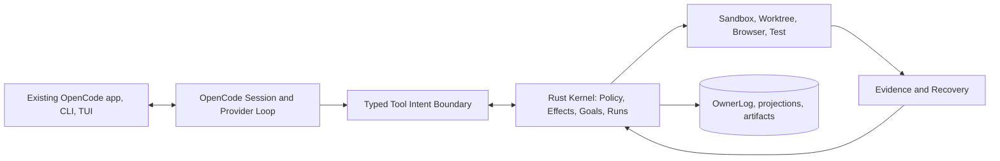
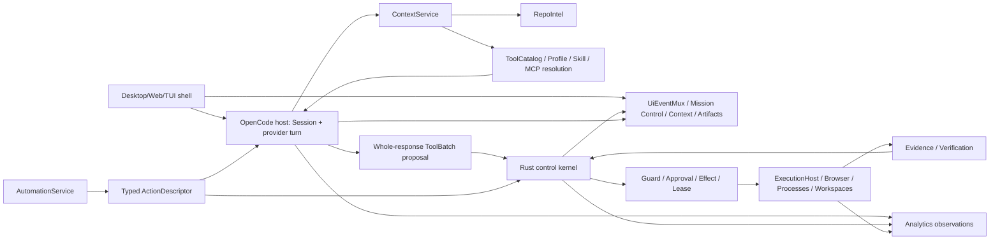

# 1. System, process, and ownership topology

> **Authoritative integration amendment, 2026-10-10:** This chapter is read with the v2 decisions in `17-GOVERNANCE-DECISIONS.md` and source-backed integration chapters 19–26. Older designs of a competing Rust canonical Session, automatic model selection or unconstrained agents are superseded **only where explicitly contradicted**. Existing code does not become implemented by this edit.

> **2026-10-11 audit resolution:** Read this chapter with §§28–34. For V1, OpenCode remains canonical for Session/Input/Message/Part/provider continuation. Rust OwnerLog is canonical only for HorizonCode-managed control-plane facts (Goal/Spec/Run/Task/Attempt, ToolBatch control metadata/correlation, effects/approvals/leases, recovery and evidence). Any older wording that makes a Rust Thread store the competing canonical conversational transcript is **superseded**. New agent/context/index/local-model/UI-performance/analytics contracts in §§29–33 are additive normative requirements; they are not claims of current implementation.

## 2026-10-10 OpenCode-first reconciliation
### Current high-level process topology
- **UI host (existing OpenCode React/Electron/TUI)**: progressive Create, Develop, Delegate, Operate presentation; it must never own the Run scheduler or persistent permissions. Prefer adapting existing packages/app, desktop, tui and server rather than installing a second desktop stack.
- **OpenCode agent substrate (existing packages/opencode, core, llm, schema, protocol)**: provider registry/auth/model selection, Session persistence, prompt turns, tool registration, plugin/MCP discovery. Canonical conversational Session messages remain OpenCode-owned *after migration gate*; Rust never executes provider inference a second time.
- **Rust kernel (existing kernel/src)**: extend existing transport, owner log, artifact store and cancellation; add Goal, Run, Task, Attempt, WorkerExecution, Effect, Evidence, verification, resource leases, authorization, ledger, circuit breakers, projections.
- **Workers**: no worker may write across the Rust effect broker. Execution process isolation is a separate variable from workspace worktrees and test database isolation. Browser and preview reuse existing implementation paths where possible.
- **Event boundary**: OpenCode Session identity plus prompt message IDs are preserved, with a versioned Session-to-Run mapping. Exactly one authority per aggregate; cross-store updates use an outbox and reconciliation, not distributed transactions.
- **Host protocol**: retain existing Rust MessagePack frame contract unless an evaluated migration is approved. A new JSON-RPC diagram is not permission to duplicate transports.
- **Resource accounting**: selected provider/model/harness is immutable per attempt; provider errors cannot trigger model replacement by a heuristic.
### Schematic

### Required class seams
`OpenCodeSessionGateway.createOrResume(sessionRef)`, `admitPrompt(messageKey,hash)`, `streamTurn(fence)`, `interruptSession()`, `getSessionCursor()`; `RunCoordinator.create(goal)`, `scheduleReady()`, `reconcileEffects()`, `verifyGoal()`. The same request is never allowed to bypass the broker via an older OpenCode tool path.

---

## 1.1 Current product/process topology (V1 normative)

~~~mermaid
flowchart LR
  U[OpenCode TUI / Solid app / desktop / CLI] --> API[OpenCode public API and Core V2]
  API --> S[(OpenCode canonical Session / Message / Part)]
  API --> L[OpenCode provider and continuation]
  L --> B[Complete ToolBatch proposal, request-pinned tools]
  B --> G[Rust kernel ManagedControl / ToolBatchControl / Guard]
  G --> E[Durable PREPARED EffectIntent and scoped one-use lease]
  E --> X[Rust ExecutionHost and authorized process/browser/MCP backend]
  X --> RC[Receipt / UNKNOWN / reconciliation]
  RC --> G
  G --> R[(Rust OwnerLog: Goal/Run/Task/Effect/Evidence)]
  S -.-> P[Read-only SessionLink / event projection]
  P -.-> G
  API --> V[Bounded Context / Mission Control / derived UI projections]
  R -.-> V
~~~

OpenCode Core V2 is the sole production provider-turn runner; existing legacy code is retained as pinned upstream/compatibility substrate. There is NO second Rust conversation history, no parallel Rust provider, no second public API for the kernel. All direct and managed effects cross the same boundary before dispatch. Runtime availability depends on the P1.2/P1.3 gates.

## 1.2 Processes and authority (operative V1)

| Existing or proposed runtime | Source placement/status | Authority | Must never do |
|---|---|---|---|
| OpenCode Core V2 / model / Session host | Existing: packages/core/src/session, packages/core/src/tool, packages/llm/src | Provider transport, prompt/continuation, canonical Session/Input/Message/Part, conversational tool result | Independently authorize effectful calls or mark managed goals PASS |
| Public app / desktop / TUI / legacy compatibility | Existing: packages/app, packages/desktop, packages/opencode, packages/server | User/API presentation and composition; canonical Session operations call Core | Mutate managed effect/Goal truth or mint kernel authorization |
| Rust managed control process | Existing primitives: kernel/src; unified production services NOT YET VERIFIED | Goal/Spec/Run/Task/Attempt; ToolBatch admission/correlation, Guard/effects/leases, recovery, verification evidence, resource fencing | Store canonical chat messages/parts; run its own LLM |
| RepoIntel derived index | Partial source: indexd/src | Rebuildable lexical/symbol/index/LSP projections when implemented | Act as source-code truth or privileged executor |
| Restricted execution workers | Proposed adapters around Rust ExecutionHost | Scoped execution only with one-use lease and receipts | Ambient host access or implicit permission elevation |
| Optional MCP, browser and external-agent adapters | Existing OpenCode adapter surfaces; Horizon effect integration PROPOSED | External capabilities only under resolved manifest/policy | Bypass effect path or become owner of Goal/Session |

The Rust supervisor must own and fence its epoch. UI closure is not cancellation of managed work. No background continuation guarantee exists without a live authorized worker/host.

## 1.3 Canonical aggregate owner table

| Aggregate/fact | Exactly one owner | Cross-store representation |
|---|---|---|
| Session/Input/Turn/Message/Part, provider continuation, original conversational tool calls/results | OpenCode Core Session/event store | Rust bounded SessionLink refs, source cursors, call IDs, digests, redacted outcome metadata |
| Goal/SpecVersion/Run/Task/Attempt/WorkerExecution and completion | Rust managed RunController / OwnerLog | OpenCode prompt context receives bounded immutable goal snapshot |
| ToolBatch permission/admission/fencing and effect intent/settlement | Rust ToolBatchControl, Guard, EffectService, ExecutionHost | OpenCode sees receipt/result data and retains its conversational parts |
| Workspace/resource leases and integration | Rust Workspace owner | Git/workspace reads observe fenced revision |
| Verification verdict and evidence | Rust VerificationService, accepted by RunController | UI shows proof refs; model claim alone never final |
| Provider observation and cost | Usage observation owner; analytics derived | Provider raw usage preserved as reported/estimated/unknown |
| RepoIntel/context/mission control/UI state | Derived services | Never promoted into canonical Session/Goal/security authority |

## 1.4 Ingress/IPC/security invariants

- Existing OpenCode application API is the sole public product entry; kernel IPC is local, authenticated, bounded, versioned MessagePack with process identity and epoch checks (§13).
- Every mutating tool, shell, Git, browser, LSP code action, MCP/skill/hook side effect uses the same exact ToolIntent → Guard → durable PREPARED → one-use lease → ExecutionHost → receipt/UNKNOWN path (§14).
- A collected tool call is not dispatched until the provider completed a valid whole batch; hosted/provider-executed tool calls are unavailable in strict governed V1 without pre-execution mediation.
- Direct Session remains lightweight: no mandatory Run/Task DAG. Explicitly managed Goal/Run work uses durable task/attempt state and independent verification.
- User-pinned provider/model/harness never silently changes, including on a local-model failure. Unsupported capability fails with typed reason.

## 1.5 Persistence boundaries

- OpenCode canonical Session/event tables persist conversational state; do not mirror text/content in Rust.
- Rust OwnerLog persists managed-control domain facts, leases, effects, approval, replay cursors, evidence and reconciliation.
- Index, context ledger, UI events, memory retrieval and metrics are scoped projections and artifacts; their own trust/retention rules do not grant authority.
- Cross-store atomicity is not assumed: stable IDs, transactional outboxes, reconciliation and honest UNKNOWN statuses bridge owners (§25).

## 1.6 Extension and reference constraints

Horizon-owned built-in assets belong to product packages (for example packages/core/src/horizon/skills/horizon-docs/SKILL.md), not .opencode compatibility paths. Product capabilities remain discoverable through the governed catalog (§33/§37). Reference upstream snapshot stays untouched. Historical Rust-owned transcript and alternate UI/IPC topologies were relocated to the provenance archive listed in §36.

## Pinned implementation references

- [OpenCode repository at the selected base revision](https://github.com/anomalyco/opencode/tree/b1fe25ab5ecc9f9bc911a8a2e6a51565cc764322)
- [TUI package manifest](https://github.com/anomalyco/opencode/blob/b1fe25ab5ecc9f9bc911a8a2e6a51565cc764322/packages/tui/package.json)
- [LLM package manifest](https://github.com/anomalyco/opencode/blob/b1fe25ab5ecc9f9bc911a8a2e6a51565cc764322/packages/llm/package.json)
- [Core V2 runner](https://github.com/anomalyco/opencode/blob/b1fe25ab5ecc9f9bc911a8a2e6a51565cc764322/packages/core/src/session/runner/llm.ts)

## 1.12 2026-10-11 expanded system topology

The new capability work in §§29–33 is added as **services/projections around the existing
OpenCode host + Rust control kernel**, not as a new competing agent framework.

### New logical services

- **AgentProfileService / DelegationService** — one rich profile registry and bounded specialist
  dispatch, layered over existing OpenCode session/provider primitives.
- **SkillRegistry / HookRuntime / McpRegistry** — extension resolution and lifecycle; never
  independent permission owners.
- **ContextService / ContextLedger** — compiles model-visible context while preserving canonical
  OpenCode history and Rust Goal/control truth.
- **RepoIntelService** — rebuildable repository symbol/reference/index projection.
- **ToolCatalogService** — model-visible lazy tool discovery over the single built-in/extension
  catalog.
- **ArtifactRenderService** — bounded preview/export including safe Mermaid.
- **UiEventMux** — multiplexed durable + ephemeral UI stream; not a domain event store.
- **AnalyticsService** — derived measured/estimated/unknown observations; no task truth.
- **AutomationService** — durable schedule definitions/runs that invoke existing typed actions.

### Process-placement rule

Do not create a new process merely because a logical service exists. Start in the existing
host/kernel process that already owns the dependency and extract only for measured isolation,
crash containment or performance reasons.

Likely placement:
- provider/session/profile/skill/tool-catalog/context compilation: OpenCode host/Core adapters;
- Guard/effects/resource/workspace/recovery/evidence: Rust kernel;
- parsers/LSP/index/browser/Mermaid/plugin/external helpers: supervised workers where needed;
- UI projections/virtualization/editor: existing desktop/web/TUI packages;
- analytics persistence/aggregation: lightweight embedded service with bounded batching.

### Interactive priority

Foreground input, provider stream control, approvals and effect state outrank background
indexing, analytics aggregation, artifact rendering and maintenance jobs. Background services
have explicit CPU/memory/IO budgets and yield under interactive pressure.
