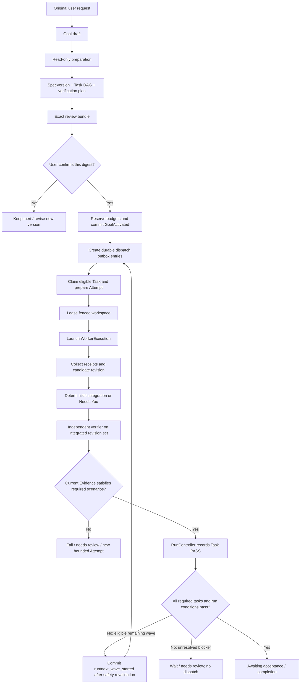

# 3. End-to-end flows


> **Authoritative integration amendment, 2026-10-10:** This chapter is read with the v2 decisions in `17-GOVERNANCE-DECISIONS.md` and source-backed integration chapters 19–26. Older designs of a competing Rust canonical Session, automatic model selection or unconstrained agents are superseded **only where explicitly contradicted**. Existing code does not become implemented by this edit.

## 2026-10-10 OpenCode-first reconciliation
### Flow F-V2-01: existing OpenCode interactive change
1. Composer parses typed references and chosen `agentId/providerId/modelId/harnessId`; pin immutable attempt configuration.
2. UI calls OpenCode Session admission with idempotent prompt ID; new managed goal only when the user chooses Delegate or explicitly invokes /goal.
3. The OpenCode turn stream persists messages/parts. Every effectful tool proposal becomes Rust `ToolIntentRequested`.
4. Kernel Guard classifies scope, permission mode, version and user grants. On approval, dispatch the constrained operation; persist effect and tool result.
5. OpenCode receives an opaque receipt plus bounded output; the UI reconciles progress from both event streams with cursors.
6. If the user pauses, stop new tool admissions, settle open effects, snapshot state; session and run may be resumed independently.
### Flow F-V2-02: managed goal
GoalRevision approved -> validate measurable criteria -> DAG -> critical path/resource conflict check -> lease task/worktree/test DB/port -> OpenCode attempt -> broker effects -> independent test and evidence -> integrate -> reverify final revision -> finalize. A model's done signal only moves Attempt to DONE_PROPOSED.
### Flow F-V2-03: nondeveloper visual creation
Plain-language intent -> trusted scaffold selection -> preview worker and isolated data -> element-selection-to-source anchor -> staged patch -> browser journey -> approval (only if policy requires) -> source commit -> optional release prep -> explicit publish approval -> postdeploy probes.
### Flow F-V2-04: provider limit
429/5xx/timeout -> classify -> circuit-breaker and bounded same-model retry -> PAUSED_PROVIDER or NEEDS_YOU. **Do not** switch to another provider/model unless explicit user action pins a new selection. Offline local mode must not call paid provider spontaneously.
### Flow F-V2-05: worker crash and reuse
Detect missed lease heartbeat -> fence execution -> reconcile effects from snapshots/remote receipts -> quarantine dirty worktree -> restart only replay-safe attempt -> new epoch -> build fresh bounded context packet -> no duplicate side effects.
### Failure contracts
Every flow reports typed `blocked`, `inconclusive`, `failed` or `succeeded` with links to evidence; never mark success just because the model or command returned successfully.

---

These flows define the adopted v1 contract across the OpenCode-derived host and Rust
kernel. Stream chunks and UI render state are not durable business facts. All durable
mutations are owner-authenticated, schema-validated, idempotent and ordered within the
owning stream.

## 3.1 Startup and composition

1. `hzcode` validates its configured state root and acquires/supervises `hz-kernel`.
2. Host and kernel exchange a `KernelHelloV1` containing protocol versions, build
   digests, instance nonce and capability features. Incompatible mandatory versions
   stop startup; optional features are explicitly unavailable.
3. Kernel validates event-log heads, rebuilds projections if needed, acquires a new
   supervisor owner epoch, reconciles outstanding launches/effects/workspace leases,
   and only then advertises service readiness.
4. Host loads the composition lock, verifies plugin bytes/provenance and schema/API
   compatibility, resolves dependency graph/cardinality, and activates pinned service
   generations in topological order.
5. Required sealed system-service failure stops startup or fences the affected
   capability. Optional presentation failure degrades that surface with a visible
   diagnostic; it never creates fake authority.
6. TUI/web/desktop/SDK clients connect through the OpenCode-derived public API. They
   obtain a snapshot cursor and then subscribe to durable projections/events.

No worker is dispatched merely because the UI or host process booted. A missing kernel
means canonical writes and effectful operations are unavailable, not silently hosted
in an in-memory fallback.

## 3.2 Direct interactive Session (current authority flow)

~~~mermaid
sequenceDiagram
  actor User
  participant UI as OpenCode client/UI
  participant Core as OpenCode Core SessionV2 / Input / EventV2
  participant LLM as OpenCode runner / packages-llm
  participant K as Rust ToolBatchControl / Guard
  participant EX as Rust ExecutionHost
  User->>UI: prompt, explicit agent/model/harness
  UI->>Core: admit/pin/queue prompt (idempotent)
  Core->>Core: persist Session/Input/Message parts
  Core->>LLM: compile context and stream provider response
  LLM-->>UI: ephemeral streaming view (no effect)
  LLM->>LLM: finish + step-finish; assemble/validate complete batch
  LLM->>K: propose exact ToolBatch IDs/digests/scope
  K->>K: Guard + durable PREPARED EffectIntent + one-use lease
  K->>EX: dispatch admitted effect(s)
  EX-->>K: exact receipt or UNKNOWN for reconciliation
  K-->>Core: ordered bounded observations/result refs
  Core->>Core: append canonical conversational tool results
  Core-->>UI: session state/progress/evidence references
~~~

For a read-only response no Rust effect is required. Direct turns do not create managed Goal/Run/Task rows. An explicit managed run adds SessionLink correlation, Task state and independent end-state verification. Provider failure, malformed calls or partial stream dispatch ZERO unstarted tool calls; a true already-dispatched operation is reconciled, never blindly retried. Current Core host batch preflight exists, but Rust Guard/ExecutionHost universal routing remains P1.3 NOT IMPLEMENTED. The old sequence that asks Rust to persist a canonical input/Turn/Message is retained only in the §36 provenance archive.

## 3.3 Effectful tool call

```text
model call
  → host normalizes schema and resource hints
  → kernel derives principal and canonical action
  → resource resolver pins exact workspace/resource revision
  → BudgetService commits hard reservation (direct Thread/Turn or managed owner)
  → Guard returns ALLOW | ASK | DENY
  → ASK creates durable exact approval challenge; no dispatch until resolved
  → kernel commits EffectIntent PREPARED with reservation and Guard receipt
  → kernel issues one-use capability lease bound to that intent
  → ExecutionHost prepares and kernel commits its lease-bound receipt
  → ExecutionHost launches with fence, capability set and bounded limits
  → host observation/output is captured to bounded artifacts
  → effect owner records SUCCESS | FAILURE | UNKNOWN
  → audit chain records security-relevant linked facts
  → result is returned to the pinned Thread/Turn as untrusted tool content
```

The effect request carries `delivery_id`, Thread/Turn/Run/Task/Attempt references,
tool-call identity, canonical action, argument digest, resource digest, expected
workspace revision. The initial submission does not supply authority: the kernel
issues the capability lease after PREPARED and attaches it only to executor dispatch.
Identity and authority are derived at the
ingress; the model cannot assert an approval, policy, principal, workspace fence or
secret scope. An approval is bound to displayed-content, policy and resource-state
digests and expires. Timeout after possible dispatch produces `UNKNOWN` until target
state is reconciled.

## 3.4 Managed Run



Preparation is read-only and produces an immutable proposed `SpecVersion`, DAG,
resource scopes, budgets and verification plan. User confirmation names the exact
digest. No worker starts before that durable activation point. Each Task has bounded
attempt count, limits, read/write scopes, dependency IDs, profile revision, route
snapshot and verification criteria.

## 3.5 Dispatch, worker, integration, verification

- `AttemptDispatchPlanned` and its outbox entry commit before process launch.
- Dispatcher claims one stable outbox ID, prepares execution, records launch identity,
  then observes the process. A crash after possible launch triggers reconciliation by
  exact process/workspace identity; never spawn a duplicate blindly.
- Native worker uses the same OpenCode-derived Thread runtime bound to a child Thread,
  immutable profile revision, TaskPackage, ContextPacket, workspace fence, permission
  ceiling and reserved budget. External ACP/CLI workers use capability handshakes and
  explicit limits; hidden internal tool coverage is reported as unknown.
- Candidate changes are not merged in finish order. Integration follows the stable DAG
  topological order and Task ID; conflict becomes `NEEDS_YOU`, not an assumed safe
  model merge.
- Verifier is read-only with respect to the subject under verification. Evidence binds
  approved SpecVersion, every integrated repository revision, workspace manifest,
  toolchain/environment, policy and scenario versions. Kernel accepts `Task PASS` only
  when evidence is current and complete.
- Run completion requires all mandatory Tasks to have current PASS, required workspace
  integrations and effects settled, required audit receipts, the active spec matching
  evidence, and no unresolved blocker.

Each next wave explicitly returns Run VERIFYING to EXECUTING through RunController;
Task PASS is not replaced by worker finish. A known terminal Attempt failure with no
retry commits `task/execution_failed`; unknown effects/launches keep work nonterminal.
Direct native delegation instead uses `DirectWorkerBindingV1`/`DirectTaskPackageV1`
and ThreadService's DirectDelegation record, not this managed Task/Attempt flow.

## 3.6 Subagent selection

1. honor explicit user profile selection;
2. honor a Task-pinned profile assignment;
3. evaluate profiles in `automatic` mode with deterministic category/path/language and
   capability matching;
4. dispatch only a unique eligible winner after runtime, model, reasoning, loadout,
   required lifecycle-hook availability/compatibility, turn/tool/token/wall-time limits,
   authority, workspace conflict, concurrency and budget checks;
5. otherwise use enabled `builtin.general` or ask/remain local.

Manual-only profiles never auto-launch. Model cost, subscription credit, and latency do
not select a profile or silently downgrade model/reasoning. Parent/profile/Task/policy
authority is intersected; a child can narrow but not widen. Every invocation pins the
profile revision (including its limits), loadout/runtime/effective-authority/context
digests, resolved lifecycle-hook-set digest and budget reservation.

## 3.7 Plugin install, activation and update

```text
discover → inspect provenance/license → stage exact bytes → validate manifest,
digest and signatures → review capabilities → configure → probe → enable → activate
```

A failed stage remains disabled. Composition rejects dependency cycles and duplicate
single-cardinality service providers before activation. `READY → DRAINING → DISABLED`
is required for normal disable/update; already pinned operations continue on the old
generation. Emergency quarantine revokes capabilities and explicitly fails/reconciles
affected operations. No plugin command callback receives arbitrary shell authority;
all UI entry points resolve to one typed ActionDescriptor.

## 3.8 Legacy Session import and cutover

1. Take a stable, read-only snapshot of the legacy Session store and record its source
   identity and digest.
2. Import each Session once, allocate a kernel `ThreadId`, and persist the unique
   `(source_store_id, legacy_session_id) → thread_id` alias before exposing the Thread.
3. Import ordered messages, tool history, fork links, attachments and compaction
   metadata with source provenance. Missing parent or attachment data is represented as
   unavailable; the importer does not invent it.
4. Initialize in-flight provider requests as `UNKNOWN_ACCEPTANCE` and pending legacy tool
   effects to `UNKNOWN`; do not replay either. Historical results remain untrusted
   conversation content and do not imply Guard mediation.
5. Verify per-Thread counts/digests and the source-to-Thread alias set, then switch
   application reads/writes to `ThreadStoreService` and leave the old store read-only.
6. Keep the source snapshot for rollback and retention. Removing it requires a separate
   accepted migration record and must not remove canonical OpenCode Session history.

An interrupted import resumes by the stored alias and digest; a conflicting source
digest refuses automatic continuation. Rollback changes the application cutover, not
the imported event history, and never makes both stores writable.

The importer uses §§11–12's historical initialization payloads and linked owner
receipts, not fabricated historical Guard grants/budget reservations. Initial import
admission establishes identities; final completion checks every required receipt before
exposure/cutover. Uncertain imported operations cannot dispatch from import replay.

## Pinned implementation references

- [Core V2 runner and streaming tool-call handling](https://github.com/anomalyco/opencode/blob/b1fe25ab5ecc9f9bc911a8a2e6a51565cc764322/packages/core/src/session/runner/llm.ts#L241-L281)
- [Legacy session LLM runtime selection](https://github.com/anomalyco/opencode/blob/b1fe25ab5ecc9f9bc911a8a2e6a51565cc764322/packages/opencode/src/session/llm.ts#L224-L279)


## 3.16 2026-10-11 additional end-to-end flows

### F-V2-16 — symbol-first existing-repository change

Request → detect repo/toolchain → `symbols.search`/outline/references → bounded symbol/source
reads → impact/tests mapping → plan/patch → stale-file precondition → targeted diagnostics/tests
→ integrated diff/evidence. Text grep is a fallback or complementary primitive, not the default
whole-repo context strategy.

### F-V2-17 — tiny/local-model coding

Explicit endpoint/model/harness → capability probe → compact profile/tool surface → retrieve
one task's source/symbol context → structured model output → schema validation/repair cap →
effect broker → compiler/test feedback → final verification. Context pressure triggers
trim/narrow retrieval/prune/compact in §30 order. No hidden provider/model escalation.

### F-V2-18 — specialist delegation

Parent detects a separable objective → resolve one eligible pinned specialist profile →
authority/resource/budget intersection → typed `SubagentRequestV2` → isolated child
context/workspace as required → bounded result/evidence → parent integration → final independent
verification. Maintenance jobs skip child session/worktree allocation.

### F-V2-19 — context cleanup and history recovery

ContextLedger reports pressure → user/policy previews a trim/prune/compact action → protected
entries validated → context view revision committed → provider continues. `clear` opens a new
context epoch but does not erase OpenCode history. Later History Search retrieves prior
message/artifact refs and explicitly reattaches selected evidence.

### F-V2-20 — artifact/Mermaid chat output

Provider/model emits complete artifact descriptor or fenced Mermaid → ArtifactService validates
bytes/digest → renderer validates trust/size/time → UI streams source while incomplete and
renders finished artifact asynchronously → user opens/downloads exact digest. Renderer failure
falls back to source + diagnostic and never changes task success.

### F-V2-21 — Mission Control multi-thread operation

Multiplexed host stream → per-thread durable cursor + bounded ephemeral buffers → Mission Control
groups running/blocked/errored/recovering work → user inspects/steers/pauses/cancels where
supported → canonical owner confirms action → foreground drafts/scroll/focus remain unchanged.

### F-V2-22 — scheduled automation

Automation definition approved → scheduler computes next trigger → creates AutomationRun with
pinned action/profile/budget/policy revisions → ordinary action/Guard/effect path → evidence/log
→ terminal result. Missed-run/concurrency policy is deterministic; schedule never grants extra
authority.

### F-V2-23 — UI stream reconnect under load

Client consumes durable+ephemeral multiplexed stream → drops/coalesces only declared ephemeral
render deltas → connection breaks → reconnect from last durable cursor → gap within retention
replays; gap outside retention returns resnapshot → final conversation/tool/task state matches
owner projection without duplicate messages/effects.

### F-V2-24 — structured Plan→Build handoff

Plan profile inspects repository/requirements → emits `PlanHandoffV1` with pinned objective,
scope, decisions, dependency DAG and acceptance criteria → user/reviewer may annotate/revise →
Build pins exact handoff revision → executes tasks in dependency order → newly falsified
assumption creates explicit deviation/revision → verifier evaluates original/revised criteria.
Markdown/HTML plan is a rendering, not the canonical dependency graph.

### F-V2-25 — language-service coexistence

RepoIntel query → LanguageServiceBroker checks compatible healthy editor-owned/project server →
reuse through authenticated read adapter when possible → otherwise use existing
Horizon-supervised generation → otherwise start one authorized supervised server → otherwise
parser/index/lexical fallback. Query response carries source/version/generation/confidence.
Never kill or reconfigure an editor-owned Pyright/rust-analyzer/tsserver. Mutating code actions
still enter Guard/EffectService.

### F-V2-26 — cold local model

Pinned local endpoint health/connect succeeds → model reports/waits in COLD_LOADING/QUEUED state →
separate response-start budget runs while cancellation remains live → first token transitions to
STREAMING → ordinary turn/tool flow. Slow weight loading alone does not open provider breaker.
Health/connect failure does. No cloud fallback/model switch without explicit user-selected route.

### F-V2-27 — safe checkpoint restore after later human work

Restore request → compare checkpoint repository/revision/branch plus subsequent commits,
uncommitted/untracked ownership and current workspace fence → if unchanged, exact restore may
proceed → if diverged, show preview/targeted reverse/conflict plan → user chooses safe scoped
action. Never blind reset later commits or unrelated user files.

### F-V2-28 — fatal managed attempt exhaustion

Attempt encounters typed non-retryable failure or exhausts its bounded retry/strategy budget →
settle/reconcile all in-flight effects → Task/Goal transitions to BLOCKED or FAILED according to
owner policy → durable reason/evidence emitted → no automatic continuation loop. Resume requires
a new strategy/input/provider availability or explicit revised goal/budget, not merely another
identical model call.
