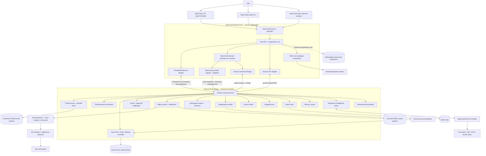
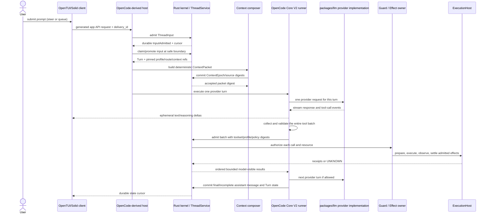
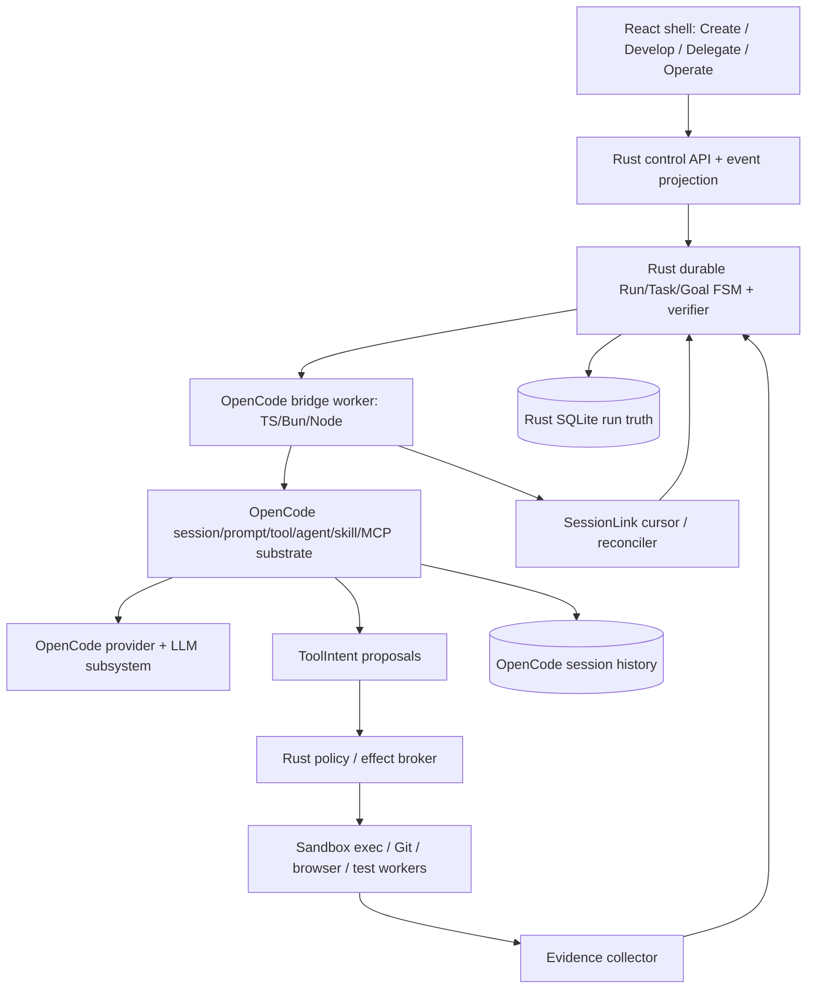

# Superseded HorizonCode architecture excerpts (historical provenance ONLY)

These are verbatim displaced passages from the pre-convergence working tree, **not executable or normative V1 instructions**. New design is §17 / §§01–04,13,20,25,36–37. Their hashes refer to displaced UTF-8 excerpts, not git commits.


---

## Prior 01-SYSTEM.md — ## 1.1 Product shape (sha256:b0858994dd63f208ca2eb6d756f2ed1cec3527b900726d744c82c11b6add7d08)

## 1.1 Product shape

OpenCode is the primary application base, not an optional sidecar. Its TypeScript/Bun
host owns UI composition, provider transport, model streaming, and interactive loop
coordination. The production turn path is Core V2 (`packages/core`) with
`packages/llm` as its provider protocol implementation; the legacy
`packages/opencode` loop is a migration/compatibility source, not a second production
runner. A supervised Rust Horizon kernel is the authority for canonical Thread
state, managed execution, security decisions, and durable outcomes. The host calls the
kernel through typed services/private IPC; it does not own a second conversation truth.



This diagram is an ownership map, not permission for arbitrary cross-process access.
The private RPC is the host-to-kernel authority seam. The OpenCode-derived public API
remains the client surface; the kernel does not expose a second public listener. The
OpenCode SQL Session tables may remain as UI/search projections, test implementations,
or migration input, but not as production canonical Thread state.

## 1.2 Processes

> **v2 ownership cutover annotation:** The v1 Rust-canonical-Thread ownership described in portions of this section is a historical target, not the current OpenCode-first design. Canonical conversational Session messages and provider continuation are targeted to remain in OpenCode. The Rust kernel remains authoritative for managed Run/Goal, effects and evidence, with the existing OwnerLog preserved as a verified primitive. The actual code cutover requires Session replay/tool/compaction parity; this architecture edit alone does not complete that migration. See [decisions](17-GOVERNANCE-DECISIONS.md), [code audit](24-LOCAL-CODE-AUDIT-AND-MIGRATION.md), and [crosswalk](25-DATA-AND-CONTROL-PLANE-CROSSWALK.md).

| Process | Language/base | Lifetime | Authority |
|---|---|---|---|
| `hzcode` host | Bun/TypeScript, derived from OpenCode | Interactive foreground or supervised app server | UI/API, composition, OpenCode-derived provider-turn runtime and presentation projections; canonical Thread/Run/effect decisions go through kernel services |
| `hz-kernel` | Rust companion in the same product repository | Supervised while local work exists | Canonical Thread and Run streams, ToolBatch state transitions, ToolExecutionCoordinator, Guard, EffectService, Rust ExecutionHost, UsageService, budgets, workspace fences, audit, artifacts, memory, secret broker, verification admission and recovery |
| `hz-indexd` | Rust worker | Supervised/restartable | Derived repository intelligence only; cannot mutate canonical Thread/Run/security state |
| Restricted workers | Host-native process, WASM, or compatibility worker | Per capability lease / operation | Only explicitly granted RPC/capability scope; no kernel-store access or ambient operator authority |
| MCP / external-agent processes | Server/agent-specific | Explicitly staged and launched | Separate trust boundary; local outer containment is not a claim that internal tools are Guard-mediated |

The kernel is not a provider host or model loop. The host remains the application and
executes Core V2 provider turns using `packages/llm`. Product routes and clients must
converge on that one runtime; legacy session-loop code is not wired as a competing
fallback. It submits durable Thread/Turn transitions, complete tool batches, and effect
requests to kernel-owned service definitions. The Rust `ToolExecutionCoordinator`
executes an admitted batch and returns bounded observations/results; only ThreadService
commits ToolBatch lifecycle transitions. `ExecutionHost` is a Rust module inside
`hz-kernel`; the TypeScript host never executes effect-capable operations or creates
their child processes. Native managed workers instantiate this same host Thread runtime
with a pinned profile, task package, workspace and authority ceiling; they do not start a
second agent engine.

For supervised pairing, use inherited private pipes where possible. Independently
attached local clients use an OS-local transport (Unix-domain socket or Windows named
pipe) with peer/process validation. No public kernel TCP listener. Closing a TUI is not
Run cancellation; continuation is claimed only while a supervised kernel owner exists.
On restart, the kernel validates logs, acquires a new owner epoch, reconciles workers,
effects, fences and reservations, and resumes only provably safe work.

## 1.3 Component ownership

| Responsibility | Owner | OpenCode contribution |
|---|---|---|
| Conversation identity, messages, prompt admission, Turn records and Thread projections | Rust kernel Thread service | Owns canonical event stream; host implements OpenCode-compatible `ThreadStoreService` adapter. OpenCode Session DB is projection/test/migration only |
| ToolBatch lifecycle and ordered result links | Rust ThreadService | ThreadService owns every ToolBatch transition in the Thread stream; Rust ToolExecutionCoordinator returns observations/results but cannot commit ToolBatch state |
| Model turn, provider request, streaming and loop coordination | OpenCode Core V2 runner in host | Core V2 owns the production turn loop and `packages/llm` provider calls; kernel records durable boundaries and unknown outcomes, not a second loop |
| Provider/model catalog, protocol adapters, auth UX and stream normalization | OpenCode `packages/llm` plus kernel secret/route bridge | Retain/adapt as primary host implementation; immutable route snapshots and secret custody policy belong to kernel authority |
| Model-visible tool definitions and presentation | OpenCode-derived registry/UI with Horizon service/action schemas | Retain schemas and UI, but effects dispatch only through kernel-authorized executors |
| Plugin/service composition | Host resolver/runtime executes; sealed kernel CompositionService owns manifests, approvals, locks and durable generation lifecycle | Host service definitions/providers/consumers are composable; canonical kernel services are sealed in production |
| Goal, SpecVersion, Run, Task DAG, Attempt, WorkerExecution and completion | Rust RunController | One canonical Run owner; Threads link to managed objects but never equal them |
| Budget policies, hierarchical reservations and accounting settlements | Rust BudgetService | Consumes UsageService observations by ID; analytics and UI totals are derived projections |
| Permission decision, approval challenge, effect intent/settlement, sandbox selection | Rust Guard/effect owner and selected execution backend | OpenCode permission UI is retained as presentation; legacy process-local permission decisions cannot bypass Guard |
| Local process/operation execution | Rust ExecutionHost module in `hz-kernel` | One-use lease validation, process supervision, OS backend selection and bounded observations; `hzcode` is never the effect executor |
| Usage observations | Rust UsageService | Append-only provider/worker observations with reported/derived/estimated provenance; BudgetService consumes observations but does not own them |
| Mutable workspace binding, revision, lease and integration | Horizon controller/workspace adapter | OpenCode worktree features may be reused as mechanics only after their revision/fencing contract is validated |
| Verification evidence | Independent verifier, accepted by Run controller | OpenCode's checks can supply observations, not independent PASS by themselves |
| MCP, skills, ACP, LSP, formatter integration | OpenCode modules plus kernel-mediated capability/ExecutionHost adapters | Retain the surface; each family keeps its trust and lifecycle contract. Third-party executable plugin code is isolated |
| Client commands, settings, themes, navigation and render projections | OpenCode TUI/CLI/web/desktop | Extend existing application surfaces; no local UI state becomes Run truth |

## 1.4 API and dependency boundaries

- TUI, web, Electron, CLI, SDK and ACP-facing endpoints continue to use the OpenCode
  application API/client composition. Horizon adds a versioned route namespace and
  maps it through a typed adapter to the controller.
- OpenCode calls the Rust controller over a private, bounded, versioned framed channel
  using MessagePack and an OS-local transport (inherited pipe for supervised pairing;
  Unix socket / Windows named pipe for local attachment). It is not reachable from a
  model, plugin, MCP server, or arbitrary local client.
- Horizon mutations carry a stable `delivery_id`; the controller derives principal
  and scope from the authenticated application ingress. Request fields cannot claim
  operator identity or broaden authority.
- The application owns provider transport. Kernel policy pins the route snapshot and
  mediates secret use; raw credential delivery is declared as visible to the recipient
  process when unavoidable. No egress/isolation guarantee is claimed without an
  enforced, tested host mechanism.
- UI and SDK packages consume generated/validated Horizon API types. Generated
  artifacts are regenerated from their owning contract; no hand-maintained second
  wire schema is allowed.

## 1.5 State placement

Use one configured user state root with owner-separated canonical stores and derived
host projections:

```text
state/
  threads/        # canonical Thread event streams, owned by hz-kernel
  runs/           # canonical Goal/Run event streams, owned by hz-kernel
  usage/          # append-only canonical usage observations, owned by UsageService
  supervisor/     # kernel owner epochs, dispatch/recovery state
  opencode/       # configuration and rebuildable UI/search projections only
  audit/          # independently owned append-only audit records
  artifacts/      # bounded immutable content-addressed bytes
  memory/         # kernel-owned advisory records
  projections/    # rebuildable SQLite read models
  secrets/        # OS credential-store references / protected broker state
```

These are logical namespaces, not a decision to share a database. Canonical event
streams are append-only and projections are rebuildable. Each owner writes only its
own data. Cross-store operations use IDs, digests, outboxes and reconciliation; no
assumed multi-store atomic commit. Migration must preserve existing OpenCode sessions
as imported Thread history with provenance, and must not auto-import untrusted
workspace configuration as policy.

## 1.6 Service/plugin composition

Host consumers depend on typed service definitions, not concrete provider modules.
Use OpenCode's existing Effect `Context.Tag`, `Layer`, `Scope` vocabulary with a
Horizon plugin manifest, resolver, registry generation and `HzPluginRuntime`; do not
add a second composition framework. A definition records stable ID/version/schema
digest, cardinality, replaceability (`sealed`, startup replaceable, hot swappable),
authority (`canonical`, derived, advisory, presentation), and required capabilities.
Design each definition against its current consumers as a complete Service Definition /
Service Provider / Consumer seam. Keep consumer-specific tool schemas, UI and transport
behavior with their owners. Require a real current consumer before exposing a public
service operation; otherwise use a private capability closure.

Production canonical authority services—Thread, RunController, Supervisor, Guard,
Effects, Audit, Workspace, Verification, Artifacts, Secrets and kernel transport—are
sealed system providers. Test doubles may replace them in tests. The plugin architecture
organizes services; it does not grant arbitrary runtime replaceability.

Plugins are classed by execution/trust boundary: signed first-party system, presentation
only, WASM with explicit imports, restricted external process, OpenCode-compat worker,
MCP server, inert skill content, declarative workflow, or Attempt-scoped agent adapter.
Downloaded JavaScript does not execute in the privileged host with unrestricted Bun
APIs. Activation returns a disposable registration scope. Disable/upgrade drains pinned
users before unregistration; emergency quarantine revokes capability and routes active
operations into explicit failure/recovery.

Composition is resolved before activation. Dependency cycles, duplicate singleton
providers, invalid capability requests, and incompatible API/schema versions fail
closed with a diagnostic graph. In-flight Turns/Attempts pin plugin/service generation,
profile revision, toolset digest and composition lock. New generation receives new work;
old generation drains before disposal.


---

## Prior 02-DOMAIN.md — ## 2.1 Identity mapping (sha256:ae4b088cf66081c55e98506d71d5a66cc155f3c7e5e625805d9befc846660d81)

## 2.1 Identity mapping

| Concept | Canonical owner | Constraint |
|---|---|---|
| `ThreadId` | Rust kernel Thread service | Canonical conversation identity and event stream. An OpenCode `SessionId` may be a compatibility ID mapped to this Thread, never a second owner. |
| `InputId` / `TurnId` / `ModelAttemptId` | Rust kernel records; host executes provider operation | Durable admission/turn boundaries; provider stream execution remains in the OpenCode-derived host. None is a managed Task Attempt. |
| `GoalId` / `SpecVersionId` / `RunId` | Rust kernel | Durable user-reviewed objective, immutable approved requirements, and managed execution lifecycle. |
| `TaskId` | Rust kernel | DAG node with dependencies, acceptance criteria, repository/workspace scope, limits and state. A child Thread is not a Task. |
| `AttemptId` | Rust kernel | One strategy for a Task. A retry with a changed strategy gets a new identity and consumes the same parent budget history. |
| `WorkerExecutionId` | Rust kernel | One launch/incarnation that may use a Thread; process/session status is only an observation. |
| `ExecutionId` | Rust ExecutionHost module in `hz-kernel` | One local process operation; a managed WorkerExecution may reference it, while a direct Turn need not fabricate an Attempt. |
| `ToolBatchId` | Rust ThreadService | ToolBatch lifecycle and ordered result links are canonical Thread-stream facts; its executor returns observations only. |
| `UsageObservationId` | Rust UsageService | Append-only usage observation; BudgetService owns policy/reservations/settlement decisions and references observations. |
| `BudgetId` / `ReservationId` / `BudgetSettlementId` | Rust BudgetService | Owns limits, reservations and settlement decisions; each settlement links the UsageObservationIds it accounts for. |
| `WorkspaceId` / lease / revision | Horizon workspace owner | Mutable source identity and fencing epoch; not an Attempt or repository catalog row. |
| `EffectId` | Rust effect owner | One governed operation with durable prepare and terminal result or explicit `UNKNOWN`. Audit stores linked security evidence, not business ownership. |
| `EvidenceId` | Independent verifier produces; RunController accepts | Exact spec, revision set, environment, toolchain and scenario bindings. Worker claims/check receipts do not create Task PASS. |
| `AgentProfileId + revision` | One Horizon profile registry | Shared definition for main/subagent/native/external adapters; OpenCode config may be migrated/adapted but is not a competing profile authority. |
| Provider route | OpenCode `packages/llm` executes; kernel policy snapshots/authorizes | One provider implementation/transport owner in the host. Active Run/Attempt route snapshots are immutable and contain references/digests, never credential bytes. |
| Service/plugin generation | Kernel CompositionService commits; host resolver/runtime executes and reports observations | Stable provider identity and pinned generation; composition does not transfer canonical truth ownership. |

Global IDs are never reused. Unknown or unsupported schema versions refuse before
partial replay. OpenCode's process-local session coordinator is an execution detail,
not durable Turn or WorkerExecution ownership. Host SQLite tables are rebuildable
projections; canonical Thread history is replayable from the kernel event stream.

## 2.2 Thread and direct-turn records

> **v2 ownership cutover annotation:** The v1 Rust-canonical-Thread ownership described in portions of this section is a historical target, not the current OpenCode-first design. Canonical conversational Session messages and provider continuation are targeted to remain in OpenCode. The Rust kernel remains authoritative for managed Run/Goal, effects and evidence, with the existing OwnerLog preserved as a verified primitive. The actual code cutover requires Session replay/tool/compaction parity; this architecture edit alone does not complete that migration. See [decisions](17-GOVERNANCE-DECISIONS.md), [code audit](24-LOCAL-CODE-AUDIT-AND-MIGRATION.md), and [crosswalk](25-DATA-AND-CONTROL-PLANE-CROSSWALK.md).

These logical records are canonical kernel facts. The host's OpenCode-derived runtime
uses `ThreadStoreService` and typed kernel RPC to read/append them; it must not write a
parallel transcript database.

```rust
struct ThreadV1 {
    thread_id: ThreadId,
    project_id: ProjectId,
    parent_thread_id: Option<ThreadId>,
    relationship: ThreadRelationship,
    attached_run_id: Option<RunId>,
    attached_task_id: Option<TaskId>,
    attached_attempt_id: Option<AttemptId>,
    title: String,
    active_context_epoch_id: ContextEpochId,
    selected_agent_profile_revision: ProfileRevisionRef,
    selected_model: Option<ModelSelection>,
    created_at: Timestamp,
    archived_at: Option<Timestamp>,
}

enum ThreadRelationship { Root, Fork, Worker, Review, SideQuestion, Verifier }

struct ThreadInputV1 {
    input_id: InputId,
    thread_id: ThreadId,
    delivery_id: DeliveryId,
    lane: InputLane,                 // steer | queue
    content_ref: ArtifactRef,
    admitted_seq: u64,
    admitted_at: Timestamp,
    state: InputState,
    promoted_turn_id: Option<TurnId>,
}

struct TurnV1 {
    turn_id: TurnId,
    thread_id: ThreadId,
    input_ids: Vec<InputId>,
    profile_revision: ProfileRevisionRef,
    context_epoch_id: ContextEpochId,
    route_snapshot_id: ProviderRouteSnapshotId,
    toolset_generation: u64,
    state: TurnState,
    provider_attempt_ids: Vec<ModelAttemptId>,
    started_at: Timestamp,
    ended_at: Option<Timestamp>,
}

struct ContextEpochV1 {
    id: ContextEpochId,
    thread_id: ThreadId,
    parent_epoch_id: Option<ContextEpochId>,
    reason: ContextEpochReason,
    baseline_digest: Digest,
    source_heads: BTreeMap<ContextSourceKey, Digest>,
    repo_generation_refs: Vec<RepoGenerationRef>,
    memory_generation_refs: Vec<MemoryGenerationRef>,
    toolset_digest: Digest,
    profile_revision: ProfileRevisionRef,
    route_snapshot_id: ProviderRouteSnapshotId,
    policy_digest: Digest,
    created_at: Timestamp,
}
```

`Steer` is eligible at the next safe provider-turn boundary. `Queue` remains FIFO until
the current continuation would otherwise become idle. Admission is durable before the
host is woken; admission does not mean the model has seen the input. Provider token
deltas are ephemeral and are not canonical Thread events. A direct Turn can complete
without completing an attached Run.


---

## Prior 03-FLOWS.md — ## 3.2 Direct interactive Thread (sha256:9f4f6f1db92772658176d6e54f766ca82492f84ce39e4486ba0cc5438034d95a)

## 3.2 Direct interactive Thread

Direct mode stays lightweight: no Goal/Run/Task DAG is created for ordinary pair
coding. It still uses the same durable Thread owner and effect guard as managed work.



`steer` inputs become eligible at the next safe provider-turn boundary. `queue` inputs
remain FIFO until the current continuation would otherwise become idle, promoting one
at a time. Durable admission precedes advisory wake; the model-visible message is only
created at promotion. On a host disconnect, the kernel preserves admitted input and
reports the actual execution state.

Context is checked against the pinned route/token budget before provider dispatch. A
local overflow runs the bounded ContextService pressure policy or fails before sending.
An explicit terminal pre-content `PROMPT_TOO_LONG` rejection preserves its failed
ProviderAttempt, then may use the same bounded recovery and a new request digest/attempt
ID on the same pinned route. Unknown acceptance or partial content is never resent.
For a direct Turn, capture the owner-built checkpoint immediately before its first
mutating ToolBatch/effect; `/rewind turn|files` previews exact owner-scoped restoration
and never rolls back external effects or Thread history.

### Whole-response tool admission is a required adaptation

While streaming, the host may render text deltas and collect tool-call fragments, but
must not execute any tool call. After the provider signals a complete response, it:

1. assembles every call and validates every argument against the pinned tool schema;
2. checks call count, aggregate bytes, deadlines, duplicate IDs and allowed toolset;
3. rejects the batch with zero unstarted effects if any structural check fails;
4. sends the complete admitted batch to the kernel before execution;
5. lets the kernel authorize and schedule calls by declared resource conflicts;
6. holds downstream calls behind a `question`/approval barrier and serializes
   conflicting writes or shell operations.

If a stream terminates before a complete response, no collected call is dispatched.
The current pinned Core runner dispatches non-hosted `tool-call` events during stream
consumption; adopted v1 requires changing that seam. `providerExecuted` calls are
not allowed in guarded v1 Turns: they execute outside the kernel before local Guard can
authorize them. Provide a local mediated equivalent or report the provider capability
unavailable. This is a compatibility reduction, not an existing OpenCode guarantee.


---

## Prior 04-STATE-EVENTS.md — ## 4.1 Canonical owners and streams (sha256:5848e615ebdb696e3a4bfd6a0202c3aa6e2c4d5ecc9c6f3df0c36a2115b3f280)

## 4.1 Canonical owners and streams

> **v2 ownership cutover annotation:** The v1 Rust-canonical-Thread ownership described in portions of this section is a historical target, not the current OpenCode-first design. Canonical conversational Session messages and provider continuation are targeted to remain in OpenCode. The Rust kernel remains authoritative for managed Run/Goal, effects and evidence, with the existing OwnerLog preserved as a verified primitive. The actual code cutover requires Session replay/tool/compaction parity; this architecture edit alone does not complete that migration. See [decisions](17-GOVERNANCE-DECISIONS.md), [code audit](24-LOCAL-CODE-AUDIT-AND-MIGRATION.md), and [crosswalk](25-DATA-AND-CONTROL-PLANE-CROSSWALK.md).

Each fact has one write owner and one append-only canonical stream. The owner emits
monotonic sequence numbers only within its stream; there is no invented global total
order. Cross-owner causality uses stable IDs and linked cursors/digests.

| Stream/store | Owner | Canonical contents |
|---|---|---|
| Thread event streams | Rust ThreadService | Thread identity, legacy Session aliases/import facts, inputs, promotions, Turns, messages/parts, context epochs, questions, ToolBatch lifecycle, direct-tool result links and DirectDelegation lifecycle |
| Goal/Run event streams | RunController | Goals, SpecVersions, Runs, Task DAG, Attempts, WorkerExecutions, dispatch decisions and terminal predicates |
| Workspace streams | WorkspaceService | Workspace identity/revisions, leases/fences, integration and conflict receipts |
| Usage streams | UsageService | Append-only provider/worker usage observations with reported, derived, estimated, external-peer and unknown provenance |
| Budget streams | BudgetService | Budget policy revisions, hierarchical reservations, accounting settlement decisions referencing UsageObservationIds, and residual uncertainty; not raw usage observations |
| Verification streams | VerificationService; RunController accepts Task/Run consequences | Verification permits, verifier observations and Evidence; no worker-authored PASS |
| Repository intelligence streams | RepoIntelService | Derived RepoGeneration lifecycle and query provenance; no canonical workspace or Guard facts |
| Memory streams | MemoryService | Advisory provenance-bearing records, tombstones and scope generations |
| Composition streams | Sealed CompositionService | Plugin manifests/approvals, immutable composition locks, generation lifecycle and host activation observations |
| Supervisor stream | Kernel supervisor | Owner epochs, dispatch outbox claims, process reconciliation and recovery checkpoints |
| Effect-owner stream | EffectService, linked to the initiating domain | Prepared/dispatched/settled/unknown effects and reconciliation facts; Guard owns approval challenge/resolution records linked by IDs/cursors |
| Guard/policy stream | Guard | Effective policy snapshots, authorization decisions, approval challenge lifecycle and one-use grant resolution |
| Audit chain | Audit service | Security-relevant actor/action/decision/receipt facts and integrity linkage; not a duplicate Run transcript |
| Artifact CAS | Artifact service | Immutable content-addressed payloads bounded to 256 MiB each, with owner references, retention and redaction metadata |
| Host DB/projections | Host/UI and kernel projector | Rebuildable query models, search tables, generated SDK caches and UI state only |

If event streams and SQLite projections disagree, the canonical committed stream wins.
Projection ahead of canonical head is corruption: fence writes and recover/diagnose; do
not promote the projection to truth.


---

## Prior 13-COMPOSITION-IPC.md — ## 13.1 Process contract (sha256:46b06038e16a5ea32099859e05fb4f83a1c1f0a6a3e11dfca41054bb753bfc0f)

## 13.1 Process contract

| Process | Owns | Must not own |
|---|---|---|
| `hzcode` (Bun/TypeScript) | OpenCode Core V2 runner, `packages/llm`, public app API, UI composition, plugin resolver/runtime, direct-turn coordination and rebuildable projections; collects complete provider tool batches | Canonical Thread/Run facts, ToolBatch transitions, Guard decisions, effect settlement, process/effect execution, workspace fences, usage observations, Task PASS, audit head |
| `hz-kernel` (Rust) | Canonical owner streams, Supervisor, ThreadService, RunController, ToolExecutionCoordinator, Guard, EffectService, Rust ExecutionHost, UsageService, WorkspaceService, CompositionService, BudgetService, verification admission, artifact metadata, memory owner, secret broker and recovery | Provider loop, TUI state, arbitrary plugin execution, public client listener |
| `hz-indexd` (Rust) | Derived, revision-pinned repository generations and bounded queries | Canonical state, Guard, external effects, secret access |
| Restricted worker | One expiring, scoped operation or plugin/peer adapter | State-root access, ambient credentials, authority beyond its capability lease |

There is one product composition root. `hz-kernel` and `hz-indexd` are supervised
processes, not alternative applications. The kernel may refuse a caller, but the
host cannot write around it. Conversely, `hz-indexd` cannot be promoted to a
canonical authority service by registering it as a plugin.

`ExecutionHost` is a Rust module within `hz-kernel`, not a third process and not the
Bun/TypeScript `hzcode` host. It owns the supervised operation/process seam and invokes
the selected OS sandbox or subprocess backend only after Guard, EffectService and the
one-use capability lease have admitted the exact operation. `hzcode` may collect model
output and submit a whole ToolBatch, but it does not execute effect-capable tools.
`ToolExecutionCoordinator` orchestrates admitted calls and returns observations/results;
ThreadService alone commits ToolBatch state and ordered result links.

### Process startup and shutdown

1. Resolve the state root from trusted user/managed configuration; reject symlink,
   ownership, ACL or permission conditions that violate the platform contract.
2. Acquire the single-instance/supervisor lock and start or attach to the configured
   kernel process using an inherited private channel where possible.
3. Complete `KernelHelloV1` negotiation and peer authentication. The kernel validates
   canonical stream heads/projections, takes a new owner epoch and reconciles pending
   effects, worker launches, workspace fences and budget reservations before
   advertising readiness.
4. Host fetches the current immutable composition lock from CompositionService,
   verifies exact plugin bytes/schemas/trust metadata, and activates the pinned graph
   in deterministic topological order. Activation/health receipts are returned to the
   owner; host observations alone do not publish a new canonical generation.
5. Start public app listeners only after required sealed services are ready. Optional
   service failure is visible as unavailable and cannot be silently replaced with a
   weaker provider. Required sealed service failure fences dependent actions and
   prevents readiness.
6. Shutdown closes admission first, persists/fences active owner work, drains host
   registrations and workers, settles or marks unknown operations, and then releases
   process ownership. A client disconnect alone does not stop a supervised Run.

Only the supervisor holding the current `owner_epoch` may dispatch or reconcile
managed work. A restart increments the epoch and fences stale dispatchers. The
`hzcode` host may reconnect but cannot mint an epoch or claim ownership.


---

## Prior 20-OPENCODE-INTEGRATION-LLD.md — ## 10.1 Dependency topology (sha256:98206fff006f9d6a64254c501163211a590815f47ad8ed9e1fbe9f39122af64e)

## 10.1 Dependency topology



**No giant cross-runtime library:** OpenCode stays TypeScript. Rust only owns things where OS behavior, deterministic transactional coordination, permission enforcement, process supervision, resource isolation or workspace race prevention measurably improve reliability. Browser and UI remain TS. Do not port `provider.ts`, AI SDK bridges, session message codec, MCP connector or auth to Rust without evidence of a concrete bottleneck AND measured parity tests.

## 10.2 Final proposed folder tree

```text
apps/desktop                 Tauri host only; no authoritative run state
apps/web                     Optional authenticated browser view
apps/cli                     Same typed command API as GUI
packages/ui/{design,shell,create,develop,delegate,operate,settings}
packages/ui/{components,command-palette,api-client,viewmodels}
packages/opencode-vendor/     pinned upstream subtree/fork (minimal maintained patches)
packages/opencode-bridge/     VersionCompat, SessionGateway, ModelGateway, ToolIntentBridge
packages/opencode-adapters/   v1/v2 session, provider, tool, agent/profile, skill mapping
packages/worker-protocol/     generated TypeScript types from one canonical schema
packages/harness-profiles/    model-agnostic native/minimal/compat codecs
packages/local-models/       endpoint probes, capabilities, structured-output adaptation
packages/agent-plugin-sdk/   versioned agent/protocol interfaces; capability manifests
packages/browser-worker/     Playwright with isolated browser contexts
packages/intel-worker/       LSP, tree-sitter, ripgrep; incremental per-revision indexes
packages/preview-worker/     dev-server driver, health checks, preview proxy
packages/publish-worker/     release adapter, exact permission handoff
packages/testing/            golden streams, provider conformance, model capability probes
crates/core-daemon            bootstrap, API, supervised workers, reconciliation
crates/domain                 immutable Goal/Run/Task/Attempt/Execution/Effect/Evidence
crates/run-engine             task planning, DAG scheduling, completion gate
crates/goal-engine            persistent /goal state + user edits + acceptance coverage
crates/state-events           SQLite, outbox, cross-store bridge cursors, migrations
crates/policy-broker          runtime authorization, scopes, decision/approval cache
crates/effect-broker          idempotency, expected revision, signed effect receipts
crates/execution-supervisor   worker lifecycle, fences, quotas, cleanup on crashes
crates/workspace-pool         Git worktree reusable pool, integration, port/data lease
crates/verification           independent test/browser/security/criterion evidence
crates/healing                L1 deterministic repair -> L2 infra -> L3 learning -> L4 canary
crates/retention              blob pin/mark/sweep/compaction, WAL housekeeping
crates/telemetry              provider/model usage, traces, quality signals
crates/repo-service           Rust read-model interface to TS intelligence worker
crates/operations             publish, incident, backup/export, monitoring
contracts/v2                 canonical RPC/event schemas + generated TS/Rust
storage/migrations/v2         new tables and safe migration path
upstream/                    upstream pins, patch ledger, 3rd-party notices
```

## 10.3 Bounded context ownership / never duplicate

| Concept | Single authority | Other readers/writers |
|---|---|---|
| session message / streamed part / local agent turn | OpenCode session DB | Rust bridge ingests read-only event receipts |
| current goal, criteria, approvals | Rust goal store | OpenCode prompt builder reads goal snapshot |
| Task dependency and Attempt status | Rust run engine | OpenCode cannot directly update status |
| ToolIntent and effect outcome | Rust effect broker | OpenCode may propose; Rust authorizes and records |
| model provider auth/capability/transport | OpenCode provider subsystem | Rust stores opaque `ModelSelection` only |
| user-selected model and harness | Rust persisted settings/profile | OpenCode uses resolved selection only |
| permission grant | Rust policy broker | UI displays requests; TS worker never mints grants |
| source file current content | filesystem/Git with Rust revision guards | UI and OpenCode read only through authorized tools |
| build/test/check observation | isolated execution worker + verifier | planner/agent sees evidence references |
| reusable worktree pool, port/test DB | Rust workspace-pool | workers hold expiring leases only |
| auto-learning patterns | rust healing learner store | prompt builder consumes filtered advisory retrieval |
| UI pane/terminal tab state | React client persisted preference | never a source of goal or permission authority |


---

## Prior 10-DELIVERY.md — Phase P2 (sha256:a726a3edb55fc7b3e7dc27f818dfd55af10255cfa8369e0b102621f67c32087a)

## Phase P2 — Rust kernel transport and canonical Thread

> **v2 ownership cutover annotation:** The v1 Rust-canonical-Thread ownership described in portions of this section is a historical target, not the current OpenCode-first design. Canonical conversational Session messages and provider continuation are targeted to remain in OpenCode. The Rust kernel remains authoritative for managed Run/Goal, effects and evidence, with the existing OwnerLog preserved as a verified primitive. The actual code cutover requires Session replay/tool/compaction parity; this architecture edit alone does not complete that migration. See [decisions](17-GOVERNANCE-DECISIONS.md), [code audit](24-LOCAL-CODE-AUDIT-AND-MIGRATION.md), and [crosswalk](25-DATA-AND-CONTROL-PLANE-CROSSWALK.md).

- Implement private versioned bounded IPC, build handshake, idempotent delivery IDs,
  typed hello result/rejection, startup `STARTING`/`READY`/`FAILED` status, early-RPC
  rejection, owner cursors, cancellation lane and process supervision.
- Implement the approved, explicit OwnerLog V2 migration because the historical
  `horizoncode-eventlog` source was not recovered. V2 is the single segmented,
  committed-head canonical store; do not claim physical compatibility, overwrite
  unknown/legacy data, or build a parallel persistence engine. Import requires a
  separately verified reader and idempotent migration fixtures.
- Bound OwnerLog recovery and pagination memory as lifetime history grows. Exact delivery
  retry identities must survive restart; never silently evict them. Use a rebuildable
  disk-backed lookup index for receipts and segment summaries, rebuilt by streaming the
  canonical log, plus a bounded in-memory negative filter for delivery IDs. The index is
  non-authoritative and may be discarded; positive/missing and unavailable/corrupt lookups
  fall back to exact OwnerLog V2 scans. This adds no history cap or second canonical store.
  Failure to build the index during owner open fails closed rather than trusting partial data;
   post-open index failure falls back to canonical scans. Index failure after head commit cannot
   undo or misreport the canonical commit. Before each append/retry, compare the disk head and
   revalidate committed bytes to detect prior mutations; this is bounded-memory but adds
   I/O proportional to retained history per append. The exclusive owner lock coordinates
   cooperating opens but is not mandatory protection from same-identity writers, so that
   race remains outside the current trust boundary and must be explicit in acceptance evidence.
- Move production Thread/input/message/Turn ownership to kernel event streams through
  `ThreadStoreService`; leave host SQL only as projection/test/import input.
- Implement the one-to-one Session alias/import contract, preserving fork links, ordered
  tool history, available attachments, compaction metadata and a read-only rollback
  snapshot.
- Preflight the production Session cutover against the required `ThreadV1` and
  `InputAdmissionRequestV1` references: authoritative Project identity, selected
  ProfileRevision, active ContextEpoch, an authenticated application principal, and
  owner-authorized ArtifactRefs must be available from their canonical owners. The current
  canonical-owner table does not name a Project stream; P3/P5 schedule related Context/Profile
  capabilities, and the current ArtifactStore is only a storage primitive. Host SQL/config,
  caller/model/plugin fields, and artifact IDs/digests are not substitutes for those owners
  or authorization. If an owner/binding is absent, keep dependent Session operations
  unavailable and the P2 gate open; do not synthesize references, add allow-all access, or
  silently pull full P3/P5 scope into P2. Any authorized prerequisite slice requires its
  owner/interface and phase dependency to be recorded in the affected `arch_V1/` contracts
  before behavior changes.

**Gate:** crash/restart, exact retry/conflict, replay/projection rebuild, snapshot+replay,
retention resnapshot and migration round-trip tests preserve conversation semantics;
missing import data is explicit, aliases are unique/idempotent, and two writable
transcript authorities are impossible by construction. Import tests prove that
uncertain provider calls and legacy effects are never replayed or promoted to Guarded
success. Windows `run_durable` is unavailable until DEC-V1-17 has an accepted backend.


