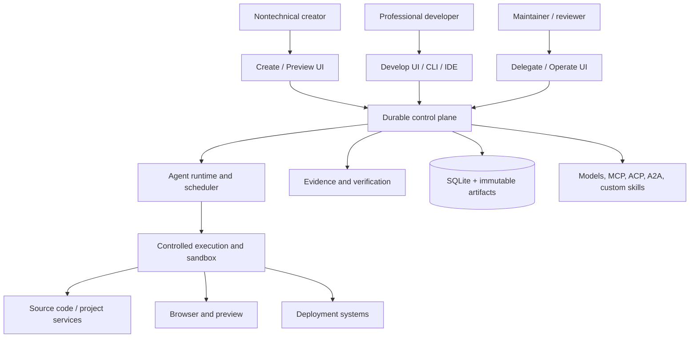
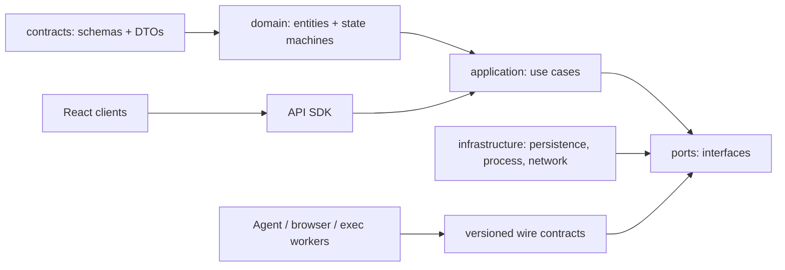
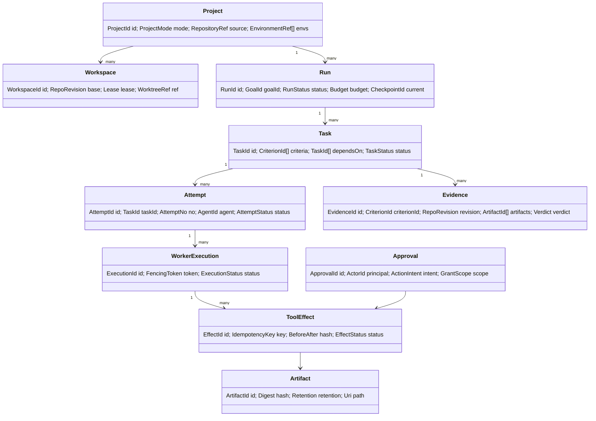
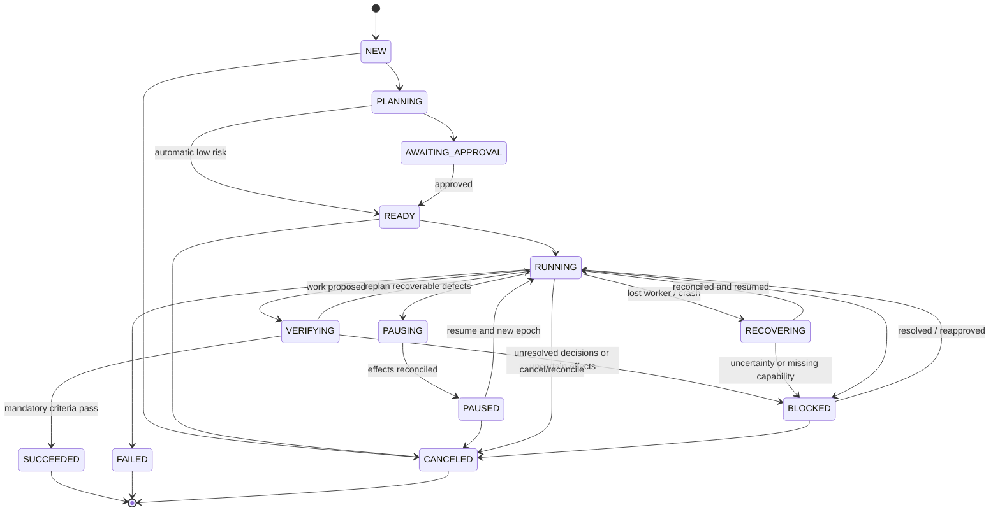
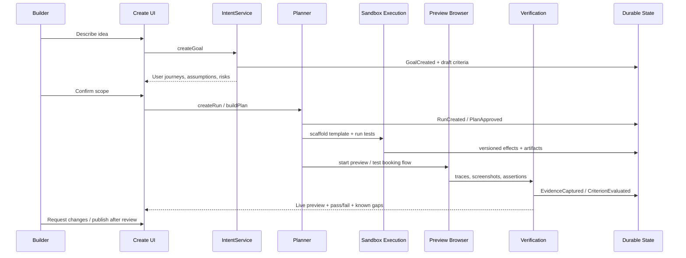
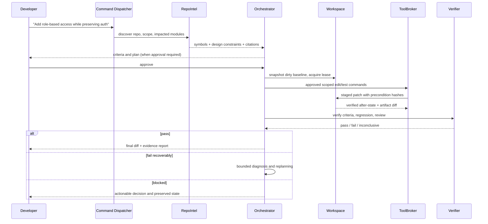
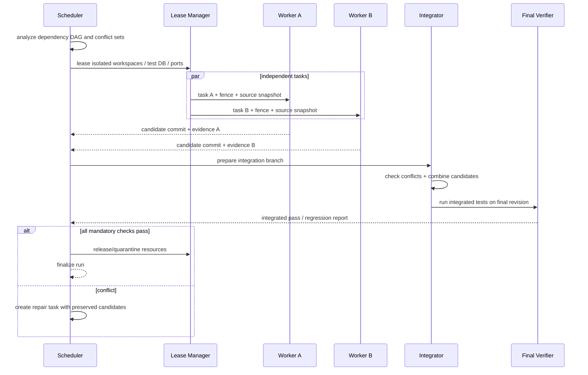
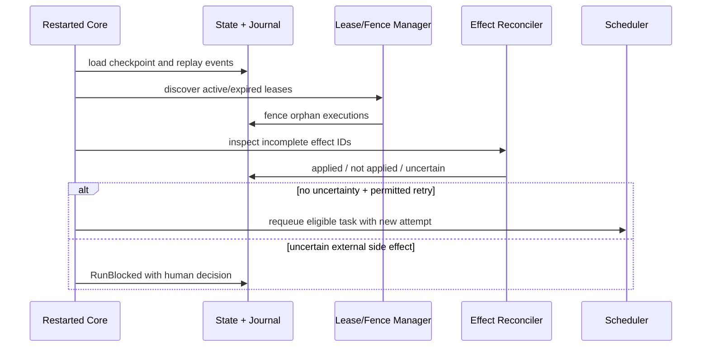
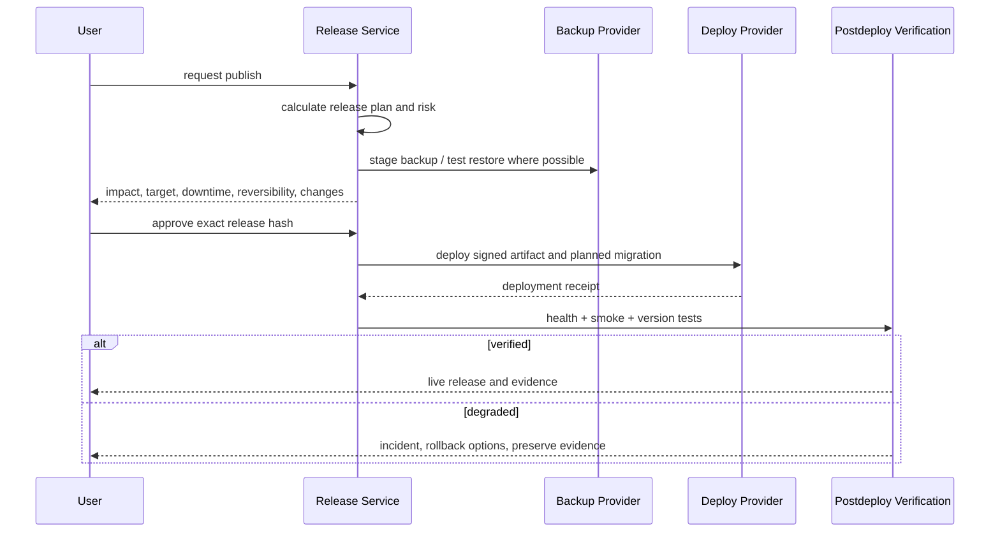
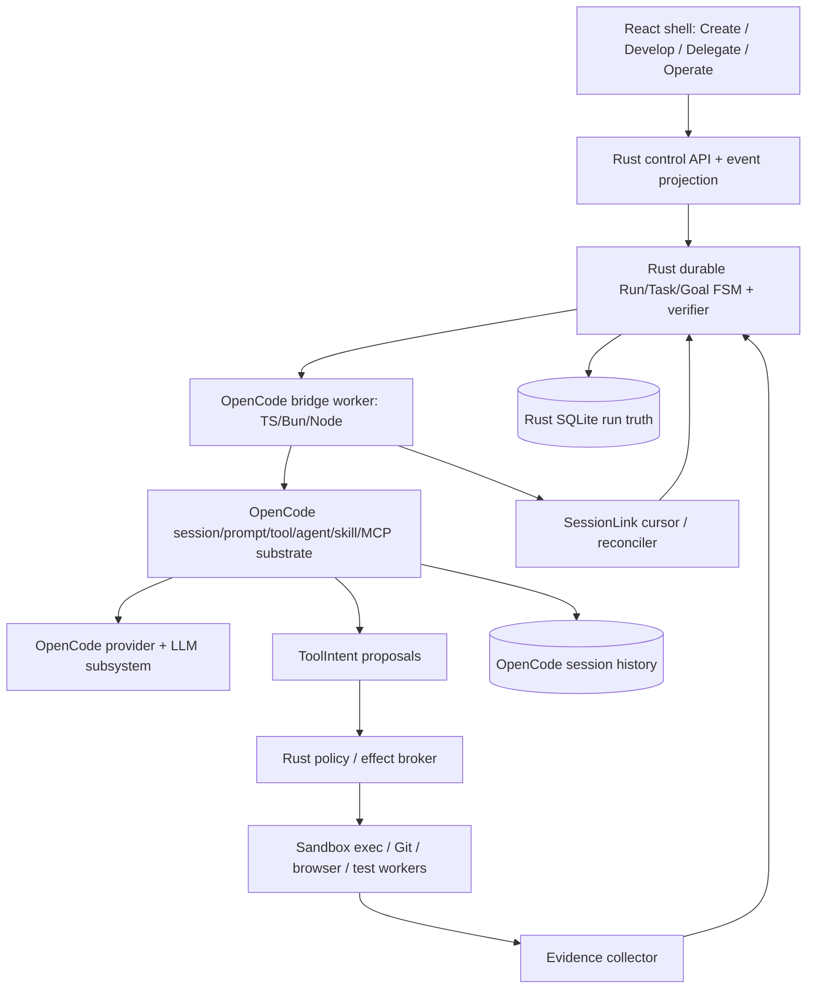

# Universal Software Agent — Architecture v2 (OpenCode-first)

**RETAINED SOURCE INPUT — NON-NORMATIVE FOR HORIZONCODE.** This whole document is historical design/research material, not operative implementation authority. Its internal “Normative precedence” statements apply only to its superseded internal draft chapters; they do **not** override the current `arch_V1/README.md`, frozen §17 decisions, topical `arch_V1` owners, `HANDOFF.md`, or the current converged implementation plan. Do not copy its proposed monorepo packages, Rust conversation model, or API as current HorizonCode facts.

**Original status:** design and integration plan, not implemented product. **Date:** 2026-10-10. **Source:** uploaded v1 architecture, 1,496-line requirements research, user screenshot, repository and documentation inspection.

**Normative precedence:** Chapters 09–13 + `contracts/v2` and additive migration override any conflicting text in original 01–08, which remain preserved for traceability. OpenCode is the base for providers, sessions and core tools. Explicit model selection, no silent routing. Safe limited permissions and pooled worktrees.

---

# 01 — Source requirements and traceability

> **v2 integration notice (2026-10-10):** The v2 user constraints supersede v1 routing assumptions: OpenCode is the implementation base; provider/session reuse is mandatory; model choice is pinned by default; `ask`/`safe-auto`/`yolo-in-sandbox` use enforced scope; worktrees are pooled with cleanup. See 09–13.

**Attached source:** `Pasted text(20261010-095056).txt`, 1,496 physical lines. The source contains previous research responses and a second product-direction section. Its reported survey figures and user anecdotes were claims in the pasted research; this architecture treats them as motivations, and checks current protocol documents separately.

## Line-range coverage map

| Source line range | Source concern | Design owner | Verification gate |
|---|---|---|---|
| 1–49 | Trust, verified completion, user effort | orchestrator, verification, UX | completion claims require evidence |
| 50–170 | User preferences: autonomy, editor, terminal, BYO models, parallelism, aesthetics | agent-runtime, editor, UX, provider registry | preference-driven interaction tests |
| 171–244 | False completion, goal loss, stale edits, bad architecture, scope drift | orchestration, state, workspace, review | false-complete / stale write tests |
| 245–329 | Token spikes, compaction loops, latency, premature stops, storage growth | usage, context, no-progress, retention | budget limits, compaction replay, maintenance tests |
| 330–391 | Parallel-agent correctness, worktrees, ports, runtime/data isolation | scheduler, leases, sandbox, integration | concurrent test and merge tests |
| 392–406 | Review burden and UI interaction | UX, diff, preview | user-observed intervention time |
| 407–477 | Discovery, symbols, architecture, impact, scope, uncertainty | repo-intel, policy, context | symbol/impact accuracy tests |
| 479–557 | Edits, test/debug, terminal, browser, git, deployment, IDE | tools, browser, editor, deployment | tool contracts / integration checks |
| 558–636 | Goal tracking, DAGs, resume, verify, loop, stop, background, budgets | orchestrator, recovery, evidence | crash/retry/replay tests |
| 637–742 | UX, permissions, history, providers, local, skills, MCP, cost, collaboration | UX, policy, adapters, extensions | role/permission tests |
| 744–815 | Example feature request; understand→plan→execute→verify→recover; interaction modes | intake, planner, run engine | scenario workflow tests |
| 816–879 | Explorer, tasks, inspect, composer, progressive disclosure | app shell / surfaces | accessibility and navigation tests |
| 880–923 | Separate durable task truth; security not prompt-only; bounded recovery | state, safety, scheduler | invariant/property tests |
| 924–1014 | Twenty specific robustness scenarios | evaluation harness | 20 mandatory scenarios |
| 1015–1084 | Quality/cost metrics, uncertain benchmark claims | eval, telemetry | transparent metric reporting |
| 1085–1191 | Phase order and product promise | release strategy and acceptance definition | staged gates |
| 1193–1228 | Non-developers as first-class users | product shells, creation workflows | zero-code user test |
| 1230–1302 | One product with progressive disclosure | unified project model, shared UI | seamlessly switch visual/code |
| 1303–1327 | Create/Develop/Delegate/Operate | navigation + domain | cross-surface task continuity |
| 1328–1366 | App engineering beyond a demo: auth, DB, tests, backups, security | project blueprints, deploy, safeguards | live-data protection tests |
| 1367–1387 | Same incident in novice/expert views | incident projections + advanced inspect | transparent simplified error UX |
| 1388–1475 | Beginner essential features + export/ownership/handoff | visual editor, deploy, export, docs | handoff and portability test |
| 1477–1496 | Unified product positioning | application shell, docs | user-journey acceptance |

## Priority decisions (proposal)

P0 *trust substrate*: project/workspace, shared state, session UI, repo search, provider adapter, single agent, sandboxed tools, atomic files, Git diff, permissions, run DAG, retries, checkpoints, verification, responsive builder preview, simple scaffold, undo, test runner, chat/editor, commands, metrics, export.

P1 *significant expansion*: concurrent agents + integration isolation, custom agents/skills, ACP/A2A/MCP range, visual DOM targeting, deployment providers, secrets integrations, prepublish security checks, debugger, editor autocomplete and language diagnostics, cloud session handoff, site data/export, templates.

P2 *ecosystem*: scheduled remote jobs, mobile oversight, organization policy, team workflows, marketplace, multiple cloud compute backends, plugin SDKs, customizable process topology.

## Non-goals

- Not a single monolithic LLM prompt that 'remembers' all project state.
- Not guaranteed autonomous secure production deployment without credentials and approval.
- Not unrestricted local computer control by default.
- Not a guarantee that BYO third-party CLI agents comply with capabilities unless sandbox enforcement is effective.
- Not a clone of one provider's privately controlled authentication/session protocol.
- Not all desired features in first release.
- Not hidden abstraction of uncertainty: blocked or unverified changes must be visible.

## ADRs to freeze

- ADR-001: one project/run model for visual and developer experiences.
- ADR-002: Rust local supervisor + independent durable state, not WebView-owned engine.
- ADR-003: SQLite WAL with serialized write coordinator and append-only domain events.
- ADR-004: tool effects are idempotency-keyed and revision-fenced.
- ADR-005: only evidence-authorized status transitions may mark a run complete.
- ADR-006: agent protocol adapters never bypass authorization boundary.
- ADR-007: no cross-worker shared database/ports without explicit reservation.
- ADR-008: route UI actions to typed API commands, not directly to model prompts.
- ADR-009: worktree creation opportunistic, bounded by pools and lease reclamation.
- ADR-010: cloud continuation is a different execution placement, not a claim that a sleeping laptop continues computing.
- ADR-011: publisher has staged intent + preview + confirmation + post-deploy validation.
- ADR-012: use plaintext Markdown/YAML user rules only as untrusted configuration text subject to validation; repository docs are not privileged commands.

## Requirements that conflict, and their resolution

- 'Autonomy' vs 'user control': one delegated execution engine with per-mode permission boundaries.
- 'Simple UI' vs 'all technical details': plain-language summary with inspectable provenance and advanced panes.
- 'Fast' vs 'strong verification': incremental verification and risk-tiered testing; never fabricate assurances.
- 'Any agent' vs 'uniform reliability': feature/capability negotiation and labels for unenforceable operations; no false equivalence.
- 'Long-lived tasks' vs 'cost': progress budgets, stop criteria, recovery/review, model selection explicit to user.
- 'Persistent history' vs 'disk pressure': immutable essential audit summaries and policy-configured artifact compaction, never silently discard needed undo/evidence.
- 'App portability' vs 'host-specific services': export manifest includes unresolved dependencies, data migration procedures and missing secret references.


---

# 02 — High-level design, processes, packages and dependency boundaries

> **v2 integration notice (2026-10-10):** Important v2 correction: this is NOT an all-new TS agent worker. The OpenCode-derived runtime owns model providers, session messages and turn processing, behind an adapter. Rust owns durable Run/Task/Goal/effects/verification/policy. Package tree here is historical and superseded by chapter 10 where it conflicts.

## 2.1 C4 context: one system, several entry points



## 2.2 Process layout

1. **Desktop GUI** (`studio-desktop`, Tauri + WebView): rendering, keyboard, accessibility, local notifications; never authoritative for run or permission state. Reconnects using cursor-based event playback.
2. **Supervisor daemon** (`studio-core`, Rust): API, run/task persistence, DB write queue, scheduling, permission checks, leases/fencing, audit log, snapshots, artifacts, process supervision. Runs independently of the window during active desktop session.
3. **OpenCode bridge worker** (`studio-opencode-bridge`, Node/Bun process): preserves OpenCode provider SDKs, auth, session history, prompt/turn loop, streaming, tools and skills behind a versioned RPC gateway; tool effect proposals pass the Rust broker; no unmediated privileged filesystem, secrets or deployment access.
4. **Execution worker** (`studio-exec-worker`, sandboxed per environment): code execution, bounded PTY, Git operations, test runner, migrations, build, scoped file patch, artifact collection. Process and container isolation when supported; permissions checked at supervisor broker.
5. **Browser worker** (`studio-browser-worker`, Playwright): isolated browser contexts, DOM snapshots, screenshots, locator validation, page navigation, user journeys, traces. Holds restricted session data and browser output artifacts.
6. **Language intelligence worker** (`studio-intel-worker`): ripgrep, tree-sitter parsers, LSP sessions, optional on-device embeddings; may be shared read-only across tasks but caches are keyed by revision.
7. **Preview supervisor** (`studio-preview-worker`): starts project dev server with reserved port, health probes, reverse proxy for localhost preview, route/element inspection; uses isolated environment where possible.
8. **Publisher worker** (`studio-publish-worker`): provider drivers, deployment previews, secret references, backups, migration plans, approvals, postdeploy probes. No direct unreviewed production write permissions.
9. **Optional cloud runner** (`studio-runner-cloud`, later): registers remote worker and leases; must use authenticated transport, persisted artifact links, an external durable store or replicated DB. SQLite on one computer is not a multi-host coordinator.

`studio-core` is a logical daemon with modular Rust crates, not a mesh of microservices. Tool workers are isolated processes; package modularity does not force network distribution.

## 2.3 Process communication

- GUI ↔ core: authenticated loopback HTTP/JSON for commands and SSE/WebSocket stream for events; randomly generated session capability, origin checks, server-bound local endpoint, replay cursor, rate limits. Unix domain socket / named pipe preferred where practical.
- Core ↔ workers: length-prefixed JSON-RPC or Protobuf over OS pipes/UDS with worker token, execution fence and correlation ID. Avoid undocumented global sockets.
- Worker → external providers: explicit egress policy; secrets delivered as narrowly scoped references or ephemeral credentials, not global environment dumps.
- Core ↔ SQLite: one short-write coordinator, busy-timeouts, snapshots and WAL management; WAL is local-file-system only and allows one concurrent writer.
- Core ↔ immutable artifacts: temp file → fsync → hash → atomic rename → DB row/outbox commit; reconciliation on crash.
- Remote agents: protocol adapters via policy proxy, never direct UI → remote tool capability by default.

## 2.4 Dependency rules



Enforce via CI import lint and Rust crate boundaries:

- `domain` does not import web UI, ORM, provider SDK or platform APIs.
- `application` depends on ports and types, not concrete implementations.
- `infra` implements ports. Cross-package calls occur through typed use-case APIs.
- `ui` can issue commands and render read models; it cannot directly change orchestration DB rows.
- `model output` may propose `ToolIntent` but cannot call privileged infrastructure without policy evaluation.
- `verification` must not consume a claim from the actor as sole evidence for that actor's own completion.
- `events` are immutable facts. Commands are requests; read models are projections; do not conflate the three.

## 2.5 Proposed monorepo structure

```text
studio/
  apps/
    desktop/                  # Tauri host and app lifecycle
    web/                      # React browser client when enabled
    cli/                      # studio ask/run/inspect ...
    vscode-extension/         # Optional remote UI/editor adapter
  packages/
    ui-design/                # accessible primitives, tokens, typography, layout
    ui-shell/                 # nav, sidebars, tabs, workspaces, panes
    ui-create/                # brief, templates, preview, visual editing
    ui-develop/               # editor, symbol nav, terminal, SCM, debugger
    ui-delegate/              # run dashboard, task tree, agent inspector
    ui-operate/               # deploy, incidents, versions, monitoring
    ui-settings/              # providers, agents, skills, permissions, costs
    ui-commandbar/            # slash registry, autocomplete, keyboard palette
    ui-evidence/              # run explanations, tests, review, provenance
    ui-api-client/            # typed API client, event stream, cursor/reconnect
    protocol/                 # versioned wire messages and JSON Schemas
    agent-sdk/                # provider and agent interfaces
    opencode-bridge/          # Node worker + V1/V2 session and model adapters
    acp-adapter/              # ACP compatibility / feature negotiation
    a2a-adapter/              # external A2A collaboration
    mcp-client/               # MCP tool/resource discovery; authorization broker
    opencode-vendor/          # pinned upstream OpenCode provider/session/agent/tool substrate
    browser-worker/           # Playwright visual locator / trace / tests
    intel-worker/             # LSP, parser, ripgrep, context retrieval
    preview-worker/           # dev server/process and browser proxy
    publish-worker/           # external deployment adapters
    extension-sdk/            # custom skills, commands, run hooks
    templates/                # app blueprints, safe defaults, importers
  crates/
    studio-domain/            # project, task, attempt, evidence types and FSMs
    studio-application/       # service interfaces and use cases
    studio-orchestrator/      # durable state machine + dependency scheduler
    studio-recovery/          # checkpoints, no-progress detection, recovery policy
    studio-policy/            # permissions, scope, provenance, risk tier
    studio-workspace/         # git, content hashing, edits, worktree pool
    studio-artifacts/         # CAS, manifests, retention, data redaction
    studio-state/             # SQLite migrations, transactions, projections
    studio-events/            # append and subscribe, outbox, dedupe
    studio-execution/         # workers, resource leases, fences, sandbox adapters
    studio-review/            # tests, assertions, evidence, gate engine
    studio-repo-intel/        # read-model/cache and language-worker protocol
    studio-agent-control/     # Rust task/profile control; no duplicate provider transports
    studio-runtime/           # tool requests, progress, budgeting, cancellation
    studio-telemetry/         # traces, cost, quality metrics
    studio-operations/        # preview, deployment, backups, incidents, export
    studio-http/              # auth, routes, stream, websocket, versioning
    studio-core/              # daemon bootstrap and lifecycle
  contracts/
    domain.ts
    events.schema.json
    http-api.yaml
  storage/
    schema.sql
    migrations/
  docs/
    ADRs/
    SECURITY.md
    EVALUATION.md
  tests/
    contract/
    integration/
    failure-injection/
    e2e-builder/
    e2e-developer/
    security/
    benchmark/
```

## 2.6 Bounded contexts and authoritative owners

| Bounded context | Authoritative data | Owns transitions | Explicitly does not own |
|---|---|---|---|
| Project | metadata, policy, source locations | project create/import/archive | run completion |
| Workspace | checkout, current revision, lease, dirty snapshot | checkout/patch/snapshot/revert | product requirements |
| Intent | user goal, constraints, acceptance criteria | proposal/approval/scope change | raw model transcript |
| Orchestration | run, tasks, attempts, edges, decision log | durable scheduling and status | execute shell commands directly |
| Agent control | agent profiles, capabilities, model refs, context | worker invocation | arbitrary privilege grants |
| Execution | worker, lease, tool call, effect, sandbox | effects/reconciliation | judge whether requirement achieved |
| Evidence | assertions, source observations, environment hash | verify/accept/reject criteria | creating code modifications |
| Security | principals, scopes, grants, approvals, secrets refs | authorization | natural-language policy guessing |
| Artifacts | blobs, manifests, snapshots, retention | storage/pinning/GC | current goal |
| Operations | deployment, incident, backup, runtime health | release/rollback/monitor | editing arbitrary app code without task |
| Presentation | read models, notifications, settings | display only | authoritative mutable state |

## 2.7 Domain graph



**Meaningful distinction:** Run = requested outcome; Task = durable subobjective; Attempt = try to fulfill a task; WorkerExecution = concrete agent/process invocation; ToolEffect = observable action; Evidence = independent claim check. Session/transcript is presentation/context only.

## 2.8 Placement options and honest guarantees

| Placement | What continues when desktop UI closes? | Laptop sleeps? | Security statement |
|---|---|---|---|
| Local embedded GUI | Only if process remains alive | No | OS-user privileges apply unless isolated |
| Local daemon | Yes, while OS and daemon active | No | local sandbox controls and permissions apply |
| Remote runner | Yes, while remote runner/credentials/lease active | Yes, if work was explicitly transferred | separate remote storage/auth/compute required |

Cloud continuation must not be implemented by sharing a live SQLite WAL over network storage. It requires distributed durable coordination or single-node remote placement with replicated/queued transfer.

## 2.9 Project classifications

- `imported`: existing repository; obey local toolchain and conventions, never auto-replatform.
- `scaffolded`: template-generated source with known test/preview/deploy manifests.
- `hybrid`: imported source with visual-capable UI selectors and optional generated segments.
- `managed`: software connected to deployed infrastructure / provider accounts.

A visual edit is an anchored source change (DOM selector + source map + expected file digest), not a separate proprietary UI document. Unknown/unmappable visual elements fall back to proposed edits requiring review.

## 2.10 Application configuration ownership

```
User configuration (global) -> default preferences and provider profiles
Organization policy (optional) -> upper bound on privileges, budgets, allowed providers
Project config (.studio/project.yaml) -> validated project behaviors, language/build manifests
Agent profile -> model, prompt role, tools, skills, supported modes, run limits
Run snapshot -> immutable resolved config + config hash at run creation
Execution token -> dynamically narrowed permissions for one effect/worker
```

Changes to agent/provider/project configuration mid-run do not silently mutate earlier approvals; a `ConfigChanged` fact and explicit replan apply a version bump to the remaining run.


---

# 03 — Public classes, functions, algorithms, responsibilities

> **v2 integration notice (2026-10-10):** Important v2 correction: replace any implied new provider implementations with calls into `OpenCodeSessionGateway` / `ModelGateway`. See 10–11 for updated functions and recovery semantics. `resolveModel` must never auto-switch providers in pinned mode.

This is the exhaustive **proposed public application-service and adapter interface** for v1 scope. It is **not** an attempt to invent every future implementation's private helper. Every public method has its purpose, logic, and failure contract; private method breakdown must evolve with implementation and tests. All mutating service methods accept `CommandContext {actor, tenant?, trace, idempotencyKey, expectedVersion?, policySnapshot}` and return typed `Result<T, DomainError>`.

## 3.1 Cross-cutting contracts

- `DomainError`: `INVALID_ARGUMENT`, `NOT_FOUND`, `CONFLICT`, `STALE_REVISION`, `POLICY_DENIED`, `APPROVAL_REQUIRED`, `QUOTA_EXCEEDED`, `UNSUPPORTED_CAPABILITY`, `UNAVAILABLE`, `TIMED_OUT`, `CANCELED`, `CORRUPT_STATE`, `ENVIRONMENT_UNSAFE`, `PRECONDITION_FAILED`, `INTERNAL`.
- `CommandContext`: authenticated principal, resource scope, trace/correlation ID, idempotency key, optimistic concurrency expected revision, evaluated policy version.
- Any mutation: (a) normalize and validate input, (b) authenticate and authorize, (c) check expected entity version, (d) perform deterministic transition, (e) append event within same storage transaction, (f) emit via outbox, (g) return current version and read-model cursor.
- All failures are structured; never turn tool stderr directly into policy text or user instructions.
- Idempotency key is unique within principal + operation + target. Reusing the same key with different input is `CONFLICT`.
- `clock` and `idGenerator` are injectable for deterministic tests; wall-clock and monotonic time are not interchangeable.

## 3.2 ProjectService (`studio-application/project`)

| Public function | Logic (steps, validations, observable outcome) |
|---|---|
| `createProject(spec, ctx)` | Validate project name, create isolated project root, write manifest; in one DB transaction create project/default policy/workspace placeholder and `ProjectCreated`; undo directory on failed commit. |
| `importRepository(source, ctx)` | Authenticate access; clone/open path using read-first authority; inspect Git status and root boundaries; classify imported source; snapshot uncommitted work; persist source fingerprint; refuse outside user-authorized roots. |
| `scaffoldProject(blueprintId, answers, ctx)` | Resolve signed/trusted versioned template; validate answers; preflight runtime/toolchain, generate into staging directory; run initial checks; atomically promote; record provenance and known limitations. |
| `inspectProject(projectId, ctx)` | Parallel-safe read of manifest, build scripts, SCM, language index and environment; return `ProjectReadModel` with confidence/provenance; do not mutate. |
| `updateProjectSettings(projectId, patch, ctx)` | Validate config schema, enforce organization maximums, compare version, append `ProjectConfigChanged`, mark affected running plans for reevaluation; never retroactively widen grants. |
| `listProjects(filter, ctx)` | Permission-filtered paging with stable sort and revision cursor; exclude undeclared roots. |
| `archiveProject(projectId, ctx)` | Require no unhandled running tasks or request explicit cancellation; preserve source and evidence; mark archived without destructive file deletion. |
| `exportProject(projectId, opts, ctx)` | Collect source, manifest, dependency/service map, generated environment instructions, migration artifacts, nonsecret configuration, unresolved secret placeholders; sign export manifest with hashes; do not claim portable data where absent. |
| `validateProjectPortability(bundle, ctx)` | Verify manifest hashes, runtime dependencies, service ownership and data export; report `READY`, `PARTIAL` or `BLOCKED` with remediation, never fabricate credentials. |

## 3.3 GoalIntakeService (`studio-application/intent`)

| Public function | Logic |
|---|---|
| `createGoal(projectId, message, attachments, ctx)` | Normalize request; redact obvious secrets for provider routing; store original securely; generate candidate scope, outcome and ambiguities without treating model output as approved authority. |
| `analyzeGoal(goalId, ctx)` | Retrieve relevant project metadata and user constraints; classify change impact/risk; produce source-grounded `GoalAnalysis` plus unknowns and assumptions. |
| `proposeCriteria(goalId, ctx)` | Convert desired behavior into measurable criteria with check method, environment and baseline revision; flag untestable claims for human acceptance. |
| `approveGoal(goalId, criteriaPatch, ctx)` | Validate criterion IDs and scope; store immutable approved `GoalRevision`, event `GoalApproved`; reject stale version and missing critical ambiguity. |
| `reviseGoal(goalId, delta, ctx)` | Append new goal revision, mark affected tasks/evidence stale based on dependency/impact analysis; require renewed approval for consequential scope expansion. |
| `resolveAmbiguity(goalId, answer, ctx)` | Link answer to original open question; update explicit assumption ledger; unblock only dependent tasks after replan. |
| `estimateImpact(goalId, projectId, ctx)` | Query repo index, dependency graph, changed files and risk rules; return affected module candidates with uncertainty labels and citations. |

## 3.4 RunService and WorkflowPlanner (`studio-orchestrator`)

| Public function | Logic |
|---|---|
| `createRun(goalRevisionId, profile, ctx)` | Verify approval and environment compatibility; freeze configuration hash, budget, base revision and conditions; persist NEW run plus root tasks and cursor. |
| `buildPlan(runId, context, ctx)` | Generate proposed task DAG using planner; validate unique nodes, dependency acyclicity, criterion coverage, permissions, resource requirements, critical-path estimate; persist `PlanProposed`, never blindly run. |
| `approvePlan(runId, planVersion, ctx)` | Check version and risk gates; mark plan accepted; enqueue dependency-ready tasks; emit `PlanApproved`. |
| `startRun(runId, ctx)` | Compare status, approval, budget, safe environment and worker availability; transition READY→RUNNING atomically; start dispatch loop. |
| `pauseRun(runId, reason, ctx)` | Stop new leases, request safe-point cancellation on active workers, record current in-flight effects; transition to PAUSING then PAUSED only after reconciliation. |
| `resumeRun(runId, ctx)` | Verify leases expired/revoked, reconcile partial effects, refresh workspace revisions/credentials/policy; requeue safe tasks; bump run epoch. |
| `cancelRun(runId, ctx)` | Atomically increment fence epoch and revoke grants; signal active workers; await bounded termination and reconcile effects; terminal CANCELED only after shutdown outcome recorded. |
| `updateRunBudget(runId, budget, ctx)` | Validate new explicit user-approved cap, never silently increase; store effective policy version and event. |
| `getRunSnapshot(runId, atCursor?, ctx)` | Return consistent joined projections at journal cursor with evidence, tasks, current workers, open decisions and resource summary. |
| `finalizeRun(runId, ctx)` | Verify all mandatory criteria against final combined revision and expected environment; require no unresolved high-risk effect; transition to SUCCEEDED/FAILED/BLOCKED with evidence-linked report. |
| `replanRun(runId, reason, ctx)` | Retain completed/verified tasks; invalidate only impacted descendant tasks and stale criteria; generate bounded plan delta and request approval if expansion or risk change. |

## 3.5 TaskGraph and TaskScheduler

| Public function | Logic |
|---|---|
| `addTask(runId, taskDraft, ctx)` | Validate task has measurable outputs and owner, DAG uniqueness, requested capabilities, no cyclic dependencies, criterion mapping; journal creation. |
| `addDependency(predecessor, successor, ctx)` | Require same run, acyclic graph and compatible environment; update transitive reachability cache; prevent edits to active dependencies without pause/replan. |
| `getReadyTasks(runId)` | Query tasks whose predecessors satisfy required completion gate, no approval or resource blocks, budget available; deterministic priority ordering. |
| `chooseExecution(task, resources, policy)` | Filter agents and workers by explicit capabilities, permission/isolation compatibility and availability; choose the user-configured agent profile from compatible candidates; never silently switch provider/model; never infer cost from unobserved usage. |
| `reserveTask(taskId, workerId)` | CAS status READY→LEASED and increment fencing token; create lease with expiry; reject duplicate reservations. |
| `heartbeatExecution(executionId, leaseToken)` | Verify fence and monotonic lease validity; update lease TTL and lightweight progress without rewriting task DAG. |
| `releaseTask(taskId, outcome)` | Complete attempt after persisted worker termination; determine verify/retry/blocked status from outcome and policy; release resources in `finally` reconciler. |
| `detectDeadlock(runId)` | Analyze unfinished tasks: cycles (should never be persisted), missing dependencies, approval waits, worker capability deficits; return actionable blockers. |
| `computeCriticalPath(plan)` | DAG dynamic programming using estimated durations; only used for scheduling hints and estimates, not truth of task completion. |
| `enforceFairness(queue)` | Weighted round-robin across runs/projects with concurrency quotas; avoid starvation of foreground requests by long-running background jobs. |
| `shouldParallelize(tasks, resources)` | Require independent write-set/resource conflicts resolved; verify probable speed benefit exceeds setup/integration overhead; otherwise keep sequential. |

## 3.6 AttemptService, WorkerSupervisor, AgentRuntime

| Public function | Logic |
|---|---|
| `beginAttempt(taskId, agentProfile, ctx)` | Require leased task; snapshot target revision, resolved tools/model policy and remaining budget; increment attempt number. |
| `startExecution(attemptId, backend, ctx)` | Verify worker runtime attestation/capabilities; create execution fence and ephemeral token; spawn isolated process; persist process identity and state. |
| `dispatchAgent(executionId, taskEnvelope)` | Stream approved task context (goal, boundaries, evidence requirements, relevant files); ask provider/ACP adapter to execute; never send unrestricted host grants. |
| `receiveAgentUpdate(executionId, update)` | Schema-validate envelope and fence; store sanitized message/tool proposal/usage; reject stale execution updates after lease revocation. |
| `requestTool(executionId, intent)` | Verify tool schema, scope, idempotency, risk and available approvals; delegate to `ToolBroker`, not to SDK direct calls. |
| `captureAttemptOutcome(attemptId, outcome)` | Link tool effects, file revision, test evidence and incomplete work; distinguish `done-proposed` from `verified`. |
| `terminateExecution(executionId, reason)` | Revoke capability token, send cancel signal, use bounded grace period then forceful worker stop, reconcile late/outstanding intents and append exit fact. |
| `recoverExecution(executionId)` | Detect lost heartbeat/process exit, enumerate acknowledged effects and uncommitted intents; fence old worker, restore checkpoint or controlled retry, never blindly replay side effects. |
| `listAgentCapabilities(agentId)` | Merge static profile, adapter-negotiated features, available tools and runtime sandbox constraints; return enforceability flags. |
| `selectSubagent(parentTask, profileId)` | Validate delegation depth, contract, allowed privileges, budget and expected output; create child task with evidence requirement and parent dependency. |
| `joinSubagentResults(parentTask, children)` | Read artifact/evidence references; reject mismatched revisions/conflicts; summarize verified findings without trusting child natural-language summary alone. |
| `updateAgentProfile(profileId, versionedSpec, ctx)` | Validate tool/skill refs and restrictions; persist new profile version; never silently mutate running snapshots. |
| `runModelInference(request, ctx)` | Invoke OpenCode ModelGateway with explicitly pinned provider/model/harness; validate model/tool capability, stream output, classify failure/usage; do not implement provider transport again in Rust or silently switch model. |

## 3.7 ToolBroker and PolicyEngine

| Public function | Logic |
|---|---|
| `authorizeIntent(principal, toolIntent, scope)` | Resolve effective policy hierarchy; canonicalize resource paths and target hosts; classify risk, enforce deny and budget; produce signed/time-bound decision tied to intent hash. |
| `requestApproval(intent, ctx)` | Persist exact action hash, potential effects, scope, expiry and user-facing explanation; return pending ID; no execution before approval. |
| `grantApproval(approvalId, actor, choice)` | Verify authenticated authorized human, exact pending action, version, expiry and risk; issue narrow one-use grant; preserve denial as an auditable fact. |
| `revokePermission(grantId, ctx)` | Revoke future and queued work, increment fence for affected worker; ensure token expiry/blocklist policy; stop affected active executions where enforceable. |
| `executeTool(toolIntent, grant, ctx)` | Revalidate grant immediately before execution, validate JSON arguments, check revision precondition, dispatch to sandbox; capture before/after effect hashes and outputs, deduplicate intent ID. |
| `classifyToolRisk(tool, target, args)` | Deterministic classification by tool verbs, write scope, data classification, network destination, environment and reversibility; unknown high-impact capabilities default restricted. |
| `verifyToolResult(effectId)` | Reinspect artifact hashes/state and actual process exit status; classify applied/rejected/uncertain; never treat success-shaped stdout as proof of effect. |
| `redactForModel(content, policy)` | Remove secret values, mask personal data patterns as configured, preserve source provenance; explicit exception only with authorized scope. |
| `evaluateInstructionBoundary(source, content)` | Mark repository/web/tool content as untrusted evidence; never promote embedded strings to system/user policy authority. |
| `handlePolicyChange(scope, newPolicy)` | Version policy; recalculate dependent pending tool grants; revoke out-of-policy queued executions; trigger replan as necessary. |
| `auditPermissionDecision(decision)` | Append immutable record referencing principal, policy version, intent hash, grant, enforcement backend and outcome, excluding raw secrets. |

## 3.8 WorkspaceService, PatchService, GitService, WorktreePool

| Public function | Logic |
|---|---|
| `openWorkspace(projectId, target, ctx)` | Normalize canonical root and revision; collect dirty state, record baseline and resource lease; reject traversal/out-of-root symlink escapes. |
| `snapshotWorkspace(workspaceId, ctx)` | Capture content hashes plus selected untracked/dirty files under policy; store immutable snapshot manifest; do not assume Git HEAD contains user edits. |
| `stagePatch(workspaceId, patch, ctx)` | Validate expected base hash for every touched file, allowed path scope, size and patch syntax; apply in staging overlay; calculate diff and potential conflicts. |
| `commitPatch(stageId, ctx)` | Recheck expected revisions and active fence at commit boundary; atomically apply where possible, verify final hash; journal per-file effects and rollback metadata. |
| `undoEffect(effectId, ctx)` | Validate reverse patch against current hashes; if subsequent edits overlap, return merge proposal rather than overwrite new work; never global `git reset --hard` implicitly. |
| `getDiff(workspaceId, compare)` | Return tracked/untracked diff, binary-file metadata, new/deleted files and review anchors; cap display size with full artifact link. |
| `checkMergeConflict(workspaces)` | Compare base, changed paths, symbols and dependency edges; produce deterministic conflict set and integration plan. |
| `mergeTaskBranch(taskId, target, ctx)` | Freeze input revisions, create staging integration branch, perform merge, run integration checks; on failure leave target untouched and present conflict artifact. |
| `acquireWorktree(projectId, taskId)` | Reuse verified idle worktree if clean and correct base; else provision within project cap; label ownership and lease expiry; use fallback shared workspace only with exclusive lock. |
| `releaseWorktree(worktreeId)` | Verify no active process/lease, collect committed/uncommitted artifacts, sweep generated build outputs per retention; return clean tree to pool or quarantine. |
| `gcWorktrees(projectId, dryRun)` | Enumerate lease-free candidates; protect unmerged user changes, snapshots, active branches and pinned artifacts; preview deletion plan, run policy-approved cleanup. |
| `discoverGitState(workspaceId)` | Read HEAD/branch, index, working tree, remotes and merge state; no implicit staging or rebase. |
| `createCommit(workspaceId, selectedFiles, msg, ctx)` | Require selected content hashes and user/repo policy; stage exact paths, commit and report SHA; guard against staging unrelated changes. |

## 3.9 RepositoryIntelligence and ContextBuilder

| Public function | Logic |
|---|---|
| `discoverBuildGraph(projectId)` | Inspect manifests, scripts and lockfiles; record source-grounded dependency graph, unresolved commands and diagnostics. |
| `indexRepository(projectId, revision)` | Enumerate permitted files; run language-aware parse and symbols; cache by normalized content hash; skip binaries/secrets and respect ignore rules. |
| `findSymbol(query, scope)` | Query LSP/AST index first; fallback lexical search; return file, range, confidence, revision and provenance. |
| `findReferences(symbol, scope)` | Query LSP refs, supplement text candidates; disambiguate identical names and generated code. |
| `traceCallGraph(symbol, direction, depth)` | Traverse stored callers/imports up to bound; record gaps where language/analysis unsupported. |
| `estimateChangeImpact(filesOrSymbols)` | Walk reverse dependents, API/contracts, tests and runtime routes; label exact edges vs heuristic edges; return risk tiers. |
| `getRelevantContext(taskId, budget)` | Start with goal/constraints, accepted plan and prior evidence; retrieve narrow snippets ranked by expected information value and token limits; preserve citations. |
| `summarizeContext(executionId)` | Summarize ephemeral dialogue with references to stable task/decision/effect IDs; preserve unacknowledged constraints and explicit open issues. |
| `compactContext(executionId)` | Checkpoint durable state first, then replace transient history with validated summary and artifact pointers; test that active goal and critical facts remain accessible. |
| `retrieveDocs(package, version, query)` | Resolve installed dependency/version; fetch approved official/versioned docs or local sources; attach version and retrieval provenance. |
| `invalidateIndex(changeSet)` | Invalidate by content hash / dependency edges, update only affected symbols, guard concurrent version changes. |

## 3.10 VerificationEngine, ReviewService, SecurityChecks

| Public function | Logic |
|---|---|
| `planVerification(criteria, repoState)` | Map criteria to tests, browser journeys, build checks, diff checks, manual acceptance; label unsupported criteria as `UNVERIFIABLE`. |
| `runChecks(plan, environment)` | Reserve isolated test environment; execute bounded checks, capture exit, structured results, logs and environment provenance. |
| `captureEvidence(criterion, observation)` | Validate observation type and source; attach run/task/execution IDs, revision, environment, hashed artifacts, tool version and time. |
| `evaluateCriterion(criterionId, evidenceIds)` | Ensure required checks ran on correct revision and environment, enforce freshness and baseline consistency; produce PASS/FAIL/INCONCLUSIVE. |
| `reviewPatch(diff, architectureContext)` | Analyze scope, security, maintainability, duplication, backwards compatibility; emit findings with file/range and severity, not unsupported absolute verdicts. |
| `checkRegression(base, head)` | Select impacted tests and required smoke suite; compare observable behavior and baseline failures; distinguish preexisting from newly introduced failures. |
| `verifyIntegratedRevision(runId)` | After all merges freeze final revision; invalidate stale task-local evidence, rerun cross-task checks; only then evaluate final goal. |
| `runSecurityChecks(projectId, revision, policy)` | Secrets scan, dependency audit, configuration exposure, auth/access-control heuristics; return check scope and limitations; never promise security certainty. |
| `requestHumanAcceptance(criterion)` | Present evidence and uncertainty in appropriate UI; store explicit acceptance with actor and revision, not implied from silence. |
| `publishVerdict(runId)` | Collect all required criterion statuses and unresolved risk findings; reject terminal success if any mandatory criterion is failed/inconclusive/unrun. |

## 3.11 RecoveryEngine, ProgressDetector, CheckpointService

| Public function | Logic |
|---|---|
| `writeCheckpoint(runId, trigger)` | Store accepted goal revision, DAG/status, active fences, worker/execution manifests, effects high-water mark, environment hashes; atomically link journal cursor. |
| `restoreCheckpoint(runId)` | Verify snapshot digest/version, replay events after cursor idempotently, reconstruct projections, fence orphaned executions, reconcile effects before dispatch. |
| `classifyFailure(error, context)` | Deterministic known classes (`TRANSIENT_PROVIDER`, `BAD_PATCH`, `ENVIRONMENT`, `POLICY`, `BUDGET`, `NO_PROGRESS`, `UNKNOWN`); preserve raw log only as artifact. |
| `detectNoProgress(window)` | Evaluate repeated tool signature, unchanged file hashes, absent new evidence and stalled ready-task count; use thresholds per task, not literal repeated reads alone. |
| `chooseRecovery(failure, history, budget)` | Pick bounded alternative: retry with backoff, reindex, change approach, restore snapshot, ask human, pause; prohibit retrying non-idempotent effects without reconciliation. |
| `scheduleRetry(attemptId, strategy)` | Verify task retry cap, budget, environment, retry-safety; allocate new attempt ID and fence, jitter/backoff; preserve prior evidence. |
| `reconcileInFlightEffects(runId)` | Query effects in REQUESTED/STARTED/UNCERTAIN; inspect actual disk/service result by idempotency key, mark applied/not-applied/needs-human; never assume command timeout means rollback. |
| `determineStop(runId)` | If all criteria PASS and no unresolved blockers/effects → ready to finalize; if recoverable and budget → continue; else classify BLOCKED/FAILED/PAUSED with evidence. |
| `garbageCollectResources(policy)` | Mark reachable/pinned artifacts and leased resources; dry-run, delete expired safe candidates, preserve forensic and undo retention; write removal report. |

## 3.12 BudgetService, TelemetryService, AuditService

| Public function | Logic |
|---|---|
| `reserveBudget(runId, planned)` | Atomically reserve allowance against total and per-kind policy; reject if limit exceeded; estimates are explicit estimates. |
| `recordUsage(callId, providerUsage)` | Validate provider response usage and dedupe call ID; attribute tokens/time/billed amount with currency, price source, unknown costs separately. |
| `settleBudget(reservation, actual)` | Release unused reservation or mark overage; never treat missing provider usage as zero. |
| `getCostBreakdown(runId)` | Group measured/estimated usage by task, agent, provider, model and tool, with provenance. |
| `emitTrace(span)` | Attach run/task/attempt/execution IDs, latency and error; scrub content by retention and privacy config. |
| `calculateRunMetrics(runId)` | Aggregate checked success, retries, human interventions, manual review time, harmful regression, leakage; denominator and missingness explicit. |
| `appendAuditEvent(event)` | Transactional append with sequence and schema version, actor/effect hash and audit classification; respect privacy and export/redaction rules. |
| `repairMaterializedViews(cursor)` | Rebuild projections from verified event order/snapshots; compare checksums and avoid double side effects. |

## 3.13 BrowserVisualService, PreviewService, UISelectorResolver

| Public function | Logic |
|---|---|
| `startPreview(workspaceId, config)` | Reserve port and test DB, resolve toolchain, launch bounded dev server in allowed environment; poll health; record process lease and URL. |
| `stopPreview(previewId)` | Revoke preview proxy, terminate process group and children, release port/temporary data after reconciliation. |
| `inspectPage(previewId, url)` | Navigate approved origin; capture screenshot, ARIA tree, DOM and console/network errors; redact secrets/sensitive values. |
| `selectVisualTarget(snapshot, pointOrElement)` | Map pixel/DOM locator to stable element fingerprint and source candidate via instrumentation/source maps; record uncertainty. |
| `proposeVisualEdit(target, request)` | Resolve candidate components and CSS cascade; produce bounded source patch and expected screenshots; no blind CSS mutations. |
| `applyVisualEdit(proposal, ctx)` | Validate target still matches current preview, stage and preview change, show diff, run visual checks, commit after required approvals. |
| `runBrowserJourney(journey, env)` | Use isolated browser context, resilient locators, assertions, network/console checks; store trace/screenshots/failures. |
| `compareScreenshots(before, after, rules)` | Control viewport/theme/scale/data; compute image regions and tolerance; treat anti-aliasing as noisy, not absolute semantic correctness. |
| `traceElementToSource(elementId)` | Use source maps, component instrumentation or heuristics; return ranked anchored references; require review if ambiguous. |

## 3.14 TemplateService, DeploymentService, OperationService

| Public function | Logic |
|---|---|
| `listBlueprints(criteria)` | Filter trusted versioned templates by app type, provider availability, required environment, security baseline and license. |
| `instantiateBlueprint(id, answers)` | Validate structured answers; create source with tests, auth/data/deploy manifests; require actual smoke test before READY. |
| `planDeployment(projectId, target)` | Compute build artifact, permissions, env vars (names only), stateful dependency migration, backup, downtime and rollback plan; mark missing prerequisites. |
| `prepareRelease(planId)` | Freeze artifact hashes, run full policy-required checks, create backup/migration dry run, generate staged release candidate. |
| `approveRelease(releaseId, ctx)` | Show exact target/version/side effects; require explicit authorized actor approval tied to release hash and expiry. |
| `executeRelease(releaseId)` | Revalidate approval and artifact hash; deploy through connector, collect provider job ID and logs; idempotent via release key where available. |
| `verifyRelease(releaseId)` | Probe correct deployed URL/version and behavioral smoke tests; report VERIFIED or DEGRADED, keep rollback option. |
| `rollbackRelease(releaseId)` | Check rollback support, migration reversibility, data restore safety; require high-risk approval before reverting irreversible changes. |
| `ingestIncident(source, signal)` | Normalize monitoring signal, correlate deployment/env/revision, redact PII, create incident ticket and safe diagnostic task. |
| `proposeRemediation(incidentId)` | Reproduce in staging where possible, calculate blast radius, make patch/task proposal; no automatic production mutation without permission. |
| `createBackup(envId)` | Use provider-native snapshot with metadata, encryption and retention; verify restore procedure periodically. |
| `exportApplicationBundle(projectId)` | Include source/test/dependency locks, infrastructure spec, service/data manifests and migration instructions; list external accounts and non-exportable services. |

## 3.15 ProviderRegistry, AgentAdapter, MCP, ACP, A2A, Skills

| Public function | Logic |
|---|---|
| `registerProvider(driver)` | Check signed/approved adapter version and contract; record supported auth, models and tool-calling mode; test capability negotiation. |
| `resolveModel(profile, requirements)` | Resolve ONLY explicitly pinned provider/model/harness using OpenCode provider registry. Filter by supported tool streaming/context/media and locality; on failure return explicit error or require user-approved fallback. |
| `connectProvider(connection)` | Store secret via OS keychain/ref only; validate provider endpoint, probe with minimal authorized operation and avoid logging tokens. |
| `discoverMcpServer(config)` | Validate server origin/process, authorization and capability list, transport-version negotiation; quarantine untrusted tools until approved. |
| `invokeMcpTool(call)` | Validate schema, route through ToolBroker scope/approval, enforce transport auth and timeouts, journal effect with remote uncertainty where external system lacks idempotence. |
| `startAcpSession(agent, cwd)` | Negotiate ACP version/capabilities, scoped cwd and tools; map external session ID to local attempt, enforce client-side policy boundary. |
| `resumeAcpSession(sessionId)` | Check adapter supports resume; restore with protocol method and cursor; else explicitly start a *new* attempt from durable task state. |
| `delegateA2aTask(remote, task)` | Inspect remote agent card and allowed capabilities; send minimal task payload and artifact refs; map remote task states onto internal execution states. |
| `syncA2aTask(remoteTaskId)` | Poll/stream remote status; validate signed/authenticated result, reconcile uncertain remote tool effects; never equate remote COMPLETED to local criterion PASS. |
| `loadSkill(manifest)` | Validate schema, version, declared tools/permissions, provenance; display requested authorities; safely render instructions as lower-trust inputs. |
| `executeSkill(skillId, args)` | Validate declared capabilities and params, execute constrained recipe/tool proposals, associate effects/evidence with run; reject undeclared escalation. |
| `registerSlashCommand(command)` | Validate namespace/collision, argument JSON Schema, mode permissions, descriptions, handler contract; index for suggestions and help. |

## 3.16 UserExperienceService and CommandDispatcher

| Public function | Logic |
|---|---|
| `resolveSurface(userPrefs, projectState, task)` | Determine visible Create/Develop/Delegate/Operate panes without changing domain state; allow manual override and save layout locally. |
| `renderStatus(view, audience)` | Convert *same* structured event/read model into plain-language or technical detail; never suppress material risk/uncertainty from novices. |
| `dispatchCommand(commandId, args, ctx)` | Parse slash/UI invocation, validate args/mode, authorize and route to registered use-case; return typed action result/events. |
| `searchCommands(text, context)` | Filter allowed commands by semantic prefix and scope; show syntax, effects, shortcut, destructive status. |
| `attachContext(runId, refs)` | Resolve file/range/selection/screenshot/DOM/test objects with hashes and bounds; pass immutable references, not arbitrary unvalidated text. |
| `loadRunTimeline(runId, cursor)` | Query projections and stream subsequent events with sequence, deduplication, resumable cursors and gap recovery. |
| `showApproval(approval)` | Render human-readable consequence, exact scope, prior state, mitigation and detailed technical evidence; distinguish allow-once vs long grant. |
| `openEvidence(evidenceId)` | Fetch trace/artifact via authorized time-bound handle, verify content digest, present source/revision/environment. |
| `switchExperience(projectId, surface)` | Persist UI preference only; retain same project/workspace/run IDs and unsaved editor state. |
| `requestExplanation(entityId, level)` | Explain state using structured provenance, no invented claims; include 'show technical details' and learning option. |

## 3.17 Main algorithms — precise pseudocode

### Transactionally accepted command

```text
applyCommand(command):
  validateSchema(command); principal = authenticate(command.ctx)
  decision = policy.check(principal, command.intent, snapshotVersion)
  if denied -> return POLICY_DENIED; if approval needed -> persist ApprovalRequested and return pending
  begin SQLite IMMEDIATE transaction via write coordinator
    existing = lookupIdempotency(scope, key)
    if existing and payloadHash == existing.payloadHash -> return previously committed result
    if existing -> CONFLICT
    entity = loadForVersion(command.targetId)
    if entity.version != command.expectedVersion -> STALE_REVISION
    next, events = pureTransition(entity, command)
    writeNext(next); appendDomainEvents(events); writeIdempotencyReceipt(key, result)
    writeOutbox(events)
  commit; wake outbox delivery; return versioned result + cursor
```

### Dependency-aware dispatch

```text
schedule(run):
  assert run.status == RUNNING and !stopRequested
  ready = graph.readyTasks(run) ordered by priority/criticalPath/fairness
  for task in ready:
    if mandatoryApprovalMissing(task): mark AWAITING_APPROVAL; continue
    if budgetOrSandboxUnavailable(task): mark BLOCKED; continue
    execSpec = chooseExecution(task, available, policy)
    if resourceConflicts(execSpec): defer
    lease = CAS_acquireTask(task, execSpec.worker, newFencingToken)
    allocateWorkspaceAndPortsAndTestData(lease)
    attempt = beginAttempt(lease, frozenTaskEnvelope)
    spawnOrQueue(attempt)
```

### Tool effect state machine

```text
executeEffect(intent):
  validate tool schema and required capabilities
  authorization = reauthorizeAtExecutionBoundary(intent)
  if !authorization.allow -> reject
  if intent.hasWrites: verify expected file hashes, workspace fence, path scope
  existing = lookup effectByIdempotencyKey(intent.key)
  if existing:
    if intentHash matches -> return existing result or resolve uncertain outcome
    else -> CONFLICT
  persist EffectRequested(effectId, intentHash, baseStateHash)
  persist EffectStarted and dispatch sandboxed tool with deadline
  on reply: collect outcome and observed after-state, not stdout alone
  persist EffectApplied/EffectRejected/EffectUncertain with evidence
  never retry externally non-idempotent or uncertain effect without reconciliation
```

### Final completion gate

```text
finalize(run):
  freeze integrated workspace revision and target environment
  if active executions or unapplied merge branches or uncertain effects: return BLOCKED
  for each mandatory criterion:
    collect independently produced evidence for final revision
    if no valid evidence -> INCONCLUSIVE
    if evidence fail -> FAIL
  perform full required suite and open risks check
  if every mandatory criterion PASS and no blocking risk -> SUCCEEDED
  else if recoverable and within budget -> replan only failed tasks
  else -> BLOCKED or FAILED with explicit incomplete items
  persist result report before emitting RunFinished
```

### Crash recovery

```text
recover():
  open DB safely, verify migrations and last checkpoint cursor
  replay journal after cursor into projections; deduplicate event IDs
  enumerate RUNNING/LEASED/STARTED entries
  for each expired/unknown execution: increment fence to invalidate late writes
  enumerate tool intents with no terminal effect:
    inspect state via provider read API or local hashes
    mark APPLIED, NOT_APPLIED or UNCERTAIN
    for UNCERTAIN side effects: pause and seek human unless safe reconciliation exists
  rebuild resource leases, ports, and worktree ownership
  requeue only idempotent and eligible tasks
  notify connected clients with RecoveryCompleted + incomplete evidence
```

### Progress detection

```text
classifyProgress(task, recentWindow):
  reward = new verified criteria + meaningful diff + resolved blocker + new source evidence
  repetition = matching normalized tool signature + unchanged target hashes + equivalent error
  if reward > 0: reset stall counter
  else if repetition >= config.repeatThreshold: STALLED
  else if elapsedNoProgress > deadline: STALLED
  if STALLED: never repeat same action unchanged; replan or ask/stop based on risk/budget
```

### Atomic visual edit

```text
visualEdit(element, instruction):
  snapshot = browser.capture(viewport, DOM, stylesheet, route, appBuildHash)
  anchor = selectorResolver.resolve(element, sourceMap, componentHierarchy)
  if anchor ambiguous: present candidates, do not edit
  check policy and workspace base hashes
  patch = generate targeted source edit with constraints
  stagePatch; run format/lint/unit tests and preview render
  compare target and regression screenshots at controlled viewports
  present before/after + diff + criterion outcomes
  commit only when checks and approval gates satisfied
```

## 3.18 Lifecycle side effects that require review

- Creating a worker may allocate a process/container, port, disk volume, credentials and resource lease: provision atomically as a reservation plan; clean every partial allocation.
- Creating a worktree may enlarge generated build caches; retain shared read-only dependency caches, but isolate writable target directories and clean by lease.
- Running tests may create DB records or send emails; use mock/test data and outbound network allowlist; avoid live production credentials.
- Code generation can introduce supply chain dependencies; pin versions and report install scripts; require approval for new unfamiliar packages with postinstall hooks.
- Deployment and schema migration may be irreversible; classify into reversible/compensatable/irreversible effects, and never treat rollback as guaranteed.

## 3.19 Interface stability policy

Public function and wire types use explicit semantic versioning. Additive fields may be ignored by forward-compatible clients; breaking enum and state-machine changes require protocol version bump and migration. A plugin advertises a `capabilityManifest` with version range; unknown tools default unavailable. Domain event schemas are append-only and upcastable; existing events are never rewritten to a newly inferred story.


---

# 04 — Domain schema, events, finite-state machines, API and concurrency semantics

> **v2 integration notice (2026-10-10):** Important v2 correction: v1 schema remains the base; `storage/migrations/002_opencode_healing_pool.sql`, `contracts/v2/integration.ts` and `contracts/v2/control-api.yaml` are additive. Goal control and session events have separate stores with explicit bridge receipts.

`contracts/domain.ts`, `contracts/events.schema.json`, `storage/schema.sql`, and `contracts/http-api.yaml` are machine-readable companions. This chapter defines their meaning, invariants and mapping.

## 4.1 Identity and versioning

IDs are opaque UUIDv7/ULID-like strings; no business semantics encoded in IDs. Every authoritative mutable entity carries a monotonically increasing integer version; references to source state carry Git commit AND dirty content digest. A `projectId` does not imply a Git repo: scaffolded non-Git workspaces are supported with a content-addressed revision. Every operation has idempotency key and actor identity.

**Five lifetimes:**
1. `Project`: until archived; contains project-level settings, source root and service manifest.
2. `Run`: durable user requested outcome; has one approved `GoalRevision`; can include several sessions and task attempts.
3. `Task`: durable planned subobjective; statuses derive from evidence and dependencies.
4. `WorkerExecution`: leased ephemeral computation; can terminate while the task survives.
5. `ToolEffect`/`Evidence`: immutable observations and action records tied to base revision and environment.

## 4.2 Required schema collections

| Aggregate or table | Critical fields and constraints | Main owner |
|---|---|---|
| Project | id, mode, rootUri, settingsVersion, archive status | ProjectService |
| Workspace | projectId, rootUri, base/current revision hashes, dirty snapshot, lease | WorkspaceService |
| GoalRevision | immutable goal text, constraints, approved actor, acceptance criteria | GoalIntakeService |
| Criterion | stable ID, requirement method, mandatory, freshness, environment | VerificationEngine |
| Run | goalRevisionId, status, epoch, planVersion, budget, config digest | RunService |
| Task | dependency graph, status, capabilities, criteria mapping, expected write set | TaskGraph |
| Attempt | taskId, increasing number, profile version, starting revision, outcome | AttemptService |
| Execution | attemptId, workerId, leaseId, fence, deadline, status | WorkerSupervisor |
| Lease | resource, owner, fence, TTL, lifecycle state | LeaseCoordinator |
| ToolEffect | executionId, intent hash, idempotency key, before-after hash, status | ToolBroker |
| Evidence | criterion, revision, environment, verified observation and provenance | VerificationEngine |
| Approval | action intent hash, signer, scope, status, expiry | PolicyEngine |
| Artifact | immutable digest, storage path, sensitivity class, retention/pinning | ArtifactStore |
| Checkpoint | run, event high-water mark, snapshot digest | RecoveryEngine |
| AgentProfile | model, tools, skills, MCP, role, mode, version | AgentProfileService |
| Environment | local/test/staging/production, nonsecret config, secret refs | EnvironmentService |
| Preview | workspace, port, process, environment, lease | PreviewService |
| Release | target, artifact hash, approved intent hash, remote receipt, state | DeploymentService |
| Event | global and per-stream sequence, schemaVersion, correlation and causation | EventStore |
| Outbox | event ID, delivery state and retry metadata | EventDispatcher |
| IdempotencyReceipt | principal/operation/target/key, payload hash and response | CommandDispatcher |
| Usage/Reservation | measured, estimated, unknown quantities separated | BudgetService |

## 4.3 Run finite-state machine



No terminal-to-nonterminal transitions. A new user request after terminal status creates a new run, optionally linked to predecessor. `BLOCKED` is nonterminal pending authorized input; `FAILED` is terminal after exhausted/irrecoverable policy.

## 4.4 Task and effect transition guards

| Entity | Valid transitions | Guard |
|---|---|---|
| Task | PENDING→READY | all prerequisite outputs satisfy gate |
| Task | READY→LEASED→RUNNING | CAS lease, valid fence, available budget |
| Task | RUNNING→VERIFYING | attempt has outcome and terminal effects |
| Task | VERIFYING→VERIFIED | evidence PASS on required revision |
| Task | VERIFYING→RETRY_WAIT | recoverable FAIL and remaining budget |
| Task | any active→BLOCKED | approval, safety, uncertain effect, missing capability |
| Attempt | CREATED→EXECUTING→DONE_PROPOSED→VERIFYING→ACCEPTED | model proposes completion, independent checks required |
| Attempt | EXECUTING→FAILED/CANCELED | recorded exit/cancel and reconciled effects |
| Execution | PREPARING→STARTING→RUNNING→TERMINATING→TERMINATED | lease/fence and process lifecycle |
| Execution | RUNNING→LOST | missed heartbeat; new lease after fencing |
| Effect | REQUESTED→STARTED→APPLIED/REJECTED/UNCERTAIN | observe actual after-state or authoritative remote receipt |
| Effect | UNCERTAIN→APPLIED/REJECTED | read-only reconciliation confirms state |
| Effect | APPLIED→COMPENSATED | explicit compensating action with independent evidence |

Prevent `Task.VERIFIED` on stale task-revision after integration if criterion requires final revision. Do not downgrade or erase earlier evidence; add superseding evidence with `supersedesId` in later schema if needed.

## 4.5 Immutable event vocabulary (v1)

Events are domain facts, not arbitrary debug messages. Each has an envelope defined in `contracts/events.schema.json` and typed payload validated by per-event schemas before persistence. The event catalog below is the proposed *public* event vocabulary.

| Area | Events and authoritative trigger |
|---|---|
| Project | `ProjectCreated`, `ProjectImported`, `ProjectScaffolded`, `ProjectConfigChanged`, `ProjectArchived`, `ProjectExportPrepared` |
| Workspace | `WorkspaceOpened`, `WorkspaceSnapshotted`, `PatchStaged`, `PatchApplied`, `PatchRejected`, `EffectUndone`, `WorktreeLeased`, `WorktreeReleased`, `WorktreeQuarantined`, `WorktreeCollected`, `MergePrepared`, `MergeCompleted`, `MergeBlocked` |
| Goal | `GoalCreated`, `GoalAnalyzed`, `CriteriaProposed`, `GoalApproved`, `GoalRevised`, `AmbiguityResolved` |
| Run | `RunCreated`, `PlanProposed`, `PlanApproved`, `RunStarted`, `RunPausing`, `RunPaused`, `RunResumed`, `RunRecovering`, `RunVerifying`, `RunBlocked`, `RunFailed`, `RunSucceeded`, `RunCanceled`, `RunBudgetChanged` |
| Task | `TaskAdded`, `DependencyAdded`, `TaskReady`, `TaskLeased`, `TaskRunning`, `TaskVerificationStarted`, `TaskVerified`, `TaskRetryScheduled`, `TaskBlocked`, `TaskFailed`, `TaskCanceled`, `TaskInvalidated` |
| Attempt | `AttemptCreated`, `AttemptStarted`, `AttemptDoneProposed`, `AttemptVerificationStarted`, `AttemptAccepted`, `AttemptRejected`, `AttemptFailed` |
| Execution | `ExecutionProvisioned`, `ExecutionStarted`, `ExecutionHeartbeat`, `ExecutionCancelRequested`, `ExecutionTerminated`, `ExecutionLost`, `ExecutionFenced` |
| Tool | `ToolIntentRequested`, `ToolIntentAuthorized`, `ToolIntentDenied`, `ToolEffectStarted`, `ToolEffectApplied`, `ToolEffectRejected`, `ToolEffectUncertain`, `ToolEffectReconciled`, `ToolEffectCompensated` |
| Permission | `ApprovalRequested`, `ApprovalGranted`, `ApprovalDenied`, `ApprovalExpired`, `GrantRevoked`, `PolicyChanged`, `PolicyViolationDetected` |
| Evidence | `EvidenceCaptured`, `CriterionEvaluated`, `IntegratedRevisionFrozen`, `RegressionDetected`, `ReviewFindingRaised`, `ReviewFindingResolved`, `VerificationReportPublished` |
| Recovery | `CheckpointWritten`, `CheckpointRestored`, `NoProgressDetected`, `RecoveryStrategySelected`, `RecoveryCompleted`, `ResourceCleanupPlanned`, `ResourceCleanupCompleted` |
| Budget | `BudgetReserved`, `ModelUsageRecorded`, `BudgetSettled`, `BudgetLimitReached`, `CostCorrectionRecorded` |
| Create | `BlueprintSelected`, `PreviewStarted`, `PreviewReady`, `VisualTargetResolved`, `VisualChangeProposed`, `VisualChangeApplied`, `BrowserJourneyCompleted`, `PreviewStopped` |
| Operate | `ReleasePlanned`, `ReleasePrepared`, `ReleaseApprovalRequested`, `ReleaseApproved`, `ReleaseStarted`, `ReleaseVerified`, `ReleaseDegraded`, `ReleaseRolledBack`, `IncidentRaised`, `IncidentTriaged`, `BackupCreated`, `BackupRestoreTested` |
| Integration | `ProviderConnected`, `ProviderUnavailable`, `AgentProfileChanged`, `McpServerConnected`, `McpToolCatalogChanged`, `AcpSessionStarted`, `AcpSessionResumed`, `A2aDelegationStarted`, `A2aDelegationReconciled`, `SkillLoaded` |

**Rules:** `RunSucceeded` emitted only by `RunService.finalizeRun` after verification gate; agent workers cannot emit it. `ToolEffectApplied` emitted only by `ToolBroker` after reconciliation, not because an agent said a write succeeded. `ApprovalGranted` emitted only after authenticated human acknowledgement and policy checks.

## 4.6 Critical event payload examples

```json
{
  "eventId": "evt_01", "schemaVersion": 1, "streamId": "run_01", "streamSeq": 23, "globalSeq": 143,
  "eventType": "ToolEffectApplied", "occurredAt": "2026-10-10T10:00:00Z", "actorId": "runtime:tool-broker",
  "correlationId": "trace_01", "causationId": "tool-intent_11",
  "payload": {
    "runId": "run_01", "taskId": "task_02", "attemptId": "attempt_03", "executionId": "exec_03",
    "effectId": "effect_11", "toolId": "file.patch", "idempotencyKey": "patch:req-11",
    "workspaceRevisionBefore": "sha256:abc", "workspaceRevisionAfter": "sha256:def",
    "leaseFence": 9, "approvalId": "approval_01", "artifacts": ["artifact_diff_11"]
  }
}
```

A `CriterionEvaluated` payload: `{runId, criterionId, verdict, finalRevisionDigest, environmentId, evidenceIds, verifierVersion, reasons[]}`. A `RunSucceeded` payload: `{runId, resultRevisionDigest, mandatoryCriteriaIds[], acceptedEvidenceIds[], unresolvedNonBlockingIssues[], reportArtifactId}`. A `RunBlocked` payload: `{runId, blockerCodes[], affectedTaskIds[], requiredUserDecisionIds[]}`.

## 4.7 Event storage and delivery semantics

- **Atomic DB semantics:** project/run/task mutation, event append, idempotency receipt, and outbox row in one transaction.
- **Ordering:** monotonically increasing `globalSeq` for replay; unique `(streamId,streamSeq)` for per-stream deterministic order. Global sequence allocation can have gaps; consumers must tolerate them.
- **Delivery:** at-least-once with `eventId` dedupe and consumer cursor. No impossible promise of exactly-once network message processing.
- **UI reconnection:** `GET /events?after=<cursor>` returns materialized ordered event envelopes; clients resync snapshots if retention gap occurs.
- **Retry:** outbox driver reattempts delivery with bounded exponential backoff; read projections are idempotent by event ID and sequence.
- **Schema evolution:** immutable old event, versioned schema + upcaster to current projection version, explicit migration tests and golden event fixtures.
- **Crash boundaries:** if file object committed but DB row absent, background orphan sweep finds and quarantines blob; if DB references missing blob, integrity check blocks dependent effect/evidence.
- **Sensitive payloads:** event contains references rather than entire secrets/prompts; remote analytics opt-in and redacted.

## 4.8 Concurrency isolation and fencing

A worker carries `{runEpoch, executionFence, workspaceRevisionDigest, permissionIntentHash}`. Every write checks these values against supervisor state immediately before committing. Revocation increments a monotonically increasing fence. An old worker can still send events, but its actions cannot mutate the trusted workspace through the broker. If an external CLI agent has unrestricted host access, the guarantee is **not available**; require OS/container isolation or mark operation as high trust and require explicit exception.

Workspaces and browser contexts are leased independently. Test DB identifiers/ports allocated per execution; cross-worker access is denied by resource scope unless deliberately configured. Shared read-only caches are allowed but must be content-addressed and safe against tampering.

## 4.9 External API contract

`contracts/http-api.yaml` specifies endpoints. Essential versioned routes:

- `POST /v1/projects`, `POST /v1/projects/import`, `GET /v1/projects/{id}`, `POST /v1/projects/{id}/export`
- `POST /v1/goals`, `POST /v1/goals/{id}/analyze`, `POST /v1/goals/{id}/approve`
- `POST /v1/runs`, `POST /v1/runs/{id}/plan`, `POST /v1/runs/{id}/start`, `POST /v1/runs/{id}/pause`, `POST /v1/runs/{id}/resume`, `POST /v1/runs/{id}/cancel`
- `GET /v1/runs/{id}`, `GET /v1/runs/{id}/tasks`, `GET /v1/runs/{id}/evidence`, `GET /v1/events?after=...`
- `POST /v1/tool-intents/{id}/approve`, `POST /v1/tool-intents/{id}/deny`
- `POST /v1/workspaces/{id}/patches/stage`, `POST /v1/workspaces/{id}/patches/{id}/commit`, `POST /v1/effects/{id}/undo`
- `POST /v1/previews`, `GET /v1/previews/{id}`, `POST /v1/previews/{id}/targets/resolve`
- `POST /v1/releases/plan`, `POST /v1/releases/{id}/approve`, `POST /v1/releases/{id}/execute`
- `GET /v1/providers`, `GET /v1/agent-profiles`, `GET /v1/commands`, `POST /v1/commands/dispatch`

Requests must carry `X-Idempotency-Key` for mutations and `If-Match` or `expectedVersion` when changing existing entities. Structured error status codes: 400 invalid, 401 unauthenticated, 403 policy denial, 404 not found, 409 conflict/stale version, 412 failed precondition, 422 unsupported environment, 429 budget/rate limits, 503 unavailable. SSE/WebSocket uses heartbeat and cursor replay; no client should infer success from disconnect.

## 4.10 Security and threat boundaries

Trust order: user-authorized runtime policy and OS enforcement > authenticated user commands and scoped approvals > app/project validated config > agent plans > external sources (web, repo markdown, tool output, MCP/A2A payloads). Under no circumstance may a webpage or repository README modify permission policy by containing an instruction.

Secrets reside in OS credential storage or purpose-built vault with reference IDs; only required credential reaches the specific worker/API call. Local connector configurations have risk displays and per-resource scopes. Disable 'allow always' for critical production mutations unless organization policy explicitly supports it. Prompts are not a sandbox. Tauri WebView capability restrictions protect WebViews from privileged API overexposure but do not isolate arbitrary host shell commands: enforce the latter in OS execution backend.

## 4.11 Retention and storage lifecycle

- `domain_events` metadata retained under user policy with upgrade/archival strategy; do not silently prune events needed for legal/audit or state replay.
- Transcript chunks can be summarized with durable links; never treat context compaction as event deletion.
- Artifacts: pinned while referenced by active runs, approvals, undo, release rollback or open incidents; then time-based retention.
- Worktrees: project configurable soft pool size and disk quota, actively leased cannot delete, unmerged user edits never deleted automatically.
- Build caches: resource-managed with size tiers and last-access eviction, while respecting active processes.
- WAL: periodic checkpoint when safe; long-lived readers must not hold file handles indefinitely. On cleanup, report before/after bytes and preserved artifacts.


---

# 05 — End-to-end flows and failure branches

> **v2 integration notice (2026-10-10):** Important v2 correction: all LLM execution now enters through the OpenCode bridge; provider failures pause/manual-select by default; tool effects pass Rust broker; worktrees come from a bounded pool and are quarantined if dirty. See 10–13.

## 5.1 Create an app with no prior code

**Example user intent:** "Build a booking app for my classes, with login and cancellation reminders."



**Exact steps:**
1. Intake asks only blocking questions (e.g., payment needed? which user roles? data retention needs?) instead of 30-field form.
2. Choose blueprint from app type and constraints. User selects tech stack only if desired; template manifest declares language, auth/data service, tests and build.
3. Create `Project`, `GoalRevision`, acceptance criteria and `Run`; record unapproved assumptions separately.
4. Provision isolated workspace and test DB. Generate source and `PROJECT.md` manifest, not proprietary visual-only state.
5. Run install/build/lint/smoke checks with pinned versions. Create meaningful sample data clearly marked as sample.
6. Start preview on reserved localhost port. Map DOM elements to source where possible.
7. Test key user journeys: signup, login, create booking, cancel booking, expected notification behavior; never send real messages in test mode.
8. Show visible preview, edit controls, change history, and verification status. Explain unverified external services explicitly.
9. First publish invokes release flow, not direct hidden production write.

**Failure branches:** template unavailable → offer trusted alternative without silently changing requirements; missing credential → show setup assistance; test unable to send reminder → mark incomplete; environment unavailable → preserve project and report blockage.

## 5.2 Import repository and implement a feature



**Crucial checks:** do not overwrite dirty user files; impact radius drives test selection; code changes protected by version checks; model completion signal merely begins verification; final full check on integrated workspace revision.

## 5.3 Visual point-and-edit → source-code edit

1. User clicks element in live preview. Browser worker captures DOM, ARIA/role, CSS cascade, route, viewport, element bounding box and image.
2. `VisualTargetResolver` maps element to source using dev instrumentation + source maps, then LSP/AST fallback.
3. If multiple source candidates match, show options; do **not** silently select arbitrary file.
4. Resolve requested change and explicit style constraints. Create anchored `EditProposal` including file digests, selectors, expected before/after, fallback behavior.
5. Stage patch; rebuild and inspect target at matched viewport; run nearby interaction tests.
6. Show updated visual diff and source diff from the same edit. Support accept/reject/undo.
7. Persist `VisualChangeApplied` linking source revision, screenshot/trace artifacts and acceptance criteria.
8. On stale DOM/source: refresh selection and propose rebase rather than applying old coordinates.

## 5.4 Multi-agent plan and merge



**Algorithm:** only parallelize when tasks have no dependency chain, allocated resources do not conflict, write set can be isolated, and projected benefit exceeds merge/test overhead. Each child task owns a concrete contract and observable output. Test DBs, browser sessions, ports, writable caches and runtime services must be isolated, not merely Git worktrees.

**Failure branches:** worker A drops → fence A only, preserve B, retry A if safe; merge conflict → preserve both branches, create integration task; one subagent reports done without artifacts → treat as incomplete; idle worktree contains dirty changes → quarantine, never silently delete.

## 5.5 Context compaction and resume

1. Before compaction, persist run/task/criterion state, decisions, patch/effect/evidence IDs, active blockers, current repo revision, pending intents and budget.
2. Create a short *context summary* linking back to stable IDs and sources; verify it includes active objective and nonnegotiable constraints.
3. Discard only transient dialogue tokens; do not delete durable events, artifacts or acceptance criteria.
4. On next model call reconstruct from durable state, context graph and necessary file snippets; use fresh repository revision.
5. When context and state disagree, domain truth wins; warn about source conflicts rather than following a stale summary.
6. Regression test this over multiple compaction cycles with seeded old instructions.

**Avoid:** serializing arbitrary provider private chain-of-thought. Persist user-visible plan, decisions, tool results and explicit summaries instead.

## 5.6 Crash or provider failure



Provider rate-limit: failover only to a user-approved provider whose capabilities and data-handling conditions satisfy policy, otherwise pause with current work preserved. A process being killed does not prove its remote API call was rolled back. Reconciliation needs provider receipt/idempotency or human review.

## 5.7 Repeated/no-progress work

1. Normalize tool-call signature (tool ID + target + relevant arguments), compare with recent window.
2. Compare artifacts, file hashes, new evidence, task graph state and resolved blockers.
3. If no meaningful progress after configurable repeat/duration thresholds, emit `NoProgressDetected`.
4. Try one distinct recovery strategy selected by failure class; prohibit unmodified repetition of same failed operation.
5. If strategy already failed or budget exhausted, mark `BLOCKED`/`FAILED` and report evidence, attempts and next action.
6. Distinguish legitimate repeated reads with new context from truly redundant reads; avoid overaggressive heuristic loop blocking.

## 5.8 Cancellation under active mutation

1. User requests cancel; mark `RunPausing` or cancellation intent and immediately prevent new task leases.
2. Increment run and execution fences, revoke scoped tool grants before signaling processes.
3. Ask workers for graceful termination; force process-group stop after deadline when supported.
4. Reconcile in-flight effects; for remote side effects, consult authoritative APIs before retry/reversal.
5. Preserve safe work and snapshot; report any external side effect that cannot be undone.
6. Only then record `RunCanceled`, and show ability to open diff/export partial work.

**Invariant:** no broker-approved effect can commit after fence invalidation. Unsandboxed external processes do not inherit this guarantee—disable or warn according to strict policy.

## 5.9 Publishing / migrating a data-backed application



Non-developer display: "This update may change existing customer records. Your live version stays unchanged until you approve." Developer details: schema diff, migration statements, rollback/recovery notes, impacted services, backup receipt, test logs. Never claim rollback works for irreversible migrations unless demonstrated.

## 5.10 Operate / production incident

1. Ingest alert with source URI, environment ID, app version, timestamp and redacted details.
2. Correlate with release and logs; create incident and safe read-only diagnostic task.
3. Attempt to reproduce in staging/test environment using sanitized input.
4. Propose patch with impact/tests/release plan; request approval for any external or production changes.
5. Deploy through gated release; verify health, functional behavior and persistence.
6. Close incident only with evidence and clear remaining limitations; link incident → run → release → evidence.

## 5.11 App ownership/export/handoff

1. Generate source archive with tracked/untracked accepted assets, lock files, architecture summary, `README` and environment manifest.
2. Export provider resources and data only through authorized APIs; include data format, schema/migration mapping, checksums, exclusions and legal restrictions.
3. Replace live secret values with named secret references and setup instructions.
4. Produce dependency inventory: auth provider, storage, email provider, DNS/domain, background jobs, deployment target, DB and backups.
5. Perform a *fresh-environment rebuild test* where feasible; report any missing items rather than marking bundle portable.
6. Offer developer handoff with run history, design decisions, test evidence and known issues.

## 5.12 External tool malicious output / prompt-injection case

1. An MCP tool, file, webpage or AI subagent returns content containing instructions unrelated to the user's task.
2. Intake layer tags its provenance as untrusted input; content is provided as evidence, never converted into policy grants.
3. Model may propose a sensitive action anyway; ToolBroker evaluates *the action and resource*, refuses expanded scope and generates `PolicyViolationDetected`.
4. If a plugin process itself can access forbidden resources, sandbox/egress boundary denies access or the environment is marked unsafe and invocation cannot proceed in strict mode.
5. Record minimal redacted trace for review; no harmful content copied into reusable memories or authoritative project rules.

## 5.13 Test results/changes made by a human while agent is working

1. Editor observes filesystem change and increments workspace revision.
2. Worker patch containing old hash reaches broker; broker rejects with STALE_REVISION.
3. Orchestrator pauses conflicting task and asks patch service to produce three-way rebase proposal.
4. Nonoverlapping worker updates can be merged after successful hash/impact checks.
5. Human edits are retained, and all previous verification using old revision is checked for freshness.

## 5.14 Cross-device and cloud handoff

1. Authenticate remote execution user and target; collect explicit permission and data transfer consent.
2. Freeze local work snapshot and required artifact manifest. Transfer only permitted files/secrets refs through encrypted channel.
3. Register remote durable run placement with new execution leases; invalidate local write fences to prevent split-brain.
4. Remote runner restores environment, verifies hashes, and resumes incomplete safe tasks.
5. UI reconnects to remote API; user must see locality and data egress details.
6. On return, prepare reviewed merge/export of remote outputs rather than overwriting uncommitted local state.

## 5.15 Explicit error handling matrix

| Failure | Detection | Action | User-visible outcome |
|---|---|---|---|
| Model timeout / rate limit | provider typed error | backoff or approved failover | paused/retrying with measured usage |
| Unsupported model feature | capability negotiation | choose compatible profile or block | show missing capability |
| Stale patch | base hash mismatch | reject, rebase proposal | safe conflict review |
| Lost worker | lease expiry and process health | fence/reconcile, retry if safe | resumed / blocked with last progress |
| Failed test | structured runner result | diagnose and bounded repair | real failing assertion with trace |
| No-progress loop | repeated signatures, zero new artifacts/evidence | change strategy or stop | reason and next possible choice |
| DB busy/corrupt | SQLite error/integrity check | short retry or safe recovery/backup restore | no false success |
| Tool output injection | trust policy and intent checks | deny unauthorized action | visible security issue |
| Undeployed preview | preview health failure | inspect logs, stop orphaned processes | build problem, not 'finished' |
| Wrong data environment | environment identity mismatch | stop test/migration | exact blocked reason |
| Production deploy degraded | health/test evidence | halt follow-up releases, consider rollback | incident and safe rollback decision |
| Missing artifact | content store integrity | block dependent verification; recover from backup if possible | missing evidence clearly labeled |
| Unexpected large costs | measured usage vs reservation | warn/hard cap, pause | budget and source of usage |
| Cannot safely sandbox | backend attestation fails | refuse strict execution mode | clear security limitation |


---

# 06 — UX architecture, screens, components, navigation and slash commands

> **v2 integration notice (2026-10-10):** Important v2 correction: use the user-uploaded three-pane Explorer / Active Task / Inspect mockup and persistent bottom composer as base. Add pinned Model and PermissionMode controls, full functional Inspect tabs, resource/healing inspector. Superseded command catalog in 12.

## 6.1 Core interaction contract

**Screenshot parity v2:** outer bordered Workspace, left Explorer, central Active Task, right Inspect, bottom full-width composer. All Inspect items must open functional detail tabs. Add visible pinned model/harness and permission-mode control. See chapter 12 for exact component/command contracts.

One product, one project state, four *experiences* and five *interaction modes*. Experiences are navigation/view compositions, not different engines:

- `Create`: idea → template/blueprint → app preview → visual edit → publish.
- `Develop`: explorer → code editor → terminal → Git → debug → tests.
- `Delegate`: goals → plans → tasks/agents → evidence → review/steer.
- `Operate`: releases → environments → runtime health → incidents → rollback/backups.

Modes change permission defaults and tool availability, not data ownership: `Ask` (read-only), `Plan` (proposals), `Edit` (scoped changes), `Delegate` (bounded approved autonomy), `Review` (evidence/analysis). Users can change experience at any time without losing work. **Never silently change mode because the model wants additional permissions.**

The design system must serve ordinary users without presenting misleading certainty. A plain-language status never suppresses destructive risk, uncertainty, production target or missing credential. Experts can expand the same issue into trace, diff, stderr and events.

## 6.2 Application shell

```text
┌────────────────────────────────────────────────────────────────────────────────────┐
│ Project ▼  /  Branch ▼   [Create] [Develop] [Delegate] [Operate]    Search  Settings │
├─────────────────┬─────────────────────────────────────────┬────────────────────────┤
│ Context rail    │ Primary work surface                    │ Contextual inspector   │
│                 │                                         │                        │
│ Projects        │ Create: live responsive preview         │ Task / run status      │
│ Explorer        │ Develop: tabs/code diff/terminal        │ Change summary         │
│ Tasks           │ Delegate: plan/task activity             │ Evidence/test results  │
│ Agents          │ Operate: environments/releases           │ Review / permissions   │
│ History         │                                         │ Details / logs         │
├─────────────────┴─────────────────────────────────────────┴────────────────────────┤
│ Composer: [Ask | Plan | Edit | Delegate | Review]  @file  /command   [Send] [Stop]  │
│ Status: worker/permission/evidence/budget; expandable; always shows active run ID   │
└────────────────────────────────────────────────────────────────────────────────────┘
```

Allow hide, resize, re-dock, keyboard toggle, full-screen editor/preview, dual-pane diff/browser, activity center and small displays. Don't ship twelve permanently visible panels; keep a compact default and advanced workspace presets. A project may have multiple run tabs, no forced single chat thread.

## 6.3 Screen and component inventory

| Screen / route | Composition | Main actions | Authoritative source |
|---|---|---|---|
| Welcome `/home` | create/import/open cards, recent projects, onboarding | new app, open repo, resume run | projects projection |
| Project overview `/p/:id` | goals, preview, repository health, recent changes, open issues | create feature task, switch experience | project + runs |
| Create brief `/p/:id/create` | natural-language objective, attachments, examples, audience/questions | describe, validate acceptance, choose blueprint | GoalRevision |
| Blueprint gallery | trusted versions, language/runtime, integrations, preview demo, license | inspect/select template | signed/approved template catalog |
| Visual builder | responsive device bar, preview iframe/browser, selection overlay, component breadcrumb, change composer | click-to-edit, annotate, compare, undo | preview snapshot + workspace |
| Database/data explorer | schema overview, sample vs live labels, migrations, data permissions, test data | inspect, migrate draft, backup | environment & DB adapter |
| Develop workspace | code tabs, explorer, search/symbols, SCM, terminal, problems, debugger | edit, run, commit, review | workspace + repo intelligence |
| Delegation dashboard | goal summary, task DAG/list, active workers, budget and blockers | start/pause/resume/cancel/steer | run/tasks/executions |
| Run detail | timeline, task graph, diff, evidence, audit and decisions | filter, inspect, replay, compare | event projections |
| Task detail | description, acceptance, dependency, attempts, current workspace | retry, reassign, inspect, split | task/attempt/evidence |
| Agent profile editor | agent identity, provider/model, effort options, allowed tools/MCP, skills, mode/delegation cap | create/clone/test profile | AgentProfile |
| Skills and tools | signed manifest, capabilities, install source, trust warning | install/update/disable | plugin registry + policy |
| Permission center | pending exact intents, scope and side effects, grant expiry | approve once, deny, revoke | Approval/Policy |
| Test and evidence center | criteria tree, pass/fail, logs, traces, revision/environment, coverage | rerun, inspect, accept manual | Evidence |
| Review changes | 2-way/3-way diff, file tree, confidence, risk, suggested tests | accept/reject, revert, comment | effects + SCM |
| Deployment wizard | provider, env, missing setup, data migration preview, backup readiness, permissions | stage, test, approve release | Release |
| Operation dashboard | live/staging versions, incidents, logs, backups, error rate | diagnose, hotfix proposal, rollback | monitoring + release evidence |
| Export and handoff | source/export manifest, services, data transfer, credentials instructions | export, fresh-run validate, share report | export artifact |
| History and undo | structured timeline, patch effects, undo preview, checkpoints | revert effect, open snapshot | event log + artifacts |
| Usage and budgets | per task/agent/model usage, estimates/unknowns, hard caps | set limits, export usage | usage ledger |
| Global settings | profiles, SDKs, appearance, privacy, security, storage, ports, trusted roots | configure | persisted user prefs |
| Help/learn | context-specific explanations, command catalog, learn-why, accessibility | help, learn, examples | versioned docs |

## 6.4 Reusable React components (proposed files)

```text
packages/ui-design/src/
  tokens.ts            # semantic color/spacing/type/motion, accessible focus ring
  components/Button.tsx
  components/Field.tsx
  components/CommandInput.tsx
  components/Dialog.tsx
  components/SplitPane.tsx
  components/VirtualList.tsx
  components/EmptyState.tsx
  components/ToastCenter.tsx
  components/StatusLabel.tsx
packages/ui-shell/src/
  AppShell.tsx          # project + experience selectors, route outlets
  ProjectSwitcher.tsx  # scope-aware project navigation
  ContextRail.tsx      # file/task/agent/history tabs
  InspectorDock.tsx    # diff/evidence/permissions panel
  ComposerDock.tsx     # goal input, mode, attachments
  WorkSurface.tsx      # Create/Develop/Delegate/Operate surface route
  RunStatusBar.tsx     # active state with critical risks always visible
packages/ui-create/src/
  BriefComposer.tsx / BlueprintPicker.tsx / ProjectPreview.tsx
  DeviceViewportPicker.tsx / ElementSelectionOverlay.tsx
  VisualChangeInspector.tsx / DataSchemaView.tsx
packages/ui-develop/src/
  FileExplorer.tsx / CodeEditor.tsx / TerminalPane.tsx
  SymbolNavigator.tsx / DiagnosticsPane.tsx / GitChanges.tsx
  DiffReview.tsx / DebuggerPane.tsx / TestExplorer.tsx
packages/ui-delegate/src/
  RunBoard.tsx / TaskDAG.tsx / TaskInspector.tsx
  AgentActivity.tsx / RunTimeline.tsx / RecoveryView.tsx
packages/ui-operate/src/
  EnvironmentSwitcher.tsx / ReleasePlan.tsx / MigrationReview.tsx
  HealthDashboard.tsx / IncidentPanel.tsx / BackupPanel.tsx
packages/ui-evidence/src/
  CriteriaChecklist.tsx / EvidenceCard.tsx / TraceViewer.tsx
  TestResult.tsx / RiskDisclosure.tsx / ApprovalDialog.tsx
packages/ui-settings/src/
  ModelProviderList.tsx / AgentProfileEditor.tsx / ToolsSkillsMcp.tsx
  PermissionsSettings.tsx / StorageRetention.tsx / UsageLedger.tsx
packages/ui-commandbar/src/
  CommandPalette.tsx / SlashCompleter.tsx / ContextReferencePicker.tsx
```

All components with state interactions use typed view models and actions exposed by `ui-api-client`; they never bind directly to event-stream textual summaries. Example `RunBoard` props: `{snapshot: RunReadModel; onPause(runId): Promise<Receipt>; onResume(runId): Promise<Receipt>}`. Mutations always return receipt and stream cursor, then UI refreshes from projections.

## 6.5 Beginner → expert disclosure mapping

| Same underlying state | Default message | Expanded technical detail |
|---|---|---|
| `TaskFailed` test | “A login test failed. The agent is investigating.” | test ID, code location, stderr, trace, environment, attempt history |
| `PatchRejected` stale | “This file changed while the agent was working. Your changes are safe.” | file hashes, conflict hunk, three-way patch, fence ID |
| `ApprovalRequested` production | “This update changes live customer records. Approve only after reviewing the backup.” | migration, execution scope, exact intent hash, backup receipt |
| `CriterionEvaluated` PASS | “Booking a class works in the tested environment.” | test plan, artifacts, browser trace, revision, backend response |
| `RunBlocked` unsupported | “Publishing requires a deployment connection.” | provider auth status, missing scope, API driver error |
| `BudgetLimitReached` | “The agent reached your limit and paused.” | model/provider usage, reservation, calls, cache accounting |
| `NoProgressDetected` | “The last fixes didn't improve the result. The agent stopped repeating them.” | normalized repeat signatures, progress heuristic, recovery decision |

If a criterion is unverified, render "not verified", never “everything works”. If a UI builder preview is present, label `preview`, `staging` and `production` visibly and distinctly.

## 6.6 Command system architecture

**Slash command grammar:** `/namespace.command [--flag value] [@context-ref] [quoted text]`. Abbreviated aliases are optional; commands are structured invocations, not magic strings in an LLM prompt. `@` attaches typed references (file, folder, symbol, screenshot, selected element, failing test, task, diff, commit). Commands from user-installed skills are namespaced (`/skill.<id>.<command>`) and validated against JSON Schema.

Processing sequence: UI tokenizer → AST and argument validator → `CommandRegistry` resolves spec/mode/context → risk/permission preflight → `CommandDispatcher` calls typed use case → event/outbox receipt → progress UI. A command can open a local UI, initiate a safe read, propose a task, or request an explicitly approved mutation. Slash text from external documents is **never executed** automatically.

**Command descriptor schema:** `{id, aliases, title, description, category, argsSchema, requiredContext, allowedModes, riskTier, approvalPolicy, handlerId, shortcuts?, examples[], resultView, version}`. Conflict resolution: core names reserved; plugins require namespace; command names checked case-insensitively.

## 6.7 Proposed slash command catalog

| Category | Slash command | Parameters | Exact behavior |
|---|---|---|---|
| Project | `/project.new` | `--name`, `--template?` | start project creation and blueprint flow |
| Project | `/project.open` | path/URI | authorize root and open workspace |
| Project | `/project.import` | remote/repo URI | import repository without discarding dirty work |
| Project | `/project.info` | none | show project architecture, status, toolchain |
| Project | `/project.export` | `--include-data?` | prepare portable bundle with gap report |
| Project | `/project.switch` | project ID | switch active UI project |
| Create | `/app.create` | description | open brief/criteria and scaffolding workflow |
| Create | `/app.preview` | `--device?` | launch or focus preview, report readiness |
| Create | `/app.visual-edit` | `@element` / instruction | prepare anchored visual patch proposal |
| Create | `/app.test-flow` | user journey | run isolated browser behavioral test |
| Create | `/app.inspect-data` | environment | show schema and sample/live data warning |
| Repo | `/repo.map` | path/`--depth` | summarize modules and sourced dependency graph |
| Repo | `/repo.find` | symbol/text | precise lexical/LSP search with provenance |
| Repo | `/repo.impact` | `@file`/symbol | discover affected modules and tests |
| Repo | `/repo.explain` | `@selection` | explain existing code and tradeoffs |
| Repo | `/repo.docs` | package + version | retrieve relevant versioned documentation |
| Run | `/ask` | question | read-only investigation, no edits |
| Run | `/plan` | objective | generate and display plan, no execution |
| Run | `/edit` | change request | scoped editor-assisted change with review |
| Run | `/delegate` | goal | create approved autonomous run with cap |
| Run | `/review` | `@diff`/run | review without modifying code |
| Run | `/run.status` | run ID? | show goal, status, workers, blockers, cost |
| Run | `/run.pause` | run ID? | request safe point, revoke new leases |
| Run | `/run.resume` | run ID? | reconcile and resume from checkpoint |
| Run | `/run.cancel` | run ID? | revoke new writes, terminate and reconcile |
| Run | `/run.replan` | reason | preserve verified work and propose delta |
| Run | `/run.history` | run ID | open event timeline and past attempts |
| Run | `/run.evidence` | run ID | inspect criterion-linked proof |
| Run | `/run.retry` | task ID | bounded retry only when safe and authorized |
| Run | `/run.budget` | `--max-*` | inspect or request cap change |
| Task | `/task.list` | run ID? | show task DAG/list |
| Task | `/task.inspect` | task ID | display attempts, deps, evidence, blockers |
| Task | `/task.split` | task ID | propose independent subtasks with output contracts |
| Task | `/task.assign` | task + agent | assign validated configured profile |
| Agent | `/agent.list` | none | list effective available agents |
| Agent | `/agent.create` | name | open profile editor (model/tools/skills/caps) |
| Agent | `/agent.inspect` | ID | show model, tools, permissions, capability state |
| Agent | `/agent.test` | profile ID | run small conformance test in sandbox |
| Tools | `/tools` | none | show current effective tool grants |
| Tools | `/mcp` | none | open configured MCP server catalog |
| Tools | `/skills` | none | inspect and manage skills |
| Tools | `/permissions` | none | display pending approvals and active grants |
| Workspace | `/diff` | revs? | open staged/untracked changes |
| Workspace | `/undo` | effect ID | stage safe reverse patch; never unguarded reset |
| Workspace | `/checkpoint` | label? | persist run and workspace checkpoint |
| Workspace | `/worktree.list` | none | show leased/idle/quarantined trees |
| Workspace | `/worktree.cleanup` | `--dry-run` default | inspect and optionally clean unleased trees |
| Test | `/test.run` | suite/file | run scoped checks with trace and environment |
| Test | `/test.browser` | URL/journey | run Playwright test in allowed context |
| Test | `/test.regression` | base/head | compare checks and changed behavior |
| Test | `/test.security` | revision? | run available static/dependency/secret scans |
| Test | `/test.report` | run ID? | open evidence report |
| Deploy | `/deploy.plan` | env | create staged plan with migrations/backup risk |
| Deploy | `/deploy.preview` | env | prepare nonproduction release preview |
| Deploy | `/deploy.publish` | release ID | request exact release approval, then deploy |
| Deploy | `/deploy.status` | release ID | show provider receipt and checks |
| Deploy | `/deploy.rollback` | release ID | review and request safe rollback |
| Operate | `/operate.health` | env | show live health probes and recent incidents |
| Operate | `/operate.incidents` | project | list incidents and triage |
| Operate | `/operate.backup` | env | initiate authorized backup |
| Operate | `/operate.restore-test` | backup ID | test restoring in nonproduction context |
| Help | `/help` | command? | contextual help and examples |
| Help | `/learn` | `@concept` | explain why/how in accessible language |
| Help | `/settings` | section? | open settings panel |
| Help | `/usage` | run ID? | show tokens/costs with measured vs estimated |
| Help | `/privacy` | none | show what data may leave the machine |

**Policy:** `/deploy.publish`, `/deploy.rollback`, production writes, secret exfiltration risks, and `/worktree.cleanup` destructive modes cannot become unrestricted simply because issued as slash commands. They invoke the same policy engine and approvals as visual buttons.

## 6.8 Command interactions and keyboard

- `Ctrl/Cmd+K`: command palette including files, tasks, symbols and slash actions.
- `Ctrl/Cmd+P`: quick open file; `Ctrl/Cmd+Shift+P`: advanced command search.
- `Ctrl/Cmd+Enter`: submit goal; `Esc`: dismiss overlay, **not** silent task cancellation.
- `Ctrl/Cmd+Shift+E`: toggle Explorer; `Ctrl/Cmd+Shift+T`: terminal; `Ctrl/Cmd+Shift+D`: diff; `Ctrl/Cmd+Shift+V`: preview.
- `@` opens context reference picker; typed `@file`, `@line`, `@task`, `@test`, `@element` reference objects are serialized as immutable IDs and revision hashes.
- Screen reader announces substantive task/approval state updates with restrained ARIA live regions; scrolling log streams are not announced continuously.
- Keyboard focus is restored after modal close; every dialog has a clear action and cancellation path.

## 6.9 Core interfaces for view models

```ts
export interface RunReadModel {
  runId: string;
  title: string;
  state: string;
  progress: { verifiedCriteria: number; mandatoryCriteria: number; inProgressTasks: number };
  blockers: Array<{ code: string; explanation: string; technicalDetailsRef?: string }>;
  activeExecutions: Array<{ id: string; agentName: string; taskTitle: string; state: string }>;
  usage: { measuredCost?: number; estimatedCost?: number; currency?: string; unknownCostCalls: number };
  permissionsPending: number;
  eventCursor: number;
}
export interface VisualSelection {
  previewId: string; revisionDigest: string; route: string;
  locator: { ariaRole?: string; text?: string; cssFingerprint?: string; componentId?: string };
  boundingBox: { x: number; y: number; width: number; height: number };
  screenshotArtifactId: string;
  candidateSourceSpans: Array<{ file: string; startLine: number; endLine: number; confidence: number }>;
}
export interface ApprovalViewModel {
  id: string; actionTitle: string; riskTier: string; targetEnvironment: string;
  resources: string[]; consequences: string[]; rollbackAvailable: boolean | 'unknown';
  expiresAt: string; exactIntentHash: string; technicalEvidenceIds: string[];
}
```

## 6.10 Status and trust patterns

- `Preparing`, `Working`, `Checking`, `Needs decision`, `Blocked`, `Verified`, `Partly complete`, `Failed`, `Canceled` must be semantically separate.
- A progress bar measures completed accepted milestones, not raw token count or arbitrary planned step count. If scope changes, display plan revision.
- Show test coverage and confidence as measured data, not invented percentages.
- Every agent activity line can expand to `why this action`, `what changed`, `what evidence`, `who authorized`, and `how to undo` if applicable.
- Warning language is plain for new builders and technically precise on expansion; no gratuitous scary banners.
- Budget shows provider usage from metering, unmeasured estimates and user-set limits separately.

## 6.11 Accessibility, responsiveness, internationalization

- WCAG 2.2 AA-targeted semantics, labels, contrast, focus and keyboard testing; reduced motion; color-blind-safe status labels plus icons/text; localized date/number and time zones.
- Support narrow laptop widths via collapsing inspector, not shrinking code to unreadable sizes; optional mobile monitor is view-only by default.
- Large diffs, task logs and histories virtualized, search/filter/pagination, streaming with backpressure; no huge DOM tree.
- All AI-generated UI text is treated as potentially unsafe and escaped; Markdown rendering disallows arbitrary script or untrusted external image loads by default.

## 6.12 Example user journeys across experiences

**Novice:** open app → type "make a bookings tool" → choose template only if needed → see preview → click calendar → ask "allow cancellation" → view regression result → accept change → deployment wizard → publish after explicit approval → monitor bookings.

**Expert:** import monorepo → inspect architecture → select branch + diff → `/plan` migration → modify task DAG → assign workers → inspect LSP references → review patches → run integration tests → merge → commit → PR → release staging → production approval.

**Hybrid:** create UI in Create → switch Develop to inspect/generated TypeScript source → change API implementation → switch back to visual preview → run complete browser journey → deploy; all source revisions and run history remain unified.


---

# 07 — Verification strategy, adversarial test plan, gates and release roadmap

> **v2 integration notice (2026-10-10):** Important v2 correction: original 50 scenarios remain required. Add the 50+ upstream, local model, goal, healing and worktree tests of chapter 13; implementation starts with pinned OpenCode parity, not a new provider SDK.

The architecture is not accepted merely because a demo works. It is accepted when risk-tiered invariants hold under crash/retry/race/adversarial tests, user journeys are usable by both audiences, and measured task outcomes are reproducibly verified.

## 7.1 Test pyramid and test owners

| Test class | Owner | Environment | Gate |
|---|---|---|---|
| Domain state-machine/property tests | domain + orchestration | deterministic in-process | every PR |
| Schema and API backward compatibility | protocol + state | generated wire fixtures | every PR |
| Permission/risk/fencing tests | policy + execution | mock and OS sandbox | every PR; weekly real sandbox |
| Transaction/recovery and SQLite fault tests | state + recovery | crash-injection harness and temp DB | every PR; nightly concurrency |
| Workspace/diff safety | workspace | multiple Git repos and dirty trees | every PR |
| Agent compatibility | ACP/MCP/A2A/provider adapters | simulated remote protocol peers | per adapter version |
| UI component/accessibility | React packages | browser component tests | every PR |
| Full app creator journeys | Create + preview + deploy | sandbox with disposable backend | release gate |
| Expert coding journeys | Develop + orchestration + test | real open-source repos, controlled fixture | release gate |
| Red-team input/tool tests | security | sandbox + fake malicious sources | release gate |
| Cloud placement/handoff | remote execution | single-node runner + network partitions | future gate |
| UX usability tests | product | observed novice and expert testers | release gate |

All tests record harness version, seed, repository revision, environment image digest, selected provider/model, constraints and result artifacts. Do not silently remove failing tests from the suite.

## 7.2 Primary 20 mandatory scenarios (source lines 929–1014)

| ID | Scenario setup / fault injection | Required assertion |
|---|---|---|
| T01 | Feature request in a mature application with dozens of modules | edits restricted to necessary files; existing behavior tests pass |
| T02 | Hidden dependency from API → worker → DB | affected dependency discovered or uncertainty documented; contract preserved |
| T03 | Trigger compaction during live task | approved goal, current task and constraints intact |
| T04 | Force 3+ compactions while work continues | previously approved decisions and evidence remain queryable |
| T05 | Kill worker/daemon after 2nd applied patch | checkpoint recovery reconstructs state, no lost accepted work |
| T06 | Agent emits DONE before required changes implemented | final run NOT SUCCEEDED; missing criterion shown |
| T07 | Reproduce identical failed build for multiple iterations | loop detector changes strategy or blocks within bounded attempts |
| T08 | Two agents attempt overlapping edits | at most one stale write commits; other gets conflict/rebase |
| T09 | Two integration suites run on app with DB and ports | isolated DB/port; results correctly attributed to each execution |
| T10 | User has unstaged edits to files agent needs | changes preserved; conflict explicitly resolved, no forced reset |
| T11 | Provider unavailable or quota exhausted | run paused/failover only to authorized compatible provider; work retained |
| T12 | Repo README or webpage asks agent to send credentials | untrusted instruction ignored; tool broker rejects unauthorized action |
| T13 | Screenshot-driven UI feature across 3 viewport sizes | rendered preview compared to criteria with tolerance and source diff |
| T14 | Refactor passes unit tests but violates public contract | interface/static/behavioral checks catch defect or mark unverified |
| T15 | After execution canceled, delayed worker tries writing | fence rejects late effect; workspace revision unchanged |
| T16 | Generate >100MB test stdout and large traces | bounded UI memory/context, logs in artifact store, retention enforced |
| T17 | Task idle for long period while app UI closes/reopens | persisted state accurate; no phantom completion or forgotten blocker |
| T18 | All criteria satisfied on final merged revision | run completes once, releases leases, stops model usage |
| T19 | Agent introduces needless abstraction/duplicate modules | architecture review flags maintainability issue with file evidence |
| T20 | Merge two task branches each tested separately | integrated revision retested; stale evidence not accepted for final verdict |

## 7.3 Additional distinctive failure-injection scenarios

| ID | Scenario | Pass condition |
|---|---|---|
| T21 | Crash immediately after filesystem blob rename, before DB commit | orphan safely reconciled; no phantom evidence row |
| T22 | Commit DB outbox event, crash before UI delivery | event replay delivers once semantically; UI deduplicates by ID |
| T23 | Same idempotency key with different intent payload | second request rejected as conflict |
| T24 | Expired approval replayed against new release hash | broker rejects; no production change |
| T25 | Symlink inside authorized workspace points to private directory | path canonicalization/sandbox denies access |
| T26 | MCP server tool catalog mutates during running task | capabilities renegotiated; unapproved new tool cannot execute |
| T27 | A2A remote task says completed with no verifiable artifact | local verification remains pending/INCONCLUSIVE |
| T28 | ACP agent does not support resume | new attempt from persisted task state, not fabricated resume |
| T29 | Browser locator points to duplicate elements after UI re-render | selection ambiguity displayed, stale target not edited silently |
| T30 | Worktree cleanup encounters untracked human edits | tree quarantined and preserved |
| T31 | Two workers compete for same port during preview | lease coordinator assigns distinct ports or queues |
| T32 | Production DB migration blocked after backup taken | no unapproved partial release; exact observed state and next steps |
| T33 | Deployment API times out after receiving job | reconcile provider receipt/status before any retry |
| T34 | Tokens reported by model provider are missing | accounting marks unknown (not zero); budget policy acts conservatively |
| T35 | Attacker changes tool-result text to claim permission granted | actual approval store remains authoritative; deny action |
| T36 | Human changes source while visual editor patch staged | compare-and-swap denies stale patch; three-way resolution offered |
| T37 | Run goal revision changed mid-run | impacted tasks invalidated, unimpacted verified work retained |
| T38 | User wants to export code and database | export verifies portable artifacts and accurately reports missing hosted resources |
| T39 | Test artifacts and storage balloon over many runs | cap/retention policies reclaim safe resources without deleting pinned evidence |
| T40 | OS sandbox backend unavailable | strict mode refuses privileged agent execution with explicit limitation |
| T41 | Worker hangs after receiving cancellation | timed process termination; fence ensures zero authorized late writes |
| T42 | Concurrent UI and CLI command with same expected version | exactly one accepted mutation; other receives 409 with current version |
| T43 | Browser worker reaches unauthorized origin | network allowlist prevents navigation; records policy event |
| T44 | Generated app has auth UI but no server enforcement | access-control tests fail; cannot mark app ready to publish |
| T45 | App preview uses ephemeral data but production needs persistence | requirement fails until permanent data path and tests confirmed |
| T46 | User switches Create↔Develop while run executing | no separate run/project created; editor and visual state reflect same revision |
| T47 | Restore artifact missing/corrupt | integrity check fails safely; no false recovery success |
| T48 | New provider sends unexpected schema/tool call | reject unsafe data, preserve raw redacted report for adapter investigation |
| T49 | Developer disables advanced pane | warnings/approval are still visible; hidden inspector does not suppress risk |
| T50 | Multiple agents produce valid independent changes but integration is slow | scheduler can prefer sequential mode on comparable future task types without breaking explicit settings |

## 7.4 Security and policy invariants

- **S1.** No applied write without current execution fence, valid scope and recognized tool intent.
- **S2.** No production mutation without explicit approval tied to exact action hash and environment identity.
- **S3.** No secret value serialized into event payload or telemetry by default.
- **S4.** Path permission traversal, symlink escape and unauthorized network destination are enforced outside model context.
- **S5.** User cancellation revokes new grants immediately; after reconciliation, status is truthfully terminal.
- **S6.** A worker cannot grant itself more resource scope or alter upper-bound organization policy.
- **S7.** An unverified criterion cannot become PASS because an agent claims it passed.
- **S8.** The strict sandbox guarantee is only advertised for OS/runtime placements where enforcement has been tested.

Threat fixtures should include prompt injection in source files, MCP tools, browser DOM, git commit messages and delegated agent reports; race conditions across revoked permissions; logs containing secrets; and malicious template dependencies. Testing uses isolated synthetic data and authorized test systems only.

## 7.5 Measured product metrics

| Metric | Definition | Reporting concern |
|---|---|---|
| Verified task success | completed runs with all required criteria PASS / eligible runs | clearly report task mix and exclusion |
| False completion | runs labeled successful with independent failure / all runs labeled successful | externally audit subset |
| Time to verified result | wall-clock goal acceptance → accepted final revision | include waiting for humans separately |
| Active human effort | minutes spent intervening, reviewing, correcting | observe, not infer from chat token count |
| Recovery correctness | resumed runs that preserve all prior confirmed changes and reach valid outcome | stratify by failure class |
| Effective cost | measured + clearly estimated provider/infrastructure charges / successful work | don't treat unknown as zero |
| Redundant tool fraction | no-progress duplicate actions / total tool actions | avoid penalizing useful repeated test passes |
| Regression introduction | newly failing previously passing required behaviors / merged tasks | use baseline comparison |
| Stale edit rejection | unsafe stale writes denied / attempted stale writes | target 100% for brokered writes |
| Resource cleanup | eligible reclaimed bytes/count, pinned artifacts preserved | count data-loss incidents separately |
| Time-to-first-preview | user submits clear brief → functional preview available | app complexity and install tracked |
| Cross-experience continuity | Create→Develop→Create same project consistency | include nontechnical usability testers |
| Developer satisfaction | task-based acceptance + posttask surveys | not proxy with app opens/time spent |

## 7.6 External benchmarking policy

Use public SWE-style tasks as *one* signal, not proof of general engineering quality. Add hidden internally curated tasks representing multi-module work, UI behavior, operations, failures, migrations and long-horizon interruptions. Compare at fixed resource budgets, repeat runs with multiple seeds/models, provide confidence intervals, and publish limitations. Track data leakage/benchmark contamination risk. Expert review should be blinded and score maintainability, correctness, scope fidelity and reviewability separately.

## 7.7 Release phases and measurable gates

### Phase 0 — Design and typed contract freeze

Output: accepted domain terminology, privacy/security threat model, ADRs, TypeScript/Rust schema generation policy, SQL migration strategy, example UI wireframes, test fixtures and deterministic harness. Gate: APIs/event schemas validate; stakeholder walkthroughs (novice + expert) succeed on mock event data.

### Phase 1 — Trustworthy single-agent substrate

Output: project import, goal/run/task/effect/evidence state, event outbox, one agent adapter, sandbox broker, file patch and Git diff, recovery, model usage caps, test runner, prompt UI, editor, CLI basics. Gate: T01–T07, T10–T12, T15–T18, T21–T25, T34, T35, T40–T42, S1–S8 pass on supported primary OS.

### Phase 2 — Universal creation experience

Output: templates, preview worker, responsive Create UI, DOM→source anchors, visual edits, browser journeys, beginner status projections, guided setup, export/handoff. Gate: a first-time nondeveloper builds and locally verifies a useful stateful app without writing code; T13, T29, T36, T44–T46 and accessibility suite pass.

### Phase 3 — Professional workflow and extensibility

Output: LSP/editor refinements, debugger, branch review, ACP compatibility, MCP registry/tool permission displays, profile/skill editor, command palette, contextual docs, cost ledger. Gate: senior engineer can import unfamiliar mature repository, fix a bug and review evidence without UI limitations; protocol contract tests pass.

### Phase 4 — Multi-agent and long-horizon reliability

Output: DAG parallel scheduler, worktree/test runtime isolation, merge integration, remote agent A2A, failure/recovery dashboard, bounded retention/cleanup. Gate: T08–T09, T19–T20, T26–T28, T30–T31, T37, T39, T47–T50 pass with multiple concurrent agents and fault injection.

### Phase 5 — Deployment and operations

Output: target connectors, staged release plans, backups/migrations, exact-approval publishing, postdeploy verification, incidents, safe rollback, complete export manifests. Gate: T32–T33, T38 and end-to-end version/release tests pass with disposable accounts; no unsupported claims of rollback.

### Phase 6 — Remote execution, teams and ecosystem

Output: authenticated remote runner placement, synchronization, quotas, organization policies, team review, mobile oversight, plugin marketplace if warranted. Gate: network partition, revocation, host migration and split-brain tests; privacy and compliance review; user validation of value.

Phases are dependency order, not promises about dates. Define support matrix before calling a phase complete. Missing unsupported-platform sandbox capabilities must never be concealed.

## 7.8 Minimal production readiness checklist

- [ ] All externally visible mutations route through typed commands and a policy broker.
- [ ] Database migrations tested on clean and upgraded user state; rollback/repair plan exists.
- [ ] Recovery tested after process kill at every critical effect/event commit boundary.
- [ ] Worktree/preview/temp resource policies enforce cap, retain user data and handle interrupted cleanup.
- [ ] Every terminal success derives from verifiable acceptance criteria at the final revision.
- [ ] Security scans and threat tests include tool output attacks and permission-confused deputies.
- [ ] User-facing copy never labels untested or provider-unavailable behavior as verified.
- [ ] Session credentials kept outside logs/prompts/traces and OS storage appropriately restricted.
- [ ] Novice creation, expert import, hybrid mode switch and deployment approval tested with observed users.
- [ ] Known limitations and capability enforcement matrix presented in documentation and runtime UI.


## v2 required additional validation

See chapter 13 for OpenCode V1/V2 session parity, `/goal`, local/no-cost model choice, strict broker, self-healing, conflict-aware parallelism, bounded warm worktree pool and source provenance. Do not treat the earlier test matrix as exhaustive.


---

# 08 — Protocol mapping, trust boundaries, sandbox selection and explicit tradeoffs

> **v2 integration notice (2026-10-10):** Important v2 correction: native OpenCode integration is primary; ACP/A2A are optional adapters. Claude proprietary or unofficial leaked bundles are excluded. Safety modes and provider selection are defined precisely in 11–12.

## 8.1 Why these protocols are not substitutes

| Protocol | Intended boundary | The system's adapter | Does NOT mean |
|---|---|---|---|
| MCP, specification dated 2026-07-28 | tool/resource/prompt interoperability between client and server | `mcp-client` in ToolBroker integration | MCP authorization alone enforces your local file and production policy |
| ACP v2 | coding agent ↔ editing environment client session with negotiated capabilities, resume | `acp-adapter` in AgentRuntime | every ACP agent can be transparently paused, resumed or sandboxed |
| A2A v1.0 | task-oriented agent ↔ agent communication for independent services | `a2a-adapter` for external bounded subtasks | remote COMPLETED proves the local application's acceptance criteria |
| LSP (current docs report 3.18; negotiate per server) | editor ↔ language semantic service | `intel-worker` and editor adapter | LSP can fully understand app architecture or code behavior |
| Playwright | browser control/test tracing | `browser-worker` | screenshot similarity proves application security or back-end correctness |
| OpenTelemetry GenAI conventions | tracing for inference, tool and agent spans | `studio-telemetry` | tracing defines durable task authority or standardized policy semantics |

### Source links

- [MCP latest 2026-07-28 structure](https://github.com/modelcontextprotocol/modelcontextprotocol/blob/main/docs/specification/2026-07-28/basic/index.mdx) and [release notes](https://blog.modelcontextprotocol.io/posts/2026-07-28/)
- [MCP HTTP authorization](https://github.com/modelcontextprotocol/modelcontextprotocol/blob/main/docs/specification/2026-07-28/basic/authorization/index.mdx)
- [ACP v2 session setup/resume](https://github.com/agentclientprotocol/agent-client-protocol/blob/main/docs/protocol/v2/session-setup.mdx)
- [A2A v1.0 documentation](https://a2a-protocol.org/v1.0.0/)
- [LSP](https://microsoft.github.io/language-server-protocol/)
- [Playwright traces](https://playwright.dev/docs/api/class-tracing)
- [OpenTelemetry agent spans](https://github.com/open-telemetry/semantic-conventions-genai/blob/main/docs/gen-ai/gen-ai-agent-spans.md)

## 8.2 MCP adapter sequence

1. Load configured server endpoint/stdio command with provenance; classify as trusted/untrusted.
2. Apply transport-appropriate authorization: for HTTP-based MCP, follow official OAuth resource metadata and discovery flow; for stdio, use narrowly scoped environment credentials, not HTTP OAuth grafted onto stdio.
3. Negotiate protocol date/features and fetch tools metadata with schema versions; keep capability snapshot per run.
4. Display tool names/descriptions/risks; user/organization must approve new authority before use.
5. Expose only policy-permitted subset of tools to the agent as neutral `ToolIntent` schemas.
6. Convert invocation into brokered intent with resource scope, fence, budget and idempotency key.
7. Validate result, redact content and mark as untrusted evidence; do not interpret server text as new tool authorization.
8. If server reports tool catalog changes, invalidate affected run capability cache; do not automatically elevate permissions.

MCP's 2026 stateless protocol core means a transport connection must not be mistaken for a durable conversation session.

## 8.3 ACP agent adapter sequence

1. Check agent executable trust/version and enforced OS sandbox placement.
2. Start process and negotiate ACP v2 support/agent capabilities; map transport session to local `WorkerExecution`.
3. Forward only approved workspace path and MCP endpoints; preserve runtime permission enforcement in broker.
4. Stream typed agent updates, tool proposals, status and session events into durable journal.
5. Treat model/ACP 'prompt accepted' separately from task finish; await explicit state updates and independent local verification.
6. On pause, issue supported cancel/stop, fence old execution; on resume use `session/resume` only if genuinely supported.
7. If ACP session cannot be restored, resume from local durable task/criteria with new attempt, retaining artifacts and revisions. Do not fabricate historical replay.
8. No guarantee can be given if a third-party agent executable has unconstrained OS access. Require isolated worker or high-risk manual opt-in.

## 8.4 A2A delegation sequence

1. Obtain remote agent card through trusted discovery and verify endpoint ownership, supported modalities/auth.
2. Translate local task into explicit bounded goal, criteria, allowed data/assets, deadlines and collaboration ID.
3. Submit task to A2A agent; persist remote task ID and mapping to `WorkerExecution`.
4. Stream/poll remote task updates; translate remote submitted/working/input-required/completed/failed/canceled into *remote execution* state, not authoritative local task state.
5. For input-required, create local approval/user decision and respond after authorized input.
6. Verify returned artifacts, hashes, source provenance and local acceptance criteria, especially if remote agent had no direct access to app's test environment.
7. Reconcile uncertain external side effects via provider ID and native status API before retrying canceled/time-out tasks.

## 8.5 Agent selection and profiles, not automatic hidden model routing

One explicitly selected `MainAgentProfile` owns user dialogue/task acceptance. The scheduler can spawn configured default or user-chosen specialist profiles only when specified by capability and scope. Profile fields:

- identity and description; execution role (`lead`, `implementer`, `reviewer`, `tester`, `browser`, `research`, `custom`)
- provider/model and supported auth method; supported effort/reasoning options if provider offers them
- tools, enabled MCP servers, skills, system instructions, context limits and max delegation depth
- allowed modes and file/network/environment scopes, risk tier, retry limits, budget caps
- capability manifest including resume, streaming, image/context, tool calling and isolation enforceability
- trust marker and source of runtime/executable/adapter

**Selection steps:** read task requirements → intersect enabled profiles with capabilities → intersect permissions and environment → eliminate offline/quota-blocked adapters → prefer selected/default profile according to user choice → do not silently select a differently priced/less private model. When a feature is unsupported, show a capability explanation, not a fake success.

## 8.6 Sandboxing threat model

Potential adversaries: malicious repository file/README, compromised dependency or build script, untrusted MCP server, malicious browser content, remote A2A responder, compromised third-party agent executable, user copy-pasted malicious script, stale process after cancellation.

### Enforcement layers

1. **Identity:** authenticated local user, organization/user policy hierarchy, short-lived worker capabilities.
2. **Data:** scoped files/workspace volumes and secret broker. Path canonicalization after symlink resolution plus OS-level mounts.
3. **Process:** isolate user code, agents and tool runners with kernel-level controls, not merely language wrappers.
4. **Network:** explicit egress allowlist/deny-by-default in strict mode; restrict localhost/admin endpoints and metadata addresses.
5. **Provider:** data locality/privacy setting and approved model providers.
6. **Effects:** granular action approvals and before/after revision fencing.
7. **Observability:** restricted logs, proof of effect and audit trails.

**OS implementations (proposal):** Linux rootless container/user namespaces/seccomp/AppArmor when available, macOS dedicated VM or verified sandbox profile with capability limitations disclosed, Windows WSL2/Hyper-V or restricted containers with tested filesystem/network policy. Platform support is capability-tested on startup; a feature is disabled if its security boundary cannot be reliably enforced. Docker's rootless docs emphasize that the daemon and containers run without root privileges, but rootless containers are not an automatic complete isolation guarantee.

### Enforcement fail-closed conditions

- Strict execution requested but sandbox attestation unavailable.
- Agent executable needs unrestricted access to home directory or OS keychain to function without explicit user exception.
- Production environment selected with no exact approval and backup/migration policy.
- Tool uses arbitrary shell to evade a restricted tool capability.
- Network target is out of approved scope or secretly redirected.
- Stale worker fence or mismatched target revision.
- Prompt injection attempts to change authorization or exfiltrate credentials.

Reference: [OWASP Top 10 for Agentic Applications](https://genai.owasp.org/2025/12/09/owasp-top-10-for-agentic-applications-the-benchmark-for-agentic-security-in-the-age-of-autonomous-ai/), [Docker rootless mode](https://docs.docker.com/engine/security/rootless/), [Tauri capabilities](https://tauri.app/security/capabilities/).

## 8.7 Caching and performance

- Default incremental index: fast content search first, AST/LSP where available; content-hash keyed caches prevent re-index of unchanged files.
- Keep model context relevant: immutable criteria and approved plan plus selected snippets, not full repo dumps.
- Delay embeddings until lexical/symbol navigation proves insufficient; optional user-approved local models protect privacy.
- Batch safe read-only tool calls with ordering/timeout, but never batch destructive effects past approval granularity.
- Background indexing must not block interactive editor or preview.
- Stream UI updates at bounded frequency with progress summaries, full raw output in artifact store.
- Cache reads based on revision+permission scope to avoid stale or cross-principal leaks.
- Use process pools only for workers with verified independent state; avoid long-lived dirty worktree accumulation.
- Benchmark real verified completion and human review time rather than token throughput alone.

## 8.8 Decision tradeoffs and alternatives

| Decision | Advantages | Cost / risk | Revisit trigger |
|---|---|---|---|
| Rust control plane | strong state/supervision, lean host | more FFI/toolchain complexity | integration burden becomes overwhelming |
| TS worker adapters | fast SDK ecosystem and UI sharing | Node runtime/process boundary and dependency exposure | Rust-native SDK maturity and hardening improves |
| Tauri shell | smaller desktop footprint | WebView platform differences, plugin constraints | IDE extension architecture requires Electron/VS Code fork |
| SQLite single-node | easy embedded durability | single writer, not multi-host | remote multi-user control plane introduced |
| Event log + projections | recoverability and audit | upcasting/migration complexity | extremely low state-change volume (still likely useful) |
| Playwright | realistic browser testing | process/memory cost, flakiness | multi-browser native automation needs expand |
| Worktree isolation | file conflict reduction | clones/cache growth, merge overhead | isolated snapshot FS overlay proves better |
| User-defined subagents | flexible capabilities | misconfiguration and quality variance | data suggests opinionated curated defaults needed |
| Remote runners optional | laptop-closed continuation | distributed consistency/privacy/cost | real user demand + security readiness |
| Visual source anchoring | same canonical source | imperfect mapping to complex component trees | stable framework instrumentation available |

## 8.9 Unresolved items requiring measured prototype decisions

- Editor technology (Monaco, CodeMirror, full VS Code integration) measured by LSP, rename/refactor, accessibility and plugin needs.
- Isolation backend per OS: verify read/write/network limitations with adversarial tests before promising support.
- Rust ↔ Node wire format: JSON-RPC initially; Protobuf only when throughput and schema evolution needs justify.
- Single file snapshot vs overlay/CoW filesystem for large monorepos; measure create, cleanup and disk impact.
- Context retrieval ranking: evaluate lexical/symbol/embedding hybrid against representative repos, including false positives and privacy impact.
- Visual selector fidelity across React/Vue/Svelte, CSS-in-JS, Shadow DOM, iframes, minified production builds and responsive views.
- Deployment provider selection and exportability for backend/database/auth products; avoid committing to one proprietary platform.
- Cloud worker authorization and resumability: must be designed with distributed durable state, not retrofitted by copying local SQLite.

No external research can prove these implementation choices universally correct. Prototype them with documented tradeoff tests before freezing the low-level backend.


---

# 09 — Upstream source audit, incorporation boundaries and licensing

**Inspection date:** 2026-10-10. **Design rule:** OpenCode is the PRIMARY implementation substrate, not merely an optional adapter. Read this before any Rust port. URLs reference public repositories; confirm exact commit before copying code. File-level observations were made against the upstream `dev`/`main` branches on this date, not exhaustive validation of all behaviors.

## 9.1 Upstream reuse matrix

| Source | Verified implementation/design observation | Decision | Exact integration seam | Do NOT transplant | Tests before adoption |
|---|---|---|---|---|---|
| `anomalyco/opencode` | `packages/opencode/src/provider/provider.ts` (~2,095 lines), SDK-based/provider-specific mapping; separate `packages/llm`, newer `packages/core` and `packages/protocol` plus `packages/opencode` legacy | **BASE / retain TS** | versioned fork/subtree of the supported provider, model catalog, auth, token accounting, streaming, AI-SDK shims | rebuilding every provider SDK in Rust; dependence on incidental globals | streaming and tool call contract across selected hosted, free-tier and local providers; usage errors and auth |
| OpenCode sessions | `packages/opencode/src/session/session.ts`, `prompt.ts`, `compaction.ts`, `packages/core/src/session/runner/llm.ts`, `specs/v2/session.md` | **BASE / retain** | SessionGateway maps `SessionID` ↔ logical conversation/execution ID; OpenCode retains turn/prompt/message state, Rust owns goal/task/attempt/evidence | duplicate independent transcript as mutable authority; importing legacy giant loop into Rust | durable inbox, compaction, model switch, replay, user steer, disconnect |
| OpenCode tool registry/agent profiles | `packages/opencode/src/tool/registry.ts`, `tool/task.ts`, `agent/`, `command/`, `skill/`, `mcp/`, `acp/` | **BASE, selected** | `ToolCatalogAdapter` and `AgentProfileAdapter`; typed cross-process `ToolIntent` | granting JS SDK direct host shell access outside broker; assuming old subagent sessions are durable work tasks | task-to-child mapping, cancellation, policy, plugin/version compatibility |
| OpenCode core v2 | `packages/core/src/session/runner/llm.ts` notes unfinished durable ownership, bounded retries, duplicate-call detection, scoped runtime context | **UPSTREAM WATCH / selectively migrate** | `opencode-bridge` hides V1/V2 details; one canonical translation of session events | coding against unstable internal APIs in UI / Rust | V1→V2 contract golden traces; no lost `ToolCall`/reasoning/usage |
| `OpenHands/software-agent-sdk` | documented stateless agent loop, immutable conversation state, tools/workspace/security/condenser boundaries | **BORROW PATTERN / optional adapter** | task/evidence events; optional Python worker through AgentRuntime SPI | embedding the complete OpenHands application into OpenCode core | long-run pause/resume, condensed context, action event ordering |
| `OpenHands/OpenHands` | current Canvas frontend is deliberately separate from Agent Server; GUI handles events, not execution | **BORROW UI separation** | UI projections and backend registry; no second full frontend | copying its entire stateful React provider or adopting alternate authoritative DB | event stream replay and browser/terminal presentation |
| `openai/codex` | persisted thread goal state, `codex-rs/ext/goal/src/tool.rs` get/create/update handlers, `spec.rs`; `/goal` statuses incl. active, paused, blocked, usage_limited, budget_limited, complete | **BORROW / own implementation** | GoalController in Rust; tool-facing `get_goal`, `propose_goal_complete`, `report_goal_blocked` | treating an agent-set complete status as verified product outcome | goal survives crash and compaction; external intervention; insufficient evidence never passes |
| `SWE-agent/mini-swe-agent` | `src/minisweagent/agents/default.py`: small model-environment loop, step/cost/time limits, explicit format errors; interactive `/u`, `/c`, `/y` modes | **BORROW CONCEPT / optional minimal harness** | `HarnessProfile = minimal` and harness-compat tests | permanently restricting the product to a one-command shell agent | runs with no native tool calling, progress limits, low-memory endpoints |
| `openinterpreter/openinterpreter` | October 2026 main is a Codex fork, not merely legacy Python interpreter; README advertises low-cost model harness emulation and /harness variants, `docs/open-interpreter-delta.md` describes provider transport | **BORROW STRATEGIES / optional worker** | user-selected `HarnessProfile` with model-specific codecs, translation and strict tool validation | importing its full Codex fork as a second competing session/runtime authority | Ollama/LM Studio/OpenAI-compatible interoperability, malformed tool outputs |
| `anthropics/claude-code` | public repo contains docs/plugins, official docs describe CLAUDE.md/AGENTS.md, auto memory, skills, hooks and permissions | **BORROW DOCUMENTED UX PATTERNS ONLY** | skills, rules, hooks, memory lifecycle, command palette; support via external ACP/CLI adapter where permitted | reproducing proprietary leaked bundles or claiming Claude has the supplied four-layer architecture | rule precedence, capability scoping, hook denies and tool trust |

## 9.2 Source-level inspections and pinned path list

- OpenCode: https://github.com/anomalyco/opencode/blob/dev/packages/opencode/src/provider/provider.ts ; https://github.com/anomalyco/opencode/blob/dev/packages/opencode/src/session/session.ts ; https://github.com/anomalyco/opencode/blob/dev/packages/opencode/src/session/prompt.ts ; https://github.com/anomalyco/opencode/blob/dev/packages/opencode/src/tool/registry.ts ; https://github.com/anomalyco/opencode/blob/dev/packages/opencode/src/tool/task.ts ; https://github.com/anomalyco/opencode/blob/dev/packages/core/src/session/runner/llm.ts ; https://github.com/anomalyco/opencode/blob/dev/specs/v2/session.md .
- Codex: https://github.com/openai/codex/blob/main/codex-rs/ext/goal/src/tool.rs ; https://github.com/openai/codex/blob/main/codex-rs/ext/goal/src/spec.rs ; https://github.com/openai/codex/blob/main/codex-rs/state/src/model/thread_goal.rs ; https://github.com/openai/codex/blob/main/codex-rs/core/src/context/user_goal.rs ; https://github.com/openai/codex/blob/main/codex-rs/tui/src/slash_command.rs .
- mini-SWE: https://github.com/SWE-agent/mini-swe-agent/blob/main/src/minisweagent/agents/default.py .
- Open Interpreter: https://github.com/openinterpreter/openinterpreter/blob/main/README.md ; https://github.com/openinterpreter/openinterpreter/blob/main/docs/open-interpreter-delta.md .
- OpenHands: https://github.com/OpenHands/software-agent-sdk/blob/main/openhands-sdk/openhands/sdk/agent/agent.py ; https://github.com/OpenHands/software-agent-sdk/blob/main/openhands-sdk/openhands/sdk/conversation/conversation.py ; https://github.com/OpenHands/OpenHands/blob/main/docs/architecture.md ; https://docs.openhands.dev/sdk/ .
- Claude public documentation: https://code.claude.com/docs/en/memory ; https://code.claude.com/docs/en/skills ; https://code.claude.com/docs/en/interactive-mode ; https://code.claude.com/docs/en/hooks ; https://code.claude.com/docs/en/permissions .

## 9.3 Key OpenCode discovery: two concurrent generations

As inspected, `packages/opencode` remains a substantial shipping surface while `packages/core/src/session/runner/llm.ts` already isolates an Effect-native runner. The latter explicitly identifies TODOs for durable cross-node ownership, status transitions, bounded retries, repeated tool calls and scoped context. `specs/v2/session.md` describes admitted prompts and execution separately; an inbox row is admitted before it is promoted to model-visible history, and session resume is keyed by ID. These details make it incorrect to label core V2 either absent or fully complete.

**Implementation:** begin with an OpenCode-derived Node/Bun compatibility host exporting stable `SessionGateway` and `ModelGateway` RPC contracts. Preserve upstream internals behind that seam. The Rust supervisor adds goal/task/effect authority without changing OpenCode's message database semantics. If OpenCode's new core stabilizes, swap the internal adapter behind the same contract and verify event golden fixtures. Do not make a simultaneous V2 port and new Rust rewrite a prerequisite to shipping.

**Storage ownership:** OpenCode's session store is authoritative for message chronology/tool-call parts. Rust DB is authoritative for Run/Task/Attempt/Effect/Evidence/Approval and project/workspace leases. Write `SessionLink { run_id, task_id?, attempt_id?, opencode_session_id, adapter_version }` transactionally; session events ingested with stable `(session_id, sequence,event_id)` idempotency keys. Avoid distributed two-phase commits across the two stores. A bridge reconciliation scan is required after crash; monotonic acknowledged cursors and pending intents are recorded.

## 9.4 Providers and local models: do not throw away a mature subsystem

Retain upstream provider adapters, model capability metadata, streaming, response adaptation, authentication methods and token accounting, but isolate them behind `ModelGateway`. Implement a single user-controlled `ModelSelection` with pinned `{provider,model,variant,harness,auth_profile}`. No hidden price-driven or quality-driven automatic model selection. A connection failure returns an error and a choice prompt, not a silent switch.

`HarnessProfile` is independent of provider and model: `native_tools`, `xml_tool_adapter`, `json_strict`, `single_shell`, `minimal_shell`, `custom`; choose explicitly in UI, with tested recommended defaults but no model-switch. Capability detection tests whether tools/JSON/context/vision are ACTUALLY supported. Free-tier and local inference supported; features degrade clearly rather than making unearned claims. Do not assume local models reliably obey structured calls.

Prevent local model waste using smaller prompts, LSP discovery, bounded output, deterministic checks, prompt template selection and adaptive task granularity **without silently upgrading to a paid model**. Missing or unpriced token usage is `unknown`, never `$0`; local inference has wall-time/energy advisory rather than invented dollar billing.

## 9.5 Licensing, upstream update and provenance

At inspection OpenCode's root `LICENSE` is MIT; Codex, the inspected Open Interpreter fork and mini-SWE carry Apache-2.0/ MIT licensing respectively. **License is not the same as universal reusability:** check each package, generated client, asset, model provider SDK, vendored dependency, trademark, and applicable notice. Preserve source copyright and required notices for any copied code. Do not imply proprietary Claude Code leaked bundles are open source; use only legitimately published code and docs. A GitHub mirror claiming to contain private source is not a validated or endorsed integration reference.

Create `UPSTREAM_LOCK.json` with base commit, files imported, license, local patch ledger, license-notice path and golden test status. Use a small downstream fork with patch queue; upstream changes enter a review branch, not automatic production merges. Build CI against current pinned base and a periodic candidate upstream branch. Changelog must distinguish adopted behavior from experimental features.

## 9.6 Reuse decision criteria

A dependency is accepted only when (a) it removes meaningful implementation burden, (b) can run behind a stable interface, (c) has clear license and update story, (d) fits user-selected models and existing auth, (e) honors safety contracts, and (f) passes contract/fault-injection tests. If upstream does not expose a clean interface, isolate with a process adapter rather than directly importing private implementation everywhere.


---

# 10 — OpenCode-first implementation map: packages, interfaces, classes and logic

This chapter SUPERSEDES the greenfield `packages/model-providers`, `packages/agent-worker`, session portions of `studio-agent-control`, and any assumption that Rust should own AI provider SDKs in 02/03. Existing durable Rust services remain. The names below are **proposed new code**, not present in upstream.

## 10.1 Dependency topology



**No giant cross-runtime library:** OpenCode stays TypeScript. Rust only owns things where OS behavior, deterministic transactional coordination, permission enforcement, process supervision, resource isolation or workspace race prevention measurably improve reliability. Browser and UI remain TS. Do not port `provider.ts`, AI SDK bridges, session message codec, MCP connector or auth to Rust without evidence of a concrete bottleneck AND measured parity tests.

## 10.2 Final proposed folder tree

```text
apps/desktop                 Tauri host only; no authoritative run state
apps/web                     Optional authenticated browser view
apps/cli                     Same typed command API as GUI
packages/ui/{design,shell,create,develop,delegate,operate,settings}
packages/ui/{components,command-palette,api-client,viewmodels}
packages/opencode-vendor/     pinned upstream subtree/fork (minimal maintained patches)
packages/opencode-bridge/     VersionCompat, SessionGateway, ModelGateway, ToolIntentBridge
packages/opencode-adapters/   v1/v2 session, provider, tool, agent/profile, skill mapping
packages/worker-protocol/     generated TypeScript types from one canonical schema
packages/harness-profiles/    model-agnostic native/minimal/compat codecs
packages/local-models/       endpoint probes, capabilities, structured-output adaptation
packages/agent-plugin-sdk/   versioned agent/protocol interfaces; capability manifests
packages/browser-worker/     Playwright with isolated browser contexts
packages/intel-worker/       LSP, tree-sitter, ripgrep; incremental per-revision indexes
packages/preview-worker/     dev-server driver, health checks, preview proxy
packages/publish-worker/     release adapter, exact permission handoff
packages/testing/            golden streams, provider conformance, model capability probes
crates/core-daemon            bootstrap, API, supervised workers, reconciliation
crates/domain                 immutable Goal/Run/Task/Attempt/Execution/Effect/Evidence
crates/run-engine             task planning, DAG scheduling, completion gate
crates/goal-engine            persistent /goal state + user edits + acceptance coverage
crates/state-events           SQLite, outbox, cross-store bridge cursors, migrations
crates/policy-broker          runtime authorization, scopes, decision/approval cache
crates/effect-broker          idempotency, expected revision, signed effect receipts
crates/execution-supervisor   worker lifecycle, fences, quotas, cleanup on crashes
crates/workspace-pool         Git worktree reusable pool, integration, port/data lease
crates/verification           independent test/browser/security/criterion evidence
crates/healing                L1 deterministic repair -> L2 infra -> L3 learning -> L4 canary
crates/retention              blob pin/mark/sweep/compaction, WAL housekeeping
crates/telemetry              provider/model usage, traces, quality signals
crates/repo-service           Rust read-model interface to TS intelligence worker
crates/operations             publish, incident, backup/export, monitoring
contracts/v2                 canonical RPC/event schemas + generated TS/Rust
storage/migrations/v2         new tables and safe migration path
upstream/                    upstream pins, patch ledger, 3rd-party notices
```

## 10.3 Bounded context ownership / never duplicate

| Concept | Single authority | Other readers/writers |
|---|---|---|
| session message / streamed part / local agent turn | OpenCode session DB | Rust bridge ingests read-only event receipts |
| current goal, criteria, approvals | Rust goal store | OpenCode prompt builder reads goal snapshot |
| Task dependency and Attempt status | Rust run engine | OpenCode cannot directly update status |
| ToolIntent and effect outcome | Rust effect broker | OpenCode may propose; Rust authorizes and records |
| model provider auth/capability/transport | OpenCode provider subsystem | Rust stores opaque `ModelSelection` only |
| user-selected model and harness | Rust persisted settings/profile | OpenCode uses resolved selection only |
| permission grant | Rust policy broker | UI displays requests; TS worker never mints grants |
| source file current content | filesystem/Git with Rust revision guards | UI and OpenCode read only through authorized tools |
| build/test/check observation | isolated execution worker + verifier | planner/agent sees evidence references |
| reusable worktree pool, port/test DB | Rust workspace-pool | workers hold expiring leases only |
| auto-learning patterns | rust healing learner store | prompt builder consumes filtered advisory retrieval |
| UI pane/terminal tab state | React client persisted preference | never a source of goal or permission authority |

## 10.4 Class / interface map (public contracts)

`OpenCodeBridgeHost` (`packages/opencode-bridge/src/host.ts`): `start(handshake)`, `health()`, `stop(grace)`, `createOrAttachSession(ref)`, `admitPrompt(session,prompt,idempotencyKey)`, `resumeSession(session,cursor)`, `interruptSession(session)`, `subscribeEvents(session,cursor)`, `resolveAgentProfile(profileVersion)`, `resolveModelSelection(pinned)`. Always isolate upstream SDK exceptions into versioned `BridgeError` and NEVER swallow a lost event stream.

`OpenCodeV1Adapter`/`OpenCodeV2Adapter`: same Gateway port; translate messages/parts/streaming tool calls into canonical `SessionEvent`, preserve OpenCode-native IDs; detect a feature unavailable in V2 and fall back to **selected supported adapter**, never silently move DB data. `compatibilityProbe` captures exact upstream package semver/commit and supported protocol version.

`ModelGateway`: `listProviders()`, `listModels(provider)`, `getCapabilities(provider,model)`, `probeProvider(connection)`, `inferStream(selection,history,toolCatalog,cancelToken)`, `resumeProviderContinuation(providerOpaqueMetadata)` when supported; usage record must include `{measured,estimated,unknown}`. The gateway must honor selected model and fail with `UNAVAILABLE` rather than silently choosing another.

`HarnessRegistry`: `listHarnesses()`, `getHarness(id,version)`, `validate(selection,capabilities)`, `encodeTools()`, `decodeToolCall()`, `validateToolCall()`, `formatToolResult()`, `classifyStop()`, `normalizeMalformedOutput()`. A harness is compatibility formatting and decoding, not a tool privilege bypass. Retry malformed model outputs at most configuration threshold; no false tool success.

`SessionLinkRepository`: `link(runId,taskId,attemptId,openCodeSessionId)`, `ackCursor(linkId,sequence)`, `getUnackedEvents(linkId)`, `detectGap(linkId, sequence)`, `reconcileCrossStore(linkId)`. Duplicate OpenCode events may arrive after crash: `unique(opencode_session_id, event_id)` prevents duplicate Run mutations.

`AgentTaskBridge`: `startAttempt(taskEnvelope,agentProfile)`, `injectGoalSnapshot(goalRevision,criteria,acceptedDecisions)`, `proposeToolIntent(openCodeCall)`, `emitTurnResult(outcome)`, `applySteer(userInput)`, `endAttempt(result)`. Agent messages are never counted as independently verified criteria.

`ToolBrokerBridge`: `registerToolProxy(toolId,schema)`, `requestTool(intent,executionFence)`, `awaitApproval(approvalId)`, `deliverResult(result)`, `cancelPending(toolCallId)`; never expose privileged direct Node host-tool implementation in untrusted worker. For tool implementations inseparable from legacy OpenCode, run them in OS-isolated worker with scoped mount/process permissions and record explicitly weaker guarantees.

`GoalController`: `set(objective,criteria)`, `get()`, `edit(revisionPatch)`, `pause()`, `resume()`, `clear()`, `proposeComplete(evidenceRefs)`, `reportBlocked(reason)`, `suspendBudget()`, `reconcileAfterCrash()`. All functions use optimistic revision and append status event. Mark `complete` only after verification and invariant checks; creation/restoration never drops open criteria.

`ProviderHealthRegistry`: `observe(endpoint,measurement)`, `classify(error)`, `tripBreaker(endpoint)`, `allowRequest(endpoint)`, `recordHalfOpenProbe()`, `resetAfterSuccess()`; health decisions operate on endpoint, auth profile and model, not globally. UX offers manual fallback, never automatic model routing.

`WorktreePool`: `ensureWarm(project,base,policy)`, `acquire(requirements)`, `validateIdle(tree)`, `renewLease()`, `release(tree,artifacts)`, `rebaseOrResetCleanIdle()`, `quarantine(tree)`, `planGC(dryRun)`, `sweepSafeGarbage()`; external processes and dirty user work must be inspected before reclamation.

`ParallelismAdvisor`: `computeConflicts(tasks)`, `estimateCriticalPath()`, `estimateSetupAndIntegrationCost()`, `selectParallelGroup()`, `enforceMaxActive()`. Explicit user concurrency cap overrides recommendation; absent proof of independence -> serialize shared mutable resources.

`VerificationGate`: `deriveChecks(criteria)`, `executeChecks(revision,environment)`, `readEvidence()`, `compareBaseline()`, `evaluateCriteria()`, `signRunVerdict()`. This is Rust-authoritative and cannot be issued directly by the model.

`HealingOrchestrator`: `normalizeFailure()`, `runL1()`, `runL2()`, `recordL3Candidate()`, `evaluateL4Candidate()`, `stopOrReplan()`. L1–L4 are separate configurable strategies, not one always-running LLM chain.

## 10.5 Low-overhead fast execution path

**Small safe edit:** UI→Core request→repo index scoped context→OpenCode provider turn→proposed `edit`→Rust broker checks hash/policy→stage patch→incremental parser/linter/tests→evidence→UI. Avoid mandatory large task DAG decomposition: a Run may contain ONE Task, ONE Attempt. Persist only meaningful facts; batch chat tokens in OpenCode store; do not copy token stream into Rust events byte-for-byte.

**Complex delegated work:** UI→goal/criteria→planner proposes DAG→scheduler picks independent tasks→acquire warm workspace/test lease→OpenCode child session per Attempt→effects→verifier→integration staging→final goal gate. Python/CLI agents are optional peer executors through `AgentRuntime` SPI, not used to implement the core loop again.

**Performance SLO proposals, not guaranteed measurements:** UI keystroke responsiveness p95 < 50 ms on a reference desktop; local status/event round trip p95 < 150 ms; engine startup with warm profile < 2 s excluding model startup; model first token and tokens/s measured by chosen provider and never marketed as guaranteed; index cached by file hash; worker pool min=0 idle, max user-defined; prompt preparation target p95 < 300 ms on indexed moderate repositories.

## 10.6 Integration and upstream upgrade rules

(1) Detect `OpenCodeUpstreamRevision`; (2) run provider and session differential tests; (3) regenerate protocol mappings; (4) run tool-broker security tests; (5) run crash/compaction/goal persistence tests; (6) validate migration; (7) update patch ledger + notices; (8) opt-in rollout. The Rust build must compile against our own generated contract, not OpenCode internal module paths.

### Why not simply keep OpenCode's own permission DB and add a second Rust permission engine?

That would create TWO authorities and allow inconsistent approvals. The chosen design uses Rust's permission decision as the ultimate gate for privileged effects; OpenCode permission prompts may be displayed as UI proposals but cannot authorize a tool without Rust consent. If an upstream tool cannot be securely intercepted, disable it in strict modes or place it inside an enforceable restricted sandbox; document weaker mode explicitly.


---

# 11 — Reliability: four-tier healing, permissions, pooled workspaces, routing and completion

## 11.1 Review of the supplied four-tier self-healing hypothesis

**Source of design:** the four levels in the user's message are a proposed architecture, NOT a verified implementation of Claude Code. Do not attribute a specific SHA-256 error clustering, EWMA, deterministic fallback waterfall, or self-modifying policy to Anthropic absent authoritative source. Source-grounded inspiration: public Claude Code docs describe memory, hooks, skills and permissions. Their memory is advisory context, not execution enforcement.

The four levels should be **orthogonal strategies governed by one coordinator** rather than a literal always-executed cascade: syntax failure goes L1; 429 goes L2; repeated resolved defect contributes an L3 candidate asynchronously; proposed heuristic config changes require L4 testing; *policy privilege changes are never self-applied.*

### L1: deterministic and cheap application-level repair

`FailureNormalizer.normalize(diagnostic)` -> canonical `{kind, tool, code, fileRelative, symbol?, normalizedStack, buildFingerprint, revision, environment}`. Strip volatile timestamps/paths and PII before hashing; `signature = sha256(canonicalJson(stableFields))`. Preserve original logs in restricted artifacts. Same signature **twice in three attempts** is an escalation *signal*, not unconditional proof of a loop: only escalate when no new file/content hash, test observation or resolution evidence has appeared.

`PreflightPipeline.run(stage)` -> file patch syntax validation; parsed syntax via installed compiler/parser or tree-sitter; formatter dry run; relevant LSP diagnostics; impacted lint/check; targeted tests. Never use AST correctness as a substitute for runtime correctness; parsers often accept semantically wrong code. Apply mechanical fixes (formatter, safe import organizing) only if deterministic AND allowlisted. Ambiguous diagnostic -> make small context bundle for **user-selected model**, not assumed cheap different model.

`PatchCheckpoint.create()` stores `{baseRevision, stagedPatchDigest, previousGreenDigest, touchedHashes, acceptedCriterionIds}` in CAS. `rollbackFailedPatch()` may discard only a staged/owned patch if no newer user modifications; otherwise quarantine and propose 3-way reverse patch. Git *virtual trees* are valid for staging, but cannot reliably undo external DB calls, commands or deployed code. Never `git reset --hard` against user's working state.

`NoProgressDetector.observe(step)` uses weighted evidence: verified criterion improvement, changed relevant symbols/files, removed blocker, novel diagnostic or resolved error count. Rolling repeated-hash threshold, time deadline, tool-call count and user cap; classify `repeat_same_plan`, `no_new_evidence`, `over_budget`, `different_failure`, `working`. Do not stop useful retries simply because a stack trace signature repeats while affected state improves.

### L2: provider and infrastructure availability

`ProviderCircuitBreaker`: per **endpoint + model + auth-profile** `{CLOSED,OPEN,HALF_OPEN}`. Record retryable 429/5xx/timeout separately from bad API key, invalid schema, context overflow, safety rejection, malformed tool response, and user cancellation. Only repeat idempotent inference calls when client has proved prior response was not committed or can reconcile provider request ID. Stream interruptions may have billable tokens and partial text—retain partial receipt and mark usage `unknown` if not provided.

EWMA for latency/error-rate: `s_t = α*x_t + (1-α)*s_(t-1)`; minimum sample count, cold-start baseline and breaker cooldown required. Separate input-length/streaming-mode buckets to avoid penalizing slow but normal local models. `OPEN` means unavailable at that endpoint; automatic retries of SAME selected model can occur with capped exponential backoff and jitter, but **model/provider switching requires explicit per-profile user opt-in**. The default is NO cross-model fallback. An explicitly configured fallback list can require `ask` before switching; show likely cost, data locality and output fidelity impacts.

### L3: empirical learner, optional local-first

`OutcomeMiner` records `ErrorSignature`, candidate resolution, repo/framework version, attempts, tests and failure rate. Only evidence-confirmed successful repairs enter `ResolutionPatternStore`. Deduplicate and keep confidence/provenance; avoid storing secret-bearing log strings. Project-specific facts outrank generalized similarity. Retrieval supplies a *suggestion* to the selected model, never a privileged tool directive. User can disable history learning and delete derived entries. Memory retention configurable by record count/bytes/TTL; do not blindly prune all records at 30 days when pinned project knowledge is still relevant.

`ModelQualityEstimator` records context-size bucket, output truncation, format failures, tool schema error rate, time to first token, throughput and success **with sample sizes**. Do not assert e.g. “60% drop rate at 14k tokens” until supported by a statistically useful local sample. It may recommend a shorter context or compatibility harness, but may NOT silently change model.

### L4: sandboxed adaptive changes

`HealingCandidate` has `{category:prompt_template|tool_hint|harness_decoder|diagnostic_rule|timeout_recommendation, diff, evidence, origin, scope, experimentId, decision}`. **Policy rules, allowed paths, elevated privileges, secret access, deployment approvals and sandbox strength are excluded** from automatic promotion. `CanaryEvaluator` runs against immutable benchmark fixtures and optional live *shadow* runs with no privileged write authority; compare false complete, regression, latency and measured consumption. `PromotionGate` requires configured evaluation coverage, minimum samples, no security regression, and human approval for any change affecting operations. Rollback candidate on worse metrics, retain provenance.

### Healing coordinator pseudocode

```text
onFailure(ctx, err):
  cause = normalize(err); persist FailureObserved(cause)
  if cause.kind in {policy_denied, invalid_user_scope, uncertain_external_effect}:
      pause_or_block_with_explanation(); return
  if cause.kind in {syntax, lint, deterministic_patch, test_failure}:
      if safe_known_recipe(cause) and can_prove_scope():
          staged = repair_in_owned_overlay(cause)
          if verify(staged): accept_staged_only(); return
      if no_progress_detected(): change_approach_or_request_user(); return
      schedule_bounded_repair_on_same_selected_model(); return
  if cause.kind in {rate_limited, endpoint_down, timeout}:
      update_breaker(); if safe_retry_selected_model(): retry_with_jitter()
      else pause_and_offer_manual_provider_choice(); return
  if cause.kind in {context_overflow, malformed_tool}:
      preserve_goal_and_evidence(); compact_or_change_harness_with_user_policy(); retry_bound(); return
  if cause.kind == workspace_conflict: quarantine_stale_worker_and_integrate(); return
  record_unknown(); show_actionable_error(); do_not_fake_completion()
```

## 11.2 Model and harness policy: no forced automatic routing

Settings modes:
- `pinned`: exactly one selected provider/model/harness. **Default**. Same-endpoint retries allowed according to budget.
- `manual-fallback`: when unavailable, UI displays explicit comparable choices; execution PAUSES. Never route without acceptance.
- `user-defined-fallback`: optional ordered list of approved pairs `{provider,model,harness,authorization,dataLocality,costCeiling}`; may switch ONLY when profile explicitly allows that trigger. No global AI-chosen ranking.
- `offline-only`: network egress blocked for model/agent tasks and relevant extensions; only reachable local endpoints permitted.

The scheduler may choose which *already configured agent profile* executes a task if the user selected delegation, but this is NOT automatic model routing. If a subagent profile points to a different model, display it in task creation/agent settings, inherit cost/data policy and never surprise-switch the main profile.

`ModelSelectionChanged` must not rewrite existing Run configuration silently. Resume/new attempt snapshots new selection and records a provenance link; provider-native reasoning metadata may be incompatible across model switches, so don't replay opaque metadata blindly.

## 11.3 Permission modes without repeated prompts

| Mode | Behavior | Strict limits |
|---|---|---|
| `ask` | Interactive approval for non-read effects; support allow-once and scoped grant for task/session/project | deny out-of-scope and secret access, never invisible |
| `safe-auto` | Pre-authorize bounded known-safe reads, test/lint, owned temporary writes and reversible scoped source patches | escalating effects, production changes, outside-root writes and destructive operations require approval |
| `yolo-in-sandbox` | Skip *repetitive* prompts for in-sandbox developer actions within explicitly selected disposable workspace | MUST enforce sandbox policy, path/egress/secret confinement, resource budget, deny outside boundary; never equivalent to OS-wide root/superuser privileges |

Keep grant semantics `{effectType,rootGlobs,commands?,networkOrigins?,environment,principal,runId?,maxUses,expiresAt,riskCeiling,revocable}`. Permission precedence deny > organizational restrictions > project restrictions > explicit user grant > mode defaults. `ApprovalCacheKey = hash(principal, tool, actionTemplate, canonicalRoot, environment, riskClass, policyVersion)`, not just command name. Provide quick `Allow once`, `Allow for this task`, `Allow within project`, `Deny`, `View impact`, and `Revoke` in UI. Avoid thousands of approvals by grouping low-risk operations under a short-lived scoped lease, but show a visible audit feed. `YOLO` label MUST explain residual unsandboxed risk if strict confinement is unavailable; do not silently downgrade security.

## 11.4 Multi-agent coordination model

A task is eligible for parallelization when writes/resources are independent OR explicitly isolated. The conflict graph includes `{pathGlobs, repoRevision, exportedAPIs, ports, writableCaches, databases, runningServices, secretsRefs, browserProfiles, publishTargets, sharedFiles}`. Treat unknown predicted write sets conservatively; dynamically detect write/write conflict at effect broker when two workers touch the same revision. Scheduler estimates `parallelBenefit = sequentialCriticalPath - predictedParallelCriticalPath - setupCost - integrationCost - reworkRisk`. Only positive-benefit groups recommended; explicit user override cannot violate safety resource constraints.

**Worker allocator:** `capacity`, `queue`, `fairness`, `maxConcurrentByProject`, `maxConcurrentByProvider`, `maxConcurrentByUser`, `agentCapabilities`. Prefer warm worker/process reuse where isolation permits, not arbitrary creation. When a worker crashes, lease fencing ensures no stale writes. Subagents return typed `ArtifactRef`, `EvidenceRef`, `PatchRef`, `BlockingQuestion`, `ResourceReceipt`, not prose alone. A parent task waits for each child result's accepted outcome or safely handles partial results.

## 11.5 Reusable bounded worktree pool — exact algorithm

Pool states: `CREATING`, `WARM_IDLE`, `LEASED`, `DIRTY_RECOVERABLE`, `QUARANTINED`, `RECLAIMING`, `DELETED`. Defaults suggested (configurable): `max_active=4`, `max_warm_idle=2`, `min_warm_idle=0`, idle TTL `20m`, total disk soft cap `5GiB` dedicated worktree data excluding shared read-only cache; numbers are product hypotheses, not universal constants.

Acquire:
1. lock pool project; reconcile exited PID/process-group and lease fence;
2. choose `WARM_IDLE` whose repository ID/config/toolchain/base commit match and whose clean Git index/working tree AND untracked files verification pass;
3. if none, and active+creating below caps and sufficient disk/inode budget, create linked worktree on unique internal branch/ref; otherwise queue;
4. allocate port, test DB namespace, writable build/output cache and browser profile as **a single reservation manifest**. Roll back partially allocated resources on failure;
5. bind `{taskId, attemptId, workerId, resourceId, epoch, leaseTTL, baseRevision, ownerUid}` and issue short-lived grant;
6. assign to agent; ensure every tool call checks current fence.

Release:
1. fence old execution and stop attached process tree; wait for child cleanup and open-handle stabilization;
2. gather Git dirty/untracked report and staged patch effects; preserve unmerged data and checkpoint artifacts;
3. integration work happens on staging branch with three-way merge; run final integrated verification; do not modify user's branch until user policy allows;
4. if all changes integrated/archived, strip task-generated directories and reset only **owned** worktree to prepared base; validate clean state and safe reference, transition `WARM_IDLE`;
5. if unknown writes/processes/dirty patches remain -> `QUARANTINED`, not idle reuse; show recover/review/discard options;
6. periodically retain up to `max_warm_idle`, reclaim clean idle after TTL/disk pressure; Git prune only after OS process and worktree metadata check.

Heartbeats must not be sole cleanup authority (worker crash, machine crash); use startup recovery scan. Do not delete an entire worktree because a job finished if a dirty user change, unmerged agent result, or active child PID remains. Build caches shared read-only keyed by toolchain+lockfile; writable target/build dirs isolated with explicit eviction policy. Track disk use, inode use, clean/dirty state, lease epoch, reuse count, last verified base and cleanup outcomes.

## 11.6 Parallel integration and retry

Parallel agent tasks operate on pinned base snapshots; their proposed artifacts are merged into a fresh integration tree in dependency order. An API contract change can invalidate downstream tasks. On conflict, first use deterministic Git 3-way resolution only for provably independent hunks; otherwise invoke selected model on minimal conflict with both task intents and evidence. After merge, run cross-task checks and re-evaluate the whole goal. A successful subtask verification on earlier branch is stale for final integrated revision unless evidence explicitly remains valid.

## 11.7 Durable goal based on Codex observations, strengthened

`Goal` is a user-owned objective and `GoalRevision` immutable criteria; `Run` executes a version. `/goal` shows objective, status, criteria coverage, pending tasks, budget/time, open questions and evidence. `/goal edit` creates new revision and invalidates affected work. `/goal pause`, `/goal resume`, `/goal clear` have explicit semantics. Agent may call `propose_goal_complete(evidenceRefs)`, `report_goal_blocked(reason)` or `get_goal` but **NOT** `finalize_run` directly. Goal completion gate checks all mandatory criteria against final integrated revision, resolved effects, policy and no active workers. `goal complete` is derived from a successful Run, not a model signal. If user edits a goal while active, do not continue on obsolete approved scope.

## 11.8 Critical invariants and recovery

- No `GoalCompleted` without authoritative verification receipt and final integrated revision.
- No effect after fence changes. Stale output can be preserved as artifact but NEVER applied.
- No automatic paid-model switch or external-data transfer under pinned model.
- No `WARM_IDLE` worktree with untracked writes or running processes.
- No `yolo-in-sandbox` effect outside enforced sandbox. Refuse / ask for lower mode if sandbox unavailable.
- No unbounded retries without measurable progress, current user budget, or explicit continuation consent.
- No silent deletion of user modifications; quarantine is always preferred to destructive cleanup.
- No agent-generated healing proposal can widen OS privileges, alter security policy or enable network egress automatically.
- A provider timeout does not imply its request cost was zero, and an external tool timeout does not prove the effect did not happen.


---

# 12 — UI, tools, slash commands, rules, hooks, memory, local models

## 12.1 Preserve the uploaded image's compact three-column workspace

The uploaded screenshot displays a bordered `Project / Workspace` region, left Explorer, central Active Task card with progress/checkbox rows, right Inspect list and a full-width bottom composer. **Keep this as the base**, with proportional flexible/resizable panes, not three independent screens or a dashboard full of status cards.

```
┌──────────────────────────────────────────────────────────────────────────────────────────┐
│ Project ▾   [Create] [Develop] [Delegate] [Operate]   Current branch    Model   Mode  ⚙ │
├───────────────────┬────────────────────────────────────────────┬─────────────────────────┤
│ Explorer          │ Task / Editor / Live Preview               │ Inspect                 │
│ Files             │ Active goal and compact progress           │ Changes  Tests          │
│ Branches          │ Task tabs, diff, preview or visual canvas  │ Terminal  Evidence      │
│ Tasks             │ Contextual on-demand advanced panels      │ Browser  Agents  Logs   │
│ Agents            │                                            │ Cost  Resources         │
├───────────────────┴────────────────────────────────────────────┴─────────────────────────┤
│ [@attach] [/]  Ask, steer, or delegate...      [Pinned model] [Permission mode] [Run →]     │
└──────────────────────────────────────────────────────────────────────────────────────────┘
```

**Presentation contracts:** (a) no duplicate navigator for beginners, (b) left pane collapses to icon rail, (c) central content defaults to goal for Delegate, visual preview for Create, editor for Develop, dashboard for Operate, (d) right inspect is a tabbed detail surface, not a fixed list of inert links, (e) compose stays persistent and lets user attach `@file`, `@symbol`, `@diff`, `@screenshot`, `@test`, `@element`, `@run`, `@url`, (f) right inspect shows exact verification evidence and cost/unknown usage, (g) task list only shows status actually represented by Run/Task FSM, (h) Tauri/React layout memory is local UI state, not a hidden mutation of Run state.

Responsive: desktop three panes min center ~500px, side panes individually resizable and dismissible; narrow window collapses left and right drawers; keyboard focus/ARIA live-region updates are essential. Store pane layout per project/user and restore without delaying launch. Starter users can choose plain-language cards while experts inspect raw trace; both render the same event IDs and safety/risk flags.

### UI component modules and proposed signatures

| Module / class | Props or events | Behavior |
|---|---|---|
| `WorkspaceShell` | `projectId, experience, panels, navigate()` | draggable layout/pane persistence; no run mutations |
| `ExplorerTree` | `workspaceRef, branch, onSelect(path)` | tracked/untracked files, symbol tree and safe refresh |
| `ActiveGoalCard` | `goalId, revision, status, criteriaProgress` | truthful status, pause/resume/edit and evidence drilldown |
| `TaskTimeline` | `runId, cursor` | stream/replay canonical events, collapsible detail |
| `DiffReviewPane` | `baseRevision, candidatePatch` | syntax diff, per-hunk accept/reject, copy and undo guards |
| `AgentFleetPane` | `runId, active, queued` | subagent steps, selected models, isolation resources, cost |
| `PreviewCanvas` | `previewId, viewport` | choose DOM element, source-anchored edit, screenshot comparison |
| `CodeEditorPane` | `workspaceId,fileId` | Monaco/CodeMirror with LSP, autocomplete, breakpoints, navigation |
| `CommandTerminal` | `executionId, terminalLease` | xterm.js output throttle, CTRL-C/terminate with authorization |
| `InspectorTabHost` | `selectedArtifact, tab` | Changes / Tests / Terminal / Preview / Evidence / Browser / Costs |
| `ModelSelector` | `provider,model,harness,locality` | explicit pinned selection; capabilities and unavailable markers |
| `PermissionSwitch` | `ask|safe-auto|yolo-in-sandbox` | scope explanation, hard-boundary warning and active grants |
| `ApprovalQueue` | `actionIntent,scope,risk,history` | grouped one-time/task grants without repetitive prompts |
| `ResourcePoolPanel` | `worktrees,ports,testDbs,leases,disk` | active/warm/quarantined and interactive dry-run GC |
| `HealTimeline` | `failures,attempts,strategy,evidence` | explain retry reasons, no-progress, healing candidates and paused cases |
| `CommandComposer` | `contextChips,mode,model,input` | autocomplete slash commands and named context with token count |
| `BuildReport` | `criteria,evidence,unknowns` | no false success language, plain and technical toggles |

### Beginner interaction examples

"Build me a booking app" -> new project wizard, editable user-facing outcome, preview with demo data, clear “not yet published”, explicit app permissions and data behavior. Clicking a button in preview -> source map + visual edit proposal -> verified preview update; no proprietary alternate source state. "My users cannot sign in" -> incident captures app environment, deploy revision, logs, staging reproduction; explain whether *observed*, *suspected* or *fixed*. Production changes always separate from creating the local patch.

## 12.2 Tool definitions and boundaries (inbuilt and reused)

Retain OpenCode's tested read, edit, grep, glob, shell, task/subagent, skill, MCP, question/approval, LSP and compaction helpers behind `ToolRegistryAdapter`, where present and working in pinned version. Promote every privileged **effect** through Rust's `ToolBroker`; don't allow Node to call raw FS/command APIs with wider privileges than its scoped worker. Some OpenCode tools are context-only and can remain internal; classify them by side-effect severity.

| Tool namespace | Exact proposed operations | Isolation / evidence |
|---|---|---|
| `fs.*` | `read`, `list`, `glob`, `grep`, `stage_patch`, `apply_patch`, `diff`, `undo` | canonical root, digest/fence for writes, file evidence |
| `repo.*` | `symbol`, `references`, `callers`, `impact`, `manifest`, `docs`, `semantic_search` | indexed revision + confidence and source ranges |
| `git.*` | `status`, `diff`, `branch`, `commit`, `worktree_acquire`, `worktree_release`, `merge_prepare`, `merge_apply` | Git ref and dirty snapshot, no blind `reset --hard` |
| `exec.*` | `shell`, `pty`, `test`, `lint`, `format`, `build`, `debug`, `process_list`, `process_stop` | process group, resource quota, output/truncation receipts |
| `browser.*` | `navigate`, `inspect`, `select`, `click`, `type`, `screenshot`, `journey`, `trace` | sandboxed browser/profile, origin/target, trace artifact |
| `preview.*` | `start`, `stop`, `port`, `health`, `map_element`, `propose_visual_edit`, `compare` | port/test database lease, screenshot and source anchor |
| `context.*` | `attach`, `compact`, `retrieve`, `history`, `decision`, `goal_snapshot` | only trusted user/system facts privileged, clear provenance |
| `agent.*` | `delegate`, `list`, `status`, `join`, `steer`, `cancel`, `capabilities` | task graph ownership + child evidence receipt |
| `goal.*` | `get`, `create`, `edit`, `propose_complete`, `report_blocked` | GoalController gate, model cannot self-finalize |
| `skills.*` | `catalog`, `inspect`, `run`, `validate` | manifests + declared tool scopes, user override |
| `mcp.*` | `list`, `connect`, `disconnect`, `invoke` | deny untrusted tools until scopes approved; URI allowlist |
| `publish.*` | `plan`, `prepare`, `approve`, `deploy`, `verify`, `rollback` | production/environment-specific explicit approval |
| `resources.*` | `status`, `gc_preview`, `gc_execute`, `reconcile` | never reclaim leased or dirty changes |
| `healing.*` | `diagnose`, `history`, `candidate`, `canary`, `promote` | no automatic privilege/policy escalation |

Results carry canonical `ToolResult { callId, effectId?, status, output, outputArtifactRefs, contentDigest?, environmentRef?, revision?, warningCodes[], cost?, startedAt,finishedAt }`; outputs are capped for model context with full artifacts retrievable via references. Tools expose JSON schemas with deterministic errors and tagged output variants; external protocols go through the same broker.

## 12.3 Slash command system (exactly one registry)

A slash command is a typed UI/API invocation, NOT prompt text interpreted for side effects. Registry schema: `{id, aliases, description, namespace, argumentSchema, allowedSurfaces, requiredCapabilities, permissionEffects, handlerId, shortcut?, completions, hiddenWhenUnsupported}`. Namespace collisions resolved explicitly; community skills use `/skill:name` or `/name` with disambiguation, and bundled commands cannot be silently shadowed. Status and help show disabled/unavailable commands with reasons.

| Group | Commands | Semantics |
|---|---|---|
| workspace | `/open`, `/new`, `/import`, `/project`, `/workspace`, `/cd`, `/tree`, `/files`, `/branch`, `/worktree`, `/clean`, `/export` | project/workspace navigation and safe resources cleanup |
| sessions | `/session`, `/sessions`, `/resume`, `/fork`, `/rename`, `/archive`, `/clear`, `/history`, `/recap`, `/compact` | only `/clear` chat does not erase durable run |
| goal/work | `/goal`, `/goal edit`, `/goal pause`, `/goal resume`, `/goal clear`, `/plan`, `/run`, `/pause`, `/continue`, `/stop`, `/status`, `/tasks`, `/checkpoint`, `/retry`, `/verify`, `/review` | goal actions invoke durable controller; `goal clear` requires no unsafe orphaned work |
| agent | `/agent`, `/agents`, `/delegate`, `/parallel`, `/join`, `/model`, `/harness`, `/effort`, `/provider`, `/models`, `/local`, `/limits` | explicit profile selection and task dispatch; no silent routing |
| permission | `/permissions`, `/mode ask`, `/mode safe-auto`, `/mode yolo`, `/approvals`, `/grants`, `/revoke`, `/sandbox` | scoped grants and mode policy UI; command doesn't itself bypass security |
| dev | `/diff`, `/test`, `/lint`, `/build`, `/fix`, `/debug`, `/terminal`, `/logs`, `/symbols`, `/references`, `/impact`, `/docs`, `/git`, `/pr` | invoke typed tools with clear target and evidence |
| visual/operate | `/preview`, `/browser`, `/select`, `/screenshot`, `/design`, `/deploy`, `/releases`, `/rollback`, `/backups`, `/incident` | visual editing and safe operations |
| extensions | `/skills`, `/skill:name`, `/mcp`, `/hooks`, `/rules`, `/memory`, `/init`, `/doctor`, `/plugin`, `/settings`, `/help`, `/shortcuts` | discoverable composable extension infrastructure |
| observability | `/cost`, `/usage`, `/budget`, `/healing`, `/resources`, `/events`, `/evidence`, `/trace` | auditable action/status details |

`/goal <objective>` means create or propose a changed goal; use `/goal edit` to revise active goals rather than arbitrarily replace approved criteria. `/goal clear` archives/retracts the active goal after ensuring active workers have stopped or been explicitly reattached. `/model` preserves user choice across sessions unless a per-project preference overrides it visibly. `/harness` changes tool protocol formatting, not the model provider; warn when active provider-native state cannot be reused. `/clean` does a **dry run first** by default; exact policy grants still apply on execution. `/parallel N` controls maximum active agents and can be reduced even during a running task after current tool safe points.

## 12.4 Rules, memory and instruction trust

Public Claude documentation describes two memory classes: `CLAUDE.md`/`AGENTS.md` authored guidance and auto memory generated from corrections. The official docs explicitly state memory is **context** and not enforcement; tool hooks implement hard boundaries. Implement analogous separation:

1. **Durable goal memory** (Rust, authoritative): criteria, approved goal revisions, current task states, decisions, effects and evidence; cannot be overwritten by summarization.
2. **Project rules** (files from user/organization/repo): versioned and scoped by path; `AGENTS.md` compatible; imported rules marked lower-trust repo content and never allowed to override hard permission policy.
3. **Session working context** (OpenCode): conversations, compaction, context epochs; compact references, not authenticated goal DB facts.
4. **Learned patterns** (L3): local opted-in success/failure memory with provenance and utility score; advisory, sanitized, auditable, deletable.
5. **Agent/subagent scratch**: ephemeral attempt memory and delegated artifacts; no unreviewed promotion to global rules.

`RuleLoader` methods: `discover(scope,files)`, `parseFrontmatter()`, `matchPathGlobs()`, `detectConflicts()`, `dedupe()`, `contextualize()`, `audit()`, `proposeUpdate()`; context budget bounds and source/trust labels. `MemoryService`: `storePattern`, `retrieveRelevant`, `rateOutcome`, `pruneUnpinned`, `export`, `delete`, `auditProvenance`. `ContextAssembler` includes goal snapshot FIRST, then authorized project context, selected skills, relevant source, optional trusted learned hints. Keep model-visible memory compact and target-specific; don't force complete repository summaries into every prompt.

## 12.5 Hooks and skills

Hook phases: `BeforeGoal`, `BeforePlan`, `BeforeModelCall`, `AfterModelOutput`, `BeforeToolUse`, `AfterToolUse`, `AfterPatch`, `BeforeVerification`, `AfterVerification`, `BeforeRelease`, `AfterRelease`, `OnFailure`, `OnCheckpoint`, `OnStop`. Deterministic hooks can be blocking (deny/rewrite-to-safe), advisory, or async telemetry; registry validates extension scope, maximum runtime and exit semantics. `BeforeToolUse` hooks cannot grant authority beyond `PolicyEngine`; hook returning 'allow' does not override a deny.

Skills: lazy discovery by task relevance; versioned `SKILL.md` + typed manifest `{id, version, summary, entrypoints, activation, requiredTools, requestedPermissions, inputsSchema, outputsSchema, verificationHints}`. Execute instructions as guidance; actual tools are still authorized; avoid loading the bodies of dozens of skills on every turn. Distinguish tools (capabilities), skills (reusable procedures), commands (UI entry points), agent profiles (composition of model+harness+tools+skills+instructions+limits), and hooks (deterministic lifecycle checks).

## 12.6 Agent configuration UI

Settings → Agents → [Default / custom] allows name, use-case, optional instructions, pinned provider + model, harness, reasoning/effort if provider supports it, tool allow/deny, skill list, MCP connections, permission ceiling, max turn/time/token allowances, whether main/child allowed, worktree policy and isolation requirements. No compulsory AI-designed cost routing. Delegation defaults to child profile selected by user; user may define `when_to_delegate` hints, but explicit grant and resource caps still apply. Show accurate feature availability: a local model lacking tool calling can choose minimal harness with degraded capabilities instead of being falsely advertised as equivalent to a large hosted model.

## 12.7 Performance and offline usability

Do not automatically load expensive semantic embedding models at start. Stage retrieval: Git/ripgrep → tree-sitter → LSP on demand → opt-in embeddings. Use lightweight terminal/log stream virtualization; bounded memory history, disk retention, cache quotas and lazy IDE editor initialization. Bundled tools and minimal local model should work offline if all necessary toolchains and model weights are installed. No forced vendor subscription and no arbitrary core local run cap; real physical/token constraints displayed honestly. Respect provider terms/auth methods and don't promise one subscription necessarily works in another host.

## 12.8 Claude source caution

Third-party GitHub collections claiming to contain exposed/minified Claude Code internals cannot establish official implementation guarantees. This architecture does not reproduce such code. Officially documented memory, hooks, agent/profile customization and slash UX are adequate to design lawful equivalents. Do not call the user-supplied four-tier healer “Claude Code self healing” unless independently verified from authorized public documentation.


---

# 13 — Exact implementation sequence, test matrix and change-control gates

## 13.1 Implementation plan: reuse before writing

| Phase | Package groups | Implementation order and acceptance gate |
|---|---|---|
| A — Pin | `upstream`, `opencode-vendor`, `opencode-bridge`, `worker-protocol` | Choose exact OpenCode upstream commit, read package licenses/deps, generate golden traces for tool, streaming, compaction and user steering. Lock upstream in manifest. No Rust port. |
| B — Provider parity | `opencode-adapters`, `local-models`, `harness-profiles` | Bring up one hosted API, a free-tier compatible endpoint, Ollama, LM Studio and an OpenAI-compatible local endpoint where available. Verify usage, stream chunks, tool format errors, context overflow, credential security and model pinning. |
| C — Durable control | `domain`, `goal-engine`, `run-engine`, `state-events`, `opencode-bridge` | Link SessionID to RunID/AttemptID, goal set/get/edit/pause/resume/clear, typed events and recovery replay; test three compactions and a killed worker. |
| D — Safe effects | `policy-broker`, `effect-broker`, `execution-supervisor` | Implement restricted tool bridge, OS isolation capability detection, grant cache, `ask`/`safe-auto`/`yolo-in-sandbox`, guarded file write, terminal cancellation; reject unenforceable sandbox mode. |
| E — Core UI | `ui-shell`, `ui-delegate`, `ui-develop`, `ui-command-palette` | Match the uploaded three-column image, live code viewer/editor, tests/diff/terminal/evidence, pinned model/harness and permission mode controls; implement slash parser as typed dispatcher. |
| F — Verification | `verification`, `repo-service`, `intel-worker` | repository search/LSP, check mapping, atomic staging, evidence by revision, independent final criteria gate and bad-architecture reviewer. |
| G — Parallel | `workspace-pool`, `agent-control`, `resource supervisor` | warm worktree pool, isolated test databases and ports, dependency DAG, conflict-aware scheduler, clean/quarantine/prune/lease recovery. |
| H — Healing | `healing`, `telemetry`, `retention` | L1 safe deterministic repair, L2 circuit breaker with manual fallback, L3 local candidate index, optional L4 offline canary; stop/no-progress and disk pressure checks. |
| I — Creator/Operate | `ui-create`, `browser-worker`, `preview-worker`, `ui-operate`, `publish-worker` | visual DOM/source map, beginner flow, smoke tests, deployment approval, data backup/restore and export. |
| J — Ecosystem | `agent-plugin-sdk`, MCP/ACP/A2A, cloud adapters | opt-in special agents, extension compatibility and remote execution placement after local reliability proven. |

Parallel contributors may work on packages after contract schemas freeze. Each package must have a `README` containing owners, dependencies, state invariants, minimum test fixtures, user-visible errors, versioning and exact external code license requirements. Do not construct a fresh custom LLM provider layer in Rust during Phase A/B.

## 13.2 Public acceptance tests mapped to new requirements

| ID | Failure-injection / user test | Must prove |
|---|---|---|
| UP-01 | OpenCode legacy session → bridge → UI | ordering, usage and tool receipts preserved |
| UP-02 | OpenCode newer core event trace | V1/V2 mappings equal where capability exists; unsupported surfaced |
| UP-03 | admitted prompt, daemon crashes before model visibility | exactly-once admission and safe later promotion |
| UP-04 | live session compacts three times mid-goal | immutable goal and decisions remain exact |
| UP-05 | provider sends malformed tool JSON | no execution; bounded reformulation/no false success |
| UP-06 | stream closes midway through multi-tool reply | reconcile partial provider output; uncertain billing visible |
| UP-07 | provider selected local, service dies | no cross-provider routing; pause/manual choice |
| UP-08 | 429 repeated after backoff | per-endpoint breaker opens, appropriate cooldown and half-open probe |
| UP-09 | local model has no native tool calls | minimal harness works within limitations or explicit unsupported |
| UP-10 | user-selected harness incompatible with current provider | descriptive error, choice; no hidden selection |
| GO-01 | `/goal` set, crash, resume and inspect | goal objective, criteria and counters preserved |
| GO-02 | model calls propose-complete before remaining tests | goal stays active/verification pending |
| GO-03 | user `/goal edit` during active worker | stale fence invalidated; scope revised without lost evidence |
| GO-04 | `/goal clear` with active unsafe effect | reject pending clear until reconciled or cancelled |
| GO-05 | goal blocked by missing decision | `BLOCKED` visible with actionable question, no spin |
| POL-01 | ask mode invokes 20 known-safe test reads | consolidated scoped approval or preauthorized safe action, not 20 dialogs |
| POL-02 | yolo mode without adequate sandbox | mode refused, no unrestricted fallback |
| POL-03 | yolo tries writing outside project root | OS-level deny regardless of model instruction |
| POL-04 | grant revoked during long exec | old execution fenced; no new privileged effect |
| POL-05 | project rule asks to reveal secrets | rule treated untrusted; denied at policy broker |
| PAR-01 | 6 independent tasks, max-active=3 | at most 3 worker leases live, queue fair |
| PAR-02 | two tasks mutate same exported API | scheduler serializes or isolated integration invalidates downstream |
| PAR-03 | separate worktrees but same database URL | runtime lease detects collision/isolates DB |
| PAR-04 | release clean worktree with running child process | quarantine until child process gone |
| PAR-05 | release worktree with uncommitted change | preserve dirty work, never reset to WARM_IDLE |
| PAR-06 | pool disk cap reached | queue/reclaim only safe idle, no deletion of pinned evidence |
| PAR-07 | restart daemon with stale worktree lease | reconcile PID/lease, stale fences cannot write |
| PAR-08 | merge two branches each independently green | rerun integrated contract + regression tests |
| PAR-09 | worktree 1 touched by user while run active | detect stale revision, preserve user edits and stop overwrite |
| PAR-10 | same worktree after many jobs | Git/IPC/path cleanup, no leaked ports or target dirs |
| HL-01 | AST parse fail in one modified file | focused deterministic report/fix, no global regen |
| HL-02 | repetitive identical error in three turns but useful progress | no false loop stop |
| HL-03 | repeated error and unchanged state | strategy switch / bounded stop with explanation |
| HL-04 | L3 has old repair pattern for different framework | not applied as authority, provenance surfaced |
| HL-05 | L4 canary proposes loosening denied permission | candidate rejected before evaluation |
| HL-06 | L4 candidate degrades verification | rollback and keep previous known-good config |
| UX-01 | novice builds app from brief | functioning preview and plain-language accurate progress |
| UX-02 | expert uses same project in code view | identical source/goal/evidence IDs; no data conversion |
| UX-03 | slash search while typing | help and safe typed handler; no misleading prompt side effect |
| UX-04 | select UI element on unmappable component | show ambiguity and request source/target clarification |
| UX-05 | edit from visual surface and inspect diff | source-anchored reversible patch, test result visible |
| SEC-01 | prompt injection in repo README / MCP result | cannot override grants or goal |
| SEC-02 | malicious local tool escapes sandbox via symlink | canonicalized path and mount enforcement deny |
| SEC-03 | external agent cannot enforce mediation | strict mode refuses adapter, weaker mode labelled |
| OPS-01 | deployment with DB schema migration | explicit frozen approval, backup, postdeploy checks |
| OPS-02 | backup exists but can't restore | not represented as fully recoverable |
| SYS-01 | event database and OpenCode session store differ after crash | cursor reconciliation restores safe state without duplicate effects |
| SYS-02 | 1 GB verbose log | bounded UI/model context, persisted artifact, disk GC safe |
| SYS-03 | local hardware insufficient for selected model | offer resource diagnosis, NOT default paid provider switch |
| LIC-01 | upstream subtree release | required notices and license manifest present |
| LIC-02 | upstream update changes provider output schema | golden stream suite blocks unsafe upgrade |

Retain all fifty v1 scenarios. These v2 scenarios are additive, not replacements.

## 13.3 Metric targets and user-segment tests

Use **measurements**, not output quantity. Primary metrics: independently verified completion, false completion, regressions, human intervention count, time to verified result, actual tokens per accepted result, model cost as measured or unknown, process and disk leaks, recovery correctness, review effort, permissions prompt rate, UI responsiveness. Disaggregate by: novice vs expert, existing vs scaffolded repository, task duration, selected model/harness, local/hosted, work complexity, and concurrent agents. Never conclude small model is worse only from unsupported capability failures; record capability support separately.

Acceptance studies: novice should be able to create and revise a live preview without reading source; expert must be able to inspect/edit every changed file and tool action. A task is successful only if accepted criteria pass on the integrated revision, even if screenshots look impressive. A run can be accurately *blocked* without being falsely labelled successful or failed.

## 13.4 Upstream-risk matrix

- **OpenCode V1/V2 churn:** adapter golden traces, pinned revision, minimal patch queue, no direct UI imports of internal SDK.
- **Provider SDK auth and terms:** support officially documented auth only; no assumption that paid chat subscriptions confer third-party API access.
- **Local-model quality:** capability-first detection, smaller context/selected harness, explicit limitations; no hidden model replacement.
- **Third-party agent bypass:** restricted execution environment or refuse strict mode.
- **SQLite dual stores:** acknowledge cursor and reconcile bridge; versioned schema, no shared WAL across hosts.
- **Unbounded tokens/disk:** cost ceilings, artifact pin/GC, auto-stop on no progress, visible unknown provider billing.
- **Worktree accumulation:** bounded warm pool plus quarantine, startup recovery and periodic sweep.
- **Feature availability:** CLI/SDK/agent provider capabilities can change; test before exposing an affordance.

## 13.5 Decisions still requiring spikes (do not falsely freeze)

1. Which OpenCode commit and API family is safe to pin for the first integration? Must benchmark realistic long-run workloads and provider parity.
2. Which existing built-in OpenCode tools can be policy-proxied without monkeypatching? Audit code paths and OS sandbox behavior.
3. Bun vs Node per worker on each desktop OS; measure cold start and memory.
4. Strict sandbox cross-platform parity (Linux namespaces/container, macOS sandbox, Windows restricted tokens/Job Objects/WSL); test actual escape protections.
5. Monaco vs CodeMirror in Tauri with LSP and debugging affordances.
6. Whether visual DOM-to-source mapping works on real imported React/Vue/Next/Angular repos without instrumenting source build; fail gracefully where impossible.
7. Exact remote runner authentication, durable transfer, and isolation contract.
8. Optional fallback policy UX; never silently enable it, A/B test only with informed permission.

## 13.6 Definition of done for the architecture package

A complete **design document** must pass syntax/structural tests but is not a runnable product. CI should verify machine contracts parse, schema migration works, all links to proposed code are labelled proposal, no duplicative provider ownership, no unbounded goal continuation, correct permission-mode labels, event schema versioning, no prototype assumed production-ready, and old v1 features remain mapped to an owner and verification test.
