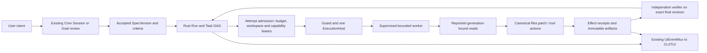

# VEO-Inspired HorizonCode Capability Roadmap

**Status:** selected design refinements accepted into existing V1 phases by A-V2-33; runtime remains governed by each phase's existing acceptance gates. VEO-F1..F8 remain post-V1 proposals.  
**Source reviewed:** `C:\Users\Sonali\Downloads\extra_some_Stuff.md` (read through `/mnt/c/users/sonali/downloads/extra_some_Stuff.md`, 1,851 lines).  
**Architecture authority:** `arch_V1/README.md`, `arch_V1/17-GOVERNANCE-DECISIONS.md`, and their topic owners. If this proposal conflicts with them, the topic owner wins until a governance decision changes it.

## 1. Intent

Evaluate the useful parts of the supplied Virtual Engineering Organization (VEO) concept for HorizonCode's longer-term roadmap. The target is an agent that can carry complex engineering work through durable plans, bounded delegation, source-grounded changes and independent evidence while remaining understandable and safe on the user's machine.

The accepted subset extends existing HorizonCode owners and is recorded normatively in the relevant `arch_V1` topics. It adds no daemon, conversation store, effect executor, provider router, extension registry, UI event bus, or alternate source of truth. It sharpens existing P1/P2/P3/P6/P7/P8 V1 acceptance without creating a new phase train. Browser, desktop, remote production operations and autonomous self-improvement remain post-V1 under A-V2-31.

## 2. Decision summary

| Source idea | Decision | HorizonCode treatment |
|---|---|---|
| Contract-first, bounded subagents | Adopt the principle; implementation is already an architecture target | Use accepted `SpecVersion`, Rust `Task`/`Attempt`, `AgentProfileV2`, `SubagentRequestV2`/`SubagentReplyV2`, leases and typed artifact delivery. Never create child-owned Task authority. |
| Isolated child context and compact result | Adopt with lineage | Use the existing context ledger and `fresh`/`conversation_slice`/`fork` modes. A result summary is a derived artifact with evidence refs, not a replacement for canonical history or test output. |
| AST skeleton, symbol graph and demand paging | Adopt as a RepoIntel evolution | Extend the single RepoIntel/index generation owner. Node references are generation-bound read handles; edits still become canonical `files.patch`/Guard operations. |
| Fitness functions and deterministic checks | Adopt within P2's accepted-criteria verification | A deterministic check can block settlement only when named by accepted criteria and budgeted; it cannot grant authority, mutate scope or overwrite criteria. Rich rule authoring and mutation campaigns remain post-V1. |
| Mutation testing and adversarial critic | Defer to a verifier/evaluation phase | May strengthen a distinct verifier's evidence. No absolute 100% mutation score guarantee; bounded campaign, mutant denominator and surviving-mutant reasons must be reported. |
| Provider cache-aware prompting | Adopt measurement/provenance only | Record provider-reported cache reads/writes and observed cost under the selected provider/model. Do not promise a universal hit rate or rewrite the selected provider request semantics. |
| CodeMode/programmatic tool batching | Defer pending P1 Guard and P2 managed Attempt | Any script is an ordinary bounded effectful action under the one Guard/ExecutionHost, with full batch admission and receipts. No arbitrary host SDK escape. |
| Firecracker/CoW microVM swarm | Reject as a prescribed runtime | Use the existing per-OS confinement and leased worktree/resource owners. Evaluate an alternate backend only through a measured, separately reviewed OS capability experiment. |
| Blind credential MITM proxy | Reject as described | Use DEC-V1-06 SecretBroker and the selected first-party one-request ProviderTransport. No TLS interception or secrets in child environments. |
| Four immutable tools / automatic provider tiers | Reject | Existing progressive capability registry remains canonical. Provider/model/harness stay user-pinned; no hidden escalation. |
| Self-forging skills/specialists | Defer and constrain | A model may propose a versioned candidate artifact. Registration, trust, IDs, permissions and activation remain under the existing extension registry and user policy; no auto-registration. |
| DOM-to-AST visual canvas | Defer post-V1 | Browser/desktop services and UI remain unavailable in V1 under A-V2-31. If promoted, use generation-bound observations and ordinary Guarded mutations. |
| Wire-captured API twins and zero-downtime migrations | Defer to separately scoped integration work | Require explicit staging consent, data sanitization, bounded artifact retention, and a read-only/default migration preview. No production credentials or database branching assumption. |
| Automatic canary, flag reaping, telemetry-to-patch | Reject autonomous behavior; retain reviewable future proposals | Deployment and production mutation require a separate explicit decision, user approval and independently tested rollback. No V1 self-changing policy. |
| Time travel and deterministic chaos | Defer as optional diagnostics | Use only when the selected OS/runtime supports it, with bounded recording, opt-in data capture and resource budgets. DAP remains under its existing Guarded owner. |
| 28 ms boot, >92% cache hits, 99% savings | Reject as evidence | Treat as unverified claims. Establish reproducible baselines and confidence intervals before setting targets. |

## 3. Goals, non-goals and guardrails

### Goals

- Make larger managed jobs decomposable into bounded, inspectable Task/Attempt work.
- Reduce repeated broad repository reads by paging source-grounded symbols and exact ranges.
- Bind all proposed changes, tests and reviewer decisions to one exact workspace revision.
- Preserve a compact user-facing progress stream while keeping complete evidence available by reference.
- Measure quality, resource use and cache behavior without making measurements into permission.

### Non-goals

- Replacing the OpenCode-derived direct Session or Rust managed-control authority.
- Making every ordinary direct coding turn require a Goal.
- Implementing a new VEO daemon, new agent runtime, fixed tool schema or parallel cache/index database.
- Enabling browser/desktop, remote production operations, autonomous deploy/rollback or self-modifying policy in V1.
- Claiming a benchmark result from a proposal, simulator or model self-report.

### Guardrails

1. Mutations pass P1 Guard and ExecutionHost; managed effects additionally require P2 Attempt authority and a live EffectIntent/lease.
2. Child authority is the intersection of parent delegation, pinned profile, accepted Task scope, workspace lease, current policy and OS-enforced confinement.
3. Unknown, stale, missing, malformed or unsupported authority/evidence denies before dispatch.
4. Child text, generated skills, AST node IDs and verifier summaries are data, never authority.
5. Cancellation and restart preserve `UNKNOWN`; no blind replay of a possibly dispatched effect.
6. Provider/model/harness do not change without explicit user selection.
7. User edits and canonical Session history are never silently overwritten, rebased or evicted.

## 4. High-level design



The flow has three existing authorities: Core owns direct conversation, Rust owns managed work/effects, and the artifact store owns immutable bytes and metadata. RepoIntel is derived and rebuildable. CLI/TUI events are projections of these owners. A child can propose work and return artifacts; only Rust can advance managed Task/Run state, and only Guard/ExecutionHost can dispatch effects.

## 5. Contract design

### 5.1 Reuse existing canonical contracts

Do not create duplicate versions of these owners: `AgentProfileV2`, `HarnessProfileV1`, `SubagentRequestV2`, `SubagentReplyV2`, `PlanHandoffV1`, `SubagentDeliveryV1`, `GoalV1`, `SpecVersionV1`, `RunV1`, `TaskV1`, `AttemptV1`, `EffectIntentV1`, `ExecutionLeaseV1`, `EffectReceiptV1`, `EvidenceV1`, `VerificationV1`, `ContextLedgerV2`, `SourceArtifactV1`, and `RepoIntel` query/generation contracts. Their owning schemas in §§12, 29, 30, 33 and 37 remain canonical.

The following are proposed additions/refinements only. They must be added to the existing `arch_V1/contracts-v2/` generation and cross-language fixture pipeline before runtime wiring; this document is not itself a wire schema.

### 5.2 Managed delegation binding

```ts
type DelegationBindingV1 = {
  schemaVersion: 1
  runId: RunId
  taskId: TaskId
  attemptId: AttemptId
  parentExecutionId: WorkerExecutionId
  childExecutionId: WorkerExecutionId
  profileRevision: ProfileRevisionRef
  acceptedSpecDigest: Digest
  criteriaIds: string[]
  workspaceLeaseId: LeaseId
  sourceRevision: SourceRevision
  capabilityCeilingDigest: Digest
  budgetLeaseId: LeaseId
  ownerEpoch: OwnerEpoch
}
```

The binding is minted from authenticated Rust state after Attempt admission. Caller JSON cannot assert principal, workspace, revision, profile ceiling, budget or owner epoch. This binding applies to managed Attempts. When direct-session delegation has no managed Attempt, it uses the existing direct-mode delegation contract: it cannot settle a managed Task, and any effect still requires normal Guard/ExecutionHost admission. This proposal does not make direct coding Goal-dependent or impose a new default read-only policy.

### 5.3 RepoIntel node reference and query

```ts
type RepoNodeRefV1 = {
  workspaceBinding: WorkspaceBinding
  sourceGeneration: SourceGeneration
  sourceRevision: SourceRevision
  pathRef: WorkspacePathRef
  fileDigest: Digest
  nodeId: string
  nodeKind: string
  symbol: string
  byteRange: { start: number; end: number }
  parserId: string
  parserVersion: string
}

type RepoStructureQueryV1 = {
  schemaVersion: 1
  rootRef: WorkspacePathRef
  sourceGeneration: SourceGeneration
  selector: { symbols?: string[]; nodeRefs?: RepoNodeRefV1[]; includeCallers?: boolean }
  maxNodes: number
  maxBytes: number
  deadline: Timestamp
}
```

Authenticated principal and read scope come from the transport/session context, not this body. Node IDs are opaque, generation-bound handles; they are not durable identity and must not be trusted after a generation change. A query returns exact source digest/ranges, parser status, coverage and typed fallback reason. A proposed edit must validate current digest and range, then lower to canonical `files.patch`; AST splicing never writes files directly.

### 5.4 Validation and verifier evidence

Reuse `EvidenceV1`/`VerificationV1`. Add typed evidence kinds only through the owning schema: `fitness_result`, `property_test_result`, `mutation_campaign`, `repo_navigation_provenance`, `resource_measurement`, `provider_cache_usage`. Every item binds to criterion, Attempt/Run, source revision, command/test identity, artifact digest, producer identity and measured/estimated/unknown quality. The verifier consumes immutable evidence and the live final workspace digest. It cannot accept a worker-provided PASS field or artifact ref without owner revalidation.

Mutation campaigns report `mutantsGenerated`, `mutantsKilled`, `mutantsTimedOut`, `mutantsNotApplicable`, harness digest, budget and survivor details. A campaign is `INCOMPLETE` if its budget expires or a mutant cannot be evaluated; the acceptance policy chooses a threshold per criterion and never assumes every syntactic mutation is meaningful.

### 5.5 Event projection

Extend the existing `UiEventMuxV2`/`ui-stream-event-v2` projection; do not add an independent event bus. Durable managed state is read from Rust OwnerLog/RPC and conversational state from Core. Durable events carry owner sequence and source generation/revision; ephemeral paint events may be coalesced. Reconnect uses the source cursor and resnapshot contract.

Proposed event kinds (exact schema names to be generated later):

| Kind | Owner | Durable? | Required binding |
|---|---|---:|---|
| `managed.spec.accepted` | Rust managed control | yes | Goal, SpecVersion digest, reviewer identity, revision |
| `managed.task.ready` / `managed.task.blocked` | Rust scheduler | yes | Run/Task revision, dependency state, wait reason |
| `managed.attempt.admitted` / `managed.attempt.started` | Rust scheduler/HostKernel | yes | Attempt, leases, profile revision, owner epoch |
| `managed.child.progress` | projection | no | Attempt, source generation, bounded status only |
| `repo.query.completed` | RepoIntel | artifact-backed | workspace, source generation, query digest, coverage |
| `effect.prepared` / `effect.settled` / `effect.unknown` | Rust Guard/effect owner | yes | EffectIntent, lease, receipt or reconciliation ref |
| `artifact.published` / `artifact.failed` | artifact store | yes | owner/scope, digest, bytes, fidelity |
| `verification.started` / `verification.completed` | Rust verification | yes | verifier identity, evidence-set digest, final revision |
| `managed.run.paused` / `cancelled` / `recovered` | Rust managed control | yes | Run revision, fence/epoch, UNKNOWN set |
| `ui.progress.updated` | Core/TUI projection | no | source cursor/generation; bounded and redacted |

Sequence gaps, duplicate/out-of-order delivery, owner restart and source-generation change must trigger cursor reconciliation/resnapshot rather than a guessed continuation. Child output and tool arguments are redacted before projection; full approved artifacts remain scope-checked references.

## 6. Lifecycle flows

### 6.1 Managed delegated change

1. Core receives the user request and delivers a Goal proposal. No effect starts at proposal time.
2. The user reviews/accepts an immutable SpecVersion with criteria and scope.
3. Rust creates Run/Task records and admits one Attempt only after budget, workspace, profile and capability checks.
4. Rust mints `DelegationBindingV1`; the worker receives bounded context refs and no inherited authority beyond that binding.
5. RepoIntel returns generation-bound source refs. The worker proposes changes through canonical guarded tools.
6. Rust records effect intents, one-use leases, receipts, UNKNOWN and bounded evidence. A user edit that changes the revision fences subsequent writes.
7. An independent verifier receives read-only access to the actual final revision and criteria, validates artifact/test provenance and returns a typed verdict.
8. Rust settles the Task/Run. Core/TUI renders the durable owner events plus bounded progress. A model's completion text is not evidence.

### 6.2 Source navigation and AST patch proposal

1. RepoIntel resolves one current index generation and source revision.
2. It returns bounded symbol pages and opaque node refs with file digests, ranges and parser provenance.
3. The context compiler selects only relevant refs and records why they were included.
4. An edit proposal supplies expected source digest and operations. The canonical file patch path revalidates against live bytes and Guard scope.
5. Stale digest or generation rejects the patch before mutation; caller may request a fresh query. No automatic “rebase” blesses unrelated human edits.

### 6.3 Verification pipeline

1. Deterministic formatting/type/lint/tests run under the admitted Attempt and produce immutable artifacts.
2. Optional fitness rules evaluate exact changed source and report rule-set digest.
3. A bounded independent verifier checks acceptance criteria and final revision.
4. Optional mutation/chaos campaigns run only within the declared resource/deadline/cost budget.
5. Missing, stale, timed out or contradictory evidence yields `INCOMPLETE`, `NEEDS_YOU` or `UNKNOWN`, never PASS.

### 6.4 Post-V1 visual and external integration flows

Browser/DOM observations, wire-captured API twins, database migration previews and release canaries remain separate future service designs. Any future flow must bind exact user consent, provider/credential class, target environment, workspace/source generation, effect lease and artifact retention. Production mutation is never triggered by a verifier result alone.

## 7. HLD/LLD phase map

The note-derived ideas below are **not all post-V1**. Several are already required by current V1 phase owners and stay in their existing release scope; the table records where they belong so this proposal does not defer accepted work:

| Selected note idea | Existing V1 owner | Existing V1 contract/evidence boundary | What this proposal adds |
|---|---|---|---|
| Bounded, visible, steerable subagent delegation | P2 managed vertical; P1 Guard | `SubagentRequestV2`/`ReplyV2`, Goal/Spec/Run/Task/Attempt, EffectIntent/lease/receipt and one real managed Attempt | No new V1 gate; later hardening options are VEO-F1 |
| Compact child return with evidence lineage | P2, P7 artifact/event owners | `SubagentDeliveryV1`, `EvidenceV1`, immutable artifact refs and existing UiEventMux | Candidate summary-quality and larger-DAG acceptance only after V1 |
| Source-grounded symbol/call navigation | P3 RepoIntel; P1 read-scope/stale-write fence | Existing RepoIntel generation/source revision contracts; all edits through `files.patch` + Guard | Multi-language structural paging and richer parser coverage are VEO-F2 |
| Independent final-revision verifier | P2 managed vertical | Actual current workspace revision, distinct authenticated reviewer/verifier, immutable evidence and no self-PASS | Rich fitness and mutation campaigns are VEO-F3 |
| Provider/model truth and usage provenance | P6 providers/settings; P7 analytics; P8 resource baselines | User-pinned provider/model, honest cost/capability/availability, existing analytics provenance | Cache-effectiveness experiments and context-quality benchmarks are VEO-F4 |
| Bounded durable worker/resource operation | P1/P2/P8 | One Guard/ExecutionHost, Attempt and resource leases, durable receipts, UNKNOWN recovery | Optional deterministic test harnesses are VEO-F5 |
| Skill trust and activation | P6 registry; P1 Guard | Existing canonical capability/skill IDs, review and permission boundaries | Reviewed candidate-recipe lifecycle is VEO-F6 |

The accepted V1 requirements above are incorporated into P1/P2/P3/P6/P7/P8, not deferred. VEO-F1..F8 remain post-V1 proposals and require the prerequisites and owner design listed below before separate implementation authorization. Browser/visual verification and production/data operations remain separately gated post-V1 under the current scope decision.

| Phase | Scope | Prerequisites | Exit evidence |
|---|---|---|---|
| VEO-F1 — Multi-task delegation hardening | Extend the accepted V1 single Attempt to larger DAGs, nested delivery lineage and bounded cross-task dependency artifacts | P1 Guard, P2 single Attempt/verifier, P8 recovery/resource owners pass | Multi-task real-socket graph; forged scope, stale revision, budget, cancellation/restart/UNKNOWN, artifact dependency and collision negatives |
| VEO-F2 — RepoIntel structural paging | Multi-language parser adapters, exact source ranges, call/reference links, generation-bound AST views, selective paging and fallback provenance | P1 read-scope Guard seam; P3 RepoIntel production adapter and stale-write fence | Real repositories; parser errors/partial coverage, 10k files/resource bounds, overlay invalidation, stale patch refusal, rebuild/recovery |
| VEO-F3 — Fitness and mutation campaigns | Rich rule-authoring lifecycle and optional bounded mutation campaign beyond the accepted V1 deterministic checks | VEO-F1; P2 verifier; P8 resource/quota accounting | Adversarial rules, incomplete mutation campaign, false-PASS prevention, exact final-revision evidence |
| VEO-F4 — Cache and context efficiency | Stable prefix-cache experiments, demand paging and context-quality/resource benchmarks beyond required usage provenance | P6 provider/auth/model truth; P7 analytics; P8 reproducible baselines | Same selected provider/model across runs; measured vs estimated cache use/cost; protected-fact, cache invalidation and no-fallback tests |
| VEO-F5 — Deterministic test extensions | Optional property, mutation, chaos and time-travel harness adapters with admission, artifact and stop budgets | P1/P2/P8 verified boundaries and supported local tooling | Reproducible task suite, no external side effects, seed/replay provenance, bounded CPU/RAM/disk, unsupported-tool behavior |
| VEO-F6 — Skills as reviewed deterministic recipes | Candidate skill proposal, schema/lint/test/review lifecycle and sealed ID/version activation through existing registry | P6 registry/trust model; P1 Guard; VEO-F3 evidence | No self-registration, identity shadowing or permission escalation; rollback and provenance tests |
| VEO-F7 — Visual verification | Managed browser observation, generation-bound DOM/AX/screenshot artifacts and point-to-source navigation | Explicit post-V1 scope decision; browser Guard, P4 lifecycle, P7 artifact/render owners | Real supported browser journey, stale observation, untrusted page prompt injection, screenshot/DOM bounds, zero host escape |
| VEO-F8 — Data integration and production operations | Sanitized staging twins, expand/backfill/contract preview, shadow traffic, canary proposals and rollback evidence | Separate explicit scope decision, secret transport, deployment/remote mutation governance and independent verifier | Disposable/staging-only end-to-end tests, consent, PII scrub, target isolation, failure recovery, user-approved production action |

Ordering: F1 precedes F3; F2 can proceed independently after P3/P1 read-scope readiness; F4 depends on P6/P7/P8; F5 depends on verified P1/P2/P8; F6 depends on P6/F3; F7 and F8 require separately promoted scope. None is a reason to delay current V1 delivery.

## 8. Acceptance catalogue proposal

Add canonical test IDs to `arch_V1/32-TASK-BASED-AGENT-TEST-CATALOG.md` only when the design is accepted. Candidate families:

- **VEO-DEL:** child identity/scope intersection, fresh versus bounded parent context, context digest, child crash/cancel, sibling contention, typed artifact-only result, cost/budget admission, parent restart and late reply.
- **VEO-REPO:** generation-bound refs, byte-range correctness, parser-version change, malformed/partial parse, symlink/path escape, large repository paging, stale patch, user edit during query, bounded fallback.
- **VEO-VER:** distinct verifier, accepted criteria coverage, exact current workspace revision, contradictory/stale evidence, mutation campaign timeout/survivor accounting, no model self-PASS.
- **VEO-EVENT:** sequence gap, duplicate/out-of-order, source generation change, reconnect/resnapshot, redaction, backpressure and durable receipt preservation.
- **VEO-CACHE:** exact selected model/provider/harness, measured/estimated/unknown cache usage, no cross-workspace prefix leak, invalidation after policy/source change, no paid fallback.
- **VEO-EXT:** candidate skill review/activation/revoke/rollback, sealed identity, no self-registration or permission widening.
- **VEO-POST:** browser/Dom, staging twin, migration, shadow traffic and production rollout tests only after the corresponding scope decision.

Every case must use a real owner boundary where applicable, bind results to a revision, and record platform/backend and resource measurements. Mocks are contract tests only.

## 9. Open questions for design review

These do not block the current V1 implementation. Before any VEO-F phase begins, resolve:

1. Which language parsers and licenses are acceptable for F2, and which outputs require exact versus partial parse status?
2. Is VEO-F3's mutation campaign a required acceptance tier or an opt-in expensive check per risk class?
3. Which wire data, if any, can be captured for F8, and what retention/de-identification policy applies?
4. Which post-V1 browser and deployment targets, if any, should be promoted and supported?
5. Which benchmark workloads and reference hardware define efficiency targets? No supplied performance claim is adopted without this evidence.

## 10. Source-to-owner traceability

| Proposal section | Normative owner to extend after approval |
|---|---|
| Delegation and child lifecycle | `arch_V1/29-AGENTS-SKILLS-HOOKS-MCP.md`, `12-DOMAIN-SCHEMAS.md`, `15-RUNTIME-EXECUTION.md`, `37-RUNTIME-SERVICE-LLD.md` |
| RepoIntel/AST/context | `arch_V1/30-CONTEXT-INDEXING-LOCAL-MODELS.md`, `12-DOMAIN-SCHEMAS.md`, `37-RUNTIME-SERVICE-LLD.md` |
| Evidence and verification | `arch_V1/12-DOMAIN-SCHEMAS.md`, `14-EFFECTS-EXECUTION-SECURITY.md`, `32-TASK-BASED-AGENT-TEST-CATALOG.md`, `37-RUNTIME-SERVICE-LLD.md` |
| Events and artifacts | `arch_V1/31-UI-PERFORMANCE-ARTIFACTS-ANALYTICS.md`, `12-DOMAIN-SCHEMAS.md`, `37-RUNTIME-SERVICE-LLD.md` |
| Cache/provider efficiency | `arch_V1/16-UX-SETTINGS-ECOSYSTEM.md`, `30-CONTEXT-INDEXING-LOCAL-MODELS.md`, `31-UI-PERFORMANCE-ARTIFACTS-ANALYTICS.md` |
| Visual, staging and release | `arch_V1/17-GOVERNANCE-DECISIONS.md`, `18-OPERATIONS-RELEASE.md`, `37-RUNTIME-SERVICE-LLD.md` after explicit scope promotion |

